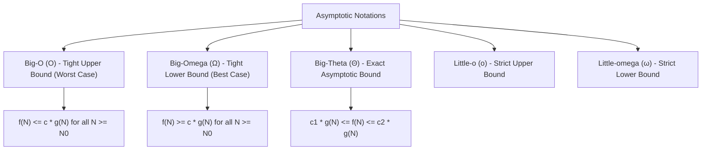
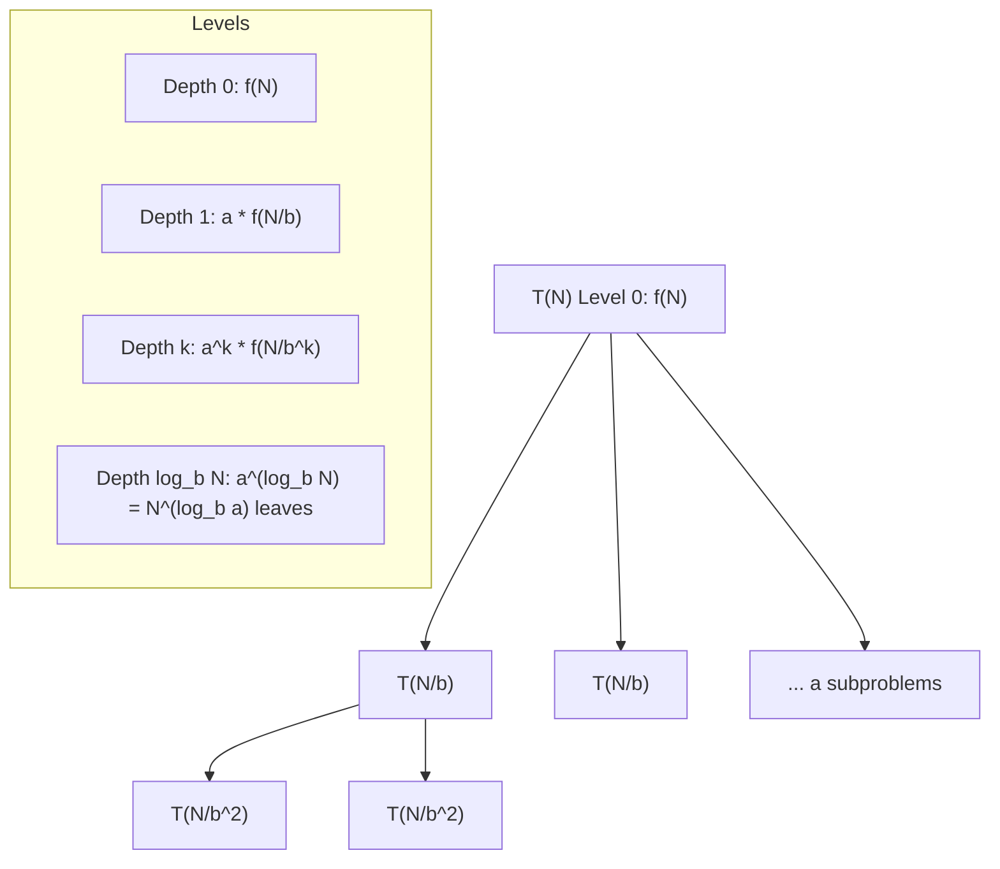

---


title: "00. 📊 Mastering Big O Notation & Algorithmic Complexity Analysis"
type: "concept_guide"
category: "dsa"
subcategory: "01_basics"
created_at: 2026-08-22T00:00:00+07:00
updated_at: 2026-08-26T23:45:00+07:00
tags: [dsa, complexity-analysis, big-o, big-theta, big-omega, amortized-analysis, master-theorem, space-complexity, algorithms, computer-science, learning-note]
aliases:
  - 00_overview_big_o_notation_complexity_analysis
---

# 📌 00. 📊 Mastering Big O Notation & Algorithmic Complexity Analysis

Algorithmic complexity analysis forms the mathematical bedrock of computer science and software engineering. It provides an objective, hardware-independent language to quantify the performance, scalability, and resource consumption of algorithms as input size $N$ approaches infinity ($N \to \infty$).

---

## 1. Mathematical Foundations of Asymptotic Notations

To rigorously compare algorithms, we abstract away constant multipliers, processor clock speeds, memory bus latency, and compiler optimizations. We classify growth rates using formal asymptotic bounds.



### 1.1 Formal Mathematical Definitions

1. **Big-O Notation ($\mathcal{O}$)** — Asymptotic Upper Bound:
   $$f(N) = \mathcal{O}(g(N)) \iff \exists\, c > 0, N_0 > 0 \quad \text{such that} \quad \forall N \ge N_0, \quad 0 \le f(N) \le c \cdot g(N)$$
   - Represents the guaranteed upper ceiling of execution time. An algorithm with $\mathcal{O}(N^2)$ time will never require more than $c N^2$ operations for sufficiently large $N$.

2. **Big-Omega Notation ($\Omega$)** — Asymptotic Lower Bound:
   $$f(N) = \Omega(g(N)) \iff \exists\, c > 0, N_0 > 0 \quad \text{such that} \quad \forall N \ge N_0, \quad 0 \le c \cdot g(N) \le f(N)$$
   - Represents the best possible scenario or theoretical minimum work required by the problem.

3. **Big-Theta Notation ($\Theta$)** — Asymptotically Tight Bound:
   $$f(N) = \Theta(g(N)) \iff f(N) = \mathcal{O}(g(N)) \quad \text{and} \quad f(N) = \Omega(g(N))$$
   $$\exists\, c_1 > 0, c_2 > 0, N_0 > 0 \quad \text{such that} \quad \forall N \ge N_0, \quad c_1 g(N) \le f(N) \le c_2 g(N)$$

4. **Little-o ($o$) and Little-omega ($\omega$)**:
   - $f(N) = o(g(N)) \iff \lim_{N \to \infty} \frac{f(N)}{g(N)} = 0$ (Strictly slower growth).
   - $f(N) = \omega(g(N)) \iff \lim_{N \to \infty} \frac{f(N)}{g(N)} = \infty$ (Strictly faster growth).

---

## 2. The Hierarchy of Time Complexities

The following table summarizes standard computational complexity classes from fastest to slowest, including typical algorithmic paradigms and practical limits:

| Notation | Class Name | Example Algorithms | Maximum Scalable $N$ ($10^8$ ops/sec $\approx 1$s) |
| :--- | :--- | :--- | :--- |
| $\mathcal{O}(1)$ | Constant | Hash map lookup, stack push/pop, bitwise shifts | $N = 10^{18}+$ (Independent of $N$) |
| $\mathcal{O}(\log \log N)$ | Double Logarithmic | Interpolation search, Van Emde Boas tree operations | $N = 10^{18}+$ |
| $\mathcal{O}(\log N)$ | Logarithmic | Binary search, GCD (Euclidean), exponentiation by squaring | $N = 10^{18}$ |
| $\mathcal{O}(\sqrt{N})$ | Square Root (Sub-linear) | Prime factorization trial division, Mo's algorithm block query | $N = 10^{12}\text{--}10^{14}$ |
| $\mathcal{O}(N)$ | Linear | Single pass scan, Kadane's algorithm, sliding window, counting sort | $N = 10^7\text{--}10^8$ |
| $\mathcal{O}(N \log N)$ | Linearithmic | MergeSort, QuickSort (average), HeapSort, Segment Tree build | $N = 10^5\text{--}10^6$ |
| $\mathcal{O}(N \sqrt{N})$ | Fractional Poly | Square root decomposition, block decomposition | $N = 5 \times 10^4\text{--}10^5$ |
| $\mathcal{O}(N^2)$ | Quadratic | Bubble sort, Floyd-Warshall, nested loops over 2D matrix | $N = 3,000\text{--}8,000$ |
| $\mathcal{O}(N^3)$ | Cubic | Naive matrix multiplication, all-pairs shortest paths | $N = 300\text{--}500$ |
| $\mathcal{O}(2^N)$ | Exponential | Subset generation, naive recursive Fibonacci, recursive knapsack | $N = 20\text{--}24$ |
| $\mathcal{O}(N!)$ | Factorial | Traveling Salesperson brute force, permutation generation | $N = 10\text{--}12$ |

---

## 3. Solving Recurrences: The Master Theorem and Recursion Trees

### 3.1 The Master Theorem

For divide-and-conquer recurrences of the canonical form:
$$T(N) = a T\left(\frac{N}{b}\right) + f(N), \quad \text{where } a \ge 1, b > 1$$

We compare $f(N)$ against the watershed function $N^{\log_b a}$:

1. **Case 1 (Leaf-Heavy)**: If $f(N) = \mathcal{O}\left(N^{\log_b a - \epsilon}\right)$ for some $\epsilon > 0$:
   $$T(N) = \Theta\left(N^{\log_b a}\right)$$
   *Example*: Strassen's Matrix Multiplication: $T(N) = 7 T(N/2) + \mathcal{O}(N^2)$. Since $\log_2 7 \approx 2.807 > 2$, $T(N) = \Theta(N^{\log_2 7}) \approx \Theta(N^{2.81})$.

2. **Case 2 (Balanced Work per Level)**: If $f(N) = \Theta\left(N^{\log_b a} \log^k N\right)$ for $k \ge 0$:
   $$T(N) = \Theta\left(N^{\log_b a} \log^{k+1} N\right)$$
   *Example*: MergeSort: $T(N) = 2 T(N/2) + \Theta(N)$. Here $a=2, b=2, k=0 \implies N^{\log_2 2} = N^1 \implies T(N) = \Theta(N \log N)$.

3. **Case 3 (Root-Heavy)**: If $f(N) = \Omega\left(N^{\log_b a + \epsilon}\right)$ for some $\epsilon > 0$ and regularity condition $a f(N/b) \le c f(N)$ holds for $c < 1$:
   $$T(N) = \Theta(f(N))$$



---

## 4. Amortized Complexity Analysis

Amortized analysis guarantees the average performance of each operation in the worst-case sequence of operations. Unlike average-case analysis, no probability distribution over inputs is assumed.

### 4.1 The Three Classical Methods of Amortized Analysis

1. **Aggregate Analysis**: Compute the total worst-case time $T(k)$ for a sequence of $k$ operations. The amortized cost per operation is $T(k) / k$.
2. **Accounting (Banker's) Method**: Assign artificial charges (amortized costs) to operations. Overcharged operations store "credits" that pay for later expensive operations.
3. **Potential (Physicist's) Method**: Define a potential function $\Phi(D)$ mapping data structure state $D$ to a real number. The amortized cost $\hat{c}_i$ is:
   $$\hat{c}_i = c_i + \Phi(D_i) - \Phi(D_{i-1})$$
   $$\sum_{i=1}^k \hat{c}_i = \sum_{i=1}^k c_i + \Phi(D_k) - \Phi(D_0)$$

### 4.2 Concrete Case: Dynamic Array Expansion ($2\times$ Resizing)

When a dynamic array (e.g. `std::vector`, `List<T>`, Python `list`) exceeds capacity:
1. Allocates new buffer of size $2C$.
2. Copies existing $C$ elements.
3. Inserts new element.

- Individual insertion cost: $c_i = 1$ (if no reallocation) or $c_i = 1 + C$ (upon reallocation).
- Potential function: $\Phi(D) = 2 \cdot (\text{size}) - \text{capacity}$.
- When full, $\text{size} = C$, $\text{capacity} = C \implies \Phi(D) = 2C - C = C$.
- After doubling and copy, $\text{size} = C + 1$, $\text{capacity} = 2C \implies \Phi(D') = 2(C+1) - 2C = 2$.
- $\Delta \Phi = 2 - C$. Actual cost $c_i = C + 1$.
- Amortized cost: $\hat{c}_i = (C + 1) + (2 - C) = 3 = \mathcal{O}(1)$.

---

## 5. Space Complexity: Auxiliary vs In-Place vs Heap Layout

Space complexity measures total memory scaling. We differentiate:

1. **Input Space**: Memory occupied by the input arguments.
2. **Auxiliary Space**: Extra memory allocated by the algorithm during execution (buffers, hash tables, call stacks).
3. **In-Place Algorithms**: Algorithms requiring $\mathcal{O}(1)$ or $\mathcal{O}(\log N)$ auxiliary space (e.g., QuickSort, Heapsort).

```
+-------------------------------------------------------------+
|                      Total Space                            |
|  +---------------------------+  +------------------------+  |
|  |     Input Space           |  |    Auxiliary Space     |  |
|  |  (Input Array, Graph,     |  | (Hash map, DP table,   |  |
|  |   Matrix Data)            |  |  Recursion Call Stack) |  |
|  +---------------------------+  +------------------------+  |
+-------------------------------------------------------------+
```

---

## 6. Implementation Code: Polyglot Benchmarking Harnesses

Below are production-grade implementations illustrating complexity measuring harnesses in C++, Python, and C#.

### 6.1 Modern C++ (C++20 High-Resolution Timer & Complexity Profiler)

```cpp
#include <iostream>
#include <vector>
#include <chrono>
#include <numeric>
#include <algorithm>
#include <random>

class ComplexityBenchmark {
public:
    // Linear Scan O(N)
    static long long LinearSum(const std::vector<int>& arr) {
        long long sum = 0;
        for (int val : arr) {
            sum += val;
        }
        return sum;
    }

    // Binary Search O(log N)
    static bool BinarySearch(const std::vector<int>& sorted_arr, int target) {
        int left = 0, right = static_cast<int>(sorted_arr.size()) - 1;
        while (left <= right) {
            int mid = left + (right - left) / 2;
            if (sorted_arr[mid] == target) return true;
            if (sorted_arr[mid] < target) left = mid + 1;
            else right = mid - 1;
        }
        return false;
    }
};

int main() {
    std::vector<int> sizes = {10000, 100000, 1000000, 10000000};
    std::mt19937_64 rng(1337);

    std::cout << "--- C++20 Complexity Benchmark Harness ---
";
    for (int n : sizes) {
        std::vector<int> data(n);
        std::iota(data.begin(), data.end(), 1);

        // Benchmark Linear O(N)
        auto start = std::chrono::high_resolution_clock::now();
        volatile long long res = ComplexityBenchmark::LinearSum(data);
        auto end = std::chrono::high_resolution_clock::now();
        auto dur_linear = std::chrono::duration_cast<std::chrono::nanoseconds>(end - start).count();

        // Benchmark Binary Search O(log N)
        start = std::chrono::high_resolution_clock::now();
        volatile bool found = ComplexityBenchmark::BinarySearch(data, n - 7);
        end = std::chrono::high_resolution_clock::now();
        auto dur_bs = std::chrono::duration_cast<std::chrono::nanoseconds>(end - start).count();

        std::cout << "N = " << n 
                  << " | Linear: " << dur_linear << " ns"
                  << " | BinarySearch: " << dur_bs << " ns
";
    }
    return 0;
}
```

### 6.2 Python 3.12 (High-Precision `time.perf_counter_ns` Framework)

```python
import time
import bisect
from typing import List

class ComplexityBenchmark:
    @staticmethod
    def linear_sum(nums: List[int]) -> int:
        total = 0
        for x in nums:
            total += x
        return total

    @staticmethod
    def binary_search(sorted_nums: List[int], target: int) -> bool:
        idx = bisect.bisect_left(sorted_nums, target)
        return idx < len(sorted_nums) and sorted_nums[idx] == target

def run_benchmarks():
    sizes = [10_000, 100_000, 1_000_000, 5_000_000]
    print("--- Python 3.12 Benchmark Harness ---")
    for n in sizes:
        arr = list(range(n))
        
        # Benchmark Linear O(N)
        t0 = time.perf_counter_ns()
        _ = ComplexityBenchmark.linear_sum(arr)
        t1 = time.perf_counter_ns()
        dur_linear_ns = t1 - t0
        
        # Benchmark Binary Search O(log N)
        t0 = time.perf_counter_ns()
        _ = ComplexityBenchmark.binary_search(arr, n - 7)
        t1 = time.perf_counter_ns()
        dur_bs_ns = t1 - t0
        
        print(f"N = {n:9d} | Linear: {dur_linear_ns:9d} ns | Binary Search: {dur_bs_ns:6d} ns")

if __name__ == "__main__":
    run_benchmarks()
```

### 6.3 C# (.NET 8 Stopwatch & Memory Footprint Tracking)

```csharp
using System;
using System.Diagnostics;

public static class ComplexityBenchmark {
    public static long LinearSum(int[] arr) {
        long sum = 0;
        for (int i = 0; i < arr.Length; i++) {
            sum += arr[i];
        }
        return sum;
    }

    public static bool BinarySearch(int[] arr, int target) {
        int left = 0, right = arr.Length - 1;
        while (left <= right) {
            int mid = left + ((right - left) >> 1);
            if (arr[mid] == target) return true;
            if (arr[mid] < target) left = mid + 1;
            else right = mid - 1;
        }
        return false;
    }

    public static void Main() {
        int[] sizes = new int[] { 10_000, 100_000, 1_000_000, 10_000_000 };
        Console.WriteLine("--- .NET 8 Performance Stopwatch Benchmark ---");

        foreach (int n in sizes) {
            int[] data = new int[n];
            for (int i = 0; i < n; i++) data[i] = i + 1;

            var sw = Stopwatch.StartNew();
            long sum = LinearSum(data);
            sw.Stop();
            long linearTicks = sw.ElapsedTicks;

            sw.Restart();
            bool found = BinarySearch(data, n - 7);
            sw.Stop();
            long bsTicks = sw.ElapsedTicks;

            Console.WriteLine($"N = {n,10} | Linear: {linearTicks,8} ticks | BinarySearch: {bsTicks,5} ticks");
        }
    }
}
```

---

## 7. Common Complexity Traps and Anti-Patterns

1. **Hidden String Concatenation ($\mathcal{O}(N^2)$)**:
   - In Python, Java, or C#, `str += ch` inside a loop allocates a new string of length $k$ each iteration, yielding $\sum_{k=1}^N k = \mathcal{O}(N^2)$.
   - *Remedy*: Use `StringBuilder` (C#/Java) or `''.join(list)` (Python).

2. **Nested Dependent Loops ($\mathcal{O}(N^2)$ vs $\mathcal{O}(N)$)**:
   - If an inner loop pointer only advances and never resets (Two Pointers, Monotonic Stack, Sliding Window), total inner steps across all outer iterations is $\le N \implies \mathcal{O}(N)$ amortized.

3. **Array Slicing in Recursion ($\mathcal{O}(N^2)$ instead of $\mathcal{O}(N)$)**:
   - In Python: `def solve(arr): solve(arr[1:])` creates a copy of size $N-1$, costing $\mathcal{O}(N^2)$ total.
   - *Remedy*: Pass index pointers `solve(arr, idx + 1)`.

4. **Tree Recursion with Repeated Subproblems ($\mathcal{O}(2^N)$)**:
   - Naive Fibonacci: $T(N) = T(N-1) + T(N-2) \implies \Theta(\phi^N) \approx \Theta(1.618^N)$.
   - *Remedy*: Memoization / Dynamic Programming reduces to $\mathcal{O}(N)$.

---

## 🔗 Graph-Linked Knowledge Base
- ⚓ Next Step: Time & Space Complexity Deep Guide
- 🧩 Problem Set: 01 Basics Classical Problem Set
- 💬 Interview Q&A: 01 Basics Interview Q&A
- 📝 Module Exam: 01 Basics Exam & Self-Assessment
