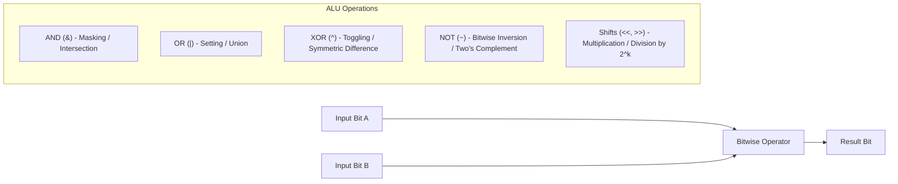
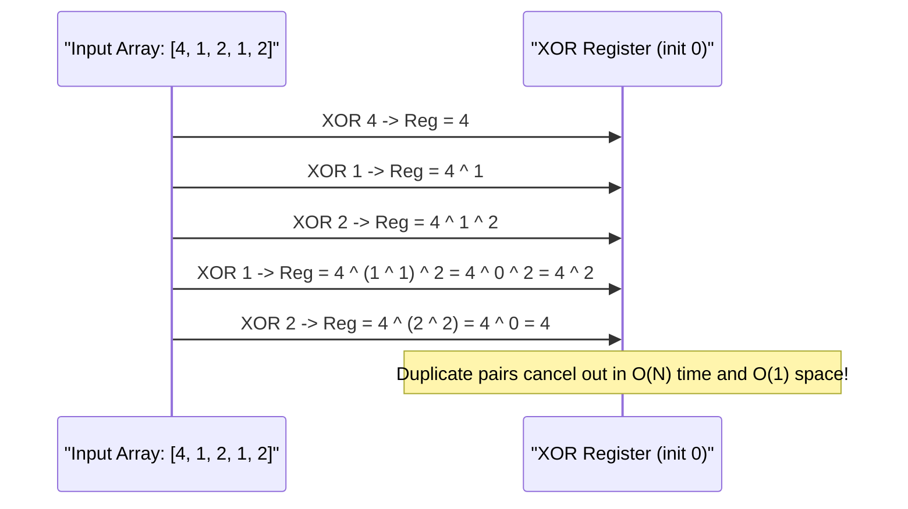

---


title: "00. ⚡ Mastering Bit Manipulation & Low-Level Binary Computing"
type: "concept_guide"
category: "dsa"
subcategory: "01_basics"
created_at: 2026-08-22T00:00:00+07:00
updated_at: 2026-08-26T23:45:00+07:00
tags: [dsa, bit-manipulation, binary, xor-tricks, bitmasks, lowbit, bitwise-hacks, algorithms, computer-science, learning-note]
aliases:
  - 00_overview_bit_manipulation
---

# 📌 00. ⚡ Mastering Bit Manipulation & Low-Level Binary Computing

Bit manipulation operates directly on binary representation at the single-clock-cycle CPU register level. It forms the algorithmic core for subset generation, Bloom filters, high-performance state compression, cryptographic primitives, and constant-time arithmetic hacks.

---

## 1. Core Bitwise Operators & Hardware Execution Mechanics

Modern CPU ALUs execute standard bitwise logic in exactly $1$ clock cycle (\$0.2\text{--}0.5\text{ ns}$). 



### 1.1 Bitwise Truth Table & Arithmetic Equivalence

| Operator | Syntax | Truth Condition | Algebraic / Set Interpretation |
| :--- | :--- | :--- | :--- |
| **AND** | `a & b` | $1$ if both bits are $1$ | Set intersection $A \cap B$, bit extraction |
| **OR** | `a \| b` | $1$ if either bit is $1$ | Set union $A \cup B$, bit setting |
| **XOR** | `a ^ b` | $1$ if bits differ | Symmetric difference $(A \setminus B) \cup (B \setminus A)$, toggle |
| **NOT** | `~a` | Inverts all bits | Complement $\overline{A}$, satisfies `~x = -x - 1` |
| **Left Shift** | `a << k` | Shift left $k$ places, fill $0$s | Multiplies by $2^k$: $a \times 2^k$ |
| **Right Shift (Arithmetic)** | `a >> k` | Shift right, preserves sign bit | Floor division: $\lfloor a / 2^k 
floor$ |
| **Right Shift (Logical)** | `a >>> k` (C#/Java) | Shift right, fills $0$s | Unsigned division by $2^k$ |

---

## 2. The Fundamental Bitwise Identities & Tricks

Here is the essential toolbox of constant-time bitwise operations:

### 2.1 Lowbit and Lowest Set Bit Mechanics
- **Extract lowest set bit (`lowbit`)**:
  $$\text{lowbit}(x) = x \ \& \ (-x)$$
  *Proof via Two's Complement*: $-x = \sim x + 1$. Inverting $\sim x$ flips all bits; adding $1$ cascades through trailing zeros until the lowest set bit is restored, leaving only that single bit in common.
- **Clear lowest set bit**:
  $$x \ \& \ (x - 1)$$
  *Explanation*: Subtracting $1$ flips the lowest set bit and all trailing zeros to $1$s. AND-ing with $x$ zeroes out the lowest set bit.
- **Is Power of Two?**:
  $$x > 0 \quad \text{and} \quad (x \ \& \ (x - 1)) == 0$$
- **Isolate lowest zero bit**:
  $$\sim x \ \& \ (x + 1)$$

### 2.2 Bit Masking & State Compression Representation

A standard 32-bit or 64-bit integer can represent a finite set $S \subseteq \{0, 1, \dots, N-1\}$:

| Set Operation | Bitwise Formula | Description |
| :--- | :--- | :--- |
| Empty Set $\emptyset$ | `mask = 0` | All bits cleared |
| Full Set $\{0..N-1\}$ | `mask = (1 << N) - 1` | Lowest $N$ bits set to $1$ |
| Add Element $k$ ($S \cup \{k\}$) | `mask |= (1 << k)` | Set $k$-th bit |
| Remove Element $k$ ($S \setminus \{k\}$) | `mask &= ~(1 << k)` | Clear $k$-th bit |
| Toggle Element $k$ | `mask ^= (1 << k)` | Flip $k$-th bit |
| Test Element $k$ ($k \in S$) | `(mask >> k) & 1` | Check if $k$-th bit is $1$ |
| Set Size $|S|$ (Popcount) | `__builtin_popcount(mask)` | Count set bits |
| Iterate All Subsets of `mask` | `for (sub = mask; sub; sub = (sub - 1) & mask)` | Lexicographical subset traversal in $\mathcal{O}(2^{|S|})$ |

---

## 3. Deep Algorithmic Patterns Using Bitwise Operations

### 3.1 XOR Properties & Single Number Variations

The XOR operator ($\oplus$) forms an Abelian group over $\{0, 1\}^W$:
1. **Commutative**: $a \oplus b = b \oplus a$
2. **Associative**: $(a \oplus b) \oplus c = a \oplus (b \oplus c)$
3. **Identity**: $a \oplus 0 = a$
4. **Self-Inverse**: $a \oplus a = 0 \implies a \oplus b \oplus a = b$



### 3.2 Finding Two Unique Numbers (Single Number III)

When an array contains two unique numbers $x, y$ and all others appear twice:
1. Compute total XOR: $X = \bigoplus A_i = x \oplus y$. Since $x 
e y$, $X 
\ne 0$.
2. Find any set bit in $X$, typically `diff_bit = X & (-X)`.
3. Partition the array into two groups based on whether `A_i & diff_bit` is non-zero.
4. XOR each group independently: $x$ and $y$ land in separate groups, while all duplicates land in the same group and cancel out.

---

## 4. Multi-Language Implementations

### 4.1 Modern C++ (C++20 `<bit>` Library & Core Solutions)

```cpp
#include <iostream>
#include <vector>
#include <bit>
#include <cstdint>

class BitManipulationSuite {
public:
    // Single Number I: O(N) time, O(1) space
    static int SingleNumber(const std::vector<int>& nums) {
        int xor_sum = 0;
        for (int x : nums) xor_sum ^= x;
        return xor_sum;
    }

    // Single Number III: Find two unique numbers
    static std::pair<int, int> SingleNumberIII(const std::vector<int>& nums) {
        long long xor_all = 0;
        for (int x : nums) xor_all ^= x;

        // Extract lowest set bit safely against INT_MIN overflow
        long long lowbit = xor_all & (-xor_all);

        int num1 = 0, num2 = 0;
        for (int x : nums) {
            if (x & lowbit) {
                num1 ^= x;
            } else {
                num2 ^= x;
            }
        }
        return {num1, num2};
    }

    // Submask enumeration: O(2^popcount)
    static void EnumerateSubmasks(uint32_t mask) {
        std::cout << "Submasks of " << mask << ": ";
        for (uint32_t sub = mask; ; sub = (sub - 1) & mask) {
            std::cout << sub << " ";
            if (sub == 0) break;
        }
        std::cout << "
";
    }
};

int main() {
    std::vector<int> nums = {4, 1, 2, 1, 2, 7, 9, 7};
    auto [a, b] = BitManipulationSuite::SingleNumberIII(nums);
    std::cout << "Two unique numbers: " << a << ", " << b << "
";

    BitManipulationSuite::EnumerateSubmasks(0b1011);
    return 0;
}
```

### 4.2 Python 3.12 (Bitmasking & Dynamic Programming Subsets)

```python
from typing import List, Tuple

class BitManipulationSuite:
    @staticmethod
    def single_number(nums: List[int]) -> int:
        xor_sum = 0
        for x in nums:
            xor_sum ^= x
        return xor_sum

    @staticmethod
    def single_number_iii(nums: List[int]) -> Tuple[int, int]:
        xor_all = 0
        for x in nums:
            xor_all ^= x
            
        lowbit = xor_all & (-xor_all)
        num1, num2 = 0, 0
        for x in nums:
            if x & lowbit:
                num1 ^= x
            else:
                num2 ^= x
        return num1, num2

    @staticmethod
    def count_set_bits(n: int) -> int:
        # Brian Kernighan's Algorithm: O(number of set bits)
        count = 0
        while n > 0:
            n &= (n - 1)
            count += 1
        return count

if __name__ == "__main__":
    nums = [1, 2, 1, 3, 2, 5]
    u1, u2 = BitManipulationSuite.single_number_iii(nums)
    print(f"Unique numbers: {u1}, {u2}")
    print(f"Set bits in 29 (0b11101): {BitManipulationSuite.count_set_bits(29)}")
```

### 4.3 C# (.NET 8 `System.Numerics.BitOperations` & Span Memory Efficiency)

```csharp
using System;
using System.Numerics;

public static class BitManipulationSuite {
    public static int SingleNumber(ReadOnlySpan<int> nums) {
        int xorSum = 0;
        foreach (int x in nums) {
            xorSum ^= x;
        }
        return xorSum;
    }

    public static (int, int) SingleNumberIII(ReadOnlySpan<int> nums) {
        long xorAll = 0;
        foreach (int x in nums) {
            xorAll ^= x;
        }

        long lowbit = xorAll & (-xorAll);
        int num1 = 0, num2 = 0;
        foreach (int x in nums) {
            if ((x & lowbit) != 0) {
                num1 ^= x;
            } else {
                num2 ^= x;
            }
        }
        return (num1, num2);
    }

    public static void Main() {
        int[] arr = { 2, 4, 7, 9, 2, 4 };
        var (n1, n2) = SingleNumberIII(arr);
        Console.WriteLine($"Found unique elements: {n1}, {n2}");

        uint value = 0b10110100;
        Console.WriteLine($"PopCount: {BitOperations.PopCount(value)}");
        Console.WriteLine($"Trailing Zero Count: {BitOperations.TrailingZeroCount(value)}");
    }
}
```

---

## 5. Architectural & Low-Level Hardware Considerations

1. **Popcount Instruction**:
   - Modern x86 processors provide `POPCNT`, ARM provides `VCNT`. These instructions compute set bit count in 1 CPU cycle, as opposed to $\mathcal{O}(32)$ shift loops.
2. **Integer Overflow in Bitwise Shifts**:
   - In C++ and C#, `1 << 31` on a 32-bit signed integer invokes Undefined Behavior (overflows sign bit). Always use unsigned integer literals: `1U << 31` or `1ULL << k` for 64-bit masks.
3. **Operator Precedence Pitfall**:
   - Bitwise operators `&`, `|`, `^` have **lower precedence** than comparison operators `==`, `!=`, `<`, `>`.
   - `if (x & 1 == 0)` evaluates as `if (x & (1 == 0))` $\implies$ bug!
   - Always parenthesize: `if ((x & 1) == 0)`.

---

## 🔗 Graph-Linked Knowledge Base
- ⚓ Next Step: Bit Manipulation Basics Deep Guide
- ⚡ Advanced Masking: Bit Masking and XOR Tricks Master Guide
- 🧩 Practice Suite: LeetCode Practice Basics
- 📝 Module Exam: 01 Basics Exam & Self-Assessment
