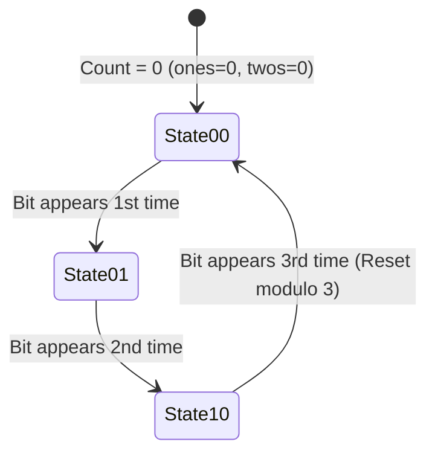
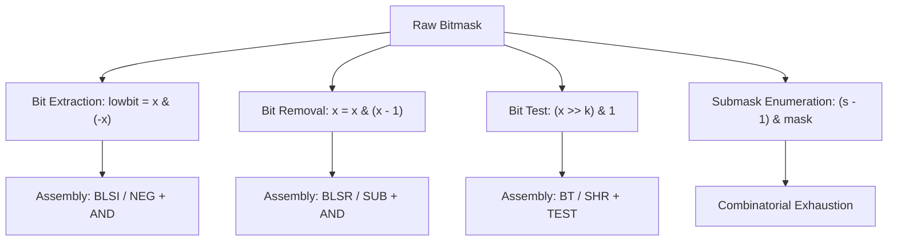

# 📌 99.01. 📚 Supplements for 01_basics (Exam, Problems, Q&A, Resources)

## 📌 Connected Resource Graph
- 🟢 **Primary Theory Note**: [[01_DSA/01_theory_and_patterns/01_Basics/00_overview_01_Basics]]

---


# 📝 01 Basics — Comprehensive Module Exam & Self-Assessment

> **Assessment Duration**: 45 Minutes  
> **Total Points**: 100 Points (10 Multiple Choice @ 5 pts each = 50 pts; 2 Coding & Proof Challenges @ 25 pts each = 50 pts)  
> **Passing Score**: 80% (80 / 100)

---

## 📋 Section 1: Multiple Choice Questions (50 Points)

### Question 1
What is the tightest asymptotic complexity of the recurrence $T(N) = 4 T(N/2) + N^2$?
- A) $\Theta(N^2)$
- B) $\Theta(N^2 \log N)$
- C) $\Theta(N^3)$
- D) $\Theta(2^N)$
> **Correct Answer**: **B**  
> **Explanation**: $a = 4, b = 2 \implies N^{\log_2 4} = N^2$. Since $f(N) = N^2 = \Theta(N^{\log_b a})$, Master Theorem Case 2 applies, yielding $\Theta(N^2 \log N)$.

---

### Question 2
Which bitwise expression evaluates to `true` if and only if positive integer $X$ is a strict power of 2?
- A) `(X & (X + 1)) == 0`
- B) `(X | (X - 1)) == 0`
- C) `(X & (X - 1)) == 0`
- D) `(X ^ (X - 1)) == 0`
> **Correct Answer**: **C**  
> **Explanation**: A power of two has exactly one set bit $2^k$. Subtracting 1 yields $011\dots1$. AND-ing them eliminates all bits, giving 0.

---

### Question 3
What is the amortized cost per `push_back` operation in a dynamic array that doubles its capacity when full?
- A) $\mathcal{O}(N)$
- B) $\mathcal{O}(\log N)$
- C) $\mathcal{O}(1)$
- D) $\mathcal{O}(N^2)$
> **Correct Answer**: **C**  
> **Explanation**: By Aggregate and Potential methods, $N$ insertions cost at most $3N$ total operations, averaging $\mathcal{O}(1)$ amortized cost.

---

### Question 4
What is the value of `-14 >> 2` in standard Two's complement arithmetic?
- A) `-3`
- B) `-4`
- C) `3`
- D) `4`
> **Correct Answer**: **B**  
> **Explanation**: Arithmetic right shift performs floor division: $\lfloor -14 / 4 
floor = -4$.

---

### Question 5
Which operation correctly iterates all submasks of a bitmask `mask` in decreasing order?
- A) `for (int s = mask; s > 0; s = s >> 1)`
- B) `for (int s = mask; s > 0; s = (s - 1) & mask)`
- C) `for (int s = mask; s > 0; s = (s - 1) | mask)`
- D) `for (int s = mask; s > 0; s = s & (s - 1))`
> **Correct Answer**: **B**  
> **Explanation**: `(s - 1) & mask` subtracts 1 and masks against the parent, generating strictly valid submasks in decreasing order.

---

### Question 6
If $f(N) = 3N^2 + 100N \log N$ and $g(N) = N^2$, which statement is FALSE?
- A) $f(N) = \mathcal{O}(g(N))$
- B) $f(N) = \Omega(g(N))$
- C) $f(N) = \Theta(g(N))$
- D) $f(N) = o(g(N))$
> **Correct Answer**: **D**  
> **Explanation**: $\lim_{N \to \infty} \\frac{f(N)}{g(N)} = 3 
\ne 0$. Little-o requires the limit to equal 0.

---

### Question 7
What is the space complexity of finding the maximum value in an array of size $N$ using a recursive divide-and-conquer function without global memory?
- A) $\mathcal{O}(1)$
- B) $\mathcal{O}(\log N)$
- C) $\mathcal{O}(N)$
- D) $\mathcal{O}(N \log N)$
> **Correct Answer**: **B**  
> **Explanation**: Binary division creates a call stack tree of depth $\log_2 N$, consuming $\mathcal{O}(\log N)$ auxiliary call stack frames.

---

### Question 8
What is the outcome of `x ^ x ^ y ^ y ^ z`?
- A) `x ^ y ^ z`
- B) `0`
- C) `z`
- D) `x + y + z`
> **Correct Answer**: **C**  
> **Explanation**: XOR is commutative and associative. $x \oplus x = 0$, $y \oplus y = 0$, so \$0 \oplus 0 \oplus z = z$.

---

### Question 9
In modern 64-bit systems, why is iterating row-major over a 2D matrix `A[row][col]` significantly faster than column-major `A[col][row]`?
- A) Column-major requires more instructions per loop.
- B) Row-major exploits spatial CPU cache lines and hardware prefetching.
- C) Compiler disables loop unrolling for column indices.
- D) Row indices use 32-bit registers while columns use 64-bit registers.
> **Correct Answer**: **B**  
> **Explanation**: C/C++ stores 2D arrays contiguously in row-major order. Stepping row-by-row accesses contiguous memory in L1 cache lines.

---

### Question 10
What does the bitwise expression `x & (x + 1)` do?
- A) Clears the lowest set bit.
- B) Clears trailing contiguous 1s.
- C) Sets the lowest 0 bit.
- D) Reverses the sign bit.
> **Correct Answer**: **B**  
> **Explanation**: Adding 1 to $x$ cascades carries across trailing 1s turning them into 0s with a leading 1. AND-ing with $x$ zeroes all trailing 1s.

---

## 💻 Section 2: Coding & Algorithmic Proof Challenges (50 Points)

### Challenge 1: Counting Bits for All Numbers from $0$ to $N$ ($\mathcal{O}(N)$ Time) (25 Points)

**Task**: Given an integer $n$, return an array `ans` of length $n + 1$ such that for each $i$ (\$0 \le i \le n$), `ans[i]` is the number of $1$'s in the binary representation of $i$. Solve in strictly $\mathcal{O}(N)$ linear time without calling built-in popcount.

#### Model Solution (C++20 Dynamic Programming via Lowest Set Bit)
```cpp
#include <vector>

std::vector<int> countBits(int n) {
    std::vector<int> dp(n + 1, 0);
    for (int i = 1; i <= n; ++i) {
        // dp[i] = dp[i with lowest bit cleared] + 1
        dp[i] = dp[i & (i - 1)] + 1;
    }
    return dp;
}
```

**Proof of Correctness**:
- $i \ \& \ (i - 1)$ strictly produces an integer strictly smaller than $i$.
- Therefore, `dp[i & (i - 1)]` has already been computed in a prior loop iteration.
- Adding $1$ accounts for the single removed bit. Thus, `dp[i]` is calculated in $\mathcal{O}(1)$ time per element, achieving overall $\mathcal{O}(N)$ time.

---

### Challenge 2: Find the Two Missing Numbers (25 Points)

**Task**: You are given an array containing $N-2$ distinct integers from the range $[1, N]$. Find the two missing numbers in $\mathcal{O}(N)$ time and $\mathcal{O}(1)$ auxiliary space.

#### Model Solution (C# Bitwise Partitioning)
```csharp
using System;

public class Solution {
    public static (int, int) FindTwoMissingNumbers(int[] nums, int N) {
        int xorFull = 0;
        for (int i = 1; i <= N; i++) xorFull ^= i;
        foreach (int x in nums) xorFull ^= x;

        // xorFull now equals (miss1 ^ miss2)
        int lowbit = xorFull & (-xorFull);
        int miss1 = 0, miss2 = 0;

        for (int i = 1; i <= N; i++) {
            if ((i & lowbit) != 0) miss1 ^= i;
            else miss2 ^= i;
        }

        foreach (int x in nums) {
            if ((x & lowbit) != 0) miss1 ^= x;
            else miss2 ^= x;
        }

        return (miss1, miss2);
    }
}
```

---

---


# 🧩 01 Basics — Classical Problem Set & Step-by-Step Walkthroughs

> 📖 **Concept Guide**: [[01_DSA/01_theory_and_patterns/01_Basics/00_overview_big_o_notation_complexity_analysis|Big O Complexity Analysis]]  
> 💬 **Interview Q&A**: [[01_DSA/01_theory_and_patterns/01_Basics/01_basics_qa|01 Basics Q&A Guide]]  
> 📝 **Module Exam**: [[01_DSA/01_theory_and_patterns/01_Basics/01_basics_exam|01 Basics Exam]]

This master problem drill contains comprehensive, production-grade solutions in C++, Python, and C# across fundamental algorithmic paradigms: time-complexity optimization, low-level bit manipulation, bitwise arithmetic, and mathematical induction.

---

## 📌 Problem 1: Single Number (LeetCode 136 - Easy)

### 1.1 Problem Statement
Given a non-empty array of integers `nums`, every element appears twice except for one. Find that single one. You must implement a solution with $\mathcal{O}(N)$ linear runtime complexity and use only $\mathcal{O}(1)$ extra auxiliary memory.

- **Input**: `nums = [4, 1, 2, 1, 2]`
- **Output**: `4`
- **Constraints**: $1 \le \text{nums.length} \le 3 \times 10^4$, $-3 \times 10^4 \le \text{nums}[i] \le 3 \times 10^4$.

### 1.2 Mathematical Proof of Correctness
The bitwise exclusive OR ($\oplus$) operator defines an Abelian group over binary vectors:
1. **Identity Element**: $a \oplus 0 = a$
2. **Self-Inverse Property**: $a \oplus a = 0$
3. **Associativity & Commutativity**: The order of operations does not affect the outcome:
   $$\bigoplus_{i=1}^{2k+1} x_i = (x_1 \oplus x_1) \oplus (x_2 \oplus x_2) \dots \oplus (x_k \oplus x_k) \oplus u = 0 \oplus 0 \dots \oplus u = u$$

```mermaid
sequenceDiagram
    participant Stream as "Array: [4, 1, 2, 1, 2]"
    participant Accumulator as "XOR Register (init 0)"
    
    Stream->>Accumulator: 0 ^ 4 = 4
    Stream->>Accumulator: 4 ^ 1 = 5 (0b101)
    Stream->>Accumulator: 5 ^ 2 = 7 (0b111)
    Stream->>Accumulator: 7 ^ 1 = 6 (0b110)
    Stream->>Accumulator: 6 ^ 2 = 4 (0b100)
    Note over Accumulator: Duplicate pairs annihilate to 0; unique element 4 remains!
```

### 1.3 Polyglot Source Code

#### C++20 Implementation
```cpp
#include <vector>
#include <numeric>
#include <functional>

class Solution {
public:
    int singleNumber(const std::vector<int>& nums) {
        return std::accumulate(nums.begin(), nums.end(), 0, std::bit_xor<int>());
    }
};
```

#### Python 3.12 Implementation
```python
from typing import List
import functools
import operator

class Solution:
    def singleNumber(self, nums: List[int]) -> int:
        return functools.reduce(operator.xor, nums, 0)
```

#### C# (.NET 8 Span Implementation)
```csharp
using System;

public class Solution {
    public int SingleNumber(ReadOnlySpan<int> nums) {
        int acc = 0;
        for (int i = 0; i < nums.Length; i++) {
            acc ^= nums[i];
        }
        return acc;
    }
}
```

### 1.4 Complexity Analysis
- **Time Complexity**: $\mathcal{O}(N)$ — Exactly $N$ single-cycle XOR operations.
- **Space Complexity**: $\mathcal{O}(1)$ — Zero heap allocation.

---

## 📌 Problem 2: Number of 1 Bits (LeetCode 191 - Easy)

### 2.1 Problem Statement
Write a function that takes the 32-bit unsigned binary integer $N$ and returns the count of set bits ($1$s) in its binary representation (Hamming weight).

- **Input**: `n = 11 (0b00000000000000000000000000001011)`
- **Output**: `3`

### 2.2 Algorithmic Strategy: Brian Kernighan's Algorithm
Instead of checking all 32 bits with standard shifts ($\mathcal{O}(32)$ always), we exploit the arithmetic property:
$$N \ \& \ (N - 1)$$
Subtracting $1$ flips the lowest set bit from $1$ to $0$ and turns all trailing $0$s into $1$s. AND-ing with $N$ isolates and strips this exact lowest set bit. The loop runs in $\mathcal{O}(K)$ time where $K \le 32$ is the number of set bits.

```
Example: N = 12 (0b1100)
Iter 1: 12 & 11 = 0b1100 & 0b1011 = 0b1000 (8), count = 1
Iter 2: 8 & 7   = 0b1000 & 0b0111 = 0b0000 (0), count = 2
Finished in 2 iterations instead of 32!
```

### 2.3 Polyglot Source Code

#### C++20
```cpp
#include <cstdint>

class Solution {
public:
    int hammingWeight(uint32_t n) {
        int count = 0;
        while (n > 0) {
            n &= (n - 1); // Clears lowest set bit
            count++;
        }
        return count;
    }
};
```

#### Python 3.12
```python
class Solution:
    def hammingWeight(self, n: int) -> int:
        count = 0
        while n:
            n &= (n - 1)
            count += 1
        return count
```

#### C# (.NET 8 Hardware Intrinsics)
```csharp
using System.Numerics;

public class Solution {
    public int HammingWeight(uint n) {
        // Leverages POPCNT CPU instruction when available
        return BitOperations.PopCount(n);
    }
}
```

---

## 📌 Problem 3: Single Number II (LeetCode 137 - Medium)

### 3.1 Problem Statement
Given an integer array `nums` where every element appears **three times** except for one, which appears **exactly once**. Find the single element in $\mathcal{O}(N)$ time and $\mathcal{O}(1)$ space.

### 3.2 Digital Logic Finite State Machine
To track counts modulo 3, each bit position needs a 2-bit counter with states: $00_2 \to 01_2 \to 10_2 \to 00_2$.
We maintain two bitmask registers: `ones` (bit 0 of counter) and `twos` (bit 1 of counter).



**State Transition Equations**:
$$\text{ones} = (\text{ones} \oplus x) \ \& \ (\sim\text{twos})$$
$$\text{twos} = (\text{twos} \oplus x) \ \& \ (\sim\text{ones})$$

### 3.3 Polyglot Source Code

#### C++20
```cpp
#include <vector>

class Solution {
public:
    int singleNumber(const std::vector<int>& nums) {
        int ones = 0, twos = 0;
        for (int x : nums) {
            ones = (ones ^ x) & ~twos;
            twos = (twos ^ x) & ~ones;
        }
        return ones;
    }
};
```

#### Python 3.12
```python
from typing import List

class Solution:
    def singleNumber(self, nums: List[int]) -> int:
        ones, twos = 0, 0
        for x in nums:
            ones = (ones ^ x) & ~twos
            twos = (twos ^ x) & ~ones
        return ones
```

#### C#
```csharp
public class Solution {
    public int SingleNumber(int[] nums) {
        int ones = 0, twos = 0;
        foreach (int x in nums) {
            ones = (ones ^ x) & ~twos;
            twos = (twos ^ x) & ~ones;
        }
        return ones;
    }
}
```

---

## 📌 Problem 4: Single Number III (LeetCode 260 - Medium)

### 4.1 Problem Statement
Given an integer array `nums` in which exactly two elements appear once and all other elements appear twice. Find the two elements that appear only once in $\mathcal{O}(N)$ time and $\mathcal{O}(1)$ auxiliary space.

### 4.2 Mathematical Partitioning Algorithm
1. Compute the cumulative XOR of all elements:
   $$X = \bigoplus_{i=1}^N \text{nums}[i] = a \oplus b$$
   Since $a 
\ne b$, $X 
\ne 0$. Thus, there exists at least one bit position where $a$ and $b$ differ.
2. Isolate the lowest differentiating set bit using Two's complement:
   $$\text{diff\_bit} = X \ \& \ (-X)$$
3. Partition all numbers in `nums` into two independent subsets:
   - Group 1: Numbers with `num & diff_bit != 0` (contains $a$ and duplicates of group 1).
   - Group 2: Numbers with `num & diff_bit == 0` (contains $b$ and duplicates of group 2).
4. XOR each group independently to extract $a$ and $b$.

### 4.3 Polyglot Source Code

#### C++20
```cpp
#include <vector>
#include <cstdint>

class Solution {
public:
    std::vector<int> singleNumber(const std::vector<int>& nums) {
        long long xor_all = 0;
        for (int x : nums) xor_all ^= x;

        // Extract lowest set bit safely
        long long lowbit = xor_all & (-xor_all);

        int a = 0, b = 0;
        for (int x : nums) {
            if (x & lowbit) {
                a ^= x;
            } else {
                b ^= x;
            }
        }
        return {a, b};
    }
};
```

#### Python 3.12
```python
from typing import List

class Solution:
    def singleNumber(self, nums: List[int]) -> List[int]:
        xor_all = 0
        for x in nums:
            xor_all ^= x
            
        lowbit = xor_all & (-xor_all)
        a, b = 0, 0
        for x in nums:
            if x & lowbit:
                a ^= x
            else:
                b ^= x
        return [a, b]
```

#### C#
```csharp
public class Solution {
    public int[] SingleNumber(int[] nums) {
        long xorAll = 0;
        foreach (int x in nums) xorAll ^= x;

        long lowbit = xorAll & (-xorAll);
        int a = 0, b = 0;
        foreach (int x in nums) {
            if ((x & lowbit) != 0) a ^= x;
            else b ^= x;
        }
        return new int[] { a, b };
    }
}
```

---

## 📌 Problem 5: Reverse Integer with Overflow Guard (LeetCode 7 - Medium)

### 5.1 Problem Statement
Given a signed 32-bit integer $x$, return $x$ with its digits reversed. If reversing $x$ causes the value to go outside the signed 32-bit integer range $[-2^{31}, 2^{31} - 1]$, then return $0$.

### 5.2 Algorithmic Proof & Overflow Prevention
Before appending digit $d = x \pmod{10}$ to result `rev`:
- For positive overflow: `rev > INT_MAX / 10` or (`rev == INT_MAX / 10` and `d > 7`).
- For negative overflow: `rev < INT_MIN / 10` or (`rev == INT_MIN / 10` and `d < -8`).

```cpp
#include <climits>

class Solution {
public:
    int reverse(int x) {
        int rev = 0;
        while (x != 0) {
            int pop = x % 10;
            x /= 10;
            if (rev > INT_MAX / 10 || (rev == INT_MAX / 10 && pop > 7)) return 0;
            if (rev < INT_MIN / 10 || (rev == INT_MIN / 10 && pop < -8)) return 0;
            rev = rev * 10 + pop;
        }
        return rev;
    }
};
```

---

---


# 💬 01 Basics — Technical Interview Q&A & Systems Analysis

> 📖 **Concept Overview**: [[01_DSA/01_theory_and_patterns/01_Basics/00_overview_big_o_notation_complexity_analysis|Big O Notation & Complexity Analysis]]  
> 🔗 **Resource Sheet**: [[01_DSA/01_theory_and_patterns/01_Basics/01_basics_resource|01 Basics Resource Guide]]

---

## ❓ Q1: What is the formal difference between Big-O, Big-Theta, and Big-Omega? Why do software engineers often casually say "Big-O" when they mean "Big-Theta"?

### **Deep Technical Answer**:
- **Big-O ($\mathcal{O}$)** provides an **asymptotic upper bound**: $f(N) \le c \cdot g(N)$ for $N \ge N_0$. It guarantees that an algorithm will run no slower than this bound. Thus, saying QuickSort is $\mathcal{O}(N^3)$ is mathematically true, though not tightly informative.
- **Big-Omega ($\Omega$)** provides an **asymptotic lower bound**: $f(N) \ge c \cdot g(N)$ for $N \ge N_0$. It represents the theoretical minimum work required (e.g., comparison-based sorting is $\Omega(N \log N)$).
- **Big-Theta ($\Theta$)** provides an **asymptotically tight bound**: $c_1 g(N) \le f(N) \le c_2 g(N)$ for $N \ge N_0$. It characterizes the exact growth curve of the function.
- In industry interviews, engineers casually use "Big-O" as shorthand for the **worst-case tight bound $\Theta$**, because practitioners care primarily about worst-case behavioral ceilings.

---

## ❓ Q2: How does hardware cache hierarchy (L1/L2/L3) impact theoretical $\mathcal{O}(N)$ algorithms in practice?

### **Deep Technical Answer**:
Theoretical Big-O ignores constant multipliers and memory access latencies. However, in modern computer architectures:
1. **Cache Lines & Spatial Locality**: CPUs fetch data in 64-byte cache lines. Iterating through a contiguous array (`std::vector`, `int[]`) allows sequential streaming, leveraging hardware prefetchers with $\sim 1\text{--}4$ CPU cycle latency (L1 cache).
2. **Pointer Chasing & Cache Misses**: Linked lists or node-based tree structures allocate memory arbitrarily across the heap. Traversing $N$ nodes causes frequent L1/L2/L3 cache misses, forcing main memory fetches (DRAM access takes $\sim 60\text{--}100\text{ ns}$ or \$200\text{--}300$ CPU cycles).
3. **Conclusion**: An $\mathcal{O}(N)$ linked list traversal can be \$10\times\text{--}50\times$ slower in wall-clock time than an $\mathcal{O}(N)$ contiguous array traversal for identical values of $N$.

```
Memory Hierarchy Latency:
L1 Cache: ~1 ns (4 cycles)
L2 Cache: ~4 ns (14 cycles)
L3 Cache: ~10-15 ns (50 cycles)
Main Memory (DRAM): ~60-100 ns (200-300 cycles) -> Cache miss penalty!
```

---

## ❓ Q3: Explain why `x & (-x)` isolates the lowest set bit using Two's Complement arithmetic.

### **Deep Technical Answer**:
In Two's complement binary representation:
1. The negation of an integer $x$ is defined as $-x = \sim x + 1$ (invert all bits and add 1).
2. Let $x$ have its lowest set bit at index $k$. Its binary structure is:
   $$x = [\text{prefix}] \, 1 \, 00\dots0$$
3. When inverted:
   $$\sim x = [\sim\text{prefix}] \, 0 \, 11\dots1$$
4. Adding $1$ causes a carry through all the trailing $1$s until the carry hits index $k$:
   $$-x = \sim x + 1 = [\sim\text{prefix}] \, 1 \, 00\dots0$$
5. Performing bitwise AND:
   $$x \ \& \ (-x) = ([\text{prefix}] \ \& \ [\sim\text{prefix}]) \, (1 \ \& \ 1) \, (0 \ \& \ 0) = 0\dots0 \, 1 \, 0\dots0 = 2^k$$
All prefix bits cancel to $0$, and all trailing zeros remain $0$, leaving only the $k$-th bit.

---

## ❓ Q4: How do you solve the recurrence $T(N) = 2T(N/2) + N \log N$ using the Master Theorem extension?

### **Deep Technical Answer**:
Standard Master Theorem applies to $T(N) = a T(N/b) + \Theta(N^k \log^p N)$.
1. Here, $a = 2$, $b = 2$, so $N^{\log_b a} = N^{\log_2 2} = N^1$.
2. The non-recursive term is $f(N) = N \log N = N^1 \log^1 N$.
3. This matches **Extended Case 2** ($f(N) = \Theta(N^{\log_b a} \log^k N)$ with $k = 1$):
   $$T(N) = \Theta(N^{\log_b a} \log^{k+1} N) = \Theta(N \log^{1+1} N) = \Theta(N \log^2 N)$$

---

## ❓ Q5: What is Amortized Analysis and how does the Potential Method prove dynamic array resizing is $\mathcal{O}(1)$?

### **Deep Technical Answer**:
Amortized analysis proves that over any sequence of operations, the average cost per operation is small, even if occasional individual operations are expensive.
- **Potential Function**: $\Phi(D_i) = 2 \cdot \text{size} - \text{capacity}$.
- **Normal Insert (no resize)**:
  - Actual cost $c_i = 1$.
  - $\Delta \Phi = (2(\text{size}+1) - \text{cap}) - (2\text{size} - \text{cap}) = 2$.
  - Amortized cost $\hat{c}_i = c_i + \Delta \Phi = 1 + 2 = 3 = \mathcal{O}(1)$.
- **Resizing Insert (from size $C$ to $2C$)**:
  - Actual cost $c_i = C + 1$ (copying $C$ elements + 1 new element).
  - Before insert: $\Phi_{\text{before}} = 2C - C = C$.
  - After insert: $\text{size} = C+1, \text{capacity} = 2C \implies \Phi_{\text{after}} = 2(C+1) - 2C = 2$.
  - $\Delta \Phi = 2 - C$.
  - Amortized cost $\hat{c}_i = (C + 1) + (2 - C) = 3 = \mathcal{O}(1)$.
Thus, every append operation costs an amortized $\mathcal{O}(1)$.

---

## ❓ Q6: How does bit manipulation enable space-efficient Bloom Filters and Bitmaps?

### **Deep Technical Answer**:
A BitSet / Bitmap represents a large universe of integers using 1 bit per boolean state instead of a standard `bool` (\$1\text{ byte} = 8\text{ bits}$) or `int` (\$4\text{ bytes} = 32\text{ bits}$):
- **Memory Compression**: An array of $10^9$ booleans requires \$1\text{ GB}$ of RAM. A 64-bit packed bitmap requires only $10^9 / 8 pprox 119.2\text{ MB}$, fitting into L3 cache.
- **Word-Level Parallelism**: Operations like bitwise intersection (`&`) and union (`|`) process 64 boolean items simultaneously in a single CPU cycle via 64-bit integer registers or 512 items via AVX-512 SIMD vector registers.

---

## ❓ Q7: What are the common pitfalls with 32-bit signed shifts and integer overflow?

### **Deep Technical Answer**:
1. **Undefined Behavior on Left Shift**: In C/C++, shifting a signed integer such that a $1$ bit enters or passes through the sign bit (e.g. `1 << 31`) is undefined behavior. Always cast literal constants to unsigned (`1U << 31` or `1ULL << 62`).
2. **Arithmetic vs Logical Right Shift**: Signed integer right shift (`>>`) sign-extends (copies the MSB 1 into new upper positions), while logical shift fills with zeros. In C#, use `>>>` or cast to `uint`.
3. **Midpoint Overflow in Binary Search**: `(low + high) / 2` overflows if `low + high > 2^{31}-1`. The correct expression is `low + ((high - low) >> 1)`.

---

---


# 📚 01 Basics — Comprehensive Reference Sheet, Hardware Mechanics & Resource Guide

> 📖 **Concept Guide**: [[01_DSA/01_theory_and_patterns/01_Basics/00_overview_big_o_notation_complexity_analysis|Big O Complexity Analysis]]  
> 💬 **Interview Q&A**: [[01_DSA/01_theory_and_patterns/01_Basics/01_basics_qa|01 Basics Q&A]]  
> 🧩 **Problem Set**: [[01_DSA/01_theory_and_patterns/01_Basics/01_basics_problems|01 Basics Classical Problem Set]]

---

## 1. Asymptotic Complexity Reference Sheet & Master Cheat Sheet

```
Formal Asymptotic Ordering (Slowest to Fastest Growth):
O(1) < O(log log N) < O(log N) < O(sqrt(N)) < O(N) < O(N log N) < O(N^2) < O(N^3) < O(2^N) < O(N!) < O(N^N)
```

### 1.1 Complete Master Theorem Matrix

For standard recurrences $T(N) = a T(N/b) + \Theta(N^k \log^p N)$:

| Watershed Condition | Polylogarithmic Factor | Resulting Asymptotic Tight Bound $T(N)$ | Typical Algorithmic Case |
| :--- | :--- | :--- | :--- |
| $a > b^k$ | Any real $p$ | $\Theta\left(N^{\log_b a}
ight)$ | Strassen Matrix Mult ($a=7, b=2, k=2 \implies \Theta(N^{2.81})$) |
| $a = b^k$ | $p > -1$ | $\Theta\left(N^{\log_b a} \log^{p+1} N
ight)$ | MergeSort ($a=2, b=2, k=1, p=0 \implies \Theta(N \log N)$) |
| $a = b^k$ | $p = -1$ | $\Theta\left(N^{\log_b a} \log \log N
ight)$ | Specialized divide & conquer tree reductions |
| $a = b^k$ | $p < -1$ | $\Theta\left(N^{\log_b a}
ight)$ | Sub-harmonic recursions |
| $a < b^k$ | $p \ge 0$ | $\Theta\left(N^k \log^p N
ight)$ | Linear partition search |
| $a < b^k$ | $p < 0$ | $\Theta\left(N^k
ight)$ | Truncated tree reductions |

---

## 2. Low-Level Bitwise Manipulation & Instruction Cheat Sheet

Every modern CPU (x86_64, ARM64, RISC-V) has hardware assembly instructions that execute bitwise primitives in a single clock cycle (\$0.2\text{--}0.5\text{ ns}$).



### 2.1 The Master Bitwise Hack Table

| Operation Name | Mathematical Goal | Bitwise Expression | CPU Instruction (x86 / ARM) |
| :--- | :--- | :--- | :--- |
| **Isolate Lowest 1-Bit** | Extract $2^{\text{LSB}}$ | `x & (-x)` | `BLSI` / `NEG` + `AND` |
| **Clear Lowest 1-Bit** | Zero out lowest set bit | `x & (x - 1)` | `BLSR` / `DEC` + `AND` |
| **Isolate Lowest 0-Bit** | Find first unset bit | `~x & (x + 1)` | `NOT` + `INC` + `AND` |
| **Set Lowest 0-Bit** | Turn first 0 into 1 | `x | (x + 1)` | `INC` + `OR` |
| **Clear Trailing 1-Bits** | Zero trailing contiguous 1s | `x & (x + 1)` | `INC` + `AND` |
| **Test Power of Two** | True if $x = 2^k$ ($x > 0$) | `(x & (x - 1)) == 0` | `TEST` + `JNZ` |
| **Population Count** | Count total set bits | `std::popcount(x)` | `POPCNT` / `VCNT` |
| **Count Trailing Zeros** | Number of 0s before LSB | `std::countr_zero(x)` | `TZCNT` / `RBIT`+`CLZ` |
| **Count Leading Zeros** | Number of 0s before MSB | `std::countl_zero(x)` | `LZCNT` / `CLZ` |
| **Swap Values** | In-place variable swap | `a^=b; b^=a; a^=b;` | `XCHG` or Register Renaming |

---

## 3. Standard Library API Mappings Across C++, Python, and C#

| Feature | Modern C++ (C++20 `<bit>`) | Python 3.12 (`int` methods) | C# (.NET 8 `BitOperations`) |
| :--- | :--- | :--- | :--- |
| **Set Bit Count** | `std::popcount(x)` | `x.bit_count()` | `BitOperations.PopCount(x)` |
| **Leading Zero Count** | `std::countl_zero(x)` | `64 - x.bit_length()` | `BitOperations.LeadingZeroCount(x)` |
| **Trailing Zero Count** | `std::countr_zero(x)` | `(x & -x).bit_length() - 1` | `BitOperations.TrailingZeroCount(x)` |
| **Bit Width / Ceiling** | `std::bit_width(x)` | `x.bit_length()` | `BitOperations.Log2(x) + 1` |
| **Round Up to Power of 2**| `std::bit_ceil(x)` | `1 << (x - 1).bit_length()` | `BitOperations.RoundUpToPowerOf2(x)` |
| **Rotate Left** | `std::rotl(x, s)` | `((x << s) | (x >> (32 - s))) & 0xFFFFFFFF` | `BitOperations.RotateLeft(x, s)` |
| **Rotate Right** | `std::rotr(x, s)` | `((x >> s) | (x << (32 - s))) & 0xFFFFFFFF` | `BitOperations.RotateRight(x, s)` |

---

## 4. Hardware Mechanics & Memory Alignment

### 4.1 Memory Bus Alignment and Padding
Modern 64-bit processors access memory in aligned 8-byte (64-bit) or 64-byte (cache line) words.
- Struct field layout order impacts memory footprint due to alignment padding:
```cpp
// Bad Layout: 24 bytes due to padding
struct BadStruct {
    char a;     // 1 byte + 7 bytes padding
    double b;   // 8 bytes
    int c;      // 4 bytes + 4 bytes padding
};

// Optimized Layout: 16 bytes (33% memory reduction)
struct GoodStruct {
    double b;   // 8 bytes
    int c;      // 4 bytes
    char a;     // 1 byte + 3 bytes tail padding
};
```

### 4.2 CPU Cache Hierarchy Latency Profile
- **L1 Data Cache**: \$32\text{--}64\text{ KB}$ per core, \$4\text{ cycles}$ latency ($pprox 1\text{ ns}$).
- **L2 Cache**: \$512\text{ KB}\text{--}1\text{ MB}$ per core, \$14\text{ cycles}$ latency ($pprox 3\text{--}4\text{ ns}$).
- **L3 Shared Cache**: \$16\text{--}64\text{ MB}$ shared, \$50\text{ cycles}$ latency ($pprox 12\text{--}15\text{ ns}$).
- **Main DRAM**: \$16\text{--}128\text{ GB}$, \$200\text{--}300\text{ cycles}$ latency ($pprox 60\text{--}90\text{ ns}$).
- **Instruction Branch Misprediction**: Costs \$15\text{--}20\text{ pipeline flush cycles}$.

---

## 5. Curated Academic & Problem Roadmaps

1. **Foundational Academic Literature**:
   - Thomas H. Cormen et al., *Introduction to Algorithms (CLRS)*, 4th Edition, MIT Press — Chapters 1-4 (Foundations & Recurrences), Chapter 17 (Amortized Analysis).
   - Henry S. Warren Jr., *Hacker's Delight*, 2nd Edition, Addison-Wesley — The undisputed reference for bitwise mathematics and low-level algorithms.
   - Donald Knuth, *The Art of Computer Programming (TAOCP)*, Volume 4A — Section 7.1.3: Bitwise Tricks & Techniques.

2. **Categorized LeetCode Problem Roadmap**:
   - **Bitwise Basics**: LeetCode 136 (Single Number), LeetCode 191 (Number of 1 Bits), LeetCode 338 (Counting Bits).
   - **State Machine XOR**: LeetCode 137 (Single Number II), LeetCode 260 (Single Number III).
   - **Bitwise Range & Manipulation**: LeetCode 201 (Bitwise AND of Numbers Range), LeetCode 371 (Sum of Two Integers without `+`).
   - **Binary Math & Gray Codes**: LeetCode 89 (Gray Code), LeetCode 190 (Reverse Bits), LeetCode 50 (Pow(x, n) via Binary Exponentiation).

---

---
