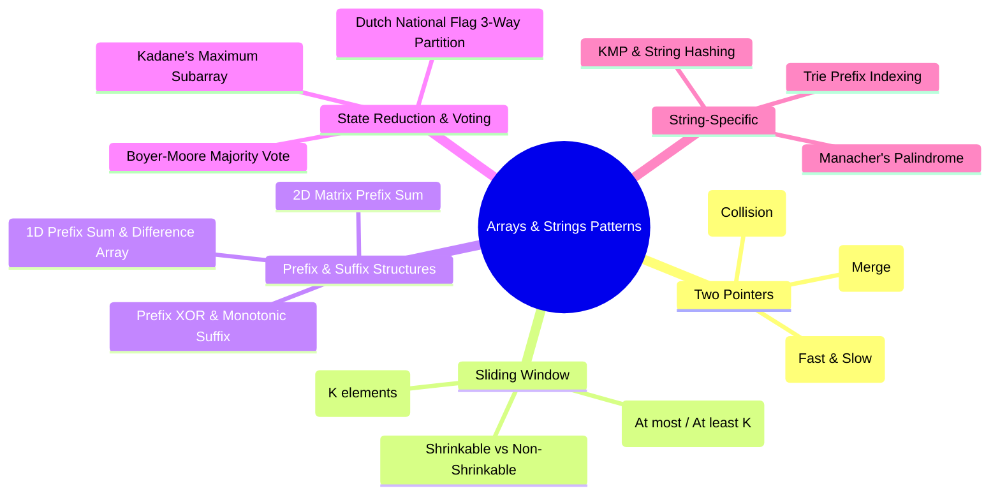

---


title: "00. 📦 Arrays & Strings: Master Architectural Overview & Algorithmic Patterns"
type: "concept_guide"
category: "dsa"
subcategory: "02_arrays_strings"
created_at: 2026-08-22T00:00:00+07:00
updated_at: 2026-08-26T23:45:00+07:00
tags: [dsa, arrays, strings, two-pointers, sliding-window, prefix-sum, kadanes, moores-voting, string-algorithms, algorithms, computer-science, learning-note]
aliases:
  - 00_overview_arrays_strings_core_operations_patterns
---

# 📌 00. 📦 Arrays & Strings: Master Architectural Overview & Algorithmic Patterns

Arrays and Strings form the most pervasive, cache-friendly data structures in modern software systems. Because elements occupy contiguous physical memory, they maximize CPU L1/L2 cache line hits and hardware branch prediction efficiency. This master guide unifies theoretical memory mechanics, asymptotic operational boundaries, core design patterns, and polyglot implementations.

---

## 1. Physical Memory Layout & CPU Cache Line Dynamics

### 1.1 Contiguous Memory & Spatial Locality
An array of elements of type $T$ with size $S = \text{sizeof}(T)$ starting at base memory address $B$ maps the $i$-th element to:
$$\text{Address}(A[i]) = B + i \cdot S$$

Because the memory offset calculation is a single arithmetic multiplication and addition, element retrieval is guaranteed in strictly $\mathcal{O}(1)$ constant time.

```
Array Physical Memory Layout (64-byte Cache Line):
+-------------+-------------+-------------+-------------+-------------+-------------+
| Index 0 (B) | Index 1     | Index 2     | Index 3     | Index 4     | Index 5 ... |
| 4 bytes     | 4 bytes     | 4 bytes     | 4 bytes     | 4 bytes     | 4 bytes     |
+-------------+-------------+-------------+-------------+-------------+-------------+
|<--------------------------- 64-byte CPU L1 Cache Line -------------------------->|
```

### 1.2 Fixed vs Dynamic Arrays vs Immutable Strings

| Characteristic | Fixed Array (`int[]`, `std::array`) | Dynamic Array (`std::vector`, `List<T>`, `list`) | Immutable String (`string` in C#/Java/Python) | Mutable Buffer (`StringBuilder`, `std::string`) |
| :--- | :--- | :--- | :--- | :--- |
| **Size Resizing** | Fixed at allocation | Dynamic (\$2\times$ or \$1.5\times$ geometric doubling) | Fixed (new allocation on modification) | Dynamic buffer expansion |
| **Memory Location** | Stack or Heap | Heap buffer + Stack pointer/metadata | Heap (Interned string pool) | Heap contiguous buffer |
| **Access Time** | $\mathcal{O}(1)$ | $\mathcal{O}(1)$ | $\mathcal{O}(1)$ | $\mathcal{O}(1)$ |
| **Append Cost** | Not supported | $\mathcal{O}(1)$ amortized ($\mathcal{O}(N)$ worst-case reallocation) | $\mathcal{O}(N)$ (creates full copy) | $\mathcal{O}(1)$ amortized |
| **Insert / Delete (Arbitrary)** | $\mathcal{O}(N)$ shift | $\mathcal{O}(N)$ shift | $\mathcal{O}(N)$ copy | $\mathcal{O}(N)$ shift |

---

## 2. Core Algorithmic Patterns Taxonomy

Mastery over array and string problems requires recognizing which algorithmic pattern unlocks linear $\mathcal{O}(N)$ or sub-quadratic $\mathcal{O}(N \log N)$ complexity:



---

## 3. Deep Dive into the 5 Foundation Patterns

### 3.1 Two Pointers (Opposite Direction & Collision)
Used on sorted collections to find pairs satisfying a monotonic predicate (e.g., Two Sum II, Container With Most Water, 3Sum).
- **Invariant**: If `arr[left] + arr[right] < target`, the sum is too small; increasing `left` monotonically increases the sum.
- **Complexity**: $\mathcal{O}(N)$ time, $\mathcal{O}(1)$ space.

### 3.2 Sliding Window (Variable Size)
Maintains a valid subarray state `[left, right]` across a stream or sequence.
- **Template Mechanics**: Expand `right` to include elements until a condition is violated, then advance `left` to restore validity.
- **Amortized Guarantee**: Since each pointer moves from \$0 \to N-1$ at most once, total pointer advancements is $\le 2N \implies \mathcal{O}(N)$.

### 3.3 Prefix Sum & Difference Array
- **Prefix Sum**: $P[i] = \sum_{k=0}^{i-1} A[k]$. Enables any range query $\text{Sum}(L, R) = P[R+1] - P[L]$ in $\mathcal{O}(1)$ time.
- **Difference Array**: $D[i] = A[i] - A[i-1]$. Enables range updates $\text{Add}(L, R, V)$ via $D[L] \mathrel{+}= V$ and $D[R+1] \mathrel{-}= V$ in $\mathcal{O}(1)$ time, reconstructed via prefix sums in $\mathcal{O}(N)$ time.

### 3.4 Kadane's Maximum Subarray Algorithm
Finds the contiguous subarray with the largest sum in $\mathcal{O}(N)$ time and $\mathcal{O}(1)$ space.
- **DP Recurrence**: $\text{dp}[i] = \max(A[i], \text{dp}[i-1] + A[i])$.
- **State Compression**: Only track `current_sum = max(x, current_sum + x)` and `max_sum = max(max_sum, current_sum)`.

### 3.5 Boyer-Moore Majority Voting Algorithm
Identifies the element appearing more than $\lfloor N/2 
floor$ times in $\mathcal{O}(N)$ time and $\mathcal{O}(1)$ space by pairing off distinct elements, leaving the majority element surviving.

---

## 4. Polyglot Master Implementations

### 4.1 C++20 (Span, Algorithms, and Zero-Allocation Primitives)

```cpp
#include <iostream>
#include <vector>
#include <span>
#include <string>
#include <algorithm>
#include <unordered_map>

class ArrayStringMasterSuite {
public:
    // 1. Kadane's Maximum Subarray
    static int MaxSubArray(std::span<const int> nums) {
        int max_sum = nums[0];
        int current_sum = nums[0];
        for (size_t i = 1; i < nums.size(); ++i) {
            current_sum = std::max(nums[i], current_sum + nums[i]);
            max_sum = std::max(max_sum, current_sum);
        }
        return max_sum;
    }

    // 2. Longest Substring Without Repeating Characters (Sliding Window)
    static int LengthOfLongestSubstring(const std::string& s) {
        std::vector<int> last_pos(128, -1);
        int max_len = 0, left = 0;
        for (int right = 0; right < static_cast<int>(s.size()); ++right) {
            char ch = s[right];
            if (last_pos[ch] >= left) {
                left = last_pos[ch] + 1;
            }
            last_pos[ch] = right;
            max_len = std::max(max_len, right - left + 1);
        }
        return max_len;
    }

    // 3. Boyer-Moore Voting Algorithm
    static int MajorityElement(std::span<const int> nums) {
        int candidate = 0, count = 0;
        for (int num : nums) {
            if (count == 0) {
                candidate = num;
                count = 1;
            } else if (num == candidate) {
                count++;
            } else {
                count--;
            }
        }
        return candidate;
    }
};

int main() {
    std::vector<int> nums = {-2, 1, -3, 4, -1, 2, 1, -5, 4};
    std::cout << "Max Subarray Sum: " << ArrayStringMasterSuite::MaxSubArray(nums) << "
";

    std::string s = "abcabcbb";
    std::cout << "Longest Substring No Repeat: " 
              << ArrayStringMasterSuite::LengthOfLongestSubstring(s) << "
";

    std::vector<int> votes = {2, 2, 1, 1, 1, 2, 2};
    std::cout << "Majority Element: " << ArrayStringMasterSuite::MajorityElement(votes) << "
";
    return 0;
}
```

### 4.2 Python 3.12 (High-Performance Idiomatic Solutions)

```python
from typing import List

class ArrayStringMasterSuite:
    @staticmethod
    def max_sub_array(nums: List[int]) -> int:
        max_sum = current_sum = nums[0]
        for x in nums[1:]:
            current_sum = max(x, current_sum + x)
            max_sum = max(max_sum, current_sum)
        return max_sum

    @staticmethod
    def length_of_longest_substring(s: str) -> int:
        char_map = {}
        max_len = left = 0
        for right, ch in enumerate(s):
            if ch in char_map and char_map[ch] >= left:
                left = char_map[ch] + 1
            char_map[ch] = right
            max_len = max(max_len, right - left + 1)
        return max_len

    @staticmethod
    def majority_element(nums: List[int]) -> int:
        candidate, count = 0, 0
        for num in nums:
            if count == 0:
                candidate = num
                count = 1
            elif num == candidate:
                count += 1
            else:
                count -= 1
        return candidate

if __name__ == "__main__":
    suite = ArrayStringMasterSuite()
    print("Max Subarray:", suite.max_sub_array([-2, 1, -3, 4, -1, 2, 1, -5, 4]))
    print("Longest Substring:", suite.length_of_longest_substring("pwwkew"))
    print("Majority Element:", suite.majority_element([3, 2, 3]))
```

### 4.3 C# (.NET 8 Memory Efficiency with `ReadOnlySpan<T>`)

```csharp
using System;
using System.Collections.Generic;

public static class ArrayStringMasterSuite {
    public static int MaxSubArray(ReadOnlySpan<int> nums) {
        int maxSum = nums[0];
        int currentSum = nums[0];
        for (int i = 1; i < nums.Length; i++) {
            currentSum = Math.Max(nums[i], currentSum + nums[i]);
            maxSum = Math.Max(maxSum, currentSum);
        }
        return maxSum;
    }

    public static int LengthOfLongestSubstring(string s) {
        Span<int> lastIndex = stackalloc int[128];
        lastIndex.Fill(-1);
        int maxLen = 0, left = 0;

        for (int right = 0; right < s.Length; right++) {
            char c = s[right];
            if (c < 128 && lastIndex[c] >= left) {
                left = lastIndex[c] + 1;
            }
            if (c < 128) lastIndex[c] = right;
            maxLen = Math.Max(maxLen, right - left + 1);
        }
        return maxLen;
    }

    public static int MajorityElement(ReadOnlySpan<int> nums) {
        int candidate = 0, count = 0;
        foreach (int num in nums) {
            if (count == 0) {
                candidate = num;
                count = 1;
            } else if (num == candidate) {
                count++;
            } else {
                count--;
            }
        }
        return candidate;
    }

    public static void Main() {
        int[] arr = { -2, 1, -3, 4, -1, 2, 1, -5, 4 };
        Console.WriteLine($"C# MaxSubArray: {MaxSubArray(arr)}");
        Console.WriteLine($"C# LongestSubstring: {LengthOfLongestSubstring("abcabcbb")}");
    }
}
```

---

## 5. Performance Engineering & Edge-Case Taxonomy

1. **String Immutability Overhead**:
   - In Python, C#, and Java, concatenating characters within a loop via `s += ch` triggers $\mathcal{O}(N)$ memory allocation and copying on every step, resulting in $\mathcal{O}(N^2)$ overall time.
   - *Fix*: Use `StringBuilder` in C#, `std::string` in C++, or append to a Python `list` and call `''.join(list)`.
2. **Span and Stackalloc Zero-Allocation**:
   - In C#, using `Span<T>` and `stackalloc` eliminates garbage collection (GC) pressure for high-throughput string/array parsing pipelines.
3. **Off-by-One and Empty Boundaries**:
   - Always validate empty inputs ($N = 0$), single-element arrays ($N = 1$), all negative elements in subarray sums, and duplicate elements during two-pointer pointer advances.

---

## 🔗 Graph-Linked Knowledge Base
- 📖 Deep Arrays Guide: Arrays (Mảng) Deep Guide
- 📖 Deep Strings Guide: Strings (Chuỗi) Deep Guide
- ⚡ Sliding Window: Sliding Window Master Guide
- ⚡ Prefix Sum: Prefix Sum Deep Guide
- ⚡ Moore's Voting: Moore's Voting Algorithm Guide
- 💬 Module Q&A: Sliding Window & Array Q&A
