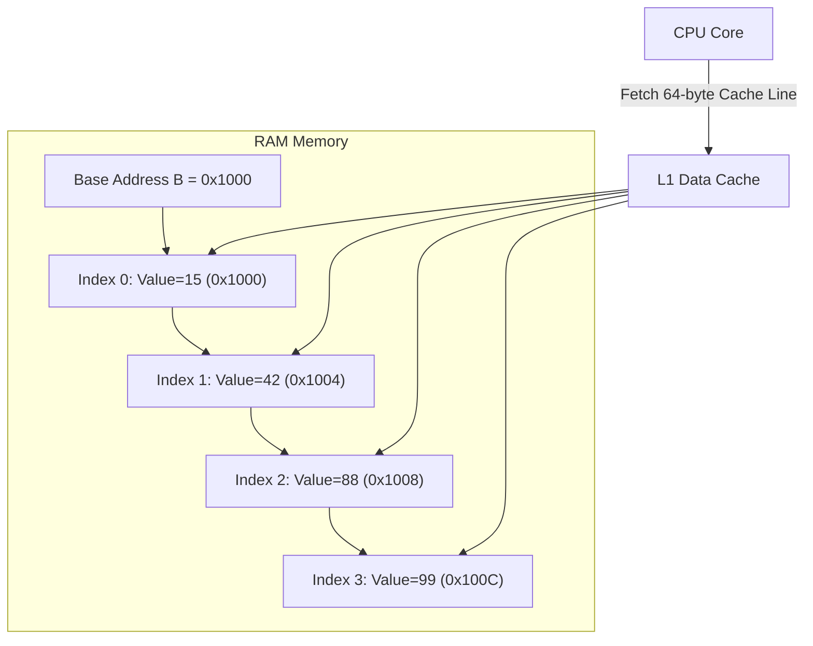

---


title: "01. 📦 Arrays (Mảng) — Cấu trúc Bộ nhớ, Thao tác Căn bản & Kỹ thuật Nâng cao"
type: "concept_guide"
category: "dsa"
subcategory: "02_arrays_strings"
created_at: 2026-08-22T00:00:00+07:00
updated_at: 2026-08-26T23:45:00+07:00
tags: [dsa, arrays, memory-layout, dynamic-arrays, vector, span, algorithmic-patterns, algorithms, computer-science, learning-note]
aliases:
  - 01_arrays_mng
---

# 📌 01. 📦 Arrays (Mảng) — Cấu trúc Bộ nhớ, Thao tác Căn bản & Kỹ thuật Nâng cao

Mảng (Array) là cấu trúc dữ liệu tuyến tính cơ bản và tối quan trọng nhất trong khoa học máy tính. Tất cả các phần tử trong mảng được lưu trữ tại **các ô nhớ liên tiếp nhau (contiguous memory)**, mang lại khả năng truy xuất ngẫu nhiên với độ phức tạp $\mathcal{O}(1)$ và hiệu năng tận dụng phần cứng CPU Cache tối ưu nhất.

---

## 1. Kiến trúc Bộ nhớ & Cơ chế Hoạt động Phần cứng



### 1.1 Công thức Tính Địa chỉ Ô nhớ (Address Calculation)
Khi một mảng kiểu dữ liệu $T$ (kích thước $S = \text{sizeof}(T)$ byte) bắt đầu tại địa chỉ cơ sở $B$:
$$\text{Address}(A[i]) = B + i \times S$$
- Truy xuất ngẫu nhiên $A[i]$: Tính toán phép nhân + cộng trong $1$ chu kỳ xung nhịp CPU $\implies \mathcal{O}(1)$.
- Tận dụng **Spatial Locality (Tính cục bộ không gian)**: Khi nạp $A[i]$, CPU tự động nạp cả đường nhớ (Cache Line 64 byte) chứa $A[i+1], A[i+2], \dots$ vào L1 Cache, giảm triệt để Cache Miss.

---

## 2. Bảng So sánh & Độ phức tạp Thao tác

| Thao tác | Mảng tĩnh (Static Array) | Mảng động (Dynamic Array - `std::vector`, `List<T>`) | Ghi chú & Cơ chế Phần cứng |
| :--- | :--- | :--- | :--- |
| **Truy xuất theo chỉ số ($A[i]$)** | $\mathcal{O}(1)$ | $\mathcal{O}(1)$ | Đọc trực tiếp con trỏ offset |
| **Cập nhật giá trị ($A[i] = v$)** | $\mathcal{O}(1)$ | $\mathcal{O}(1)$ | Ghi trực tiếp vào ô nhớ |
| **Thêm vào cuối (`push_back`)** | Không hỗ trợ | $\mathcal{O}(1)$ Amortized | $\mathcal{O}(N)$ Worst-case khi đầy bộ nhớ đệm (Reallocation) |
| **Xóa ở cuối (`pop_back`)** | Không hỗ trợ | $\mathcal{O}(1)$ | Giảm biến đếm `size` |
| **Chèn ở vị trí bất kỳ ($k$)** | $\mathcal{O}(N)$ | $\mathcal{O}(N)$ | Dịch chuyển toàn bộ phần tử từ $k \to N-1$ sang phải |
| **Xóa ở vị trí bất kỳ ($k$)** | $\mathcal{O}(N)$ | $\mathcal{O}(N)$ | Dịch chuyển toàn bộ phần tử từ $k+1 \to N-1$ sang trái |
| **Tìm kiếm tuần tự (Unsorted)** | $\mathcal{O}(N)$ | $\mathcal{O}(N)$ | Quét tuyến tính |
| **Tìm kiếm nhị phân (Sorted)** | $\mathcal{O}(\log N)$ | $\mathcal{O}(\log N)$ | Yêu cầu mảng đã sắp xếp |

---

## 3. Các Dạng Mảng và Kỹ thuật Nâng cao

### 3.1 Mảng Tĩnh (Static Array) vs Mảng Động (Dynamic Array)
- **Mảng tĩnh (`int arr[1000]`)**: Được cấp phát trên Stack hoặc vùng nhớ tĩnh (`.data`/`.bss`). Kích thước cố định tại thời điểm biên dịch.
- **Mảng động (`std::vector<int>`, `List<int>`)**:
  1. Con trỏ metadata nằm trên Stack trỏ đến vùng nhớ đệm liên tiếp trên Heap.
  2. Khi `size == capacity`, mảng tạo một vùng nhớ mới có kích thước gấp đôi (\$2 \times \text{capacity}$), sao chép dữ liệu cũ sang và giải phóng vùng nhớ cũ.

```
Dynamic Array Growth Cycle:
Capacity: 1 -> 2 -> 4 -> 8 -> 16 -> 32 -> 64 -> 128 ...
Amortized cost per insertion = O(1) via Banker's / Potential Method.
```

### 3.2 Kỹ thuật Mảng 2 Chiều & Row-Major vs Column-Major Layout
Trong C/C++ và C#, mảng 2 chiều $M \times N$ được lưu trữ phẳng theo thứ tự hàng (**Row-Major Order**):
$$\text{Index}(r, c) = r \times N + c$$
- **Quy tắc hiệu năng vàng**: Luôn duyệt vòng lặp hàng ở ngoài và cột ở trong (`for r: for c:`) để tận dụng L1 Cache. Duyệt cột ở ngoài (`for c: for r:`) gây Cache Thrashing nặng nề.

---

## 4. Source Code Hoàn chỉnh Đa ngôn ngữ (C++, Python, C#)

### 4.1 Triển khai C++20 Tối ưu với Custom Dynamic Array Container

```cpp
#include <iostream>
#include <stdexcept>
#include <algorithm>

template <typename T>
class CustomVector {
private:
    T* data_;
    size_t size_;
    size_t capacity_;

    void Reallocate(size_t new_capacity) {
        T* new_data = new T[new_capacity];
        for (size_t i = 0; i < size_; ++i) {
            new_data[i] = std::move(data_[i]);
        }
        delete[] data_;
        data_ = new_data;
        capacity_ = new_capacity;
    }

public:
    CustomVector() : data_(nullptr), size_(0), capacity_(0) {
        Reallocate(2);
    }

    ~CustomVector() {
        delete[] data_;
    }

    void PushBack(const T& value) {
        if (size_ == capacity_) {
            Reallocate(capacity_ * 2);
        }
        data_[size_++] = value;
    }

    void PopBack() {
        if (size_ > 0) {
            --size_;
        }
    }

    T& operator[](size_t index) {
        if (index >= size_) throw std::out_of_range("Index out of bounds");
        return data_[index];
    }

    const T& operator[](size_t index) const {
        if (index >= size_) throw std::out_of_range("Index out of bounds");
        return data_[index];
    }

    [[nodiscard]] size_t Size() const { return size_; }
    [[nodiscard]] size_t Capacity() const { return capacity_; }
};

int main() {
    CustomVector<int> vec;
    for (int i = 1; i <= 10; ++i) {
        vec.PushBack(i * 10);
    }

    std::cout << "CustomVector elements: ";
    for (size_t i = 0; i < vec.Size(); ++i) {
        std::cout << vec[i] << " ";
    }
    std::cout << "
Size: " << vec.Size() << ", Capacity: " << vec.Capacity() << "
";
    return 0;
}
```

### 4.2 Triển khai Python 3.12 (Mảng Nâng cao & 2D Matrix Flattening)

```python
class DynamicArrayDemo:
    @staticmethod
    def demonstrate_matrix_flattening(rows: int, cols: int):
        # 1D flattened array representing a 2D matrix
        flattened = [0] * (rows * cols)
        
        # Write values
        for r in range(rows):
            for c in range(cols):
                flattened[r * cols + c] = (r + 1) * 10 + (c + 1)
                
        # Read values
        matrix_repr = []
        for r in range(rows):
            row_vals = [flattened[r * cols + c] for c in range(cols)]
            matrix_repr.append(row_vals)
            
        return flattened, matrix_repr

if __name__ == "__main__":
    flat, grid = DynamicArrayDemo.demonstrate_matrix_flattening(3, 4)
    print("Flattened Array:", flat)
    print("Reconstructed Grid:", grid)
```

### 4.3 Triển khai C# (.NET 8 `Span<T>` & Zero-Allocation In-Place Partition)

```csharp
using System;

public static class ArrayAlgorithms {
    // Dutch National Flag (3-way Partitioning: O(N) time, O(1) space)
    public static void SortColors(Span<int> nums) {
        int low = 0, mid = 0, high = nums.Length - 1;
        while (mid <= high) {
            if (nums[mid] == 0) {
                (nums[low], nums[mid]) = (nums[mid], nums[low]);
                low++;
                mid++;
            } else if (nums[mid] == 1) {
                mid++;
            } else { // nums[mid] == 2
                (nums[mid], nums[high]) = (nums[high], nums[mid]);
                high--;
            }
        }
    }

    public static void Main() {
        int[] arr = { 2, 0, 2, 1, 1, 0 };
        SortColors(arr);
        Console.WriteLine("Sorted 3-way Dutch Flag: " + string.Join(", ", arr));
    }
}
```

---

## 5. Kinh nghiệm Thực chiến & Bẫy Thường Gặp

1. **Off-by-One Errors**: Lỗi vượt biên mảng $N$ thay vì $N-1$ dẫn đến `IndexOutOfRangeException` hoặc Buffer Overflow.
2. **Reallocation Overhead**: Khi biết trước số lượng phần tử cần thêm, luôn gọi `vec.reserve(N)` trong C++ hoặc `new List<int>(N)` trong C# để tránh liên tục phân mảnh và copy bộ nhớ $O(N)$ lần.
3. **Pass-by-Value vs Pass-by-Reference**:
   - Trong C++, truyền `std::vector<int>` theo giá trị `void Solve(std::vector<int> a)` sẽ copy toàn bộ mảng $\mathcal{O}(N)$. Luôn truyền tham chiếu hằng: `void Solve(const std::vector<int>& a)` hoặc `std::span<const int>`.

---

## 🔗 Graph-Linked Knowledge Base
- 📖 Master Overview: [[01_DSA/01_theory_and_patterns/02_Arrays_Strings/00_overview_arrays_strings_core_operations_patterns|Arrays & Strings Master Overview]]
- ⚡ Two Pointers: [[01_DSA/01_theory_and_patterns/02_Arrays_Strings/03_two_pointers_k_thut_hai_con_tr|Two Pointers Guide]]
- ⚡ Sliding Window: [[01_DSA/01_theory_and_patterns/02_Arrays_Strings/04_sliding_window_ca_s_trt|Sliding Window Guide]]
