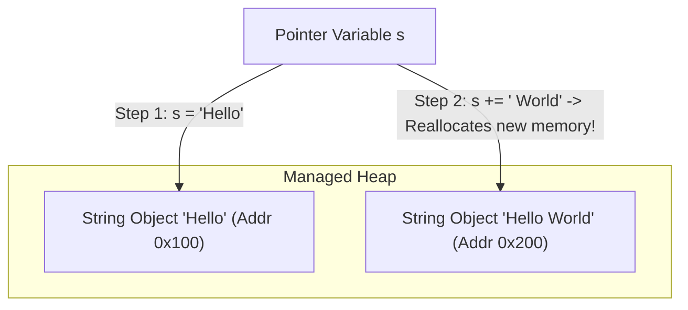

---


title: "02. 🔤 Strings (Chuỗi) — Kiến trúc Bộ nhớ, Immutability & Thuật toán Xử lý Chuỗi"
type: "concept_guide"
category: "dsa"
subcategory: "02_arrays_strings"
created_at: 2026-08-22T00:00:00+07:00
updated_at: 2026-08-26T23:45:00+07:00
tags: [dsa, strings, string-immutability, stringbuilder, kmp, rolling-hash, anagrams, algorithms, computer-science, learning-note]
aliases:
  - 02_strings_chui
---

# 📌 02. 🔤 Strings (Chuỗi) — Kiến trúc Bộ nhớ, Immutability & Thuật toán Xử lý Chuỗi

Chuỗi ký tự (String) về bản chất là một chuỗi tuần tự các ký tự (characters) được mã hóa theo các tiêu chuẩn như ASCII, UTF-8, UTF-16 hoặc UTF-32. Hiểu rõ sự khác biệt giữa chuỗi bất biến (**Immutable**) và chuỗi khả biến (**Mutable**), cùng với các thuật toán so khớp mẫu (Pattern Matching), là chìa khóa để giải quyết các bài toán tối ưu trên văn bản.

---

## 1. Kiến trúc Bộ nhớ Chuỗi & Khái niệm Immutability

### 1.1 Tính Bất biến (Immutability) và String Pool
Trong các ngôn ngữ bậc cao như C#, Java, và Python:
- **Chuỗi là Bất biến (Immutable)**: Khi một đối tượng String được tạo ra, nội dung ô nhớ của nó không thể bị thay đổi.
- **Phép nối chuỗi nguy hiểm**:
  ```csharp
  string s = "";
  for (int i = 0; i < n; i++) {
      s += "a"; // Mỗi lần lặp sẽ tạo một đối tượng String mới và copy chuỗi cũ!
  }
  // Tổng số thao tác copy: 1 + 2 + 3 + ... + N = O(N^2) Time!
  ```



### 1.2 Mutable String Buffer (`StringBuilder` & `std::string`)
Để giải quyết bài toán $\mathcal{O}(N^2)$ khi xây dựng chuỗi:
- **C# / Java**: Sử dụng `StringBuilder`, quản lý một mảng ký tự đệm có thể co giãn tự động theo cấp số nhân $\implies \mathcal{O}(N)$ thời gian tổng thể.
- **C++**: `std::string` là mutable theo mặc định và cho phép chỉnh sửa trực tiếp từng byte ký tự `s[i] = 'c'` trong $\mathcal{O}(1)$.
- **Python**: Gom các ký tự vào một `list` rồi gọi `''.join(list)` trong $\mathcal{O}(N)$.

---

## 2. Bảng Phân loại Độ phức tạp & Bảng Mã hóa

| Thao tác Chuỗi | `std::string` (C++) | `string` (C# / Java) | `StringBuilder` (C#) | `str` (Python) |
| :--- | :--- | :--- | :--- | :--- |
| **Truy xuất ký tự theo chỉ số ($s[i]$)** | $\mathcal{O}(1)$ | $\mathcal{O}(1)$ | $\mathcal{O}(1)$ | $\mathcal{O}(1)$ |
| **Chỉnh sửa ký tự tại chỗ ($s[i] = c$)** | $\mathcal{O}(1)$ | Không hỗ trợ | $\mathcal{O}(1)$ | Không hỗ trợ |
| **Nối thêm ký tự vào cuối** | $\mathcal{O}(1)$ Amortized | $\mathcal{O}(N)$ (Alloc mới) | $\mathcal{O}(1)$ Amortized | $\mathcal{O}(N)$ (Alloc mới) |
| **Cắt chuỗi con (Substring độ dài $K$)** | $\mathcal{O}(K)$ | $\mathcal{O}(K)$ | $\mathcal{O}(K)$ | $\mathcal{O}(K)$ |
| **So sánh hai chuỗi độ dài $N$** | $\mathcal{O}(N)$ | $\mathcal{O}(N)$ | $\mathcal{O}(N)$ | $\mathcal{O}(N)$ |

---

## 3. Các Kỹ thuật Thuật toán Chuỗi Kinh điển

### 3.1 Bảng Tần số Ký tự (Frequency Map / Array)
Vì bảng mã ASCII có 128 hoặc 256 ký tự, ta có thể dùng mảng tĩnh `int count[128]` hoặc `int count[26]` (chữ cái thường) để đếm tần số ký tự thay vì dùng `HashMap` $\implies$ Tối ưu bộ nhớ và đạt tốc độ truy xuất cực đại.
- **Ứng dụng**: Kiểm tra đảo ngữ (Valid Anagram), tìm ký tự không lặp lại đầu tiên, Sliding Window chuỗi.

### 3.2 Kỹ thuật Hai Con trỏ trên Chuỗi (Palindrome & Reversal)
Kiểm tra chuỗi đối xứng (Palindrome) bằng cách di chuyển hai con trỏ từ hai đầu vào giữa:
$$\text{IsPalindrome}(s) \iff orall i \in [0, \lfloor N/2 
floor], s[i] == s[N - 1 - i]$$

### 3.3 Thuật toán KMP (Knuth-Morris-Pratt) So khớp Mẫu
Tìm kiếm vị trí xuất hiện của chuỗi mẫu $P$ (độ dài $M$) trong chuỗi văn bản $T$ (độ dài $N$) trong thời gian tuyến tính $\mathcal{O}(N + M)$ bằng cách sử dụng mảng tiền tố dài nhất trùng hậu tố (**Longest Proper Prefix which is also Suffix - LPS**).

---

## 4. Triển khai Source Code Đa ngôn ngữ

### 4.1 C++20 (KMP Algorithm & String Anagrams)

```cpp
#include <iostream>
#include <string>
#include <vector>

class StringMasterAlgorithms {
public:
    // Knuth-Morris-Pratt (KMP) Pattern Matching O(N + M)
    static std::vector<int> BuildLPS(const std::string& pattern) {
        int m = static_cast<int>(pattern.size());
        std::vector<int> lps(m, 0);
        int len = 0, i = 1;

        while (i < m) {
            if (pattern[i] == pattern[len]) {
                len++;
                lps[i] = len;
                i++;
            } else {
                if (len != 0) {
                    len = lps[len - 1];
                } else {
                    lps[i] = 0;
                    i++;
                }
            }
        }
        return lps;
    }

    static std::vector<int> KMPSearch(const std::string& text, const std::string& pattern) {
        std::vector<int> matches;
        int n = static_cast<int>(text.size());
        int m = static_cast<int>(pattern.size());
        if (m == 0 || n < m) return matches;

        std::vector<int> lps = BuildLPS(pattern);
        int i = 0, j = 0; // i for text, j for pattern

        while (i < n) {
            if (text[i] == pattern[j]) {
                i++;
                j++;
            }
            if (j == m) {
                matches.push_back(i - j);
                j = lps[j - 1];
            } else if (i < n && text[i] != pattern[j]) {
                if (j != 0) {
                    j = lps[j - 1];
                } else {
                    i++;
                }
            }
        }
        return matches;
    }
};

int main() {
    std::string text = "ABABDABACDABABCABAB";
    std::string pattern = "ABABCABAB";
    auto matches = StringMasterAlgorithms::KMPSearch(text, pattern);

    std::cout << "KMP Match indices: ";
    for (int idx : matches) std::cout << idx << " ";
    std::cout << "
";
    return 0;
}
```

### 4.2 Python 3.12 (Anagram Grouping & Rolling Hash)

```python
from typing import List, Dict
from collections import defaultdict

class StringSolutions:
    @staticmethod
    def group_anagrams(strs: List[str]) -> List[List[str]]:
        # O(N * K) time using character count tuple as dictionary key
        groups: Dict[tuple, List[str]] = defaultdict(list)
        for s in strs:
            count = [0] * 26
            for ch in s:
                count[ord(ch) - ord('a')] += 1
            groups[tuple(count)].append(s)
        return list(groups.values())

if __name__ == "__main__":
    words = ["eat", "tea", "tan", "ate", "nat", "bat"]
    print("Grouped Anagrams:", StringSolutions.group_anagrams(words))
```

### 4.3 C# (.NET 8 `ReadOnlySpan<char>` Zero-Allocation Parsing)

```csharp
using System;
using System.Text;

public static class StringMasterCSharp {
    // Is Valid Palindrome (Ignoring non-alphanumeric, case-insensitive) O(N) Time, O(1) Space
    public static bool IsPalindrome(ReadOnlySpan<char> s) {
        int left = 0, right = s.Length - 1;
        while (left < right) {
            while (left < right && !char.IsLetterOrDigit(s[left])) left++;
            while (left < right && !char.IsLetterOrDigit(s[right])) right--;

            if (char.ToLowerInvariant(s[left]) != char.ToLowerInvariant(s[right])) {
                return false;
            }
            left++;
            right--;
        }
        return true;
    }

    public static void Main() {
        string test = "A man, a plan, a canal: Panama";
        Console.WriteLine($"Is Palindrome: {IsPalindrome(test)}");
    }
}
```

---

## 5. Bẫy Thường Gặp & Chiến lược Phỏng vấn

1. **Ghép chuỗi trong vòng lặp**: Luôn phát hiện và loại bỏ mã `s += c` trong vòng lặp. Dùng `StringBuilder` hoặc mảng `char[]`.
2. **Xử lý Unicode và Ký tự Có Dấu (Surrogate Pairs)**:
   - Các biểu tượng cảm xúc (Emoji) hoặc chữ tượng hình có thể chiếm 2 đơn vị mã `char` trong UTF-16 (Surrogate Pairs). Cần cẩn thận khi đảo ngược chuỗi hoặc đếm độ dài.
3. **Phân biệt Case Sensitivity & Whitespace**: Luôn xác nhận với người phỏng vấn xem chuỗi có phân biệt chữ hoa/thường hay có khoảng trắng thừa không.

---

## 🔗 Graph-Linked Knowledge Base
- 📖 Arrays Guide: [[01_DSA/01_theory_and_patterns/02_Arrays_Strings/01_arrays_mng|Arrays Deep Guide]]
- ⚡ Sliding Window: [[01_DSA/01_theory_and_patterns/02_Arrays_Strings/04_sliding_window_ca_s_trt|Sliding Window Master Guide]]
- 🧩 Problem Set: [[01_DSA/01_theory_and_patterns/02_Arrays_Strings/01_sliding_window_problems|Arrays & Strings Problems]]
