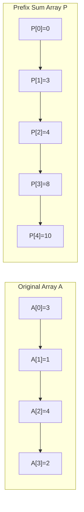

---


title: "05. ➕ Prefix Sum (Mảng Cộng Dồn) & Difference Array — Lý thuyết Toàn diện & Ứng dụng"
type: "concept_guide"
category: "dsa"
subcategory: "02_arrays_strings"
created_at: 2026-08-22T00:00:00+07:00
updated_at: 2026-08-26T23:45:00+07:00
tags: [dsa, prefix-sum, difference-array, 2d-prefix-sum, range-query, leetcode, algorithms, computer-science, learning-note]
aliases:
  - 05_prefix_sum_tng_tin_t
---

# 📌 05. ➕ Prefix Sum (Mảng Cộng Dồn) & Difference Array — Lý thuyết Toàn diện & Ứng dụng

Kỹ thuật Mảng Cộng Dồn (Prefix Sum) và Mảng Hiệu (Difference Array) là các kỹ thuật tiền xử lý dữ liệu mạnh mẽ giúp chuyển đổi các truy vấn tính tổng đoạn từ $\mathcal{O}(N)$ xuống $\mathcal{O}(1)$, và cập nhật đoạn liên tiếp trong thời gian $\mathcal{O}(1)$.

---

## 1. Bản chất Toán học & Cơ chế Hoạt động

### 1.1 Prefix Sum 1D (Mảng Cộng Dồn 1 Chiều)
Cho mảng số nguyên $A = [a_0, a_1, \dots, a_{N-1}]$. Mảng tiền tố $P$ độ dài $N+1$ được định nghĩa:
$$P[0] = 0$$
$$P[i] = \sum_{k=0}^{i-1} A[k] = P[i-1] + A[i-1] \quad (orall i \in [1, N])$$



**Công thức Truy vấn Tổng Đoạn $[L, R]$ (0-indexed)**:
$$\text{Sum}(L, R) = \sum_{k=L}^R A[k] = P[R+1] - P[L]$$
- **Chi phí**: Tiền xử lý $\mathcal{O}(N)$ thời gian và $\mathcal{O}(N)$ bộ nhớ; Mỗi truy vấn $\mathcal{O}(1)$ thời gian.

---

## 2. Prefix Sum 2D (Ma trận Cộng dồn 2 Chiều)

Với ma trận kích thước $R \times C$, ta xây dựng ma trận tiền tố $P$ kích thước $(R+1) \times (C+1)$ theo **Nguyên lý Bao hàm - Loại trừ (Inclusion-Exclusion Principle)**.

```
2D Prefix Sum Geometry:
+-------------------+-------+
|                   |       |
|      P[r-1][c-1]  |       |
|                   |       |
+-------------------+-------+
|                   |M[r][c]|
+-------------------+-------+
P[r][c] = P[r-1][c] + P[r][c-1] - P[r-1][c-1] + Matrix[r-1][c-1]
```

### 2.1 Công thức Xây dựng Ma trận Tiền tố:
$$P[r][c] = P[r-1][c] + P[r][c-1] - P[r-1][c-1] + \text{Matrix}[r-1][c-1]$$

### 2.2 Công thức Truy vấn Tổng Hình chữ nhật từ $(r_1, c_1)$ đến $(r_2, c_2)$:
$$\text{SumRegion}(r_1, c_1, r_2, c_2) = P[r_2+1][c_2+1] - P[r_1][c_2+1] - P[r_2+1][c_1] + P[r_1][c_1]$$

---

## 3. Difference Array (Mảng Hiệu) — Cập nhật Đoạn $\mathcal{O}(1)$

Ngược lại với Prefix Sum, Mảng Hiệu $D$ dùng để thực hiện hàng triệu thao tác: **"Cộng giá trị $V$ vào tất cả các phần tử trong đoạn $[L, R]$"**.
- Định nghĩa: $D[0] = A[0]$, và $D[i] = A[i] - A[i-1]$ với $i \ge 1$.
- **Cập nhật $[L, R]$ thêm $V$**:
  $$D[L] \mathrel{+}= V$$
  D[R+1] \mathrel{-}= V \quad (\text{nếu } R+1 < N)
- Sau khi hoàn thành tất cả các thao tác cập nhật, mảng kết quả cuối cùng chính là **Prefix Sum của mảng $D$**!

---

## 4. Triển khai Source Code Đa ngôn ngữ

### 4.1 C++20 (NumMatrix 2D Prefix Sum & Difference Array)

```cpp
#include <iostream>
#include <vector>

class NumMatrix2D {
private:
    std::vector<std::vector<int>> prefix_;

public:
    NumMatrix2D(const std::vector<std::vector<int>>& matrix) {
        if (matrix.empty() || matrix[0].empty()) return;
        int r = static_cast<int>(matrix.size());
        int c = static_cast<int>(matrix[0].size());
        prefix_.assign(r + 1, std::vector<int>(c + 1, 0));

        for (int i = 0; i < r; ++i) {
            for (int j = 0; j < c; ++j) {
                prefix_[i + 1][j + 1] = prefix_[i][j + 1] 
                                      + prefix_[i + 1][j] 
                                      - prefix_[i][j] 
                                      + matrix[i][j];
            }
        }
    }

    int SumRegion(int r1, int c1, int r2, int c2) const {
        return prefix_[r2 + 1][c2 + 1] 
             - prefix_[r1][c2 + 1] 
             - prefix_[r2 + 1][c1] 
             + prefix_[r1][c1];
    }
};

class DifferenceArray1D {
private:
    std::vector<int> diff_;
    int n_;

public:
    DifferenceArray1D(const std::vector<int>& arr) : n_(static_cast<int>(arr.size())) {
        diff_.assign(n_ + 1, 0);
        diff_[0] = arr[0];
        for (int i = 1; i < n_; ++i) {
            diff_[i] = arr[i] - arr[i - 1];
        }
    }

    void RangeAdd(int l, int r, int val) {
        diff_[l] += val;
        if (r + 1 < n_) {
            diff_[r + 1] -= val;
        }
    }

    std::vector<int> BuildResult() {
        std::vector<int> res(n_);
        res[0] = diff_[0];
        for (int i = 1; i < n_; ++i) {
            res[i] = res[i - 1] + diff_[i];
        }
        return res;
    }
};

int main() {
    std::vector<std::vector<int>> mat = {
        {3, 0, 1, 4, 2},
        {5, 6, 3, 2, 1},
        {1, 2, 0, 1, 5},
        {4, 1, 0, 1, 7},
        {1, 0, 3, 0, 5}
    };
    NumMatrix2D nm(mat);
    std::cout << "SumRegion(2,1,4,3) = " << nm.SumRegion(2, 1, 4, 3) << " (Expected: 8)
";
    return 0;
}
```

### 4.2 Python 3.12 (Subarray Sum Equals K via Prefix Sum + Hash Map)

```python
from typing import List
from collections import defaultdict

class Solution:
    def subarraySum(self, nums: List[int], k: int) -> int:
        # P[j] - P[i] = k  =>  P[i] = P[j] - k
        prefix_count = defaultdict(int)
        prefix_count[0] = 1 # Base case: empty prefix
        
        current_sum = 0
        ans = 0
        
        for x in nums:
            current_sum += x
            target = current_sum - k
            if target in prefix_count:
                ans += prefix_count[target]
            prefix_count[current_sum] += 1
            
        return ans

if __name__ == "__main__":
    sol = Solution()
    print("Subarrays with sum 2 in [1, 1, 1]:", sol.subarraySum([1, 1, 1], 2))
```

### 4.3 C# (.NET 8 Corporate Flight Bookings via Difference Array)

```csharp
using System;

public class Solution {
    // LeetCode 1109: Corporate Flight Bookings
    public int[] CorpFlightBookings(int[][] bookings, int n) {
        int[] diff = new int[n + 2];
        foreach (var booking in bookings) {
            int first = booking[0];
            int last = booking[1];
            int seats = booking[2];
            diff[first] += seats;
            diff[last + 1] -= seats;
        }

        int[] result = new int[n];
        int current = 0;
        for (int i = 1; i <= n; i++) {
            current += diff[i];
            result[i - 1] = current;
        }
        return result;
    }

    public static void Main() {
        var sol = new Solution();
        int[][] bookings = new int[][] {
            new int[] {1, 2, 10},
            new int[] {2, 3, 20},
            new int[] {2, 5, 25}
        };
        int[] res = sol.CorpFlightBookings(bookings, 5);
        Console.WriteLine("Flight Bookings: " + string.Join(", ", res));
    }
}
```

---

## 5. Kinh nghiệm Xử lý Biên & Các Biến thể

1. **Kích thước Mảng $N+1$**: Luôn khởi tạo mảng `prefix` có kích thước $N+1$ với `prefix[0] = 0`. Điều này loại bỏ hoàn toàn các câu lệnh `if (L == 0)` phiền toái khi tính `Sum(L, R)`.
2. **Tràn số nguyên (Integer Overflow)**: Khi mảng có $10^5$ phần tử với mỗi phần tử lên tới $10^9$, tổng tiền tố có thể đạt $10^{14}$, vượt quá giới hạn của `int32` (2 tỷ). Luôn dùng `long long` trong C++ hoặc `long` trong C#.

---

## 🔗 Graph-Linked Knowledge Base
- 📖 Master Overview: [[01_DSA/01_theory_and_patterns/02_Arrays_Strings/00_overview_arrays_strings_core_operations_patterns|Arrays & Strings Master Overview]]
- ⚡ Sliding Window: [[01_DSA/01_theory_and_patterns/02_Arrays_Strings/04_sliding_window_ca_s_trt|Sliding Window Master Guide]]
- 🧩 Practice Suite: [[01_DSA/01_theory_and_patterns/02_Arrays_Strings/01_sliding_window_problems|Arrays & Strings Problem Set]]
