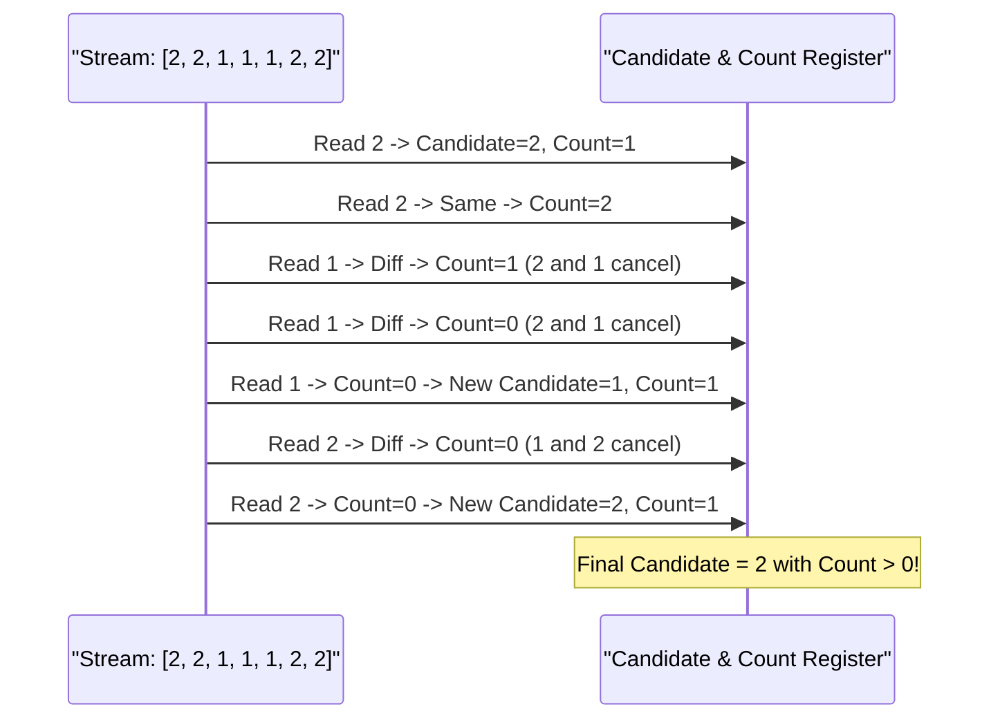

---


title: "08. 🗳️ Boyer-Moore Majority Voting Algorithm — Lý thuyết, Chứng minh Toán học & Mở rộng"
type: "concept_guide"
category: "dsa"
subcategory: "02_arrays_strings"
created_at: 2026-08-22T00:00:00+07:00
updated_at: 2026-08-26T23:45:00+07:00
tags: [dsa, moores-voting, majority-element, streaming-algorithms, state-machine, algorithms, computer-science, learning-note]
aliases:
  - 08_moores_voting_algorithm
---

# 📌 08. 🗳️ Boyer-Moore Majority Voting Algorithm — Lý thuyết, Chứng minh Toán học & Mở rộng

Thuật toán bỏ phiếu Boyer-Moore (Boyer-Moore Majority Voting Algorithm) do Robert S. Boyer và J Strother Moore phát minh năm 1981 là thuật toán kinh điển trong xử lý luồng dữ liệu (Data Streaming). Thuật toán cho phép tìm phần tử đa số (xuất hiện $> \lfloor N/2 
floor lần) trong đúng **\mathcal{O}(N) thời gian** và **\mathcal{O}(1)$ không gian bộ nhớ**, hoàn toàn không cần cấp phát thêm bảng băm hay sắp xếp.

---

## 1. Bản chất Trực giác & Chứng minh Toán học

### 1.1 Trực giác Triệt tiêu Cặp (Pairwise Annihilation)
Nếu một phần tử $M$ xuất hiện $> N/2$ lần, thì số lần xuất hiện của $M$ lớn hơn tổng số lần xuất hiện của tất cả các phần tử khác gộp lại:
$$\text{Count}(M) > \sum_{x 
e M} \text{Count}(x)$$
Do đó, nếu ta liên tục ghép cặp và loại bỏ hai phần tử **khác nhau** ra khỏi mảng, phần tử cuối cùng còn sót lại chắc chắn phải là $M$.



### 1.2 Chứng minh Bất biến Lặp (Loop Invariant Proof)
Tại bất kỳ bước $i$ nào:
- Biến `candidate` lưu giữ ứng cử viên hiện tại.
- Biến `count` lưu số lượng phiếu "chưa bị triệt tiêu" của `candidate`.
- Khi `count == 0`, tiền tố trước đó đã được phân rã thành các cặp triệt tiêu hoàn chỉnh. Phần tử đa số thực sự $M$ nếu nằm trong tập này cũng chỉ bị mất tối đa $1/2$ số lượng. Trong phần còn lại của mảng, $M$ vẫn chiếm đa số tuyệt đối.

---

## 2. Boyer-Moore Mở rộng: Tìm Phần tử Xuất hiện $> \lfloor N/3 
floor$ (Majority Element II)

Theo nguyên lý Dirichlet (Nguyên lý Chuồng bồ câu):
- Trong mảng kích thước $N$, có tối đa **2 phần tử** có thể xuất hiện $> \lfloor N/3 
floor$ lần.
- Ta duy trì **2 ứng cử viên** (`cand1`, `cand2`) và **2 bộ đếm** (`count1`, `count2`).
- Khi gặp phần tử mới $x$:
  1. Nếu $x == \text{cand1}$: tăng `count1`.
  2. Nếu $x == \text{cand2}$: tăng `count2`.
  3. Nếu `count1 == 0`: chọn $\text{cand1} = x, \text{count1} = 1$.
  4. Nếu `count2 == 0`: chọn $\text{cand2} = x, \text{count2} = 1$.
  5. Nếu $x$ khác cả hai và cả hai bộ đếm đều $> 0$: giảm cả `count1` và `count2` (triệt tiêu bộ ba khác nhau).
- **Pass 2 Verification**: Duyệt lại mảng lần 2 để kiểm tra chắc chắn xem `cand1` và `cand2` có thực sự xuất hiện $> N/3$ lần không.

---

## 3. Triển khai Đa ngôn ngữ (C++, Python, C#)

### 3.1 C++20 (Majority Element I & II Production Code)

```cpp
#include <iostream>
#include <vector>
#include <span>

class BoyerMooreVotingSuite {
public:
    // LeetCode 169: Majority Element (> N/2)
    static int MajorityElement(std::span<const int> nums) {
        int candidate = 0, count = 0;
        for (int num : nums) {
            if (count == 0) {
                candidate = num;
                count = 1;
            } else if (num == candidate) {
                count++;
            } else {
                count--;
            }
        }
        return candidate;
    }

    // LeetCode 229: Majority Element II (> N/3)
    static std::vector<int> MajorityElementII(std::span<const int> nums) {
        int cand1 = 0, cand2 = 0, count1 = 0, count2 = 0;
        for (int num : nums) {
            if (num == cand1) {
                count1++;
            } else if (num == cand2) {
                count2++;
            } else if (count1 == 0) {
                cand1 = num;
                count1 = 1;
            } else if (count2 == 0) {
                cand2 = num;
                count2 = 1;
            } else {
                count1--;
                count2--;
            }
        }

        // Pass 2: Verify frequency
        int freq1 = 0, freq2 = 0;
        for (int num : nums) {
            if (num == cand1) freq1++;
            else if (num == cand2) freq2++;
        }

        std::vector<int> result;
        int threshold = static_cast<int>(nums.size()) / 3;
        if (freq1 > threshold) result.push_back(cand1);
        if (freq2 > threshold) result.push_back(cand2);
        return result;
    }
};

int main() {
    std::vector<int> nums = {1, 1, 1, 3, 3, 2, 2, 2};
    auto majorities = BoyerMooreVotingSuite::MajorityElementII(nums);
    std::cout << "Elements appearing > N/3: ";
    for (int x : majorities) std::cout << x << " ";
    std::cout << "
";
    return 0;
}
```

### 3.2 Python 3.12 (Streaming Generator Implementation)

```python
from typing import List

class Solution:
    def majorityElement(self, nums: List[int]) -> int:
        candidate = count = 0
        for num in nums:
            if count == 0:
                candidate, count = num, 1
            elif num == candidate:
                count += 1
            else:
                count -= 1
        return candidate

    def majorityElementII(self, nums: List[int]) -> List[int]:
        cand1 = cand2 = None
        count1 = count2 = 0
        
        for num in nums:
            if num == cand1:
                count1 += 1
            elif num == cand2:
                count2 += 1
            elif count1 == 0:
                cand1, count1 = num, 1
            elif count2 == 0:
                cand2, count2 = num, 1
            else:
                count1 -= 1
                count2 -= 1
                
        # Verification pass
        threshold = len(nums) // 3
        return [c for c in (cand1, cand2) if c is not None and nums.count(c) > threshold]

if __name__ == "__main__":
    sol = Solution()
    print("Majority > N/2:", sol.majorityElement([2, 2, 1, 1, 1, 2, 2]))
    print("Majority > N/3:", sol.majorityElementII([3, 2, 3]))
```

### 3.3 C# (.NET 8 Span Implementation)

```csharp
using System;
using System.Collections.Generic;

public class BoyerMooreSolutions {
    public static int MajorityElement(ReadOnlySpan<int> nums) {
        int candidate = 0, count = 0;
        foreach (int num in nums) {
            if (count == 0) {
                candidate = num;
                count = 1;
            } else if (num == candidate) {
                count++;
            } else {
                count--;
            }
        }
        return candidate;
    }

    public static IList<int> MajorityElementII(int[] nums) {
        int cand1 = 0, cand2 = 0, count1 = 0, count2 = 0;
        foreach (int num in nums) {
            if (num == cand1) {
                count1++;
            } else if (num == cand2) {
                count2++;
            } else if (count1 == 0) {
                cand1 = num;
                count1 = 1;
            } else if (count2 == 0) {
                cand2 = num;
                count2 = 1;
            } else {
                count1--;
                count2--;
            }
        }

        int freq1 = 0, freq2 = 0;
        foreach (int num in nums) {
            if (num == cand1) freq1++;
            else if (num == cand2) freq2++;
        }

        var result = new List<int>();
        int threshold = nums.Length / 3;
        if (freq1 > threshold) result.Add(cand1);
        if (freq2 > threshold && cand1 != cand2) result.Add(cand2);
        return result;
    }

    public static void Main() {
        int[] arr = { 1, 2 };
        var res = MajorityElementII(arr);
        Console.WriteLine("Majority > N/3: " + string.Join(", ", res));
    }
}
```

---

## 4. Bẫy Thường Gặp & Lưu ý Thực chiến

1. **Giả định Tồn tại Phần tử Đa số**:
   - Nếu bài toán **không cam kết** mảng luôn có phần tử xuất hiện $> N/2$, thuật toán Boyer-Moore vẫn sẽ trả về một ứng cử viên cuối cùng. Do đó, **bắt buộc phải thực hiện vòng lặp thứ hai** để đếm lại tần số thực sự của ứng cử viên đó.
2. **Trường hợp Trùng Ứng cử viên trong Majority II**:
   - Khởi tạo giá trị ban đầu phải cẩn thận để tránh trường hợp `cand1 == cand2` khi mảng có các giá trị đặc biệt hoặc mặc định $0$.

---

## 🔗 Graph-Linked Knowledge Base
- 📖 Master Overview: [[01_DSA/01_theory_and_patterns/02_Arrays_Strings/00_overview_arrays_strings_core_operations_patterns|Arrays & Strings Master Overview]]
- ⚡ Arrays Guide: [[01_DSA/01_theory_and_patterns/02_Arrays_Strings/01_arrays_mng|Arrays Deep Guide]]
