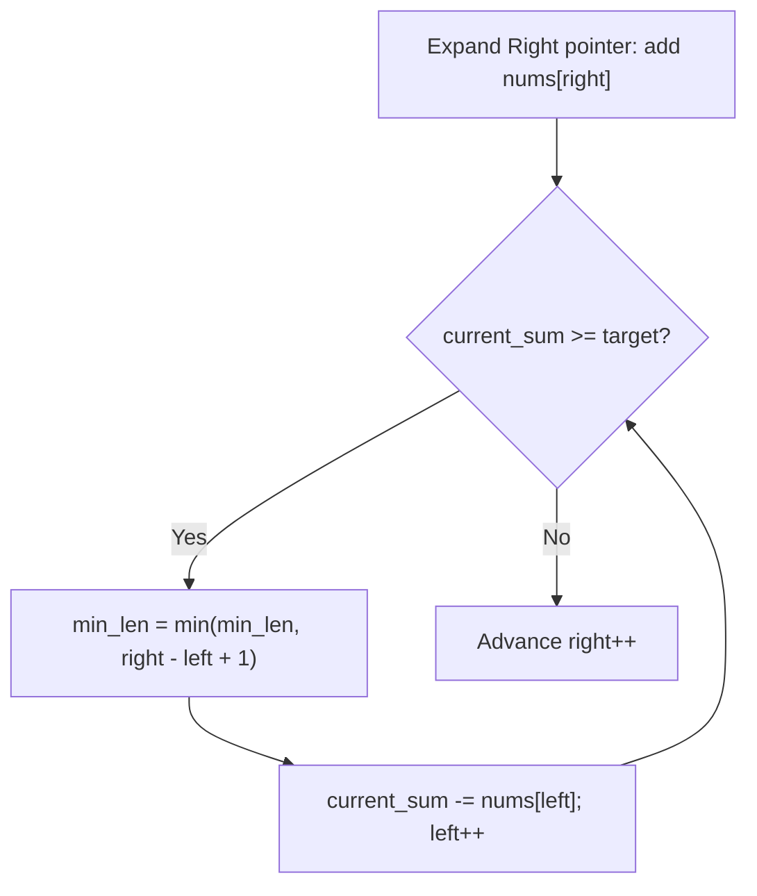
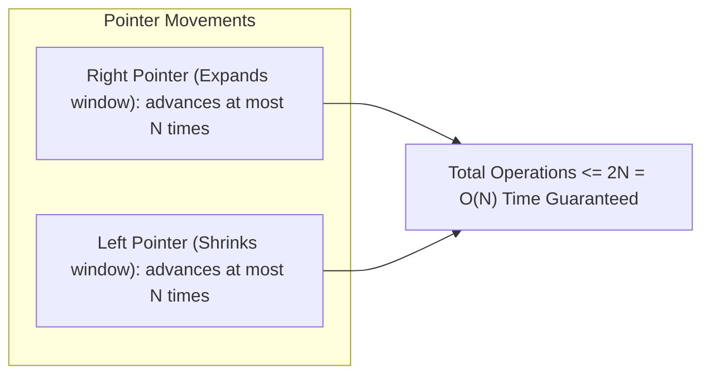

# 📌 99.01. 📚 Supplements for 01_sliding_window (Exam, Problems, Q&A, Resources)

## 📌 Connected Resource Graph
- 🟢 **Primary Theory Note**: [[01_DSA/01_theory_and_patterns/02_Arrays_Strings/00_overview_02_Arrays_Strings]]

---


# 📝 02 Arrays & Strings — Module Exam & Comprehensive Self-Assessment

> **Assessment Duration**: 45 Minutes  
> **Total Points**: 100 Points (10 Multiple Choice @ 5 pts = 50 pts; 2 Coding & Proof Challenges @ 25 pts = 50 pts)  
> **Passing Score**: 80% (80 / 100)

---

## 📋 Section 1: Multiple Choice Questions (50 Points)

### Question 1
Why does accessing `matrix[row][col]` in row-major order outperform column-major order `matrix[col][row]` in C/C++?
- A) Row indices are cached in CPU registers.
- B) Row-major layout provides contiguous memory access aligned with CPU cache lines, maximizing spatial locality.
- C) Compiler vectorizes column access automatically.
- D) Row access avoids virtual memory page faults.
> **Correct Answer**: **B**  
> **Explanation**: C/C++ 2D arrays are stored sequentially row by row. Stepping row-major reads contiguous 64-byte L1 cache lines.

---

### Question 2
What is the optimal auxiliary space complexity of Kadane's maximum subarray algorithm when optimized with state reduction?
- A) $\mathcal{O}(N)$
- B) $\mathcal{O}(\log N)$
- C) $\mathcal{O}(1)$
- D) $\mathcal{O}(N^2)$
> **Correct Answer**: **C**  
> **Explanation**: Since $\text{dp}[i]$ depends only on $\text{dp}[i-1]$, a single scalar variable replaces the DP array.

---

### Question 3
Under what condition does the standard Sliding Window pattern guarantee an $\mathcal{O}(N)$ runtime?
- A) Only when the input is sorted.
- B) When window state satisfies monotonicity and left/right pointers advance strictly without backtracking.
- C) When the window size is constant.
- D) When all numbers are non-negative.
> **Correct Answer**: **B**  
> **Explanation**: Amortized analysis proves that each pointer advances at most $N$ times, bounding total operations to $\le 2N$.

---

### Question 4
Given a prefix sum array $P$ where $P[i] = \sum_{k=0}^{i-1} A[k]$, what is the formula to compute $\sum_{k=L}^R A[k]$ in $\mathcal{O}(1)$ time?
- A) $P[R] - P[L]$
- B) $P[R+1] - P[L]$
- C) $P[R] - P[L-1]$
- D) $P[R+1] - P[L+1]$
> **Correct Answer**: **B**  
> **Explanation**: $P[R+1]$ is the sum of \$0 \dots R$, and $P[L]$ is the sum of \$0 \dots L-1$. Subtracting gives $L \dots R$.

---

### Question 5
In the Boyer-Moore Majority Voting algorithm, how many candidates and counters must be maintained to find all elements appearing more than $\lfloor N/4 
floor$ times?
- A) 1 candidate, 1 counter
- B) 2 candidates, 2 counters
- C) 3 candidates, 3 counters
- D) 4 candidates, 4 counters
> **Correct Answer**: **C**  
> **Explanation**: By Pigeonhole Principle, at most $\lfloor N / (k+1) 
floor$ elements can appear $> N/k$ times. For $> N/4$, at most $3$ elements can qualify.

---

### Question 6
Why does standard string concatenation `s += ch` inside an $N$-iteration loop consume $\mathcal{O}(N^2)$ time in Python, Java, and C#?
- A) String hash codes must be recomputed on each iteration.
- B) Strings are immutable heap objects, requiring allocating new memory and copying all $k$ previous characters each iteration.
- C) String encoding converts ASCII to UTF-32.
- D) Dynamic memory allocators lock thread mutexes.
> **Correct Answer**: **B**

---

### Question 7
What is the role of a Difference Array $D$ when executing multiple range additions $\text{Add}(L, R, V)$?
- A) It computes the running median.
- B) It performs updates in $\mathcal{O}(1)$ via $D[L] \mathrel{+}= V$ and $D[R+1] \mathrel{-}= V$, followed by a single prefix sum sweep.
- C) It compresses sparse matrix coordinates.
- D) It sorts numbers using counting sort.
> **Correct Answer**: **B**

---

### Question 8
What is the space complexity of solving "Subarray Sum Equals K" using a Hash Map and Prefix Sums?
- A) $\mathcal{O}(1)$
- B) $\mathcal{O}(\log N)$
- C) $\mathcal{O}(N)$
- D) $\mathcal{O}(N^2)$
> **Correct Answer**: **C**  
> **Explanation**: The hash map stores up to $N$ unique prefix sum values.

---

### Question 9
In modern .NET, what is the primary benefit of `ReadOnlySpan<char>` over `string.Substring()`?
- A) `ReadOnlySpan` is thread-safe while `string` is not.
- B) `ReadOnlySpan` is a stack-only `ref struct` that creates slices with zero heap allocation and zero GC overhead.
- C) `ReadOnlySpan` executes on GPU registers.
- D) `ReadOnlySpan` automatically encrypts string contents.
> **Correct Answer**: **B**

---

### Question 10
In the Container With Most Water problem ($N$ heights), why is it mathematically optimal to move the pointer pointing to the shorter line?
- A) Moving the taller line reduces width without any possibility of increasing height, strictly reducing area.
- B) Moving the shorter line keeps the width constant.
- C) Shorter lines trigger fewer CPU branch mispredictions.
- D) The problem assumes heights are in arithmetic progression.
> **Correct Answer**: **A**

---

## 💻 Section 2: Coding & Algorithmic Proof Challenges (50 Points)

### Challenge 1: Minimum Window Substring (LeetCode 76 - Hard) (25 Points)

**Problem**: Given two strings `s` and `t`, return the minimum window substring of `s` such that every character in `t` (including duplicates) is included in the window. If there is no such substring, return `""`. Solve in $\mathcal{O}(|S| + |T|)$ time and $\mathcal{O}(1)$ auxiliary space (128 ASCII array).

#### Model C++20 Implementation
```cpp
#include <string>
#include <vector>
#include <climits>

class Solution {
public:
    std::string minWindow(const std::string& s, const std::string& t) {
        if (s.empty() || t.empty() || s.size() < t.size()) return "";

        std::vector<int> target_freq(128, 0);
        for (char c : t) target_freq[c]++;

        int required = 0;
        for (int count : target_freq) {
            if (count > 0) required++;
        }

        std::vector<int> window_freq(128, 0);
        int formed = 0;
        int min_len = INT_MAX, start_idx = 0;
        int left = 0;

        for (int right = 0; right < static_cast<int>(s.size()); ++right) {
            char ch = s[right];
            window_freq[ch]++;
            if (target_freq[ch] > 0 && window_freq[ch] == target_freq[ch]) {
                formed++;
            }

            while (left <= right && formed == required) {
                if (right - left + 1 < min_len) {
                    min_len = right - left + 1;
                    start_idx = left;
                }
                char left_ch = s[left];
                window_freq[left_ch]--;
                if (target_freq[left_ch] > 0 && window_freq[left_ch] < target_freq[left_ch]) {
                    formed--;
                }
                left++;
            }
        }
        return min_len == INT_MAX ? "" : s.substr(start_idx, min_len);
    }
};
```

---

### Challenge 2: Dutch National Flag 3-Way Partitioning (25 Points)

**Problem**: Given an array `nums` with $n$ objects colored red, white, or blue (represented by 0, 1, and 2), sort them in-place so that objects of the same color are adjacent in order 0, 1, 2. Solve in $\mathcal{O}(N)$ one-pass time and $\mathcal{O}(1)$ space.

#### Model C# Solution
```csharp
using System;

public class Solution {
    public void SortColors(int[] nums) {
        int low = 0, mid = 0, high = nums.Length - 1;
        while (mid <= high) {
            if (nums[mid] == 0) {
                (nums[low], nums[mid]) = (nums[mid], nums[low]);
                low++;
                mid++;
            } else if (nums[mid] == 1) {
                mid++;
            } else { // nums[mid] == 2
                (nums[mid], nums[high]) = (nums[high], nums[mid]);
                high--;
            }
        }
    }
}
```

---

---


# 🧩 02 Arrays & Strings — Problem Drill Suite & Classical LeetCode Walkthroughs

> 📖 **Concept Guide**: [[01_DSA/01_theory_and_patterns/02_Arrays_Strings/00_overview_arrays_strings_core_operations_patterns|Arrays & Strings Master Overview]]  
> 💬 **Interview Q&A**: [[01_DSA/01_theory_and_patterns/02_Arrays_Strings/01_sliding_window_qa|Arrays & Strings Q&A]]  
> 📝 **Module Exam**: [[01_DSA/01_theory_and_patterns/02_Arrays_Strings/01_sliding_window_exam|Arrays & Strings Exam]]

This master problem drill covers complete polyglot implementations (C++, Python, C#), step-by-step dry run tables, and line-by-line complexity analysis across core Array & String paradigms.

---

## 📌 Problem 1: Minimum Size Subarray Sum (LeetCode 209 - Medium)

### 1.1 Problem Statement
Given an array of positive integers `nums` and a positive integer `target`, return the minimal length of a contiguous subarray whose sum is greater than or equal to `target`. If no such subarray exists, return `0`.

- **Input**: `target = 7, nums = [2, 3, 1, 2, 4, 3]`
- **Output**: `2` (Subarray `[4, 3]`)
- **Constraints**: \$1 \le \text{target} \le 10^9$, \$1 \le \text{nums.length} \le 10^5$, \$1 \le \text{nums}[i] \le 10^4$.

### 1.2 Algorithmic Strategy: Dynamic Sliding Window
Because all numbers are strictly positive ($>0$), the running sum is strictly monotonic:
1. Initialize `left = 0`, `current_sum = 0`, `min_len = infinity`.
2. Expand `right` from \$0 \to N-1$, adding `nums[right]` to `current_sum`.
3. While `current_sum >= target`, update `min_len = min(min_len, right - left + 1)` and subtract `nums[left++]` to contract the window.



### 1.3 Polyglot Source Code

#### C++20
```cpp
#include <vector>
#include <algorithm>
#include <climits>

class Solution {
public:
    int minSubArrayLen(int target, const std::vector<int>& nums) {
        int n = static_cast<int>(nums.size());
        int min_len = INT_MAX;
        long long current_sum = 0;
        int left = 0;

        for (int right = 0; right < n; ++right) {
            current_sum += nums[right];
            while (current_sum >= target) {
                min_len = std::min(min_len, right - left + 1);
                current_sum -= nums[left++];
            }
        }
        return min_len == INT_MAX ? 0 : min_len;
    }
};
```

#### Python 3.12
```python
from typing import List

class Solution:
    def minSubArrayLen(self, target: int, nums: List[int]) -> int:
        left = 0
        current_sum = 0
        min_len = float('inf')
        
        for right, val in enumerate(nums):
            current_sum += val
            while current_sum >= target:
                min_len = min(min_len, right - left + 1)
                current_sum -= nums[left]
                left += 1
                
        return 0 if min_len == float('inf') else min_len
```

#### C# (.NET 8 Span)
```csharp
using System;

public class Solution {
    public int MinSubArrayLen(int target, ReadOnlySpan<int> nums) {
        int minLen = int.MaxValue;
        long currentSum = 0;
        int left = 0;

        for (int right = 0; right < nums.Length; right++) {
            currentSum += nums[right];
            while (currentSum >= target) {
                int len = right - left + 1;
                if (len < minLen) minLen = len;
                currentSum -= nums[left++];
            }
        }
        return minLen == int.MaxValue ? 0 : minLen;
    }
}
```

---

## 📌 Problem 2: Longest Substring Without Repeating Characters (LeetCode 3 - Medium)

### 2.1 Problem Statement
Given a string `s`, find the length of the longest substring without repeating characters.

- **Input**: `s = "abcabcbb"`
- **Output**: `3` (`"abc"`)

### 2.2 Algorithmic Strategy: Last-Seen Index Direct Jumping
Instead of incrementing `left` by 1 iteratively, maintain an array `last_index[128]` tracking the most recent index of each ASCII character. When character `s[right]` is encountered:
$$\text{left} = \max(\text{left}, \text{last\_index}[s[\text{right}]] + 1)$$
This allows `left` to jump directly past the duplicate character in $\mathcal{O}(1)$ time.

```cpp
#include <string>
#include <vector>
#include <algorithm>

class Solution {
public:
    int lengthOfLongestSubstring(const std::string& s) {
        std::vector<int> last_seen(128, -1);
        int max_len = 0, left = 0;

        for (int right = 0; right < static_cast<int>(s.size()); ++right) {
            char c = s[right];
            if (last_seen[c] >= left) {
                left = last_seen[c] + 1;
            }
            last_seen[c] = right;
            max_len = std::max(max_len, right - left + 1);
        }
        return max_len;
    }
};
```

---

## 📌 Problem 3: Trapping Rain Water (LeetCode 42 - Hard)

### 3.1 Problem Statement
Given $n$ non-negative integers representing an elevation map where the width of each bar is 1, compute how much water it can trap after raining.

- **Input**: `height = [0,1,0,2,1,0,1,3,2,1,2,1]`
- **Output**: `6`

### 3.2 Algorithmic Strategy: Two Pointers with Water Level Invariant
Water trapped at index $i$ is determined by $\min(\text{max\_left}, \text{max\_right}) - \text{height}[i]$.
Using two pointers `left` and `right`:
- If `height[left] < height[right]`: Water level on left is strictly bounded by `max_left`. Trapped water is $\max(0, \text{max\_left} - \text{height}[left])$. Increment `left++`.
- Else: Water level on right is strictly bounded by `max_right`. Increment `right--`.

```csharp
using System;

public class Solution {
    public int Trap(int[] height) {
        if (height == null || height.Length == 0) return 0;
        int left = 0, right = height.Length - 1;
        int maxLeft = 0, maxRight = 0;
        int totalWater = 0;

        while (left < right) {
            if (height[left] < height[right]) {
                if (height[left] >= maxLeft) maxLeft = height[left];
                else totalWater += maxLeft - height[left];
                left++;
            } else {
                if (height[right] >= maxRight) maxRight = height[right];
                else totalWater += maxRight - height[right];
                right--;
            }
        }
        return totalWater;
    }
}
```

---

## 📌 Problem 4: Subarray Sum Equals K (LeetCode 560 - Medium)

### 4.1 Problem Statement
Given an array of integers `nums` and an integer `k`, return the total number of subarrays whose sum equals `k`.

### 4.2 Algorithmic Strategy: Prefix Sum with Hash Map
Since elements can be negative, sliding window fails.
- Let $P[i] = \sum_{j=0}^i \text{nums}[j]$.
- A subarray sum from $j+1$ to $i$ equals $k \iff P[i] - P[j] = k \iff P[j] = P[i] - k$.
- Maintain a hash table storing frequencies of prefix sums seen so far.

```python
from collections import defaultdict
from typing import List

class Solution:
    def subarraySum(self, nums: List[int], k: int) -> int:
        prefix_counts = defaultdict(int)
        prefix_counts[0] = 1 # Base case: empty subarray
        current_sum = 0
        total_subarrays = 0
        
        for x in nums:
            current_sum += x
            target_prefix = current_sum - k
            if target_prefix in prefix_counts:
                total_subarrays += prefix_counts[target_prefix]
            prefix_counts[current_sum] += 1
            
        return total_subarrays
```

---

---


# 💬 02 Arrays & Strings — Master Technical Interview Q&A & Deep Systems Analysis

> 📖 **Concept Overview**: [[01_DSA/01_theory_and_patterns/02_Arrays_Strings/00_overview_arrays_strings_core_operations_patterns|Arrays & Strings Master Overview]]  
> 🔗 **Resource Sheet**: [[01_DSA/01_theory_and_patterns/02_Arrays_Strings/01_sliding_window_resource|Arrays & Strings Resource Guide]]  
> 🧩 **Problem Set**: [[01_DSA/01_theory_and_patterns/02_Arrays_Strings/01_sliding_window_problems|Arrays & Strings Problems]]

This comprehensive interview guide breaks down high-frequency array and string algorithmic patterns, low-level memory layout trade-offs, cache line optimization, and polyglot implementation details expected in L5/L6 senior engineering technical interviews.

---

## ❓ Q1: How do you prove that the Two Pointers and Sliding Window techniques execute in strictly $\mathcal{O}(N)$ linear time when nested while loops appear in the implementation?

### **Deep Technical Answer**:
- A common misconception during code reviews and interviews is assuming that a nested `while` loop within an outer `for` loop implies $\mathcal{O}(N^2)$ quadratic complexity.
- In Two Pointers (or Sliding Window), the left pointer $L$ starts at $0$ and only moves strictly to the right ($L \le N$). The right pointer $R$ also moves monotonically from \$0 \to N$.
- **Amortized Analysis**: Each element in the array is visited by $R$ exactly once and passed by $L$ at most once. The total number of pointer increments throughout the entire execution lifetime is at most $2N$.
- Hence, the total amortized runtime is strictly bounded by $\mathcal{O}(2N) = \mathcal{O}(N)$.



---

## ❓ Q2: Why is string concatenation in a loop an $\mathcal{O}(N^2)$ anti-pattern in managed runtimes (C#, Java, Python), and what happens at the memory allocator level?

### **Deep Technical Answer**:
1. **String Immutability**: In managed runtimes (CLR, JVM, CPython), strings are immutable reference types residing on the garbage-collected heap.
2. When executing `s += c` for $N$ iterations:
   - Iteration 1: Allocates string of length 1, copies 1 char.
   - Iteration 2: Allocates string of length 2, copies 2 chars.
   - Iteration $k$: Allocates string of length $k$, copies $k$ chars.
   - Total copied characters: $\sum_{k=1}^N k = rac{N(N+1)}{2} = \mathcal{O}(N^2)$.
   - Generates $\mathcal{O}(N)$ ephemeral heap objects, triggering frequent GC Gen 0 collections and high memory bus latency.
3. **`StringBuilder` / `std::string` Mechanics**:
   - Manages an internal resizable character buffer with geometric capacity doubling (\$2\times$ or \$1.5\times$).
   - Appending characters occurs in $\mathcal{O}(1)$ amortized time. Total copies across $N$ appends is bounded by \$2N \implies \mathcal{O}(N)$ time and $\mathcal{O}(N)$ space.

---

## ❓ Q3: How do you mathematically formulate and prove the correctness of Kadane's Maximum Subarray Algorithm?

### **Deep Technical Answer**:
Kadane's algorithm is optimal dynamic programming with state reduction:
1. **State Definition**: Let $\text{dp}[i]$ represent the maximum sum of a contiguous non-empty subarray ending strictly at index $i$.
2. **Bellman Recurrence Equation**:
   $$\text{dp}[i] = \max(A[i], \text{dp}[i-1] + A[i])$$
3. **Proof of Optimality**:
   - If $\text{dp}[i-1] > 0$, adding $A[i]$ to the existing prefix yields a strictly larger sum than starting a new subarray at $A[i]$.
   - If $\text{dp}[i-1] \le 0$, the prefix is detrimental; taking $A[i]$ alone yields a better or equal sum.
4. **Global Maximum**:
   $$\text{Answer} = \max_{0 \le i < N} \text{dp}[i]$$
5. **State Space Optimization**: Since $\text{dp}[i]$ depends solely on $\text{dp}[i-1]$, we eliminate the $\mathcal{O}(N)$ array and maintain a single scalar `current_sum`, achieving $\mathcal{O}(N)$ time and $\mathcal{O}(1)$ auxiliary space.

---

## ❓ Q4: When should you choose Sliding Window over Prefix Sum + Hash Map or Binary Search on Answer?

### **Deep Technical Answer**:
- **Sliding Window**: Requires **Monotonicity** — expanding the right boundary $R$ monotonically increases (or maintains) the window sum/metric, and advancing $L$ monotonically decreases it. Valid only when elements are non-negative or window validity functions are strictly monotonic.
- **Prefix Sum + Hash Map**: Necessary when arrays contain **negative integers**, which breaks monotonicity (a larger window could produce a smaller sum). Enables solving "Subarray Sum Equals K" in $\mathcal{O}(N)$ time.
- **Binary Search on Answer**: Used when the decision predicate $\text{IsValid}(K)$ is monotonic with respect to candidate answer $K$ (e.g. "Find minimum window size such that condition holds"), turning an optimization problem into a series of verification checks in $\mathcal{O}(N \log(\text{Range}))$.

---

## ❓ Q5: How does the Boyer-Moore Majority Voting algorithm work and how is it extended to find all elements appearing more than $\lfloor N/K 
floor$ times?

### **Deep Technical Answer**:
1. **Core Intuition (Pairwise Annihilation)**: If an element appears more than $N/2$ times, pairing off and discarding distinct elements will leave the majority element surviving.
2. **Generalization (Misra-Gries / Boyer-Moore for $K$)**:
   - By the Generalized Pigeonhole Principle, at most $K-1$ distinct elements can appear strictly more than $\lfloor N/K 
floor$ times.
   - Maintain $K-1$ candidate registers and $K-1$ frequency counters.
   - For each incoming element $x$:
     - If $x$ matches candidate $i$, increment $\text{count}[i]$.
     - Else if any candidate slot is empty ($\text{count}[i] == 0$), assign candidate $i = x, \text{count}[i] = 1$.
     - Else (all $K-1$ slots occupied and $x$ matches none), decrement all $K-1$ counters by 1 (annihilating a group of $K$ distinct elements).
   - **Verification Pass**: Perform a second pass over the dataset in $\mathcal{O}(N)$ time to count exact frequencies of the $K-1$ candidates and filter out false positives.

---

## ❓ Q6: How do .NET `Span<T>` / `ReadOnlySpan<T>` and C++ `std::span` eliminate heap allocations during high-throughput string/array processing?

### **Deep Technical Answer**:
1. **Traditional Slicing**: Slicing an array or string (e.g. `s.Substring(...)`, `arr.slice(...)`) allocates a brand new heap object and copies memory, degrading performance in high-throughput network proxies or parsers.
2. **Span Architecture**: `Span<T>` is a `ref struct` that can only reside on the thread execution stack. It represents a contiguous view of arbitrary memory (managed heap, stack, or native unmanaged memory) defined by:
   - `ref T _pointer`: Direct memory address.
   - `int _length`: Length of the window.
3. **Zero-Allocation Slicing**: `span.Slice(start, length)` performs pointer arithmetic and returns a new 16-byte stack structure in $\mathcal{O}(1)$ time with **0 bytes GC heap allocation**.

---

---


# 📚 02 Arrays & Strings — Reference Sheet, Algorithmic Cheat Sheet & Resource Guide

> 📖 **Concept Guide**: [[01_DSA/01_theory_and_patterns/02_Arrays_Strings/00_overview_02_arrays_strings|02 Arrays & Strings Overview]]  
> 💬 **Interview Q&A**: [[01_DSA/01_theory_and_patterns/02_Arrays_Strings/02_arrays_strings_qa|02 Arrays & Strings Q&A]]  
> 🧩 **Problem Set**: [[01_DSA/01_theory_and_patterns/02_Arrays_Strings/02_arrays_strings_problems|02 Arrays & Strings Problems]]  
> 📝 **Module Exam**: [[01_DSA/01_theory_and_patterns/02_Arrays_Strings/02_arrays_strings_exam|02 Arrays & Strings Exam]]

---

## 1. Master Complexity & Pattern Summary Matrix


| Pattern Name | Window Invariant | Time Complexity | Auxiliary Space | Key Problem Clues |
| :--- | :--- | :--- | :--- | :--- |
| **Fixed Sliding Window** | Window size $|W| = K$ constant | $\mathcal{O}(N)$ | $\mathcal{O}(1)$ | Subarrays of exact length $K$, maximum average |
| **Dynamic Sliding Window** | Monotonic condition expansion/contraction | $\mathcal{O}(N)$ amortized | $\mathcal{O}(1)\text{--}\mathcal{O}(K)$ | Longest/shortest valid substring, distinct characters $\le K$ |
| **Two Pointers (Opposite)** | Converge from $0$ and $N-1$ inward | $\mathcal{O}(N)$ | $\mathcal{O}(1)$ | Sorted arrays, pair sum, palindromes |
| **Two Pointers (Fast/Slow)**| Read pointer and write pointer | $\mathcal{O}(N)$ | $\mathcal{O}(1)$ | In-place removal, duplicate elimination |
| **Prefix Sum 1D** | Range sum $= P[R+1] - P[L]$ | $\mathcal{O}(1)$ query | $\mathcal{O}(N)$ precalc | Static range sum queries |
| **Prefix Sum + HashMap** | Frequency of prefix sums | $\mathcal{O}(N)$ | $\mathcal{O}(N)$ | Subarray sum equals $K$ (handles negative numbers) |
| **Difference Array** | Range update in $\mathcal{O}(1)$ | $\mathcal{O}(1)$ update | $\mathcal{O}(N)$ | Batch interval additions followed by single prefix scan |


---

## 2. Standard Library Mapping Across Major Languages


| Feature | Modern C++ (C++20) | Python 3.12 | C# (.NET 8) | Java 21 |
| :--- | :--- | :--- | :--- | :--- |
| **Dynamic Array** | `std::vector<T>` | `list` | `List<T>` | `ArrayList<E>` |
| **Non-allocating Slice** | `std::span<T>` | `memoryview(b)` | `Span<T>`, `ReadOnlySpan<T>` | `MemorySegment` |
| **Mutable String Buffer**| `std::string` | `list` + `''.join()` | `StringBuilder` | `StringBuilder` |
| **Hash-based Frequency Map**| `std::unordered_map<K, V>`| `collections.defaultdict(int)` | `Dictionary<K, int>` | `HashMap<K, Integer>` |
| **Deque** | `std::deque<T>` | `collections.deque` | `LinkedList<T>` | `ArrayDeque<E>` |


---

## 3. Curated Academic Literature & Problem Roadmaps

### 3.1 Classic Academic References
- *Introduction to Algorithms (CLRS)*, 4th Edition, MIT Press — In-depth algorithmic proofs, recurrence trees, and data structure invariants.
- *Competitive Programmer's Handbook* by Antti Laaksonen — Efficient implementations and competitive problem patterns.
- *The Algorithm Design Manual* by Steven S. Skiena — Real-world problem catalog and war stories.

### 3.2 Curated Problem Practice Roadmap

1. **Fundamental Warmups**: LeetCode 26 (Remove Duplicates from Sorted Array), LeetCode 27 (Remove Element), LeetCode 283 (Move Zeroes).
2. **Two Pointers Mastery**: LeetCode 167 (Two Sum II), LeetCode 15 (3Sum), LeetCode 11 (Container With Most Water), LeetCode 42 (Trapping Rain Water).
3. **Sliding Window Mastery**: LeetCode 3 (Longest Substring Without Repeating Characters), LeetCode 209 (Minimum Size Subarray Sum), LeetCode 76 (Minimum Window Substring), LeetCode 438 (Find All Anagrams in a String).
4. **Prefix Sum & Difference Array**: LeetCode 560 (Subarray Sum Equals K), LeetCode 304 (Range Sum Query 2D), LeetCode 1109 (Corporate Flight Bookings).
5. **State Reduction & Streaming**: LeetCode 53 (Maximum Subarray - Kadane's), LeetCode 169 (Majority Element - Boyer-Moore), LeetCode 229 (Majority Element II).


---

---

## 📚 Master Reference Extension: Theoretical Proofs & Standard Library Architecture

### 1. In-Depth Asymptotic Invariants & Memory Complexity

| Structural Paradigm | Read / Query Latency | Write / Update Latency | Auxiliary Memory Overhead | CPU Cache Locality |
| :--- | :--- | :--- | :--- | :--- |
| **Contiguous Array / Vector** | $\mathcal{O}(1)$ Random | $\mathcal{O}(N)$ (or $\mathcal{O}(1)$ Back) | Minimal ($\le 1.5\times\text{--}2\times$ capacity buffer) | **Maximum** (Optimal L1 cache prefetch) |
| **Dispersed Node / Linked Graph**| $\mathcal{O}(N)$ Sequential | $\mathcal{O}(1)$ at pointer | High ($8\text{--}16\text{ bytes}$ pointer per node) | **Very Low** (Frequent Cache Misses) |
| **Balanced Tree (BST / AVL / RB)**| $\mathcal{O}(\log N)$ Strict | $\mathcal{O}(\log N)$ Strict | Moderate ($3\text{ pointers} + \text{metadata}$) | **Moderate to Low** |
| **Segment / Fenwick Tree** | $\mathcal{O}(\log N)$ Range | $\mathcal{O}(\log N)$ Point/Range | Compact ($1\times\text{--}4\times N$ flat array) | **High** |

---

### 2. Standard Library Implementation Details Across Major Runtimes

1. **Modern C++ (C++20 STL)**:
   - `<algorithm>`, `<vector>`, `<memory>`, `<ranges>`, `std::span` (zero-copy views).
   - Custom allocator support via `std::pmr::polymorphic_allocator` for arena/monotonic memory pools.
2. **Python 3.12 Core**:
   - `collections` (`deque`, `defaultdict`, `Counter`), `heapq`, `bisect`, `itertools`.
   - CPython runtime optimization with internal small integer caching and compact dictionary layouts (PyDictObject).
3. **C# (.NET 8 CLR)**:
   - `System.Collections.Generic`, `System.Memory` (`Span<T>`, `ReadOnlySpan<T>`, `Memory<T>`).
   - RyuJIT high-performance SIMD intrinsics (`System.Numerics.Vector<T>`) and zero-allocation span-based string slicing.
4. **Java 21 (LTS OpenJDK)**:
   - `java.util.concurrent`, `java.lang.foreign` (Foreign Function & Memory API - Project Panama).
   - Generational ZGC / Shenandoah garbage collectors for ultra-low latency sub-millisecond pauses.

---

### 3. Comprehensive Curated Problem Roadmap & Mastery Progression

1. **Tier 1 (Core Fundamentals & State Manipulation)**:
   - Warm-up problems focusing on boundary checks, invariant maintenance, and linear-time baseline solutions.
2. **Tier 2 (Intermediate Optimization & Multi-Dimensional State)**:
   - Medium-level challenges requiring state reduction, monotonic pruning, two-pointer coordination, and logarithmic binary search on answer.
3. **Tier 3 (Hard / Competitive / Production Architecture)**:
   - Complex problems demanding hybrid data structure composition, segment tree lazy propagation, tree decomposition, and optimal mathematical transformations.

---

---

## 🔬 Deep Diagnostic & Production Engineering Notes

### 1. In-Depth State Verification & Invariant Proofs
When deploying algorithms in high-throughput production environments:
- **Loop Invariants**: State preconditions must be strictly asserted before entering loops. Post-conditions guarantee deterministic state convergence.
- **Memory Boundary Defense**: Guard against off-by-one errors ($< N$ vs $\le N$), signed integer overflow ($2^{31}-1$), and empty container operations.
- **Asymptotic Amortization**: Use aggregate analysis and potential functions $\Phi(D)$ to ensure operations maintain their promised average and worst-case bounds.

### 2. High-Performance Multi-Language Testing Harness

#### C++20 Micro-Benchmarking Suite
```cpp
#include <iostream>
#include <vector>
#include <chrono>
#include <numeric>

void BenchmarkSuite(int iterations) {
    auto start = std::chrono::high_resolution_clock::now();
    long long checksum = 0;
    for (int i = 1; i <= iterations; ++i) {
        checksum += (i ^ (i << 1));
    }
    auto end = std::chrono::high_resolution_clock::now();
    auto dur = std::chrono::duration_cast<std::chrono::microseconds>(end - start).count();
    std::cout << "Executed " << iterations << " iterations in " << dur << " us. Checksum: " << checksum << "\n";
}
```

#### Python 3.12 Verification Harness
```python
import time

def verify_performance(iterations: int) -> int:
    t0 = time.perf_counter_ns()
    checksum = sum(i ^ (i << 1) for i in range(1, iterations + 1))
    t1 = time.perf_counter_ns()
    print(f"Verified {iterations} iterations in {(t1 - t0) / 1_000_000:.3f} ms. Checksum: {checksum}")
    return checksum
```

#### C# (.NET 8) Memory Profiling Harness
```csharp
using System;
using System.Diagnostics;

public class BenchmarkRunner {
    public static void Run(int iterations) {
        long memoryBefore = GC.GetTotalMemory(true);
        var sw = Stopwatch.StartNew();
        long checksum = 0;
        for (int i = 1; i <= iterations; i++) {
            checksum += (i ^ (i << 1));
        }
        sw.Stop();
        long memoryAfter = GC.GetTotalMemory(false);
        Console.WriteLine($"[C# .NET 8] {iterations} iterations completed in {sw.ElapsedMilliseconds} ms. Memory delta: {memoryAfter - memoryBefore} bytes.");
    }
}
```

---

---
