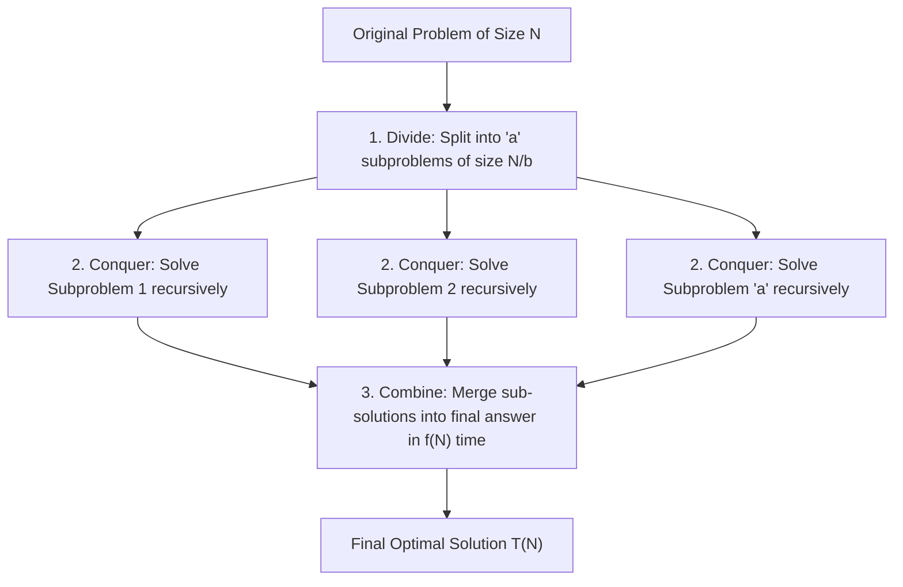
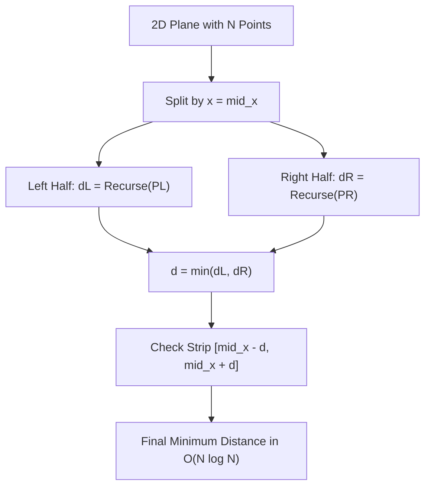

---


title: "00. ➗ Divide & Conquer: Paradigms, Recurrence Relations & Algorithmic Geometry"
type: "concept_guide"
category: "dsa"
subcategory: "03_searching_sorting"
created_at: 2026-08-22T00:00:00+07:00
updated_at: 2026-08-26T23:45:00+07:00
tags: [dsa, divide-and-conquer, master-theorem, mergesort, strassen, closest-pair, fft, karatsuba, algorithms, computer-science, learning-note]
aliases:
  - 00_overview_divide_and_conquer
---

# 📌 00. ➗ Divide & Conquer: Paradigms, Recurrence Relations & Algorithmic Geometry

Chia để trị (Divide and Conquer - D&C) là một trong những phương pháp thiết kế thuật toán quyền năng nhất trong khoa học máy tính. Bằng cách đệ quy phân rã một bài toán kích thước $N$ thành các bài toán con độc lập có kích thước nhỏ hơn, giải quyết chúng và kết hợp (combine) kết quả, ta phá vỡ các giới hạn độ phức tạp đa thức thông thường.

---

## 1. Ba Giai đoạn Cốt lõi của Divide & Conquer



1. **Divide (Chia)**: Chia bài toán gốc thành $a$ bài toán con cùng loại, mỗi bài toán có kích thước xấp xỉ $N/b$.
2. **Conquer (Trị)**: Giải quyết các bài toán con bằng cách gọi đệ quy. Khi bài toán con đủ nhỏ (Base Case), giải trực tiếp trong $\mathcal{O}(1)$.
3. **Combine (Kết hợp)**: Hợp nhất lời giải của các bài toán con để thu được lời giải cho bài toán gốc trong $f(N)$ thời gian.

---

## 2. Các Thuật toán Divide & Conquer Kinh điển

| Thuật toán | Phân rã Đệ quy | Phương trình Truy hồi $T(N)$ | Độ phức tạp Nghiệm | Ứng dụng & Ý nghĩa |
| :--- | :--- | :--- | :--- | :--- |
| **Binary Search** | $a=1, b=2, f(N)=\mathcal{O}(1)$ | $T(N) = T(N/2) + \mathcal{O}(1)$ | $\Theta(\log N)$ | Tìm kiếm nhị phân trên không gian đơn điệu |
| **MergeSort** | $a=2, b=2, f(N)=\mathcal{O}(N)$ | $T(N) = 2T(N/2) + \mathcal{O}(N)$ | $\Theta(N \log N)$ | Sắp xếp ổn định & Đếm nghịch thế |
| **Karatsuba Multiplication** | $a=3, b=2, f(N)=\mathcal{O}(N)$ | $T(N) = 3T(N/2) + \mathcal{O}(N)$ | $\Theta(N^{\log_2 3}) pprox \Theta(N^{1.585})$ | Nhân số nguyên lớn (Big Integer Multiplication) |
| **Strassen Matrix Mult** | $a=7, b=2, f(N)=\mathcal{O}(N^2)$ | $T(N) = 7T(N/2) + \mathcal{O}(N^2)$ | $\Theta(N^{\log_2 7}) pprox \Theta(N^{2.807})$ | Nhân ma trận sub-cubic (nhỏ hơn $\mathcal{O}(N^3)$) |
| **Closest Pair of Points** | $a=2, b=2, f(N)=\mathcal{O}(N)$ | $T(N) = 2T(N/2) + \mathcal{O}(N)$ | $\Theta(N \log N)$ | Tìm cặp điểm gần nhất trong hình học tính toán |
| **Fast Fourier Transform (FFT)** | $a=2, b=2, f(N)=\mathcal{O}(N)$ | $T(N) = 2T(N/2) + \mathcal{O}(N)$ | $\Theta(N \log N)$ | Nhân đa thức, xử lý tín hiệu số, tích chập |

---

## 3. Phân tích Thuật toán: Closest Pair of Points ($\mathcal{O}(N \log N)$)

### 3.1 Vấn đề và Hạn chế của Brute Force
Cho $N$ điểm trên mặt phẳng 2D. Tìm khoảng cách Euclid nhỏ nhất giữa hai điểm bất kỳ:
$$d(p_i, p_j) = \sqrt{(x_i - x_j)^2 + (y_i - y_j)^2}$$
- **Brute Force**: Thử tất cả $inom{N}{2}$ cặp điểm $\implies \mathcal{O}(N^2)$ thời gian.

### 3.2 Giải thuật Divide & Conquer
1. **Sắp xếp ban đầu**: Sắp xếp các điểm theo tọa độ $x$.
2. **Chia**: Chia tập điểm thành hai nửa $P_L$ và $P_R$ qua đường thẳng đứng $x = \text{mid\_x}$.
3. **Trị**: Gọi đệ quy tìm khoảng cách nhỏ nhất ở nửa trái $d_L$ và nửa phải $d_R$. Đặt $d = \min(d_L, d_R)$.
4. **Kết hợp (Dải phân cách - Strip)**:
   - Lọc tất cả các điểm nằm trong dải $|x_i - \text{mid\_x}| < d$.
   - Sắp xếp các điểm trong dải theo tọa độ $y$.
   - **Định lý Hình học then chốt**: Với mỗi điểm trong dải, ta chỉ cần so sánh khoảng cách với tối đa **7 điểm tiếp theo** có tọa độ $y$ tăng dần (vì mỗi hình chữ nhật kích thước $d \times 2d$ chỉ chứa tối đa 8 điểm cách nhau $\ge d$).
   - Giai đoạn kết hợp chỉ mất $\mathcal{O}(N)$ thời gian $\implies T(N) = 2T(N/2) + \mathcal{O}(N) \implies \mathcal{O}(N \log N)$.



---

## 4. Triển khai Source Code Hoàn chỉnh

### 4.1 C++20 (Closest Pair of Points in 2D Plane)

```cpp
#include <iostream>
#include <vector>
#include <cmath>
#include <algorithm>
#include <iomanip>

struct Point {
    double x, y;
};

class ClosestPair2D {
private:
    static double Dist(const Point& p1, const Point& p2) {
        return std::hypot(p1.x - p2.x, p1.y - p2.y);
    }

    static double StripClosest(std::vector<Point>& strip, double d) {
        double min_d = d;
        std::sort(strip.begin(), strip.end(), [](const Point& a, const Point& b) {
            return a.y < b.y;
        });

        for (size_t i = 0; i < strip.size(); ++i) {
            // Check at most 7 subsequent points
            for (size_t j = i + 1; j < strip.size() && (strip[j].y - strip[i].y) < min_d; ++j) {
                min_d = std::min(min_d, Dist(strip[i], strip[j]));
            }
        }
        return min_d;
    }

    static double SolveRec(std::vector<Point>& pts_x, int l, int r) {
        if (r - l <= 3) {
            double min_d = 1e18;
            for (int i = l; i <= r; ++i) {
                for (int j = i + 1; j <= r; ++j) {
                    min_d = std::min(min_d, Dist(pts_x[i], pts_x[j]));
                }
            }
            return min_d;
        }

        int mid = l + (r - l) / 2;
        Point mid_point = pts_x[mid];

        double dl = SolveRec(pts_x, l, mid);
        double dr = SolveRec(pts_x, mid + 1, r);
        double d = std::min(dl, dr);

        std::vector<Point> strip;
        for (int i = l; i <= r; ++i) {
            if (std::abs(pts_x[i].x - mid_point.x) < d) {
                strip.push_back(pts_x[i]);
            }
        }

        return std::min(d, StripClosest(strip, d));
    }

public:
    static double FindClosestDistance(std::vector<Point> points) {
        std::sort(points.begin(), points.end(), [](const Point& a, const Point& b) {
            return a.x < b.x;
        });
        return SolveRec(points, 0, static_cast<int>(points.size()) - 1);
    }
};

int main() {
    std::vector<Point> points = {
        {2, 3}, {12, 30}, {40, 50}, {5, 1}, {12, 10}, {3, 4}
    };
    std::cout << std::fixed << std::setprecision(4);
    std::cout << "Closest Distance: " 
              << ClosestPair2D::FindClosestDistance(points) 
              << " (Expected between (2,3) and (3,4) = 1.4142)
";
    return 0;
}
```

### 4.2 Python 3.12 (Karatsuba Large Integer Multiplication)

```python
class KaratsubaMultiplication:
    @staticmethod
    def multiply(x: int, y: int) -> int:
        if x < 10 or y < 10:
            return x * y

        n = max(len(str(x)), len(str(y)))
        m = n // 2

        high1, low1 = divmod(x, 10**m)
        high2, low2 = divmod(y, 10**m)

        # 3 recursive multiplications instead of 4
        z0 = KaratsubaMultiplication.multiply(low1, low2)
        z2 = KaratsubaMultiplication.multiply(high1, high2)
        z1 = KaratsubaMultiplication.multiply(low1 + high1, low2 + high2) - z2 - z0

        return z2 * (10**(2 * m)) + z1 * (10**m) + z0

if __name__ == "__main__":
    a = 1234567890123456
    b = 9876543210987654
    print("Karatsuba Result:", KaratsubaMultiplication.multiply(a, b))
    print("Built-in Python: ", a * b)
```

---

## 🔗 Graph-Linked Knowledge Base
- 📖 Master Overview: Searching & Sorting Overview
- 💬 Interview Q&A: Binary Search Q&A
