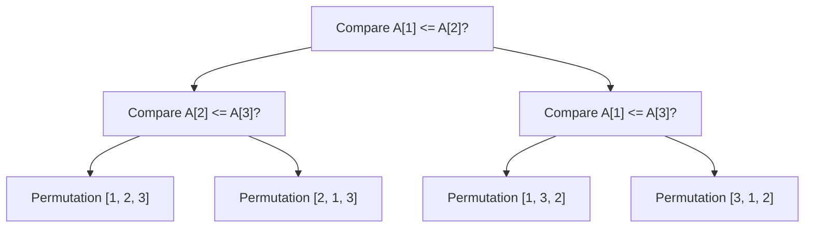
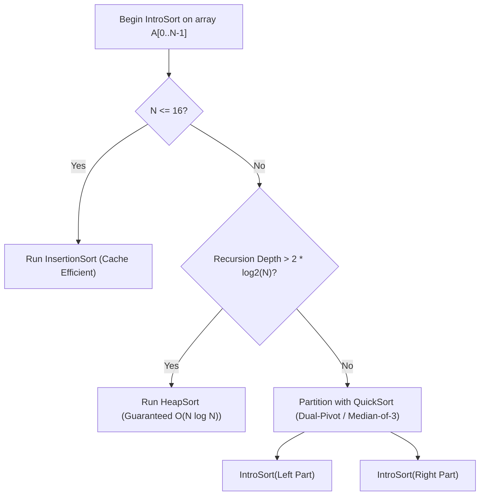

---


title: "00. 🔍 Searching & Sorting: Master Algorithmic Foundations, Theory & Engineering"
type: "concept_guide"
category: "dsa"
subcategory: "03_searching_sorting"
created_at: 2026-08-22T00:00:00+07:00
updated_at: 2026-08-26T23:45:00+07:00
tags: [dsa, searching, sorting, binary-search, quicksort, mergesort, heapsort, timsort, counting-sort, radix-sort, algorithms, computer-science, learning-note]
aliases:
  - 00_overview_searching_sorting_algorithms
---

# 📌 00. 🔍 Searching & Sorting: Master Algorithmic Foundations, Theory & Engineering

Searching and Sorting are foundational algorithmic paradigms in computer science. Sorting transforms arbitrary unstructured collections into monotonically ordered sequences, reducing search time from $\mathcal{O}(N)$ linear scan to $\mathcal{O}(\log N)$ logarithmic binary search, enabling efficient deduplication, range queries, and optimal scheduling.

---

## 1. Information-Theoretic Lower Bound for Comparison Sorting

### 1.1 Mathematical Proof of $\Omega(N \log N)$ Lower Bound
Any comparison-based sorting algorithm can be modeled as a **binary decision tree** where:
- Each internal node represents a binary comparison $A[i] \le A[j]$.
- Each leaf node represents a distinct permutation of the $N$ input elements.
- For $N$ distinct items, there are exactly $N!$ possible permutations.



Let $h$ be the height of the decision tree (the worst-case number of comparisons). A binary tree of height $h$ has at most $2^h$ leaves:
$$2^h \ge N! \implies h \ge \log_2(N!)$$

Applying **Stirling's Approximation** ($\ln(N!) = N \ln N - N + \mathcal{O}(\log N)$):
$$\log_2(N!) = \sum_{i=1}^N \log_2 i \ge \sum_{i=N/2}^N \log_2\left(rac{N}{2}
ight) = rac{N}{2} \log_2\left(rac{N}{2}
ight) = rac{N}{2} (\log_2 N - 1) = \Omega(N \log N)$$

**Conclusion**: No comparison-based sorting algorithm can achieve better than $\Omega(N \log N)$ worst-case time complexity.

---

## 2. Master Comparison of Sorting Algorithms

| Algorithm | Best Time | Average Time | Worst Time | Auxiliary Space | Stability | In-Place? | Key Paradigm & Use Case |
| :--- | :--- | :--- | :--- | :--- | :--- | :--- | :--- |
| **QuickSort** (Dual-Pivot) | $\mathcal{O}(N \log N)$ | $\mathcal{O}(N \log N)$ | $\mathcal{O}(N^2)$ / $\mathcal{O}(N \log N)$ | $\mathcal{O}(\log N)$ | No | Yes | Divide & conquer; default for primitives (`std::sort`) |
| **MergeSort** | $\mathcal{O}(N \log N)$ | $\mathcal{O}(N \log N)$ | $\mathcal{O}(N \log N)$ | $\mathcal{O}(N)$ | **Yes** | No | Divide & conquer; linked lists & external disk sort |
| **HeapSort** | $\mathcal{O}(N \log N)$ | $\mathcal{O}(N \log N)$ | $\mathcal{O}(N \log N)$ | $\mathcal{O}(1)$ | No | **Yes** | Priority queue heapify; guaranteed $\mathcal{O}(N \log N)$ in-place |
| **TimSort** | $\mathcal{O}(N)$ | $\mathcal{O}(N \log N)$ | $\mathcal{O}(N \log N)$ | $\mathcal{O}(N)$ | **Yes** | No | Hybrid Merge/Insertion; default in Python, Java, C# |
| **Insertion Sort** | $\mathcal{O}(N)$ | $\mathcal{O}(N^2)$ | $\mathcal{O}(N^2)$ | $\mathcal{O}(1)$ | **Yes** | **Yes** | Small arrays ($N \le 32$) and nearly sorted streams |
| **Counting Sort** | $\mathcal{O}(N + K)$ | $\mathcal{O}(N + K)$ | $\mathcal{O}(N + K)$ | $\mathcal{O}(K)$ | **Yes** | No | Non-comparison integer sorting over small range $[0, K]$ |
| **Radix Sort** (LSD/MSD) | $\mathcal{O}(D \cdot (N + B))$ | $\mathcal{O}(D \cdot (N + B))$ | $\mathcal{O}(D \cdot (N + B))$ | $\mathcal{O}(N + B)$ | **Yes** | No | Fixed-width integers, 64-bit keys, string keys |

---

## 3. Deep Algorithmic Mechanics

### 3.1 Introsort (Hybrid QuickSort + HeapSort + InsertionSort)
Modern standard libraries (e.g. `std::sort` in C++, `Array.Sort` in C#) implement **Introsort**:
1. Starts with **QuickSort** (Median-of-3 or Tukey's ninther pivot selection).
2. Tracks recursion depth limit: $\text{max\_depth} = 2 \lfloor \log_2 N 
floor$.
3. If recursion depth exceeds limit, switches immediately to **HeapSort** to guarantee $\mathcal{O}(N \log N)$ worst-case safety.
4. For small sub-arrays ($N \le 16\text{--}32$), switches to **Insertion Sort** to eliminate recursive overhead and maximize L1 cache hits.



### 3.2 Binary Search on Monotonic Predicates
Binary search is not merely for finding an element in a sorted list; it is a general framework to solve any optimization problem where a decision function $P(x) \in \{0, 1\}$ is monotonic:
$$P(x) = 0 \implies orall y \le x, P(y) = 0 \quad \text{and} \quad P(x) = 1 \implies orall y \ge x, P(y) = 1$$
We find the exact watershed boundary in $\mathcal{O}(\log(\text{Search Space}))$.

---

## 4. Polyglot Master Implementations

### 4.1 Modern C++20 (QuickSort with 3-Way Partitioning & Binary Search Template)

```cpp
#include <iostream>
#include <vector>
#include <span>
#include <algorithm>
#include <random>

class SearchSortMasterSuite {
public:
    // 3-Way Dutch National Flag QuickSort (Robust against duplicate keys)
    static void QuickSort3Way(std::span<int> arr, int low, int high) {
        if (low >= high) return;

        // Randomized pivot to defeat adversarial inputs
        int pivot_idx = low + rand() % (high - low + 1);
        std::swap(arr[low], arr[pivot_idx]);
        int pivot = arr[low];

        int lt = low, gt = high, i = low + 1;
        while (i <= gt) {
            if (arr[i] < pivot) {
                std::swap(arr[lt++], arr[i++]);
            } else if (arr[i] > pivot) {
                std::swap(arr[i], arr[gt--]);
            } else {
                i++;
            }
        }

        QuickSort3Way(arr, low, lt - 1);
        QuickSort3Way(arr, gt + 1, high);
    }

    // Binary Search on Answer Template: Find first element satisfying Predicate
    template <typename Predicate>
    static long long BinarySearchFirstTrue(long long low, long long high, Predicate pred) {
        long long ans = -1;
        while (low <= high) {
            long long mid = low + ((high - low) >> 1);
            if (pred(mid)) {
                ans = mid;
                high = mid - 1; // Seek smaller valid value on left
            } else {
                low = mid + 1;  // Condition not met, search right
            }
        }
        return ans;
    }
};

int main() {
    std::vector<int> nums = {4, 2, 7, 2, 4, 1, 9, 3, 2, 7};
    SearchSortMasterSuite::QuickSort3Way(nums, 0, static_cast<int>(nums.size()) - 1);

    std::cout << "Sorted with 3-Way QuickSort: ";
    for (int x : nums) std::cout << x << " ";
    std::cout << "
";

    // Example Binary Search on Answer: Find smallest x such that x * x >= 50
    auto pred = [](long long x) { return x * x >= 50; };
    long long ans = SearchSortMasterSuite::BinarySearchFirstTrue(1, 100, pred);
    std::cout << "Smallest x where x^2 >= 50: " << ans << " (Answer: 8)
";
    return 0;
}
```

### 4.2 Python 3.12 (MergeSort with Inversion Count & Binary Search on Answer)

```python
from typing import List, Tuple

class SearchSortMasterPython:
    @staticmethod
    def count_inversions(nums: List[int]) -> int:
        def merge_sort(arr: List[int]) -> Tuple[List[int], int]:
            if len(arr) <= 1:
                return arr, 0
                
            mid = len(arr) // 2
            left, left_inv = merge_sort(arr[:mid])
            right, right_inv = merge_sort(arr[mid:])
            
            merged = []
            inv = left_inv + right_inv
            i = j = 0
            
            while i < len(left) and j < len(right):
                if left[i] <= right[j]:
                    merged.append(left[i])
                    i += 1
                else:
                    merged.append(right[j])
                    inv += len(left) - i # All remaining elements in left are inversions!
                    j += 1
                    
            merged.extend(left[i:])
            merged.extend(right[j:])
            return merged, inv
            
        _, total_inv = merge_sort(nums)
        return total_inv

    @staticmethod
    def ship_within_days(weights: List[int], days: int) -> int:
        # LeetCode 1011: Capacity To Ship Packages Within D Days
        def can_ship(capacity: int) -> bool:
            needed_days = 1
            cur_load = 0
            for w in weights:
                if cur_load + w > capacity:
                    needed_days += 1
                    cur_load = w
                else:
                    cur_load += w
            return needed_days <= days

        low, high = max(weights), sum(weights)
        ans = high
        while low <= high:
            mid = low + ((high - low) >> 1)
            if can_ship(mid):
                ans = mid
                high = mid - 1
            else:
                low = mid + 1
        return ans

if __name__ == "__main__":
    nums = [8, 4, 2, 1]
    print("Total Inversions in [8, 4, 2, 1]:", SearchSortMasterPython.count_inversions(nums))
    print("Min Ship Capacity:", SearchSortMasterPython.ship_within_days([1,2,3,4,5,6,7,8,9,10], 5))
```

### 4.3 C# (.NET 8 Radix Sort & Memory-Optimized In-Place Merge)

```csharp
using System;

public static class SearchSortMasterCSharp {
    // 32-bit Integer Radix Sort (LSD 8-bit passes, O(4 * (N + 256)) = O(N))
    public static void RadixSort(int[] arr) {
        int n = arr.Length;
        int[] output = new int[n];

        // 4 passes for 32-bit integer (8 bits per pass, 256 buckets)
        for (int shift = 0; shift < 32; shift += 8) {
            int[] count = new int[256];

            for (int i = 0; i < n; i++) {
                int bucket = (arr[i] >> shift) & 0xFF;
                count[bucket]++;
            }

            for (int i = 1; i < 256; i++) {
                count[i] += count[i - 1];
            }

            for (int i = n - 1; i >= 0; i--) {
                int bucket = (arr[i] >> shift) & 0xFF;
                output[--count[bucket]] = arr[i];
            }

            Array.Copy(output, arr, n);
        }
    }

    public static void Main() {
        int[] data = { 170, 45, 75, 90, 802, 24, 2, 66 };
        RadixSort(data);
        Console.WriteLine("Radix Sorted: " + string.Join(", ", data));
    }
}
```

---

## 5. Architectural Trade-offs & Common Failure Modes

1. **Midpoint Overflow Bug**:
   - Computing `mid = (low + high) / 2` triggers integer overflow when `low + high > 2^{31} - 1`. Always compute `mid = low + ((high - low) >> 1)`.
2. **Infinite Loop in Binary Search**:
   - Occurs when bounds update rules mismatch interval closure (`[low, high]` vs `[low, high)`).
   - In closed interval `[low, high]`, loop condition is `while (low <= high)`, with updates `low = mid + 1` and `high = mid - 1`.
3. **Worst-Case $\mathcal{O}(N^2)$ QuickSort Killer**:
   - Picking fixed pivot (e.g. `arr[0]`) degrades to $\mathcal{O}(N^2)$ on already sorted arrays or duplicate elements. Always use **Randomized Pivot** or **3-Way Dutch Flag Partitioning**.

---

## 🔗 Graph-Linked Knowledge Base
- 📖 Divide & Conquer: Divide & Conquer Overview
- 💬 Interview Q&A: Binary Search & Sorting Q&A
- 🧩 Practice Suite: Binary Search Problems
- 📝 Module Exam: Binary Search & Sorting Exam
