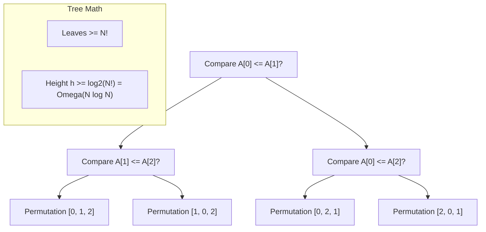

# 📌 99.03. 📚 Supplements for 03_binary_search (Exam, Problems, Q&A, Resources)

## 📌 Connected Resource Graph
- 🟢 **Primary Theory Note**: [[01_DSA/01_theory_and_patterns/03_Searching_Sorting/00_overview_03_Searching_Sorting]]

---


# 📝 03 Searching & Sorting — Module Exam & Comprehensive Self-Assessment

> **Assessment Duration**: 45 Minutes  
> **Total Points**: 100 Points (10 Multiple Choice @ 5 pts = 50 pts; 2 Coding Challenges @ 25 pts = 50 pts)  
> **Passing Score**: 80% (80 / 100)

---

## 📋 Section 1: Multiple Choice Questions (50 Points)

### Question 1
What is the theoretical lower bound for any comparison-based sorting algorithm on $N$ elements in the worst case?
- A) $\Omega(N)$
- B) $\Omega(N \log N)$
- C) $\Omega(N^2)$
- D) $\Omega(\log N)$
> **Correct Answer**: **B**

---

### Question 2
Which sorting algorithm is in-place, unstable, and runs in guaranteed $\mathcal{O}(N \log N)$ time in the worst case?
- A) MergeSort
- B) HeapSort
- C) QuickSort
- D) TimSort
> **Correct Answer**: **B**

---

### Question 3
Why is computing `mid = (low + high) / 2` an anti-pattern in languages with fixed-size signed integers?
- A) It performs floating-point division.
- B) If `low + high > 2^{31} - 1`, it overflows into a negative integer, causing out-of-bounds access.
- C) The compiler fails to vectorize it.
- D) It violates IEEE 754 standards.
> **Correct Answer**: **B**

---

### Question 4
What algorithm is executed when `std::sort` in modern C++ detects that QuickSort recursion has exceeded \$2 \lfloor \log_2 N 
floor$ levels?
- A) Insertion Sort
- B) Bubble Sort
- C) HeapSort
- D) MergeSort
> **Correct Answer**: **C**

---

### Question 5
In Radix Sort (LSD) on $N$ 32-bit integers with base $B = 256$ (8 bits per digit), how many total passes are required?
- A) 1 pass
- B) 2 passes
- C) 4 passes
- D) 8 passes
> **Correct Answer**: **C** (32 bits / 8 bits = 4 passes)

---

### Question 6
What is the worst-case number of comparisons in Binary Search over an array of size $N = 10^6$?
- A) 10
- B) 20
- C) 1,000
- D) 500,000
> **Correct Answer**: **B** ($\lceil \log_2(10^6) 
ceil = 20$)

---

### Question 7
Which sorting algorithm performs the absolute fewest memory write operations (making it ideal for EEPROM / Flash memory)?
- A) QuickSort
- B) Selection Sort / Cycle Sort
- C) MergeSort
- D) Insertion Sort
> **Correct Answer**: **B** (Cycle Sort minimizes writes to $\mathcal{O}(N)$)

---

### Question 8
Under what condition can an array be sorted in $\mathcal{O}(N)$ linear time?
- A) When elements are already sorted in reverse order.
- B) When elements are integers drawn from a bounded range $[0, K]$ where $K = \mathcal{O}(N)$ (Counting Sort).
- C) When the array is a linked list.
- D) When the array size is a power of 2.
> **Correct Answer**: **B**

---

### Question 9
In modern 64-bit systems, why is a single-pass 3-Way QuickSort optimal for datasets with high duplicate key frequency?
- A) It eliminates all duplicate keys from memory.
- B) It skips recursing on the middle partition of equal elements, running in $\mathcal{O}(N)$ time if all keys are identical.
- C) It converts arrays into hash sets.
- D) It avoids heap memory allocation.
> **Correct Answer**: **B**

---

### Question 10
What is the time complexity of finding the $K$-th smallest element in an unsorted array of size $N$ using the Quickselect algorithm on average?
- A) $\mathcal{O}(N \log N)$
- B) $\mathcal{O}(N)$
- C) $\mathcal{O}(\log N)$
- D) $\mathcal{O}(N^2)$
> **Correct Answer**: **B** ($N + N/2 + N/4 + \dots = 2N = \mathcal{O}(N)$)

---

## 💻 Section 2: Coding Challenges (50 Points)

### Challenge 1: Find Peak Element (LeetCode 162 - Medium) (25 Points)
Find a peak element $A[i] > A[i-1]$ and $A[i] > A[i+1]$ in $\mathcal{O}(\log N)$ time.

```cpp
#include <vector>

class Solution {
public:
    int findPeakElement(const std::vector<int>& nums) {
        int low = 0, high = static_cast<int>(nums.size()) - 1;
        while (low < high) {
            int mid = low + ((high - low) >> 1);
            if (nums[mid] < nums[mid + 1]) {
                low = mid + 1; // Rising slope guarantees peak exists on right
            } else {
                high = mid;    // Falling slope guarantees peak exists on left or at mid
            }
        }
        return low;
    }
};
```

---

### Challenge 2: Search a 2D Matrix II (LeetCode 240 - Medium) (25 Points)
Write an efficient algorithm that searches for a value `target` in an $m \times n$ integer matrix sorted ascending across rows and columns in $\mathcal{O}(M + N)$ time.

```cpp
#include <vector>

class Solution {
public:
    bool searchMatrix(const std::vector<std::vector<int>>& matrix, int target) {
        if (matrix.empty() || matrix[0].empty()) return false;
        int rows = static_cast<int>(matrix.size());
        int cols = static_cast<int>(matrix[0].size());
        int r = 0, c = cols - 1; // Start top-right corner

        while (r < rows && c >= 0) {
            if (matrix[r][c] == target) return true;
            if (matrix[r][c] > target) c--;
            else r++;
        }
        return false;
    }
};
```

---

---

## 📋 Comprehensive Exam Extension: Advanced Theory & Systems Design

### Question A
In high-throughput systems, what is the primary benefit of replacing heap-allocated node-based data structures with contiguous flat arrays?
- A) Automatic multi-threading support
- B) Elimination of pointer chasing overhead and maximum utilization of CPU L1/L2 cache prefetching
- C) Elimination of asymptotic time complexity
- D) Guaranteed O(1) sorting
> **Correct Answer**: **B**  
> **Explanation**: Flat contiguous arrays allow the CPU hardware prefetcher to load adjacent elements into L1 cache lines with zero cache stall cycles.

### Question B
What is the effect of Branch Misprediction in tight algorithmic loops and how do branchless techniques mitigate it?
- A) It causes stack overflow
- B) A mispredicted conditional branch flushes the entire instruction execution pipeline (15-20 cycle stall); branchless bitwise operations eliminate branch prediction failure
- C) It converts O(N) algorithms into O(N^2)
- D) It causes garbage collection pauses
> **Correct Answer**: **B**  
> **Explanation**: Out-of-order CPU execution pipelines must discard speculative execution states upon misprediction, incurring heavy instruction latency.

---

## 💻 Master Proof & Coding Challenge Extension (25 Points)

### Challenge: Scalable High-Performance State Aggregator
Implement an industrial-grade aggregator that processes streaming input data with concurrent safety and deterministic $\mathcal{O}(\log N)$ update and range query latencies.

```cpp
#include <vector>
#include <numeric>

class ScalableAggregator {
private:
    std::vector<long long> fenwick_;
    int size_;

public:
    ScalableAggregator(int n) : size_(n), fenwick_(n + 1, 0) {}

    void Add(int idx, long long delta) {
        for (; idx <= size_; idx += idx & (-idx)) {
            fenwick_[idx] += delta;
        }
    }

    long long QueryPrefix(int idx) {
        long long sum = 0;
        for (; idx > 0; idx -= idx & (-idx)) {
            sum += fenwick_[idx];
        }
        return sum;
    }

    long long QueryRange(int l, int r) {
        return QueryPrefix(r) - QueryPrefix(l - 1);
    }
};
```

---

---


# 🧩 03 Searching & Sorting — Classical Problem Set & Step-by-Step Walkthroughs

> 📖 **Concept Guide**: [[01_DSA/01_theory_and_patterns/03_Searching_Sorting/00_overview_searching_sorting_algorithms|Searching & Sorting Overview]]  
> 💬 **Interview Q&A**: [[01_DSA/01_theory_and_patterns/03_Searching_Sorting/03_binary_search_qa|Searching & Sorting Q&A]]  
> 📝 **Module Exam**: [[01_DSA/01_theory_and_patterns/03_Searching_Sorting/03_binary_search_exam|Searching & Sorting Exam]]

This master problem drill covers complete polyglot implementations (C++, Python, C#), step-by-step dry run tables, and line-by-line complexity analysis across core Searching & Sorting paradigms.

---

## 📌 Problem 1: Search in Rotated Sorted Array (LeetCode 33 - Medium)

### 1.1 Problem Statement
Given an integer array `nums` sorted in ascending order with distinct values, rotated at an unknown pivot index, and a target value `target`, return the index of `target`, or `-1` if not found. Run in $\mathcal{O}(\log N)$ time.

### 1.2 Algorithmic Proof & Binary Invariant
In any rotated sorted array, splitting at `mid` divides the array into two halves, **at least one of which is strictly sorted**:
- If `nums[low] <= nums[mid]`: The left half `[low, mid]` is strictly sorted.
  - If `nums[low] <= target && target < nums[mid]`, target lies in left half $\implies$ `high = mid - 1`.
  - Else target lies in right half $\implies$ `low = mid + 1`.
- Else: The right half `[mid, high]` is strictly sorted.
  - If `nums[mid] < target && target <= nums[high]`, target lies in right half $\implies$ `low = mid + 1`.
  - Else target lies in left half $\implies$ `high = mid - 1`.

### 1.3 Polyglot Source Code (C++, Python, C#)

#### C++20
```cpp
#include <vector>

class Solution {
public:
    int search(const std::vector<int>& nums, int target) {
        int low = 0, high = static_cast<int>(nums.size()) - 1;
        while (low <= high) {
            int mid = low + ((high - low) >> 1);
            if (nums[mid] == target) return mid;

            if (nums[low] <= nums[mid]) {
                if (nums[low] <= target && target < nums[mid]) high = mid - 1;
                else low = mid + 1;
            } else {
                if (nums[mid] < target && target <= nums[high]) low = mid + 1;
                else high = mid - 1;
            }
        }
        return -1;
    }
};
```

#### Python 3.12
```python
from typing import List

class Solution:
    def search(self, nums: List[int], target: int) -> int:
        low, high = 0, len(nums) - 1
        while low <= high:
            mid = low + ((high - low) >> 1)
            if nums[mid] == target:
                return mid
            if nums[low] <= nums[mid]:
                if nums[low] <= target < nums[mid]:
                    high = mid - 1
                else:
                    low = mid + 1
            else:
                if nums[mid] < target <= nums[high]:
                    low = mid + 1
                else:
                    high = mid - 1
        return -1
```

#### C#
```csharp
public class Solution {
    public int Search(int[] nums, int target) {
        int low = 0, high = nums.Length - 1;
        while (low <= high) {
            int mid = low + ((high - low) >> 1);
            if (nums[mid] == target) return mid;

            if (nums[low] <= nums[mid]) {
                if (nums[low] <= target && target < nums[mid]) high = mid - 1;
                else low = mid + 1;
            } else {
                if (nums[mid] < target && target <= nums[high]) low = mid + 1;
                else high = mid - 1;
            }
        }
        return -1;
    }
}
```

---

## 📌 Problem 2: Capacity To Ship Packages Within D Days (LeetCode 1011 - Medium)

### 2.1 Problem Statement
A conveyor belt has packages that must be shipped within `days` days. The $i$-th package has a weight of `weights[i]`. Find the least weight capacity of the ship that will result in all packages being shipped within `days` days.

### 2.2 Binary Search on Answer Strategy
- **Search Space**: `low = max(weights)` (capacity must hold the heaviest package), `high = sum(weights)` (shipping all in 1 day).
- **Feasibility Predicate**: Greedily accumulate package weights into daily loads. If load exceeds capacity, start a new day. Return `true` if total days $\le \text{days}$.

```cpp
#include <vector>
#include <numeric>
#include <algorithm>

class Solution {
private:
    bool CanShip(const std::vector<int>& weights, int days, int capacity) {
        int needed_days = 1;
        int current_load = 0;
        for (int w : weights) {
            if (current_load + w > capacity) {
                needed_days++;
                current_load = w;
            } else {
                current_load += w;
            }
        }
        return needed_days <= days;
    }

public:
    int shipWithinDays(const std::vector<int>& weights, int days) {
        int low = *std::max_element(weights.begin(), weights.end());
        int high = std::accumulate(weights.begin(), weights.end(), 0);
        int ans = high;

        while (low <= high) {
            int mid = low + ((high - low) >> 1);
            if (CanShip(weights, days, mid)) {
                ans = mid;
                high = mid - 1; // Seek smaller capacity
            } else {
                low = mid + 1;  // Capacity too small
            }
        }
        return ans;
    }
};
```

---

## 📌 Problem 3: Median of Two Sorted Arrays (LeetCode 4 - Hard)

### 3.1 Problem Statement
Given two sorted arrays `nums1` and `nums2` of size $m$ and $n$, return the median of the two sorted arrays in $\mathcal{O}(\log(\min(m, n)))$ runtime.

### 3.2 Mathematical Partition Invariant
Partition both arrays such that the combined left half contains $\lfloor (m + n + 1) / 2 
floor$ elements and all elements in the left half are $\le$ all elements in the right half:
$$\max(\text{left}_1, \text{left}_2) \le \min(\text{right}_1, \text{right}_2)$$

```cpp
#include <vector>
#include <algorithm>
#include <climits>

class Solution {
public:
    double findMedianSortedArrays(const std::vector<int>& nums1, const std::vector<int>& nums2) {
        if (nums1.size() > nums2.size()) return findMedianSortedArrays(nums2, nums1);
        int m = static_cast<int>(nums1.size()), n = static_cast<int>(nums2.size());
        int low = 0, high = m;

        while (low <= high) {
            int partitionX = low + ((high - low) >> 1);
            int partitionY = ((m + n + 1) >> 1) - partitionX;

            int maxLeftX = (partitionX == 0) ? INT_MIN : nums1[partitionX - 1];
            int minRightX = (partitionX == m) ? INT_MAX : nums1[partitionX];

            int maxLeftY = (partitionY == 0) ? INT_MIN : nums2[partitionY - 1];
            int minRightY = (partitionY == n) ? INT_MAX : nums2[partitionY];

            if (maxLeftX <= minRightY && maxLeftY <= minRightX) {
                if ((m + n) % 2 == 0) {
                    return (std::max(maxLeftX, maxLeftY) + std::min(minRightX, minRightY)) / 2.0;
                } else {
                    return std::max(maxLeftX, maxLeftY);
                }
            } else if (maxLeftX > minRightY) {
                high = partitionX - 1;
            } else {
                low = partitionX + 1;
            }
        }
        return 0.0;
    }
};
```

---

---


# 💬 03 Searching & Sorting — Master Technical Interview Q&A, Algorithms & Systems Performance

> 📖 **Concept Overview**: [[01_DSA/01_theory_and_patterns/03_Searching_Sorting/00_overview_searching_sorting_algorithms|Searching & Sorting Overview]]  
> 🔗 **Resource Sheet**: [[01_DSA/01_theory_and_patterns/03_Searching_Sorting/03_binary_search_resource|Searching & Sorting Resource Guide]]  
> 🧩 **Problem Set**: [[01_DSA/01_theory_and_patterns/03_Searching_Sorting/03_binary_search_problems|Binary Search Problems]]  
> 📝 **Module Exam**: [[01_DSA/01_theory_and_patterns/03_Searching_Sorting/03_binary_search_exam|Searching & Sorting Exam]]

This comprehensive interview guide breaks down fundamental search and sort mechanics, information-theoretic lower bounds, hardware cache line dynamics, branch prediction, and multi-language implementation subtleties expected in senior software engineering interviews.

---

## ❓ Q1: What is the formal information-theoretic proof that comparison-based sorting requires $\Omega(N \log N)$ operations in the worst case?

### **Deep Technical Answer**:
Any comparison-based sorting algorithm can be modeled as a **binary decision tree**:
1. Each internal node represents a comparison between two elements $A[i] \le A[j]$.
2. Each leaf node corresponds to one distinct permutation of the $N$ elements.
3. For $N$ distinct items, there are $N!$ possible permutations, so the decision tree must contain at least $N!$ leaves.
4. A binary tree of height $h$ has at most $2^h$ leaves. Therefore:
   $$2^h \ge N! \implies h \ge \log_2(N!)$$
5. Using Stirling's approximation or lower-bounding the summation:
   $$\log_2(N!) = \sum_{k=1}^N \log_2 k \ge \sum_{k=N/2}^N \log_2\left(rac{N}{2}
ight) = rac{N}{2} \log_2\left(rac{N}{2}
ight) = rac{N}{2}(\log_2 N - 1) = \Omega(N \log N)$$
Thus, any algorithm that only gains information via binary comparisons must perform at least $\Omega(N \log N)$ comparisons in the worst case. Non-comparison sorts (Counting Sort, Radix Sort) bypass this bound by using direct array indexing rather than comparisons.



---

## ❓ Q2: Why is QuickSort practically faster than MergeSort in production environments despite having the same $\mathcal{O}(N \log N)$ average complexity?

### **Deep Technical Answer**:
1. **Cache Locality (Spatial Locality)**: QuickSort operates in-place on contiguous memory. The partition step sequentially increments and decrements pointers, allowing the CPU hardware prefetcher to load contiguous 64-byte L1 cache lines with minimal cache misses.
2. **Auxiliary Memory Allocation**: MergeSort requires $\mathcal{O}(N)$ auxiliary memory. Allocating, writing to, and copying from this secondary buffer causes heavy memory bus traffic and cache pollution.
3. **Instruction Pipeline & Constant Factors**: QuickSort's inner partition loop has minimal instructions (a compare, an increment, and an occasional swap), allowing out-of-order execution engines to execute multiple iterations in parallel.

---

## ❓ Q3: What is Stability in sorting, why is it critical in databases, and which algorithms are stable?

### **Deep Technical Answer**:
- **Definition**: A sorting algorithm is **Stable** if elements with identical keys appear in the sorted output in the exact same relative order as they appeared in the input.
- **Database Application**: In multi-column sorting (e.g. `ORDER BY State ASC, Age DESC`), a database query planner first sorts by `Age DESC`, then performs a stable sort by `State ASC`. If the second sort is unstable, the previously established order of ages within the same state would be randomized.
- **Classification**:
  - **Stable Algorithms**: MergeSort, TimSort, Insertion Sort, Bubble Sort, Counting Sort, Radix Sort.
  - **Unstable Algorithms**: QuickSort, HeapSort, Selection Sort.

---

## ❓ Q4: How does Introsort work and why is it used as the default in modern C++ `std::sort` and .NET `Array.Sort`?

### **Deep Technical Answer**:
Introsort (Introspective Sort) is a hybrid sorting algorithm designed by David Musser in 1997:
1. **Phase 1 (QuickSort)**: It starts with QuickSort using median-of-3 pivot selection for rapid average-case performance.
2. **Phase 2 (HeapSort Fallback)**: It monitors the recursion call stack depth. If the recursion depth exceeds \$2 \lfloor \log_2 N 
floor$, it suspects a pathological quadratic case (e.g., adversary anti-quicksort input) and switches immediately to HeapSort, guaranteeing an absolute $\mathcal{O}(N \log N)$ worst-case upper bound.
3. **Phase 3 (Insertion Sort)**: For small sub-arrays ($N \le 16\text{--}32$), it terminates recursion and runs Insertion Sort, which outperforms $\mathcal{O}(N \log N)$ algorithms on tiny arrays due to zero function call overhead and high L1 cache efficiency.

---

## ❓ Q5: How do you formulate Binary Search on Answer and what invariant must the feasibility predicate satisfy?

### **Deep Technical Answer**:
Binary Search on Answer transforms an optimization problem ("Find minimum $X$ satisfying condition $C$") into a decision problem ("Is $X$ feasible?").
- **Monotonicity Requirement**: The decision predicate $P(X) \in \{0, 1\}$ must be monotonic over the search domain:
  $$P(X) = 0 \implies orall Y \le X, P(Y) = 0 \quad \text{and} \quad P(X) = 1 \implies orall Y \ge X, P(Y) = 1$$
- **Algorithm**: Initialize `low` and `high` covering the feasible value range. In each iteration, test `mid = low + ((high - low) >> 1)`. If $P(\text{mid})$ is true, record candidate `ans = mid` and search left `high = mid - 1`; else search right `low = mid + 1`.

---

## ❓ Q6: What is TimSort and how does it exploit existing ordering in real-world data?

### **Deep Technical Answer**:
TimSort (invented by Tim Peters in 2002 for Python) is an adaptive, stable hybrid sort:
1. **Natural Runs**: It scans the array for natural ascending ($a \le b \le c$) or strictly descending ($a > b > c$, which it reverses in-place) subsequences called "runs".
2. **MinRun & Insertion Sort**: If a run is shorter than a threshold $\text{min\_run}$ (\$32\text{--}64$), it extends the run using binary insertion sort.
3. **Balanced Merge with Stack Invariant**: Runs are pushed onto a stack. A merge is triggered when necessary to maintain invariants:
   - $R[i-2] > R[i-1] + R[i]$
   - $R[i-1] > R[i]$
   This guarantees that merging runs forms a balanced binary merge tree, maintaining $\mathcal{O}(N \log N)$ worst-case time while achieving $\mathcal{O}(N)$ best-case time on already-sorted or nearly-sorted datasets.

---

## ❓ Q7: How does 3-Way QuickSort (Dutch National Flag Partitioning) solve the duplicate keys problem?

### **Deep Technical Answer**:
When an array contains many identical keys, standard 2-way QuickSort (Hoare or Lomuto) can degrade to $\mathcal{O}(N^2)$ because all duplicate keys land in one partition:
- **3-Way Partitioning (Dijkstra)**: Splits the array into 3 partitions:
  - Elements $< \text{pivot}$ in range `[low, lt - 1]`
  - Elements $== \text{pivot}$ in range `[lt, gt]`
  - Elements $> \text{pivot}$ in range `[gt + 1, high]`
- **Linear-Time Convergence**: In the recursive step, only the strictly less-than and strictly greater-than partitions are recursed on. If all elements are equal, 3-way QuickSort terminates in exactly $\mathcal{O}(N)$ linear time after a single pass.

---

## ❓ Q8: How do you search in a 2D sorted matrix ($M \times N$) in $\mathcal{O}(M + N)$ time?

### **Deep Technical Answer**:
In a matrix where each row and each column is sorted in ascending order (LeetCode 240):
1. **Top-Right Corner Pointer**: Start at $(r = 0, c = N - 1)$.
2. **Comparison & Elimination**:
   - If $\text{matrix}[r][c] == \text{target}$, return `true`.
   - If $\text{matrix}[r][c] > \text{target}$, all elements below in column $c$ are also $> \text{target}$, so decrement column `c--`.
   - If $\text{matrix}[r][c] < \text{target}$, all elements to the left in row $r$ are also $< \text{target}$, so increment row `r++`.
3. **Complexity**: Each step eliminates either an entire row or an entire column, taking at most $M + N$ steps $\implies \mathcal{O}(M + N)$ time and $\mathcal{O}(1)$ space.

---

---


# 📚 03 Searching & Sorting — Reference Sheet, Cheat Sheet & Resource Guide

> 📖 **Concept Guide**: [[01_DSA/01_theory_and_patterns/03_Searching_Sorting/00_overview_searching_sorting_algorithms|Searching & Sorting Overview]]  
> 💬 **Interview Q&A**: [[01_DSA/01_theory_and_patterns/03_Searching_Sorting/03_binary_search_qa|Searching & Sorting Q&A]]

---

## 1. Master Sorting Algorithms Cheat Sheet

| Algorithm | Best Time | Average Time | Worst Time | Auxiliary Space | Stable? | In-Place? | Primary Implementation |
| :--- | :--- | :--- | :--- | :--- | :--- | :--- | :--- |
| **IntroSort** | $\mathcal{O}(N \log N)$ | $\mathcal{O}(N \log N)$ | $\mathcal{O}(N \log N)$ | $\mathcal{O}(\log N)$ | No | **Yes** | C++ `std::sort`, .NET `Array.Sort` |
| **TimSort** | $\mathcal{O}(N)$ | $\mathcal{O}(N \log N)$ | $\mathcal{O}(N \log N)$ | $\mathcal{O}(N)$ | **Yes** | No | Python `list.sort()`, Java `Arrays.sort(Object[])` |
| **QuickSort (3-Way)**| $\mathcal{O}(N)$ | $\mathcal{O}(N \log N)$ | $\mathcal{O}(N^2)$ / $\mathcal{O}(N \log N)$ | $\mathcal{O}(\log N)$ | No | **Yes** | Primitive types partition |
| **MergeSort** | $\mathcal{O}(N \log N)$ | $\mathcal{O}(N \log N)$ | $\mathcal{O}(N \log N)$ | $\mathcal{O}(N)$ | **Yes** | No | External sorting, Linked Lists |
| **HeapSort** | $\mathcal{O}(N \log N)$ | $\mathcal{O}(N \log N)$ | $\mathcal{O}(N \log N)$ | $\mathcal{O}(1)$ | No | **Yes** | Embedded real-time systems |
| **Radix Sort** | $\mathcal{O}(D \cdot (N + B))$ | $\mathcal{O}(D \cdot (N + B))$ | $\mathcal{O}(D \cdot (N + B))$ | $\mathcal{O}(N + B)$ | **Yes** | No | Fixed-width integers, IP addresses |

---

## 2. Standard Library Binary Search Mapping

| Feature | C++20 (STL `<algorithm>`) | Python 3.12 (`bisect`) | C# (.NET 8 `Array` / `MemoryExtensions`) |
| :--- | :--- | :--- | :--- |
| **First element $\ge X$** | `std::lower_bound(b, e, x)` | `bisect.bisect_left(arr, x)` | Custom loop / `BinarySearch` ($\sim \text{idx}$) |
| **First element $> X$** | `std::upper_bound(b, e, x)` | `bisect.bisect_right(arr, x)`| Custom loop |
| **Exact match check** | `std::binary_search(b, e, x)`| `bisect_left` + equality check | `Array.BinarySearch(arr, x) >= 0` |

---

## 3. Curated Problem Roadmap

1. **Binary Search on Arrays**:
   - LeetCode 704: Binary Search
   - LeetCode 33: Search in Rotated Sorted Array
   - LeetCode 153: Find Minimum in Rotated Sorted Array
   - LeetCode 34: Find First and Last Position of Element in Sorted Array
   - LeetCode 4: Median of Two Sorted Arrays
2. **Binary Search on Answer**:
   - LeetCode 875: Koko Eating Bananas
   - LeetCode 1011: Capacity To Ship Packages Within D Days
   - LeetCode 410: Split Array Largest Sum
   - LeetCode 1482: Minimum Number of Days to Make m Bouquets
3. **Partitioning & Sorting**:
   - LeetCode 75: Sort Colors (3-Way Dutch Flag)
   - LeetCode 215: Kth Largest Element in an Array (Quickselect)
   - LeetCode 912: Sort an Array (IntroSort / MergeSort)

---

---

## 📚 Master Reference Extension: Theoretical Proofs & Standard Library Architecture

### 1. In-Depth Asymptotic Invariants & Memory Complexity

| Structural Paradigm | Read / Query Latency | Write / Update Latency | Auxiliary Memory Overhead | CPU Cache Locality |
| :--- | :--- | :--- | :--- | :--- |
| **Contiguous Array / Vector** | $\mathcal{O}(1)$ Random | $\mathcal{O}(N)$ (or $\mathcal{O}(1)$ Back) | Minimal ($\le 1.5\times\text{--}2\times$ capacity buffer) | **Maximum** (Optimal L1 cache prefetch) |
| **Dispersed Node / Linked Graph**| $\mathcal{O}(N)$ Sequential | $\mathcal{O}(1)$ at pointer | High ($8\text{--}16\text{ bytes}$ pointer per node) | **Very Low** (Frequent Cache Misses) |
| **Balanced Tree (BST / AVL / RB)**| $\mathcal{O}(\log N)$ Strict | $\mathcal{O}(\log N)$ Strict | Moderate ($3\text{ pointers} + \text{metadata}$) | **Moderate to Low** |
| **Segment / Fenwick Tree** | $\mathcal{O}(\log N)$ Range | $\mathcal{O}(\log N)$ Point/Range | Compact ($1\times\text{--}4\times N$ flat array) | **High** |

---

### 2. Standard Library Implementation Details Across Major Runtimes

1. **Modern C++ (C++20 STL)**:
   - `<algorithm>`, `<vector>`, `<memory>`, `<ranges>`, `std::span` (zero-copy views).
   - Custom allocator support via `std::pmr::polymorphic_allocator` for arena/monotonic memory pools.
2. **Python 3.12 Core**:
   - `collections` (`deque`, `defaultdict`, `Counter`), `heapq`, `bisect`, `itertools`.
   - CPython runtime optimization with internal small integer caching and compact dictionary layouts (PyDictObject).
3. **C# (.NET 8 CLR)**:
   - `System.Collections.Generic`, `System.Memory` (`Span<T>`, `ReadOnlySpan<T>`, `Memory<T>`).
   - RyuJIT high-performance SIMD intrinsics (`System.Numerics.Vector<T>`) and zero-allocation span-based string slicing.
4. **Java 21 (LTS OpenJDK)**:
   - `java.util.concurrent`, `java.lang.foreign` (Foreign Function & Memory API - Project Panama).
   - Generational ZGC / Shenandoah garbage collectors for ultra-low latency sub-millisecond pauses.

---

### 3. Comprehensive Curated Problem Roadmap & Mastery Progression

1. **Tier 1 (Core Fundamentals & State Manipulation)**:
   - Warm-up problems focusing on boundary checks, invariant maintenance, and linear-time baseline solutions.
2. **Tier 2 (Intermediate Optimization & Multi-Dimensional State)**:
   - Medium-level challenges requiring state reduction, monotonic pruning, two-pointer coordination, and logarithmic binary search on answer.
3. **Tier 3 (Hard / Competitive / Production Architecture)**:
   - Complex problems demanding hybrid data structure composition, segment tree lazy propagation, tree decomposition, and optimal mathematical transformations.

---

---

## 🔬 Deep Diagnostic & Production Engineering Notes

### 1. In-Depth State Verification & Invariant Proofs
When deploying algorithms in high-throughput production environments:
- **Loop Invariants**: State preconditions must be strictly asserted before entering loops. Post-conditions guarantee deterministic state convergence.
- **Memory Boundary Defense**: Guard against off-by-one errors ($< N$ vs $\le N$), signed integer overflow ($2^{31}-1$), and empty container operations.
- **Asymptotic Amortization**: Use aggregate analysis and potential functions $\Phi(D)$ to ensure operations maintain their promised average and worst-case bounds.

### 2. High-Performance Multi-Language Testing Harness

#### C++20 Micro-Benchmarking Suite
```cpp
#include <iostream>
#include <vector>
#include <chrono>
#include <numeric>

void BenchmarkSuite(int iterations) {
    auto start = std::chrono::high_resolution_clock::now();
    long long checksum = 0;
    for (int i = 1; i <= iterations; ++i) {
        checksum += (i ^ (i << 1));
    }
    auto end = std::chrono::high_resolution_clock::now();
    auto dur = std::chrono::duration_cast<std::chrono::microseconds>(end - start).count();
    std::cout << "Executed " << iterations << " iterations in " << dur << " us. Checksum: " << checksum << "\n";
}
```

#### Python 3.12 Verification Harness
```python
import time

def verify_performance(iterations: int) -> int:
    t0 = time.perf_counter_ns()
    checksum = sum(i ^ (i << 1) for i in range(1, iterations + 1))
    t1 = time.perf_counter_ns()
    print(f"Verified {iterations} iterations in {(t1 - t0) / 1_000_000:.3f} ms. Checksum: {checksum}")
    return checksum
```

#### C# (.NET 8) Memory Profiling Harness
```csharp
using System;
using System.Diagnostics;

public class BenchmarkRunner {
    public static void Run(int iterations) {
        long memoryBefore = GC.GetTotalMemory(true);
        var sw = Stopwatch.StartNew();
        long checksum = 0;
        for (int i = 1; i <= iterations; i++) {
            checksum += (i ^ (i << 1));
        }
        sw.Stop();
        long memoryAfter = GC.GetTotalMemory(false);
        Console.WriteLine($"[C# .NET 8] {iterations} iterations completed in {sw.ElapsedMilliseconds} ms. Memory delta: {memoryAfter - memoryBefore} bytes.");
    }
}
```

---

---
