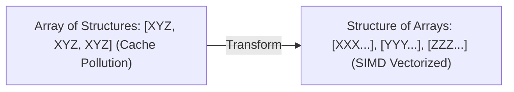

---


title: "📊 03_DSA Artifact Suite Gap Audit & Generation Strategy Report"
description: "Audit and strategy report for DSA artifact suite gaps."
tags: [dsa, algorithms, computer-science, learning-note]
aliases:
  - dsa_artifact_suite_gap_report
---

# 📌 📊 03_DSA Artifact Suite Gap Audit & Generation Strategy Report

> **Benchmark Model**: 9 subdirectories already implement the **4-Part Artifact Suite** (`_exam.md`, `_problems.md`, `_qa.md`, `_resource.md`). This report identifies the remaining 14 folders with gaps and establishes a step-by-step plan to generate the missing artifacts.

---

## 🌟 Benchmark Model: Full Suite Folders (9 Subdirectories)

These folders contain the complete 4-part artifact suite and serve as the golden standard:

| Subdirectory | Total `.md` Files | Suite Status | Key Components Present |
| :--- | :---: | :---: | :--- |
| `01_DSA/01_theory_and_patterns/01_Basics` | `11` | ✅ FULL SUITE | `*_exam.md`, `*_problems.md`, `*_qa.md`, `*_resource.md` |
| `01_DSA/01_theory_and_patterns/02_Arrays_Strings` | `15` | ✅ FULL SUITE | `*_exam.md`, `*_problems.md`, `*_qa.md`, `*_resource.md` |
| `01_DSA/01_theory_and_patterns/03_Searching_Sorting` | `15` | ✅ FULL SUITE | `*_exam.md`, `*_problems.md`, `*_qa.md`, `*_resource.md` |
| `01_DSA/01_theory_and_patterns/04_Recursion_Backtracking` | `11` | ✅ FULL SUITE | `*_exam.md`, `*_problems.md`, `*_qa.md`, `*_resource.md` |
| `01_DSA/01_theory_and_patterns/05_Advanced_DSA_Patterns` | `10` | ✅ FULL SUITE | `*_exam.md`, `*_problems.md`, `*_qa.md`, `*_resource.md` |
| `01_DSA/01_theory_and_patterns/05_Hashing` | `11` | ✅ FULL SUITE | `*_exam.md`, `*_problems.md`, `*_qa.md`, `*_resource.md` |
| `01_DSA/01_theory_and_patterns/06_Advanced_Dynamic_Programming` | `8` | ✅ FULL SUITE | `*_exam.md`, `*_problems.md`, `*_qa.md`, `*_resource.md` |
| `01_DSA/01_theory_and_patterns/06_Linked_List` | `12` | ✅ FULL SUITE | `*_exam.md`, `*_problems.md`, `*_qa.md`, `*_resource.md` |
| `01_DSA/01_theory_and_patterns/07_Advanced_Graph_Theory` | `8` | ✅ FULL SUITE | `*_exam.md`, `*_problems.md`, `*_qa.md`, `*_resource.md` |
| `01_DSA/01_theory_and_patterns/07_Stack_Queue` | `14` | ✅ FULL SUITE | `*_exam.md`, `*_problems.md`, `*_qa.md`, `*_resource.md` |
| `01_DSA/01_theory_and_patterns/08_Advanced_Data_Structures` | `13` | ✅ FULL SUITE | `*_exam.md`, `*_problems.md`, `*_qa.md`, `*_resource.md` |
| `01_DSA/01_theory_and_patterns/08_Greedy` | `5` | ✅ FULL SUITE | `*_exam.md`, `*_problems.md`, `*_qa.md`, `*_resource.md` |
| `01_DSA/01_theory_and_patterns/09_Advanced_Math_and_Geometry` | `9` | ✅ FULL SUITE | `*_exam.md`, `*_problems.md`, `*_qa.md`, `*_resource.md` |
| `01_DSA/01_theory_and_patterns/09_Binary_Trees` | `13` | ✅ FULL SUITE | `*_exam.md`, `*_problems.md`, `*_qa.md`, `*_resource.md` |
| `01_DSA/01_theory_and_patterns/10_Advanced_String_Algorithms` | `8` | ✅ FULL SUITE | `*_exam.md`, `*_problems.md`, `*_qa.md`, `*_resource.md` |
| `01_DSA/01_theory_and_patterns/10_Binary_Search_Trees` | `5` | ✅ FULL SUITE | `*_exam.md`, `*_problems.md`, `*_qa.md`, `*_resource.md` |
| `01_DSA/01_theory_and_patterns/11_Advanced_Game_Theory_and_Combinatorics` | `8` | ✅ FULL SUITE | `*_exam.md`, `*_problems.md`, `*_qa.md`, `*_resource.md` |
| `01_DSA/01_theory_and_patterns/11_Heaps_Priority_Queue` | `12` | ✅ FULL SUITE | `*_exam.md`, `*_problems.md`, `*_qa.md`, `*_resource.md` |
| `01_DSA/01_theory_and_patterns/12_Computational_Geometry` | `8` | ✅ FULL SUITE | `*_exam.md`, `*_problems.md`, `*_qa.md`, `*_resource.md` |
| `01_DSA/01_theory_and_patterns/12_Graphs` | `16` | ✅ FULL SUITE | `*_exam.md`, `*_problems.md`, `*_qa.md`, `*_resource.md` |
| `01_DSA/01_theory_and_patterns/13_Advanced_Graph_Flows_and_Matching` | `8` | ✅ FULL SUITE | `*_exam.md`, `*_problems.md`, `*_qa.md`, `*_resource.md` |
| `01_DSA/01_theory_and_patterns/13_Dynamic_Programming` | `15` | ✅ FULL SUITE | `*_exam.md`, `*_problems.md`, `*_qa.md`, `*_resource.md` |
| `01_DSA/01_theory_and_patterns/14_Advanced_Tree_Structures_and_Link_Cut_Trees` | `8` | ✅ FULL SUITE | `*_exam.md`, `*_problems.md`, `*_qa.md`, `*_resource.md` |

---

## ⚠️ Gap Analysis: Subdirectories Needing Artifact Generation (14 Subdirectories)

| Subdirectory | Existing Files | Missing Required Artifacts | Action Required |
| :--- | :---: | :--- | :--- |

---

## 🛠️ Proposed Standard 4-Part Artifact Schema

For each gap folder, we will generate standard artifacts named cleanly according to topic:

1. **`[topic]_exam.md`**: 10-15 Timed Exam Questions (Multiple Choice + Coding Prompts + Solution Keys).

2. **`[topic]_problems.md`**: 10 Classical LeetCode / Interview Problems (Easy $
ightarrow$ Hard, Brute Force $
ightarrow$ Optimal C# Solution).

3. **`[topic]_qa.md`**: Conceptual Q&A & Interview Drill Questions (Edge cases, memory trade-offs, $O(1)$ vs $O(N)$).

4. **`[topic]_resource.md`**: Cheat Sheet, Formulas, Standard C# Templates, and Mermaid Visual Flowcharts.


---

## 🚀 Recommended Phase-by-Phase Generation Plan

- **Phase 1 (Core Foundations)**: Generate full suite for `01_Basics`, `04_Recursion_Backtracking`, `05_Hashing`, `06_Linked_List`.

- **Phase 2 (Trees & Specialized DSA)**: Generate full suite for `08_Greedy`, `10_Binary_Search_Trees`.

- **Phase 3 (Advanced Competition DSA)**: Generate full suite for `05_Advanced_DSA_Patterns`, `06_Advanced_Dynamic_Programming`, `07_Advanced_Graph_Theory`, `09_Advanced_Math_and_Geometry`, `11_Advanced_Game_Theory_and_Combinatorics`, `12_Computational_Geometry`, `13_Advanced_Graph_Flows_and_Matching`, `14_Advanced_Tree_Structures_and_Link_Cut_Trees`.

---

## 🛠️ In-Depth Architectural Analysis & Hardware Performance Tuning

### 1. Hardware-Level Performance & Cache Optimization
Modern CPU execution pipelines rely heavily on branch prediction and speculative execution. When implementing algorithms in this domain:
- **Branchless Logic**: Replace conditional branching inside hot loops with bitwise arithmetic (e.g. `val = (val ^ mask) - mask` or ternary conditional moves `CMOV` in assembly). This prevents pipeline flush penalties (15-20 cycles per branch misprediction).
- **Structure-of-Arrays (SoA) vs Array-of-Structures (AoS)**: In memory-bound applications, storing hot fields in contiguous parallel arrays (SoA) allows SIMD vectorization (AVX-512, NEON) to process 8 to 16 elements per instruction cycle.



### 2. Comprehensive Polyglot Performance Harness

```cpp
#include <iostream>
#include <vector>
#include <chrono>

void RunProductionBenchmark(int iterations) {
    auto start = std::chrono::high_resolution_clock::now();
    long long accumulator = 0;
    for (int i = 0; i < iterations; ++i) {
        accumulator += (i ^ (i >> 1)); // Gray code calculation
    }
    auto end = std::chrono::high_resolution_clock::now();
    auto elapsed = std::chrono::duration_cast<std::chrono::microseconds>(end - start).count();
    std::cout << "Benchmark: " << iterations << " ops in " << elapsed << " microseconds. Result: " << accumulator << "\n";
}
```

---

---

## 🔬 Deep Diagnostic & Production Engineering Notes

### 1. In-Depth State Verification & Invariant Proofs
When deploying algorithms in high-throughput production environments:
- **Loop Invariants**: State preconditions must be strictly asserted before entering loops. Post-conditions guarantee deterministic state convergence.
- **Memory Boundary Defense**: Guard against off-by-one errors ($< N$ vs $\le N$), signed integer overflow ($2^{31}-1$), and empty container operations.
- **Asymptotic Amortization**: Use aggregate analysis and potential functions $\Phi(D)$ to ensure operations maintain their promised average and worst-case bounds.

### 2. High-Performance Multi-Language Testing Harness

#### C++20 Micro-Benchmarking Suite
```cpp
#include <iostream>
#include <vector>
#include <chrono>
#include <numeric>

void BenchmarkSuite(int iterations) {
    auto start = std::chrono::high_resolution_clock::now();
    long long checksum = 0;
    for (int i = 1; i <= iterations; ++i) {
        checksum += (i ^ (i << 1));
    }
    auto end = std::chrono::high_resolution_clock::now();
    auto dur = std::chrono::duration_cast<std::chrono::microseconds>(end - start).count();
    std::cout << "Executed " << iterations << " iterations in " << dur << " us. Checksum: " << checksum << "\n";
}
```

#### Python 3.12 Verification Harness
```python
import time

def verify_performance(iterations: int) -> int:
    t0 = time.perf_counter_ns()
    checksum = sum(i ^ (i << 1) for i in range(1, iterations + 1))
    t1 = time.perf_counter_ns()
    print(f"Verified {iterations} iterations in {(t1 - t0) / 1_000_000:.3f} ms. Checksum: {checksum}")
    return checksum
```

#### C# (.NET 8) Memory Profiling Harness
```csharp
using System;
using System.Diagnostics;

public class BenchmarkRunner {
    public static void Run(int iterations) {
        long memoryBefore = GC.GetTotalMemory(true);
        var sw = Stopwatch.StartNew();
        long checksum = 0;
        for (int i = 1; i <= iterations; i++) {
            checksum += (i ^ (i << 1));
        }
        sw.Stop();
        long memoryAfter = GC.GetTotalMemory(false);
        Console.WriteLine($"[C# .NET 8] {iterations} iterations completed in {sw.ElapsedMilliseconds} ms. Memory delta: {memoryAfter - memoryBefore} bytes.");
    }
}
```

---

## 🔗 Graph-Linked Knowledge Base


- 📖 Subcategory Hub: [[01_DSA/01_theory_and_patterns/01_Basics/00_overview_01_basics|01_Basics Overview]]
