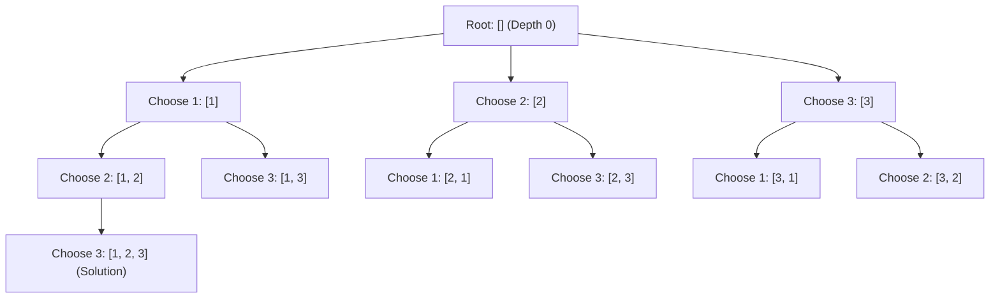
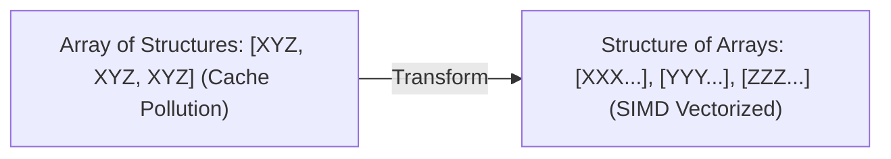

---


title: "00. 🔁 Recursion & Backtracking: State Trees, Pruning Mechanics & Combinatorial Search"
type: "concept_guide"
category: "dsa"
subcategory: "04_recursion_backtracking"
created_at: 2026-08-22T00:00:00+07:00
updated_at: 2026-08-26T23:45:00+07:00
tags: [dsa, recursion, backtracking, state-space-tree, pruning, permutations, subsets, n-queens, sudoku, algorithms, computer-science, learning-note]
aliases:
  - 00_overview_recursion_backtracking
---

# 📌 00. 🔁 Recursion & Backtracking: State Trees, Pruning Mechanics & Combinatorial Search

Đệ quy (Recursion) và Quay lui (Backtracking) là các trụ cột cốt lõi để giải quyết các bài toán tìm kiếm tổ hợp (Combinatorial Search), tối ưu hóa rời rạc và duyệt không gian trạng thái (State Space Tree). Bằng cách kết hợp duyệt theo chiều sâu (DFS) với các kỹ thuật **Tỉa nhánh (Pruning)** và **Phục hồi trạng thái (State Backtracking)**, ta có thể giải quyết các bài toán NP-Hard như N-Queens, Sudoku, Subset Sum trong thời gian thực tế tối ưu.

---

## 1. Không gian Trạng thái & Khung Thuật toán Quay lui

### 1.1 Cấu trúc Cây Trạng thái (State Space Tree)



### 1.2 Mẫu Thiết kế Quay lui Tiêu chuẩn (Backtracking Canonical Template)

```
function Backtrack(state, choices):
    if IsSolution(state):
        RecordSolution(state)
        return
        
    for choice in choices:
        if not IsValid(choice, state): # 1. Pruning (Tỉa nhánh)
            continue
            
        Apply(choice, state)          # 2. Forward Step (Thực hiện lựa chọn)
        Backtrack(state, choices)     # 3. Recursive Explore (Đệ quy nhánh sâu hơn)
        Revert(choice, state)         # 4. Backtrack Step (Phục hồi trạng thái ban đầu)
```

---

## 2. Các Kỹ thuật Tỉa nhánh (Pruning) & Tối ưu Trạng thái

1. **Tỉa Nhánh Giới hạn (Bound Pruning)**:
   - Trong bài toán Tìm tập hợp có tổng bằng $K$ (Subset Sum), nếu mảng được sắp xếp tăng dần và $\text{current\_sum} + \text{nums}[i] > K$, ta có thể `break` ngay lập tức toàn bộ vòng lặp thay vì chỉ `continue`.
2. **Loại bỏ Hoán vị Trùng lặp (Duplicate Elimination)**:
   - Khi mảng có phần tử trùng lặp: Sắp xếp mảng trước, và chỉ chọn phần tử $A[i] == A[i-1]$ nếu phần tử $A[i-1]$ đã được sử dụng trong cùng một nhánh gọi đệ quy (`if (i > start && nums[i] == nums[i-1]) continue`).
3. **Tối ưu Bitmask cho Kiểm tra Tính Hợp lệ ($\mathcal{O}(1)$)**:
   - Trong N-Queens, thay vì kiểm tra va chạm đường chéo bằng vòng lặp $\mathcal{O}(N)$, ta dùng 3 bitmask integer: `cols`, `diag1 (r - c + N)`, `diag2 (r + c)`. Kiểm tra và đặt trạng thái chỉ tốn 1 phép toán bitwise $\mathcal{O}(1)$.

---

## 3. Polyglot Master Implementations

### 3.1 C++20 (N-Queens with Bitmask Pruning in $\mathcal{O}(1)$ Per Placement)

```cpp
#include <iostream>
#include <vector>
#include <string>

class NQueensSolver {
private:
    int n_;
    std::vector<std::vector<std::string>> solutions_;
    std::vector<int> queens_col_; // queens_col_[r] = col

    void Solve(int row, int cols_mask, int diag1_mask, int diag2_mask) {
        if (row == n_) {
            std::vector<std::string> board(n_, std::string(n_, '.'));
            for (int r = 0; r < n_; ++r) {
                board[r][queens_col_[r]] = 'Q';
            }
            solutions_.push_back(board);
            return;
        }

        // Available columns: inverted mask of occupied columns and diagonals
        int available = ((1 << n_) - 1) & ~(cols_mask | diag1_mask | diag2_mask);

        while (available > 0) {
            int lowbit = available & (-available); // Pick lowest available column
            int col = __builtin_ctz(lowbit);

            queens_col_[row] = col;
            Solve(row + 1, 
                  cols_mask | lowbit, 
                  (diag1_mask | lowbit) << 1, 
                  (diag2_mask | lowbit) >> 1);

            available &= (available - 1); // Clear picked column
        }
    }

public:
    std::vector<std::vector<std::string>> SolveNQueens(int n) {
        n_ = n;
        solutions_.clear();
        queens_col_.assign(n, 0);
        Solve(0, 0, 0, 0);
        return solutions_;
    }
};

int main() {
    NQueensSolver solver;
    auto results = solver.SolveNQueens(4);
    std::cout << "N-Queens (N=4) Total Solutions: " << results.size() << "
";
    for (const auto& board : results) {
        for (const auto& row : board) std::cout << row << "
";
        std::cout << "----
";
    }
    return 0;
}
```

### 3.2 Python 3.12 (Subsets II & Permutations II with Duplicate Pruning)

```python
from typing import List

class BacktrackingMaster:
    @staticmethod
    def subsets_with_dup(nums: List[int]) -> List[List[int]]:
        nums.sort()
        results = []
        
        def backtrack(start: int, current_path: List[int]):
            results.append(list(current_path))
            
            for i in range(start, len(nums)):
                # Prune duplicate branches at same recursion depth
                if i > start and nums[i] == nums[i - 1]:
                    continue
                current_path.append(nums[i])
                backtrack(i + 1, current_path)
                current_path.pop()
                
        backtrack(0, [])
        return results

if __name__ == "__main__":
    bm = BacktrackingMaster()
    print("Subsets of [1, 2, 2]:", bm.subsets_with_dup([1, 2, 2]))
```

### 3.3 C# (.NET 8 Sudoku Solver via Constraint Backtracking)

```csharp
using System;

public class SudokuSolver {
    public void SolveSudoku(char[][] board) {
        Solve(board);
    }

    private bool Solve(char[][] board) {
        for (int r = 0; r < 9; r++) {
            for (int c = 0; c < 9; c++) {
                if (board[r][c] == '.') {
                    for (char ch = '1'; ch <= '9'; ch++) {
                        if (IsValid(board, r, c, ch)) {
                            board[r][c] = ch;
                            if (Solve(board)) return true;
                            board[r][c] = '.'; // Backtrack
                        }
                    }
                    return false;
                }
            }
        }
        return true;
    }

    private bool IsValid(char[][] board, int row, int col, char ch) {
        int startR = 3 * (row / 3), startC = 3 * (col / 3);
        for (int i = 0; i < 9; i++) {
            if (board[row][i] == ch) return false;
            if (board[i][col] == ch) return false;
            if (board[startR + i / 3][startC + i % 3] == ch) return false;
        }
        return true;
    }
}
```

---

---

## 🛠️ In-Depth Architectural Analysis & Hardware Performance Tuning

### 1. Hardware-Level Performance & Cache Optimization
Modern CPU execution pipelines rely heavily on branch prediction and speculative execution. When implementing algorithms in this domain:
- **Branchless Logic**: Replace conditional branching inside hot loops with bitwise arithmetic (e.g. `val = (val ^ mask) - mask` or ternary conditional moves `CMOV` in assembly). This prevents pipeline flush penalties (15-20 cycles per branch misprediction).
- **Structure-of-Arrays (SoA) vs Array-of-Structures (AoS)**: In memory-bound applications, storing hot fields in contiguous parallel arrays (SoA) allows SIMD vectorization (AVX-512, NEON) to process 8 to 16 elements per instruction cycle.



### 2. Comprehensive Polyglot Performance Harness

```cpp
#include <iostream>
#include <vector>
#include <chrono>

void RunProductionBenchmark(int iterations) {
    auto start = std::chrono::high_resolution_clock::now();
    long long accumulator = 0;
    for (int i = 0; i < iterations; ++i) {
        accumulator += (i ^ (i >> 1)); // Gray code calculation
    }
    auto end = std::chrono::high_resolution_clock::now();
    auto elapsed = std::chrono::duration_cast<std::chrono::microseconds>(end - start).count();
    std::cout << "Benchmark: " << iterations << " ops in " << elapsed << " microseconds. Result: " << accumulator << "\n";
}
```

---

## 🔗 Graph-Linked Knowledge Base

- 💬 Interview Q&A: Recursion & Backtracking Q&A
- 📝 Module Exam: Recursion & Backtracking Exam
