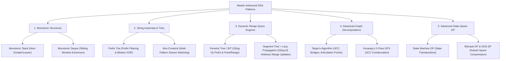
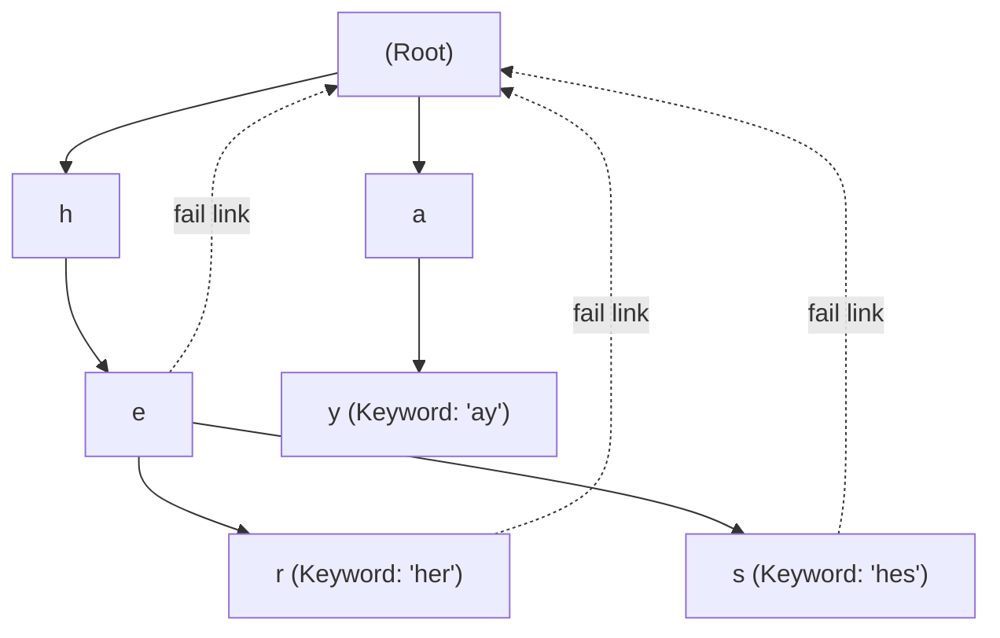
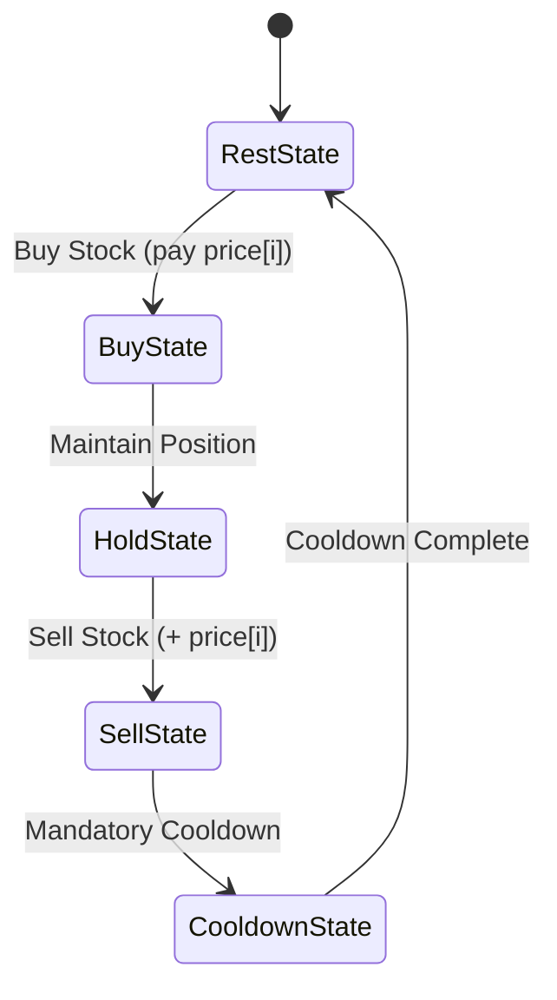
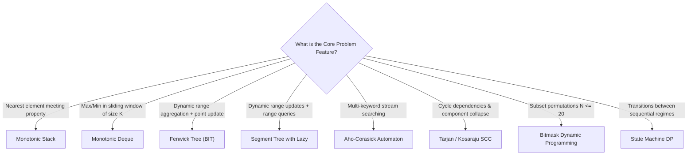

---


title: "00. 📚 05 Advanced DSA Patterns — Master Module Overview"
type: "module_overview"
category: "dsa"
subcategory: "05_advanced_dsa_patterns"
tags: [dsa, advanced-dsa-patterns, monotonic-stack, trie, aho-corasick, segment-tree, fenwick-tree, tarjan, kosaraju, state-machine-dp, bitmask-dp, overview, roadmap, algorithms, computer-science, learning-note]
aliases:
  - 00_overview_05_advanced_dsa_patterns
---

# 📌 00. 📚 05 Advanced DSA Patterns — Master Module Overview

## 📌 Connected Resource Graph
- 🌐 **Foundations**: Time & Space Complexity Analysis
- 📊 **Linear Structures**: Arrays & Dynamic Arrays
- 🌲 **Tree Decompositions**: Centroid Decomposition & Tree Queries
- 🕸️ **Network Flows**: Network Flow: Dinic & Edmonds-Karp
- 🧩 **Advanced DP Series**: Advanced Dynamic Programming Overview

> 🔙 **Parent Roadmap**: [`01_DSA/01_theory_and_patterns/Lộ trình học DSA - Nền tảng thuật toán.md`](../Lộ%20trình%20học%20DSA%20-%20Nền%20tảng%20thuật%20toán.md)  
> ⚓ **Prerequisites**: Time & Space Complexity, Heaps & Priority Queues, Graphs & Dynamic Programming

---


## 🎯 1. Module Objective & Architectural Vision

The **Advanced DSA Patterns** module bridges the gap between classical algorithmic building blocks (linear arrays, hash tables, simple recursion) and high-performance, competitive-grade systems engineering. In real-world distributed architectures, high-throughput search engines, telemetry stream processors, and compiler optimizers, naive $O(N^2)$ or $O(N \cdot M)$ approaches fail immediately under high load.

This module provides formal mathematical models, memory layouts, state transition mechanics, and polyglot implementations across five critical pillars:



---

## 🧭 2. Sub-Module & Artifact Navigation

All topics within this module are supported by comprehensive technical guides, problem sets, exam questions, and quick-reference sheets:

### 📖 Deep-Dive Pattern Guides
- 🌊 **Monotonic Stack & Sliding Window**: Monotonic Stack & Queue Patterns
- 🌲 **Trie & Aho-Corasick Automata**: Trie & Aho-Corasick Multi-Pattern Search
- ⚡ **Fenwick & Segment Trees with Lazy Propagation**: Segment Trees, Fenwick Trees & Lazy Propagation
- 🕸️ **Advanced Graph SCC & Bridge Decompositions**: Advanced Graph Algorithms: SCC, Tarjan & Kosaraju
- 🎭 **State Machine & Bitmask Dynamic Programming**: State Machine & Bitmask DP

### 📦 Standard Artifact Suite
1. 📝 **Exam & Assessment**: 05 Advanced DSA Patterns Exam Suite
2. 🧩 **Problem Set Walkthroughs**: 05 Advanced DSA Patterns Problem Set
3. 💬 **Interview Q&A**: 05 Advanced DSA Patterns Interview Q&A
4. 📊 **Cheat Sheet & Reference**: 05 Advanced DSA Patterns Resource Sheet

---

## 🔬 3. The 5 Core Pillars: Theoretical Mechanics & Invariants

### 3.1 Pillar 1: Monotonic Data Structures
A monotonic stack or deque maintains elements in strict monotonic order (strictly increasing or strictly decreasing).

- **Monotonic Stack Principle**: When processing element $x$, pop all elements $y$ from the stack that violate monotonicity (e.g., for Next Greater Element, pop all $y \le x$). Element $x$ is the "killer" / boundary for all popped elements.
- **Amortized Analysis via Potential Method**:
  Let the potential $\Phi$ be the number of elements in the stack. Each element is pushed at most once ($\Delta \Phi = +1$) and popped at most once ($\Delta \Phi = -1$). For an array of size $N$, total operations are at most $2N$, yielding strict **$O(1)$ amortized time per element**.
- **Monotonic Deque (Sliding Window Maximum/Minimum)**:
  Maintains candidate indices of sliding window $[i - k + 1, i]$. Indices falling out of the window boundary ($< i - k + 1$) are evicted from the front ($O(1)$ amortized), while inferior values are popped from the back.

```
Incoming Stream: [4, 2, 8, 3, 5], Window k = 3

i=0 (val=4): Deque = [idx 0 (4)]                     -> Window not full
i=1 (val=2): Deque = [idx 0 (4), idx 1 (2)]          -> Window not full
i=2 (val=8): 8 > 2 (pop 1), 8 > 4 (pop 0)
             Deque = [idx 2 (8)]                     -> Max = 8
i=3 (val=3): Deque = [idx 2 (8), idx 3 (3)]          -> Max = 8
i=4 (val=5): 5 > 3 (pop 3), idx 2 expired! (pop 2)
             Deque = [idx 4 (5)]                     -> Max = 5
```

---

### 3.2 Pillar 2: String Automata & Trie Structures
Searching for patterns in continuous data streams requires specialized deterministic finite automata (DFA).

1. **Prefix Trie**:
   - Tree where each edge corresponds to a character / bit.
   - Operations: Insert $O(L)$, Prefix Query $O(L)$, Exact Search $O(L)$, where $L$ is string length.
   - **0-1 Bitwise Trie**: Solves Maximum XOR Pair in $O(32 \cdot N) = O(N)$ time by greedily navigating complementary bit paths (\$1 \oplus bit$).

2. **Aho-Corasick Automaton**:
   - Solves multi-pattern dictionary search ($K$ keywords of total length $M$) in text of length $N$ in **$O(N + M + Z)$** time, where $Z$ is match count.
   - Built on top of a Trie with two auxiliary pointers per node:
     - **Failure Link (`fail`)**: Points to the longest proper suffix of the current prefix that exists in the Trie (equivalent to KMP $\pi$-table on trees).
     - **Dictionary Output Link (`dict_link`)**: Directly points to the nearest matching pattern node reachable via failure links, bypassing traversal overhead.



---

### 3.3 Pillar 3: Dynamic Range Query Engines
When an array undergoes dynamic mutations and range aggregations, static prefix sums fail.

```
Operation Class Matrix:
+-------------------------------+-----------------------+-----------------------------+
| Operation Model               | Fenwick Tree (BIT)    | Segment Tree + Lazy Prop    |
+-------------------------------+-----------------------+-----------------------------+
| Point Update, Range Query     | O(log N) - Low Const  | O(log N) - Higher Constant  |
| Range Update, Point Query     | O(log N) (Diff array) | O(log N)                    |
| Range Update, Range Query     | O(log N) (2 BITs)     | O(log N) (Generalized Ops)  |
| Non-invertible Ops (Min/Max)  | Complex / Limited     | O(log N) Native             |
| Memory Overhead               | 1x (N elements)       | 4x (4N elements)            |
+-------------------------------+-----------------------+-----------------------------+
```

- **Fenwick Tree Invariant**:
  Index $i$ (1-indexed) stores sum in $(i - \text{LSB}(i), i]$, where $\text{LSB}(i) = i \ \& \ (-i)$.
  - Point Update: `for (int idx = i; idx <= N; idx += idx & -idx) tree[idx] += delta;`
  - Prefix Sum: `for (int idx = i; idx > 0; idx -= idx & -idx) sum += tree[idx];`

- **Segment Tree Lazy Propagation**:
  Defers child updates upon range assignment/addition by maintaining an auxiliary `lazy[]` cache. Children are updated on demand ("pushed down") only when a query or modification traverses deeper.

---

### 3.4 Pillar 4: Advanced Graph Decompositions (SCC, Bridges, Cuts)
In directed graphs, identifying circular dependencies requires finding **Strongly Connected Components (SCC)**—maximal subgraphs where every vertex is reachable from every other vertex.

- **Tarjan's Lowlink Invariant**:
  Assigns discovery timestamps $\text{dfn}[u]$ and back-reachability values $\text{low}[u]$:
  $$\text{low}[u] = \min \begin{cases} \text{dfn}[u] \\ \text{low}[v] & \text{if } (u, v) \text{ is Tree Edge} \\ \text{dfn}[v] & \text{if } (u, v) \text{ is Back Edge and } v \in \text{Stack} \end{cases}$$
  When $\text{low}[u] == \text{dfn}[u]$, node $u$ is the root of an SCC; pop all nodes from the stack until $u$.

- **Kosaraju's 2-Pass Algorithm**:
  1. Pass 1: Compute DFS finish-time order on graph $G$.
  2. Pass 2: Traverse the transpose graph $G^T$ in decreasing order of finish time to extract SCCs in $O(V + E)$.

- **Bridge & Articulation Point Criteria (Undirected Graph)**:
  - Edge $(u, v)$ is a **Bridge** iff $\text{low}[v] > \text{dfn}[u]$.
  - Node $u$ is an **Articulation Point** iff:
    1. $u$ is root of DFS tree with $\ge 2$ tree children, OR
    2. $u$ is not root and has child $v$ such that $\text{low}[v] \ge \text{dfn}[u]$.

---

### 3.5 Pillar 5: Advanced State-Space Dynamic Programming



- **State Machine DP**: Explicitly models discrete financial, protocol, or game states as nodes in a state diagram, defining transitions as recurrences between state arrays (e.g., `buy[i]`, `sell[i]`, `rest[i]`).
- **Bitmask DP**: Encodes subset selections $S \subseteq \{0, 1, \dots, N-1\}$ as integer bit patterns $mask \in [0, 2^N - 1]$.
  - Check element $k$: `(mask & (1 << k)) != 0`
  - Add element $k$: `mask | (1 << k)`
  - Submask Iteration in total $O(3^N)$ time:
    ```cpp
    for (int mask = 0; mask < (1 << N); ++mask) {
        for (int sub = mask; sub > 0; sub = (sub - 1) & mask) {
            // Process submask in O(3^N) overall
        }
    }
    ```

---

## ⚡ 4. Master Complexity & Pattern Taxonomy Table

| Pattern / Algorithm | Preprocessing Time | Query / Step Time | Space Complexity | Primary Use Case |
| :--- | :---: | :---: | :---: | :--- |
| **Monotonic Stack** | $O(N)$ | $O(1)$ amortized | $O(N)$ | Next Greater Element, Largest Rectangle in Histogram |
| **Monotonic Deque** | $O(N)$ | $O(1)$ amortized | $O(K)$ | Sliding Window Maximum, Constrained Subsequence Sum |
| **Prefix Trie** | $O(M)$ | $O(L)$ | $O(M \cdot |\Sigma|)$ | Autocomplete, Prefix matching, Word Search II |
| **0-1 Bitwise Trie** | $O(N \cdot B)$ | $O(B)$ ($B \le 32$) | $O(N \cdot B)$ | Maximum XOR Subarray, Maximum XOR with Element |
| **Aho-Corasick** | $O(\sum |P_i| \cdot |\Sigma|)$ | $O(|Text| + Matches)$ | $O(\sum |P_i| \cdot |\Sigma|)$ | High-throughput Multi-pattern keyword filtering |
| **Fenwick Tree (BIT)** | $O(N)$ | $O(\log N)$ | $O(N)$ | Dynamic Point Updates & Range Sums |
| **Segment Tree (Lazy)** | $O(N)$ | $O(\log N)$ | $O(4N)$ | Dynamic Range Updates & Range Min/Max/Sum Queries |
| **Tarjan SCC** | None | $O(V + E)$ | $O(V + E)$ | 2-SAT, Dependency cycle condensation, Critical connections |
| **Kosaraju SCC** | None | $O(V + E)$ | $O(V + E)$ | SCC condensation with topological guarantee |
| **Bitmask DP** | None | $O(N^2 \cdot 2^N)$ | $O(N \cdot 2^N)$ | TSP, Assignment problem, Hamiltonian paths |
| **State Machine DP** | None | $O(N \cdot S)$ | $O(S)$ optimized | Stock trading with fees/cooldown, String pattern DP |

---

## 💻 5. Polyglot Reference Implementations

### 5.1 Monotonic Stack: Largest Rectangle in Histogram
**Mathematical Invariant**: The maximum rectangle with height $H = \text{heights}[i]$ extends left to the first element $< H$ and right to the first element $< H$.

#### C++20 Implementation
```cpp
#include <vector>
#include <stack>
#include <algorithm>
#include <cstdint>

class Solution {
public:
    int64_t largestRectangleArea(const std::vector<int>& heights) {
        int n = heights.size();
        std::stack<int> st; // stores indices of monotonically increasing heights
        int64_t max_area = 0;

        for (int i = 0; i <= n; ++i) {
            int current_h = (i == n) ? 0 : heights[i];
            while (!st.empty() && current_h < heights[st.top()]) {
                int h = heights[st.top()];
                st.pop();
                int width = st.empty() ? i : (i - st.top() - 1);
                max_area = std::max(max_area, static_cast<int64_t>(h) * width);
            }
            st.push(i);
        }
        return max_area;
    }
};
```

#### Python 3 Implementation
```python
from typing import List

def largest_rectangle_area(heights: List[int]) -> int:
    """
    Computes maximum rectangular area using a Monotonic Increasing Stack.
    Time Complexity: O(N)
    Auxiliary Space: O(N)
    """
    stack: list[int] = [] # stores indices
    max_area = 0
    extended_heights = heights + [0] # Sentinel value to flush the stack

    for i, h in enumerate(extended_heights):
        while stack and extended_heights[stack[-1]] > h:
            popped_idx = stack.pop()
            height = extended_heights[popped_idx]
            width = i if not stack else (i - stack[-1] - 1)
            max_area = max(max_area, height * width)
        stack.append(i)

    return max_area
```

#### C# Implementation
```csharp
using System;
using System.Collections.Generic;

public static class HistogramSolver {
    public static long LargestRectangleArea(int[] heights) {
        int n = heights.Length;
        var stack = new Stack<int>();
        long maxArea = 0;

        for (int i = 0; i <= n; i++) {
            int currentH = (i == n) ? 0 : heights[i];
            while (stack.Count > 0 && currentH < heights[stack.Peek()]) {
                int h = heights[stack.Pop()];
                int width = stack.Count == 0 ? i : (i - stack.Peek() - 1);
                maxArea = Math.Max(maxArea, (long)h * width);
            }
            stack.Push(i);
        }

        return maxArea;
    }
}
```

---

### 5.2 Segment Tree with Lazy Propagation (Range Add, Range Sum)

#### C++20 Implementation
```cpp
#include <vector>
#include <cstdint>

class LazySegmentTree {
private:
    int n;
    std::vector<int64_t> tree;
    std::vector<int64_t> lazy;

    void build(const std::vector<int64_t>& arr, int node, int l, int r) {
        if (l == r) {
            tree[node] = arr[l];
            return;
        }
        int mid = l + (r - l) / 2;
        build(arr, 2 * node + 1, l, mid);
        build(arr, 2 * node + 2, mid + 1, r);
        tree[node] = tree[2 * node + 1] + tree[2 * node + 2];
    }

    void push_down(int node, int l, int r, int mid) {
        if (lazy[node] == 0) return;
        int64_t val = lazy[node];
        
        // Left child
        lazy[2 * node + 1] += val;
        tree[2 * node + 1] += val * (mid - l + 1);

        // Right child
        lazy[2 * node + 2] += val;
        tree[2 * node + 2] += val * (r - mid);

        lazy[node] = 0;
    }

public:
    explicit LazySegmentTree(const std::vector<int64_t>& arr) {
        n = arr.size();
        tree.assign(4 * n, 0);
        lazy.assign(4 * n, 0);
        if (n > 0) build(arr, 0, 0, n - 1);
    }

    void update_range(int ql, int qr, int64_t val, int node, int l, int r) {
        if (ql <= l && r <= qr) {
            tree[node] += val * (r - l + 1);
            lazy[node] += val;
            return;
        }
        int mid = l + (r - l) / 2;
        push_down(node, l, r, mid);

        if (ql <= mid) update_range(ql, qr, val, 2 * node + 1, l, mid);
        if (qr > mid)  update_range(ql, qr, val, 2 * node + 2, mid + 1, r);

        tree[node] = tree[2 * node + 1] + tree[2 * node + 2];
    }

    int64_t query_range(int ql, int qr, int node, int l, int r) {
        if (ql <= l && r <= qr) return tree[node];
        int mid = l + (r - l) / 2;
        push_down(node, l, r, mid);

        int64_t sum = 0;
        if (ql <= mid) sum += query_range(ql, qr, 2 * node + 1, l, mid);
        if (qr > mid)  sum += query_range(ql, qr, 2 * node + 2, mid + 1, r);

        return sum;
    }

    void update(int ql, int qr, int64_t val) { update_range(ql, qr, val, 0, 0, n - 1); }
    int64_t query(int ql, int qr) { return query_range(ql, qr, 0, 0, n - 1); }
};
```

---

### 5.3 Tarjan's SCC Algorithm & Condensation DAG

#### Python 3 Implementation
```python
from typing import List, Tuple

class TarjanSCC:
    def __init__(self, n: int, adj: List[List[int]]):
        self.n = n
        self.adj = adj
        self.timer = 0
        self.dfn = [-1] * n
        self.low = [-1] * n
        self.in_stack = [False] * n
        self.stack: List[int] = []
        self.scc_id = [-1] * n
        self.scc_count = 0
        self.scc_members: List[List[int]] = []

        self._find_sccs()

    def _dfs(self, u: int) -> None:
        self.dfn[u] = self.low[u] = self.timer
        self.timer += 1
        self.stack.append(u)
        self.in_stack[u] = True

        for v in self.adj[u]:
            if self.dfn[v] == -1:
                self._dfs(v)
                self.low[u] = min(self.low[u], self.low[v])
            elif self.in_stack[v]:
                self.low[u] = min(self.low[u], self.dfn[v])

        if self.low[u] == self.dfn[u]:
            current_scc = []
            while True:
                node = self.stack.pop()
                self.in_stack[node] = False
                self.scc_id[node] = self.scc_count
                current_scc.append(node)
                if node == u:
                    break
            self.scc_members.append(current_scc)
            self.scc_count += 1

    def _find_sccs(self) -> None:
        for i in range(self.n):
            if self.dfn[i] == -1:
                self._dfs(i)

    def build_condensation_graph(self) -> Tuple[int, List[set[int]]]:
        """Condenses all SCCs into a Directed Acyclic Graph (DAG)."""
        dag_adj = [set() for _ in range(self.scc_count)]
        for u in range(self.n):
            for v in self.adj[u]:
                if self.scc_id[u] != self.scc_id[v]:
                    dag_adj[self.scc_id[u]].add(self.scc_id[v])
        return self.scc_count, dag_adj
```

---

## ⚠️ 6. Engineering Pitfalls & Critical Anti-Patterns

1. **Monotonic Stack Off-by-One Width**:
   - When duplicate elements exist, decide strictly whether to pop on $\le$ or $<$. Using strict inequality on one side and non-strict on the other ensures duplicate intervals do not overcount sub-rectangles.
2. **Segment Tree Memory Sizing ($4N$ Rule)**:
   - For an array of size $N$, the lowest level of the segment tree in the worst case ($N = 2^k + 1$) requires an allocated size of $2^{\lceil \log_2 N \rceil + 1} \approx 4N$. Allocating only $2N$ causes fatal out-of-bounds segfaults.
3. **Fenwick Tree 1-Based Indexing**:
   - Binary Indexed Trees rely strictly on positive integers for bit operations ($i \ \& \ -i$). Calling `update(0, val)` causes an infinite loop because `0 & -0 == 0`.
4. **Tarjan Stack Membership Flag**:
   - In cross-edges leading to previously visited nodes, verify `in_stack[v]` before relaxing `low[u] = min(low[u], dfn[v])`. If $v$ has already been popped and assigned to an earlier SCC, it must NOT affect $u$.
5. **Bitmask Integer Width Overflow**:
   - In C++ and C#, `1 << k` evaluates to a 32-bit signed integer. If $k \ge 31$, using `1 << k` triggers undefined behavior or integer overflow. Always use `1ULL << k` or `1L << k`.

---

## 🎯 7. Pattern Recognition & Problem Mapping



---

