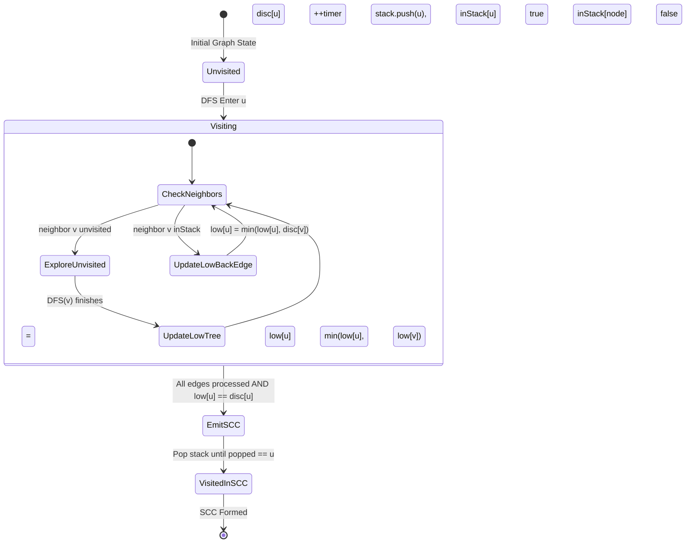

---


title: "01. Advanced DSA Pattern: Advanced Graph Algorithms (Tarjan's, Kosaraju's, Bridges & Cut-Vertices)"
type: "pattern_guide"
category: "dsa"
subcategory: "advanced_dsa_patterns"
created_at: 2026-08-21T23:58:16+07:00
updated_at: 2026-08-21T23:58:16+07:00
tags: [dsa, graph-algorithms, tarjan, kosaraju, scc, bridges, cut-vertices, advanced-patterns, competitive-programming, algorithms, computer-science, learning-note]
aliases:
  - 01_advanced_graph_algorithms_scc_tarjan_kosaraju
---


# 📌 01. Advanced DSA Pattern: Advanced Graph Algorithms (Tarjan's, Kosaraju's, Bridges & Cut-Vertices)

Strongly Connected Components (SCCs), Bridges (Critical Connections), and Articulation Points (Cut-Vertices) form the core structural decomposition tools for directed and undirected graphs. This guide explores the deep graph-theoretic intuition, low-link values, two-pass topological traversals, state transition diagrams, idiomatic C# and Python 3 implementations, asymptotic and memory overhead analysis, and competitive programming anti-patterns.

---

## 1. Under-the-Hood Intuition & Algorithmic Mechanics

### 1.1 Strongly Connected Components (SCC) & Condensation Graphs

#### Intuition
In a directed graph $G = (V, E)$, a **Strongly Connected Component (SCC)** is a maximal sub-graph where every vertex is reachable from every other vertex within that sub-graph. 
If we collapse each SCC into a single super-node, the resulting graph is guaranteed to be a **Directed Acyclic Graph (DAG)**, called the **Condensation Graph** $G^{SCC}$.

```
  Original Graph G:                      Condensation Graph G_SCC (DAG):
  [0] ----> [1] ----> [4]                      (SCC_1) ----> (SCC_2)
   ^         |         |                       {0, 1, 2}      {4, 5}
   |         v         v                          |
  [2] <---- [3]       [5] <---+                   v
   ^                   |      |                (SCC_3)
   +-------------------+------+                 {3}
```

---

### 1.2 Tarjan's Algorithm: Low-Link Values & Stack Invariants

#### Intuition & DFS Tree Properties
Tarjan's Algorithm identifies all SCCs in a **single pass DFS traversal** $O(V + E)$ by maintaining two primary integer state arrays for each node $u$:
1. `disc[u]` (Discovery Time): The timestamp at which vertex $u$ is first visited during DFS traversal.
2. `low[u]` (Low-Link Value): The smallest discovery timestamp reachable from node $u$ via DFS tree edges and back-edges to nodes currently residing on the active recursion stack.

#### The Stack Invariant & Root of SCC
During DFS, nodes are pushed onto an explicitly tracked stack. A node $u$ remains on the stack as long as its SCC has not been fully resolved.
- A vertex $u$ is the **root (head)** of an SCC if and only if:
  $$\text{low}[u] == \text{disc}[u]$$
- When DFS finishes processing all outgoing edges of node $u$ and finds $\text{low}[u] == \text{disc}[u]$, it pops nodes from the stack until $u$ is popped. All popped nodes form a single complete SCC!

#### Tarjan's Node State Transition Diagram



```
DFS Traversal Step:
1. disc[u] = low[u] = ++timer; stack.push(u); inStack[u] = true;
2. For each neighbor v of u:
   a. If v is unvisited:
      DFS(v)
      low[u] = min(low[u], low[v])
   b. Else if v is inStack:
      low[u] = min(low[u], disc[v])  // Back-edge candidate
3. If low[u] == disc[u]: Pop until stack.pop() == u (Complete SCC discovered)
```

---

### 1.3 Tarjan's Bridge & Cut-Vertex Variants (Undirected Graphs)

For an undirected graph:
1. **Bridge (Critical Edge)**: An edge $(u, v)$ whose removal increases the number of connected components.
   - **Condition**: Edge $(u, v)$ is a bridge if and only if:
     $$\text{low}[v] > \text{disc}[u]$$
   - *Intuition*: Node $v$ has no back-edge reaching back to $u$ or any ancestor of $u$.
2. **Articulation Point (Cut-Vertex)**: A node $u$ whose removal increases the number of connected components.
   - **Condition for Non-Root Node $u$**:
     $$\text{low}[v] \ge \text{disc}[u]$$
   - **Condition for Root Node of DFS Tree**: Root is an articulation point if and only if it has $\ge 2$ children in the DFS tree.

---

### 1.4 Kosaraju's Algorithm: Two-Pass Topological Graph Transposition

#### Intuition
Kosaraju's algorithm relies on the property that transposing a graph (reversing all directed edges to create $G^R$) keeps the SCC structure completely intact, but reverses the DAG dependencies between SCCs.

#### Algorithm Steps:
1. **Pass 1 (Original Graph $G$)**: Perform DFS on $G$. Upon finishing a vertex $u$ (post-order exit), push $u$ onto a processing stack.
2. **Graph Reversal**: Build transposed graph $G^R$ where edge $(u \to v)$ becomes $(v \to u)$.
3. **Pass 2 (Transposed Graph $G^R$)**: Pop vertices from the stack. If a vertex $u$ is unvisited in $G^R$, perform DFS starting from $u$. All vertices reachable in this DFS pass form one SCC.

```
Pass 1: DFS on G  ---> Push to Stack on Finish Order [0, 1, 2, ... ]
Pass 2: Pop Stack ---> DFS on G_Reversed ---> Output individual SCCs
```

---

## 2. Idiomatic Code Implementations (C# & Python 3)

### 2.1 Tarjan's SCC & Bridge Detection Implementation

#### C# Implementation
```csharp
using System;
using System.Collections.Generic;

public class TarjanGraph
{
    private readonly int _v;
    private readonly List<int>[] _adj;
    private int _timer;
    private readonly int[] _disc;
    private readonly int[] _low;
    private readonly bool[] _inStack;
    private readonly Stack<int> _stack;
    private readonly List<List<int>> _sccs;

    public TarjanGraph(int vertices)
    {
        _v = vertices;
        _adj = new List<int>[vertices];
        for (int i = 0; i < vertices; i++)
        {
            _adj[i] = new List<int>();
        }
        _disc = new int[vertices];
        Array.Fill(_disc, -1);
        _low = new int[vertices];
        _inStack = new bool[vertices];
        _stack = new Stack<int>();
        _sccs = new List<List<int>>();
    }

    public void AddEdge(int u, int v)
    {
        _adj[u].Add(v); // Directed edge u -> v
    }

    public List<List<int>> FindSCCs()
    {
        _timer = 0;
        for (int i = 0; i < _v; i++)
        {
            if (_disc[i] == -1)
            {
                DfsTarjan(i);
            }
        }
        return _sccs;
    }

    private void DfsTarjan(int u)
    {
        _disc[u] = _low[u] = ++_timer;
        _stack.Push(u);
        _inStack[u] = true;

        foreach (int v in _adj[u])
        {
            if (_disc[v] == -1)
            {
                DfsTarjan(v);
                _low[u] = Math.Min(_low[u], _low[v]);
            }
            else if (_inStack[v])
            {
                // Back-edge to node currently in stack
                _low[u] = Math.Min(_low[u], _disc[v]);
            }
        }

        // Root of SCC found
        if (_low[u] == _disc[u])
        {
            var scc = new List<int>();
            while (true)
            {
                int node = _stack.Pop();
                _inStack[node] = false;
                scc.Add(node);
                if (node == u) break;
            }
            _sccs.Add(scc);
        }
    }
}

public class BridgeFinder
{
    public static List<IList<int>> CriticalConnections(int n, IList<IList<int>> connections)
    {
        var adj = new List<int>[n];
        for (int i = 0; i < n; i++) adj[i] = new List<int>();
        foreach (var conn in connections)
        {
            adj[conn[0]].Add(conn[1]);
            adj[conn[1]].Add(conn[0]);
        }

        var disc = new int[n];
        Array.Fill(disc, -1);
        var low = new int[n];
        var bridges = new List<IList<int>>();
        int timer = 0;

        void Dfs(int u, int parent)
        {
            disc[u] = low[u] = ++timer;
            foreach (int v in adj[u])
            {
                if (v == parent) continue; // Ignore edge to immediate parent
                if (disc[v] == -1)
                {
                    Dfs(v, u);
                    low[u] = Math.Min(low[u], low[v]);
                    if (low[v] > disc[u])
                    {
                        bridges.Add(new List<int> { u, v });
                    }
                }
                else
                {
                    low[u] = Math.Min(low[u], disc[v]);
                }
            }
        }

        for (int i = 0; i < n; i++)
        {
            if (disc[i] == -1) Dfs(i, -1);
        }

        return bridges;
    }

    public static void Main()
    {
        var graph = new TarjanGraph(5);
        graph.AddEdge(1, 0);
        graph.AddEdge(0, 2);
        graph.AddEdge(2, 1);
        graph.AddEdge(0, 3);
        graph.AddEdge(3, 4);

        var sccs = graph.FindSCCs();
        Console.WriteLine("[C#] Tarjan's SCC Count: " + sccs.Count);
        foreach (var scc in sccs)
        {
            Console.WriteLine("  SCC: [" + string.Join(", ", scc) + "]");
        }

        var edges = new List<IList<int>>
        {
            new List<int>{0,1}, new List<int>{1,2}, new List<int>{2,0}, new List<int>{1,3}
        };
        var bridges = CriticalConnections(4, edges);
        Console.WriteLine("[C#] Bridges Count: " + bridges.Count);
    }
}
```

---

#### Python 3 Implementation
```python
import sys
from typing import List

# Increase recursion depth for deep graph DFS
sys.setrecursionlimit(200000)

class TarjanSCC:
    def __init__(self, vertices: int):
        self.v = vertices
        self.adj = [[] for _ in range(vertices)]
        self.timer = 0
        self.disc = [-1] * vertices
        self.low = [-1] * vertices
        self.in_stack = [False] * vertices
        self.stack = []
        self.sccs = []

    def add_edge(self, u: int, v: int) -> None:
        self.adj[u].append(v)

    def find_sccs(self) -> List[List[int]]:
        for i in range(self.v):
            if self.disc[i] == -1:
                self._dfs(i)
        return self.sccs

    def _dfs(self, u: int) -> None:
        self.timer += 1
        self.disc[u] = self.low[u] = self.timer
        self.stack.append(u)
        self.in_stack[u] = True

        for v in self.adj[u]:
            if self.disc[v] == -1:
                self._dfs(v)
                self.low[u] = min(self.low[u], self.low[v])
            elif self.in_stack[v]:
                # Back-edge to active stack node
                self.low[u] = min(self.low[u], self.disc[v])

        # Head node of SCC
        if self.low[u] == self.disc[u]:
            scc = []
            while True:
                node = self.stack.pop()
                self.in_stack[node] = False
                scc.append(node)
                if node == u:
                    break
            self.sccs.append(scc)


class KosarajuSCC:
    def __init__(self, vertices: int):
        self.v = vertices
        self.adj = [[] for _ in range(vertices)]
        self.adj_rev = [[] for _ in range(vertices)]

    def add_edge(self, u: int, v: int) -> None:
        self.adj[u].append(v)
        self.adj_rev[v].append(u)

    def find_sccs(self) -> List[List[int]]:
        visited = [False] * self.v
        order_stack = []

        # Pass 1: Order by finish time
        def dfs_pass1(u: int):
            visited[u] = True
            for v in self.adj[u]:
                if not visited[v]:
                    dfs_pass1(v)
            order_stack.append(u)

        for i in range(self.v):
            if not visited[i]:
                dfs_pass1(i)

        # Pass 2: DFS on reversed graph
        visited = [False] * self.v
        sccs = []

        def dfs_pass2(u: int, current_scc: List[int]):
            visited[u] = True
            current_scc.append(u)
            for v in self.adj_rev[u]:
                if not visited[v]:
                    dfs_pass2(v, current_scc)

        while order_stack:
            u = order_stack.pop()
            if not visited[u]:
                scc = []
                dfs_pass2(u, scc)
                sccs.append(scc)

        return sccs


if __name__ == "__main__":
    tarjan = TarjanSCC(5)
    for u, v in [(1, 0), (0, 2), (2, 1), (0, 3), (3, 4)]:
        tarjan.add_edge(u, v)
    print(f"[Python] Tarjan SCCs: {tarjan.find_sccs()}")

    kosaraju = KosarajuSCC(5)
    for u, v in [(1, 0), (0, 2), (2, 1), (0, 3), (3, 4)]:
        kosaraju.add_edge(u, v)
    print(f"[Python] Kosaraju SCCs: {kosaraju.find_sccs()}")
```

---

## 3. Complexity Analysis & Memory Overhead

### 3.1 Asymptotic Complexity Comparison

| Algorithm / Variant | Time Complexity | Space Complexity | Graph Type | Key Feature |
| :--- | :--- | :--- | :--- | :--- |
| **Tarjan's SCC** | $O(V + E)$ | $O(V + E)$ | Directed | Single DFS pass, low stack allocation overhead |
| **Kosaraju's SCC** | $O(V + E)$ | $O(V + E)$ | Directed | 2 DFS passes, requires transposed graph $G^R$ |
| **Tarjan's Bridges** | $O(V + E)$ | $O(V + E)$ | Undirected | `low[v] > disc[u]` condition |
| **Cut Vertices** | $O(V + E)$ | $O(V + E)$ | Undirected | `low[v] >= disc[u]` condition + root check |

### 3.2 Memory Overhead & Architectural Trade-offs
- **Tarjan vs Kosaraju Memory footprint**:
  - Kosaraju requires building an explicit transpose adjacency list $G^R$, effectively doubling the edge storage memory overhead (\$2 \times E$ list pointers).
  - Tarjan uses a single adjacency list, maintaining an internal boolean `inStack` array and an integer stack of size $O(V)$, which fits tightly in L1/L2 CPU cache lines.
- **Recursion Call Stack Risk**:
  - In deep line graphs ($V = 10^5$), default stack frames in Python/C# will trigger `StackOverflowException`. In Python, `sys.setrecursionlimit(200000)` is necessary, or an explicit iterative stack implementation must be used.

---

## 4. Common Pitfalls & Off-by-One Anti-Patterns

### Pitfall 1: Updating Low-Link Value for Visited Nodes Not on Stack
- ❌ **Wrong (Tarjan SCC)**: Updating `low[u] = min(low[u], disc[v])` for ANY visited neighbor $v$.
- ✅ **Correct**: `low[u] = min(low[u], disc[v])` ONLY if `in_stack[v] == true`. Updating from a visited node that is already part of a previously completed SCC corrupts the low-link invariant of the current component!

### Pitfall 2: Confusing `low[v]` vs `disc[v]` in Back-Edge Calculation
- ❌ **Wrong**: `low[u] = min(low[u], low[v])` for back-edges (when $v$ is already visited).
- ✅ **Correct**: For back-edges, `low[u] = min(low[u], disc[v])`. Using `low[v]` allows low-link values to propagate cross-component cycles incorrectly.

### Pitfall 3: Bridge Search Parent Edge Traversal in Undirected Graphs
- ❌ **Wrong**: Traversing back to immediate parent node in undirected graph DFS:
  `if (v == parent)` is omitted, causing `low[u]` to take `disc[parent]` and falsely marking no edges as bridges.
- ✅ **Correct**: Always skip immediate parent edge traversal `if (v == parent) continue;`. If multiple parallel edges exist between $u$ and $v$, count edge frequency.

### Pitfall 4: Articulation Point Root Node Fallacy
- ❌ **Wrong**: Applying `low[v] >= disc[u]` to the root node of the DFS tree.
- ✅ **Correct**: The root node is an articulation point if and only if it has $\ge 2$ children in the DFS tree.

---

## 5. Related LeetCode Problems & Variant Patterns

| Problem | Difficulty | Category | Key Formula / Strategy |
| :--- | :--- | :--- | :--- |
| **LC 1192**: Critical Connections in a Network | Hard | Bridges | Undirected Tarjan Bridge detection (`low[v] > disc[u]`) |
| **LC 2360**: Longest Cycle in a Graph | Hard | Cycle / SCC | Modified Tarjan DFS tracking step count |
| **LC 1557**: Minimum Number of Vertices to Reach All Nodes | Medium | Condensation DAG | In-degree count on Condensation Graph super-nodes |
| **LC 207**: Course Schedule | Medium | Cycle Detection | Topo-sort / Tarjan cycle check |
| **LC 1489**: Critical and Pseudo-Critical Edges in MST | Hard | Bridges / Kruskal | MST weight check + Tarjan Bridge classification |
