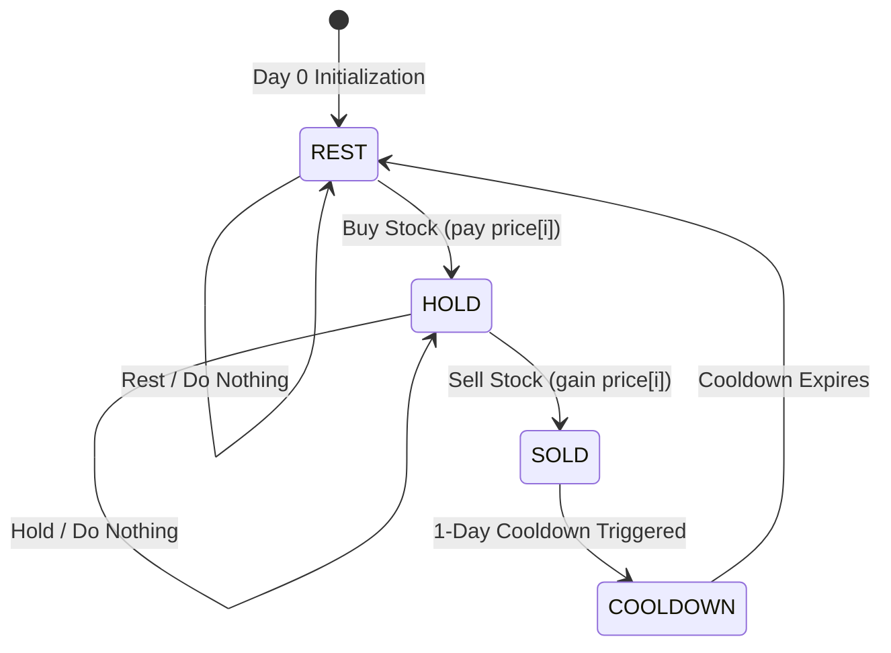

---


title: "01. Advanced DSA Pattern: Dynamic Programming with State Machine & Bitmask"
type: "pattern_guide"
category: "dsa"
subcategory: "advanced_dsa_patterns"
created_at: 2026-08-21T23:56:19+07:00
updated_at: 2026-08-21T23:56:19+07:00
tags: [dsa, dynamic-programming, state-machine, bitmask, bit-manipulation, advanced-patterns, competitive-programming, algorithms, computer-science, learning-note]
aliases:
  - 01_dynamic_programming_state_machine_bitmask
---


# 📌 01. Advanced DSA Pattern: Dynamic Programming with State Machine & Bitmask

Dynamic Programming (DP) combined with **State Machines** and **Bitmasking** forms one of the most powerful paradigms in advanced algorithmic problem solving. This guide covers the mathematical intuition, structural mechanics, state transition diagrams, idiomatic C# & Python 3 implementations, memory overhead trade-offs, and competitive programming pitfalls for both patterns.

---

## 1. Under-the-Hood Intuition & Algorithmic Mechanics

### 1.1 State Machine Dynamic Programming

#### Intuition
In standard 1D/2D DP, state transitions are often sequential (e.g., $dp[i] = dp[i-1] + dp[i-2]$). However, when a system can exist in one of several discrete structural states at any time step $i$—and transitions between these states are governed by specific actions—we model the problem as a **Finite State Automata (FSA)**.



```
       Buy Stock                 Cooldown / Rest
  +------------------+         +------------------+
  |                  v         |                  v
[REST] ------------> [HOLD] ---> [HOLD] --------> [SOLD]
  ^      Rest          |           |      Sell      |
  |                    |           +----------------+
  +--------------------+                   |
           |                               v
           +--------------------------- [COOLDOWN]
                      Rest
```

#### Transition Mechanics & Mathematical Recurrence
Consider stock trading with a 1-day cooldown period (LeetCode 309). At day $i$, we define 3 distinct states:
1. **$HOLD[i]$**: Max profit on day $i$ while holding a stock.
2. **$SOLD[i]$**: Max profit on day $i$ having just sold a stock on day $i$.
3. **$REST[i]$**: Max profit on day $i$ while holding no stock and not in cooldown.

The state transition equations are:
$$\begin{aligned}
HOLD[i] &= \max(HOLD[i-1], REST[i-1] - \text{price}[i]) \\
SOLD[i] &= HOLD[i-1] + \text{price}[i] \\
REST[i] &= \max(REST[i-1], SOLD[i-1])
\end{aligned}$$

#### Space Optimization Mechanic
Notice that values at day $i$ depend strictly on day $i-1$. Instead of maintaining full $O(N \times S)$ 2D arrays, we compress the space to $O(S) = O(1)$ space using scalar variables for each state vector.

---

### 1.2 Bitmask Dynamic Programming

#### Intuition
When a DP state depends on a **subset of visited elements or choices** from a universal set of size $N$ ($N \le 20\text{--}30$), representing subsets as hash sets or lists incurs massive hash allocation and pointer dereference overhead.

Instead, we encode any subset $S \subseteq \{0, 1, \dots, N-1\}$ as a single integer **Bitmask** of $N$ bits:
- $i$-th bit $= 1 \implies$ element $i$ is included in subset $S$.
- $i$-th bit $= 0 \implies$ element $i$ is excluded from subset $S$.

```
Index:    4  3  2  1  0
Element: [e, d, c, b, a]
Bitmask:  1  0  1  1  0  = 22 (in decimal: 16 + 4 + 2)
Subset:  {b, c, e}
```

#### Essential Bitwise Operations Cheat Sheet
| Operation | Bitwise Formula | Explanation |
| :--- | :--- | :--- |
| **Check Bit $i$** | `(mask & (1 << i)) != 0` | Returns true if element $i$ is in subset |
| **Set Bit $i$** | `mask | (1 << i)` | Adds element $i$ to subset |
| **Clear Bit $i$** | `mask & ~(1 << i)` | Removes element $i$ from subset |
| **Toggle Bit $i$** | `mask ^ (1 << i)` | Flips membership of element $i$ |
| **Extract Lowest Set Bit** | `mask & (-mask)` | Isolates rightmost 1-bit |
| **Clear Lowest Set Bit** | `mask & (mask - 1)` | Removes rightmost 1-bit |
| **Count Included Bits** | C#: `BitOperations.PopCount((uint)mask)`<br>Py: `mask.bit_count()` | Returns $|S|$ (cardinality of set) |

#### Submask Iteration Mechanic ($O(3^N)$ Total Complexity)
To iterate over all valid submasks `sub` of a given `mask`:
```csharp
for (int sub = mask; sub > 0; sub = (sub - 1) & mask) {
    // Process submask
}
```
**Why `(sub - 1) & mask` works**: Subtracting 1 flips the rightmost set bit in `sub` to 0 and all trailing 0s to 1s. Performing `& mask` filters out bits that were not in `mask`, effectively jumping directly to the next lower valid submask without visiting invalid integers!

---

## 2. Idiomatic Code Implementations (C# & Python 3)

### 2.1 State Machine DP Implementation
**Problem**: Best Time to Buy and Sell Stock with Cooldown (LeetCode 309).

#### C# Implementation
```csharp
using System;

namespace AdvancedDSA.Patterns
{
    public static class StockTradingStateMachine
    {
        /// <summary>
        /// Calculates maximum profit with 1-day cooldown using State Machine DP.
        /// Time Complexity: O(N)
        /// Space Complexity: O(1)
        /// </summary>
        public static int MaxProfit(int[] prices)
        {
            if (prices == null || prices.Length <= 1) return 0;

            // Initial state values for Day 0
            int hold = -prices[0]; // Buying stock on day 0
            int sold = 0;          // Cannot sell on day 0
            int rest = 0;          // Doing nothing on day 0

            for (int i = 1; i < prices.Length; i++)
            {
                int prevHold = hold;
                int prevSold = sold;
                int prevRest = rest;

                // State Transitions:
                // 1. Hold: Continue holding prev stock OR buy today after rest
                hold = Math.Max(prevHold, prevRest - prices[i]);

                // 2. Sold: Sell stock held from previous day
                sold = prevHold + prices[i];

                // 3. Rest: Remain in rest OR enter rest from yesterday's sold state
                rest = Math.Max(prevRest, prevSold);
            }

            // Max profit at the end must not end in 'Hold' state
            return Math.Max(sold, rest);
        }

        public static void Main()
        {
            int[] prices = { 1, 2, 3, 0, 2 };
            int profit = MaxProfit(prices);
            Console.WriteLine($"[C#] Max Profit (Expected 3): {profit}");
        }
    }
}
```

#### Python 3 Implementation
```python
from typing import List

def max_profit_state_machine(prices: List[int]) -> int:
    """
    Calculates maximum profit with 1-day cooldown using State Machine DP.
    Time Complexity: O(N)
    Space Complexity: O(1)
    """
    if not prices or len(prices) <= 1:
        return 0

    # Initial state values for Day 0
    hold = -prices[0]  # Bought stock on day 0
    sold = 0           # Sold on day 0 (impossible, initial profit 0)
    rest = 0           # Rest on day 0

    for price in prices[1:]:
        prev_hold, prev_sold, prev_rest = hold, sold, rest

        # State Transitions:
        hold = max(prev_hold, prev_rest - price)
        sold = prev_hold + price
        rest = max(prev_rest, prev_sold)

    return max(sold, rest)


# Verification test harness
if __name__ == "__main__":
    prices = [1, 2, 3, 0, 2]
    result = max_profit_state_machine(prices)
    print(f"[Python] Max Profit (Expected 3): {result}")
```

---

### 2.2 Bitmask DP Implementation

**Problem**: Traveling Salesman Problem (TSP) / Shortest Path Visiting All Nodes.
Given $N$ cities ($N \le 15$) and distance matrix `dist[i][j]`, find minimum distance path starting at city 0, visiting all cities exactly once, and returning to city 0.

#### C# Implementation
```csharp
using System;
using System.Numerics;

namespace AdvancedDSA.Patterns
{
    public static class TravelingSalesmanBitmaskDP
    {
        private const int INF = 1_000_000_000;

        /// <summary>
        /// Solves TSP using Bitmask Dynamic Programming.
        /// Time Complexity: O(N^2 * 2^N)
        /// Space Complexity: O(N * 2^N)
        /// </summary>
        public static int SolveTSP(int[][] dist)
        {
            int n = dist.Length;
            int numStates = 1 << n; // 2^N states

            // dp[mask, u] = min cost to visit subset 'mask' of cities ending at city 'u'
            int[,] dp = new int[numStates, n];

            // Initialize DP table with INF
            for (int mask = 0; mask < numStates; mask++)
            {
                for (int u = 0; u < n; u++)
                {
                    dp[mask, u] = INF;
                }
            }

            // Base case: Start at city 0, mask = 000...001 (bit 0 set)
            dp[1, 0] = 0;

            // Iterate over all subset masks
            for (int mask = 1; mask < numStates; mask++)
            {
                for (int u = 0; u < n; u++)
                {
                    // Skip if city u is not part of the current mask state
                    if ((mask & (1 << u)) == 0 || dp[mask, u] == INF) continue;

                    // Try transitioning to unvisited city v
                    for (int v = 0; v < n; v++)
                    {
                        // Skip if city v is already visited in mask
                        if ((mask & (1 << v)) != 0) continue;

                        int nextMask = mask | (1 << v);
                        int newDist = dp[mask, u] + dist[u][v];

                        if (newDist < dp[nextMask, v])
                        {
                            dp[nextMask, v] = newDist;
                        }
                    }
                }
            }

            // Return to city 0 from full mask (all bits set = (1 << n) - 1)
            int fullMask = (1 << n) - 1;
            int minCost = INF;

            for (int u = 1; u < n; u++)
            {
                if (dp[fullMask, u] != INF)
                {
                    minCost = Math.Min(minCost, dp[fullMask, u] + dist[u][0]);
                }
            }

            return minCost;
        }

        public static void Main()
        {
            int[][] dist = new int[][]
            {
                new int[] { 0, 10, 15, 20 },
                new int[] { 10, 0, 35, 25 },
                new int[] { 15, 35, 0, 30 },
                new int[] { 20, 25, 30, 0 }
            };

            int minCost = SolveTSP(dist);
            Console.WriteLine($"[C#] TSP Min Cost (Expected 80): {minCost}");
        }
    }
}
```

#### Python 3 Implementation
```python
from typing import List

INF = 1_000_000_000

def solve_tsp_bitmask(dist: List[List[int]]) -> int:
    """
    Solves TSP using Bitmask Dynamic Programming.
    Time Complexity: O(N^2 * 2^N)
    Space Complexity: O(N * 2^N)
    """
    n = len(dist)
    num_states = 1 << n  # 2^N states

    # dp[mask][u] = min cost to visit subset 'mask' ending at city 'u'
    dp = [[INF] * n for _ in range(num_states)]

    # Base case: Start at city 0, mask = 0b00..01
    dp[1][0] = 0

    for mask in range(1, num_states):
        for u in range(n):
            # Skip if city u is not visited in mask or state is unreachable
            if not (mask & (1 << u)) or dp[mask][u] == INF:
                continue

            # Try visiting next city v
            for v in range(n):
                if mask & (1 << v):  # Already visited
                    continue

                next_mask = mask | (1 << v)
                new_cost = dp[mask][u] + dist[u][v]
                if new_cost < dp[next_mask][v]:
                    dp[next_mask][v] = new_cost

    full_mask = (1 << n) - 1
    min_cost = INF

    for u in range(1, n):
        if dp[full_mask][u] != INF:
            min_cost = min(min_cost, dp[full_mask][u] + dist[u][0])

    return min_cost


# Verification test harness
if __name__ == "__main__":
    matrix = [
        [0, 10, 15, 20],
        [10, 0, 35, 25],
        [15, 35, 0, 30],
        [20, 25, 30, 0]
    ]
    res = solve_tsp_bitmask(matrix)
    print(f"[Python] TSP Min Cost (Expected 80): {res}")
```

---

## 3. Complexity Analysis & Memory Overhead

### 3.1 Asymptotic Complexity Comparison

| Pattern | Problem Example | Time Complexity | Space Complexity (Naive) | Space Complexity (Optimized) |
| :--- | :--- | :--- | :--- | :--- |
| **State Machine DP** | Stock Trading with Cooldown | $O(N)$ | $O(N \times S)$ | $O(S) = O(1)$ |
| **Bitmask DP (Graph/TSP)** | Traveling Salesman Problem | $O(N^2 \cdot 2^N)$ | $O(N \cdot 2^N)$ | $O(N \cdot 2^N)$ |
| **Bitmask Submask DP** | Partition Subsets / Minimum Teams | $O(3^N)$ | $O(2^N)$ | $O(2^N)$ |

### 3.2 Proof of Submask Enumeration $O(3^N)$ Complexity
When iterating all submasks across all masks using `(sub - 1) & mask`:
- For a mask with $k$ set bits, it has $2^k$ submasks.
- By the Binomial Theorem, the total number of operations across all masks is:
  $$\sum_{k=0}^{N} \binom{N}{k} 2^k = (1 + 2)^N = 3^N$$
- For $N = 15$, $3^{15} = 14,348,907$ operations ($\approx 0.01$s), whereas brute-force subset enumeration $4^N = 1,073,741,824$ operations would TLE!

### 3.3 Memory Overhead & Cache Locality Analysis
- **Flat 1D/2D Primitive Arrays vs Dictionary/Hash Tables**:
  - In C#, `int[,] dp = new int[1 << 20, 20]` allocates a single contiguous block of memory in the LOH (Large Object Heap), resulting in sequential CPU cache line fills ($L1/L2$ cache hits).
  - Using `Dictionary<(int mask, int u), int>` incurs heavy 32-byte object header allocations per key, GC garbage collections, and cache line misses.
- **Cache Locality Rule**: Always index the bitmask in the **outer loop** (`mask` from $0$ to $2^N-1$). Because state transitions only depend on smaller masks (`prev_mask < mask`), sequential iteration naturally guarantees DP values for dependencies are already computed and warm in CPU cache.

---

## 4. Common Pitfalls & Off-by-One Anti-Patterns

### Pitfall 1: Operator Precedence Error in Bitwise Mask Checks
- ❌ **Wrong**: `if (mask & 1 == 0)` $\implies$ Evaluates as `mask & (1 == 0)` $\implies$ `mask & 0` $\implies$ Always `0`!
- ✅ **Correct**: `if ((mask & 1) == 0)` $\implies$ Always wrap bitwise operations in explicit parentheses.

### Pitfall 2: Bit Shift Integer Overflow for $N \ge 31$
- ❌ **Wrong (C#)**: `1 << 31` creates a 32-bit signed integer resulting in `-2147483648`.
- ✅ **Correct (C#)**: `1L << 31` (uses 64-bit `long`).

### Pitfall 3: Initializing Sentinel Values (`INT_MAX` Overflow)
- ❌ **Wrong**: Initializing DP table with `int.MaxValue` or `sys.maxsize`, then adding cost `dp[mask][u] + dist[u][v]`. This causes **signed integer overflow**, turning positive values into negative numbers!
- ✅ **Correct**: Use a safe sentinel value like `1_000_000_000` (`1e9`) or check `if (dp[mask][u] != INF)` before performing addition.

### Pitfall 4: Missing Base Case for Bitmask 0 or Initial City
- ❌ **Wrong**: Forgetting to set `dp[1, 0] = 0` (or `dp[0, 0] = 0`), resulting in all DP table cells remaining `INF`.

### Pitfall 5: Submask Enumeration Loop Termination Failure
- ❌ **Wrong**: `for (int sub = mask; sub >= 0; sub = (sub - 1) & mask)` will create an **infinite loop** when `sub = 0` because `(0 - 1) & mask = -1 & mask = mask`!
- ✅ **Correct**: Use `for (int sub = mask; sub > 0; sub = (sub - 1) & mask)` and process `sub = 0` outside the loop if required.

---

## 5. Related LeetCode Problems & Variant Patterns

| Problem | Difficulty | Category | Key Formula / Strategy |
| :--- | :--- | :--- | :--- |
| **LC 309**: Stock with Cooldown | Medium | State Machine | 3 States (`Hold`, `Sold`, `Rest`) |
| **LC 714**: Stock with Transaction Fee | Medium | State Machine | 2 States (`Hold`, `Cash`) |
| **LC 123**: Stock III (At Most 2 Trades) | Hard | State Machine | 4 States (`Hold1`, `Sold1`, `Hold2`, `Sold2`) |
| **LC 847**: Shortest Path Visiting All Nodes | Hard | Bitmask DP + BFS | State `(mask, node)` with BFS layer traversal |
| **LC 698**: Partition to K Equal Sum Subsets | Medium | Bitmask DP | State `dp[mask]` storing accumulated subset sum |
| **LC 1125**: Smallest Sufficient Team | Hard | Bitmask Submask DP | State `dp[mask]` storing minimum team bitmask |
| **LC 1494**: Parallel Courses II | Hard | Submask Enumeration | Submask iteration `(sub - 1) & mask` over available prerequisites |
| **LC 1986**: Min Number of Work Sessions | Medium | Bitmask Submask DP | $O(3^N)$ submask DP over valid bin capacities |
