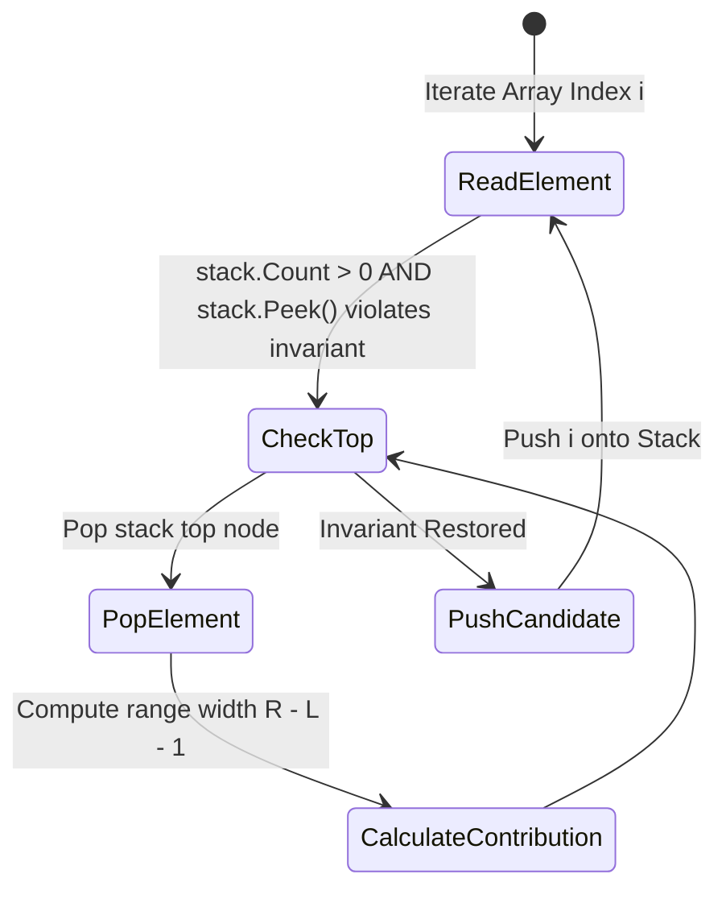

---


title: "01. Advanced DSA Pattern: Monotonic Stack, Monotonic Queue & Sliding Window Deque"
type: "pattern_guide"
category: "dsa"
subcategory: "advanced_dsa_patterns"
created_at: 2026-08-21T23:58:16+07:00
updated_at: 2026-08-21T23:58:16+07:00
tags: [dsa, monotonic-stack, monotonic-queue, sliding-window, deque, advanced-patterns, competitive-programming, algorithms, computer-science, learning-note]
aliases:
  - 01_monotonic_stack_queue_sliding_window_patterns
---


# 📌 01. Advanced DSA Pattern: Monotonic Stack, Monotonic Queue & Sliding Window Deque

The **Monotonic Stack** and **Monotonic Queue (Sliding Window Deque)** patterns are crucial tools for optimizing range dependency, histogram area, and dynamic window min/max problems from $O(N^2)$ brute-force searches to amortized $O(N)$ linear time. This master guide dissects monotonic invariants, boundary contribution counting, state transition diagrams, complete implementations in C# and Python 3, memory trade-offs, and critical anti-patterns.

---

## 1. Under-the-Hood Intuition & Algorithmic Mechanics

### 1.1 The Monotonic Invariant

#### Intuition
A data structure maintains a **monotonic invariant** when its elements are strictly non-decreasing or non-increasing from bottom to top (in stacks) or from head to tail (in deques).
When a new candidate element $x$ violates the desired invariant, existing elements in the data structure are popped until inserting $x$ restores monotonicity.



```
Monotonic Increasing Stack: [1, 3, 5, 8]  <-- Top (Elements grow larger toward top)
Candidate: 4
Popping elements > 4: Pop 8, Pop 5
Pushing Candidate 4: [1, 3, 4]             <-- Invariant restored!
```

---

### 1.2 Monotonic Stack Mechanics

#### Functional Spectrum
1. **Next Greater Element (NGE)**: Monotonic Decreasing Stack. Pop elements smaller than current element $A[i]$. The element $A[i]$ is the Next Greater Element for all popped items.
2. **Next Smaller Element (NSE)**: Monotonic Increasing Stack. Pop elements larger than current element $A[i]$.
3. **Contribution Counting / Histogram Expansion**:
   - For any index $i$, finding the nearest left boundary $L$ and nearest right boundary $R$ where $A[i]$ remains the minimum (or maximum) element:
     $$\text{Width} = R - L - 1$$
     $$\text{Area} = A[i] \times (R - L - 1)$$

```
Histogram Bar Expansion Mechanics (LC 84):
      Index: 0  1  2  3  4  5
     Heights:[2, 1, 5, 6, 2, 3]

     For height 6 at idx 3:
     - Left boundary L = 2 (height 5)
     - Right boundary R = 4 (height 2)
     - Width = 4 - 2 - 1 = 1
     - Area = 6 * 1 = 6
```

---

### 1.3 Monotonic Queue / Sliding Window Deque Mechanics

#### Intuition
When maintaining the minimum or maximum over a sliding window of dynamic size $K$:
- New elements enter from the back (`tail`) of a **Double-Ended Queue (Deque)**.
- Before pushing candidate $A[i]$, pop all tail elements that are smaller (for min deque) or larger (for max deque) than $A[i]$, because candidate $A[i]$ is newer AND strictly better, making older, inferior elements obsolete!
- Expire elements from the front (`head`) when their index falls outside the sliding window boundary: $\text{head\_index} \le i - K$.

```
Sliding Window Max (K=3): Array [1, 3, -1, -3, 5, 3, 6, 7]
Window [1, 3, -1]  --> Deque: [3, -1]   --> Max = 3
Window [3, -1, -3] --> Deque: [3, -1, -3]--> Max = 3
Window [-1, -3, 5] --> Deque: [5]       --> Max = 5 (3 popped, obsolete)
```

---

## 2. Idiomatic Code Implementations (C# & Python 3)

### 2.1 Monotonic Stack (Largest Rectangle in Histogram - LC 84)

#### C# Implementation
```csharp
using System;
using System.Collections.Generic;

public class MonotonicStack
{
    public static int LargestRectangleArea(int[] heights)
    {
        int n = heights.Length;
        Stack<int> stack = new Stack<int>();
        int maxArea = 0;

        // Traverse indices 0 to n (n acts as dummy sentinel height 0)
        for (int i = 0; i <= n; i++)
        {
            int currentHeight = (i == n) ? 0 : heights[i];

            while (stack.Count > 0 && heights[stack.Peek()] > currentHeight)
            {
                int h = heights[stack.Pop()];
                int rightBound = i;
                int leftBound = (stack.Count == 0) ? -1 : stack.Peek();
                int width = rightBound - leftBound - 1;

                maxArea = Math.Max(maxArea, h * width);
            }

            stack.Push(i);
        }

        return maxArea;
    }
}
```

---

### 2.2 Monotonic Queue (Sliding Window Maximum - LC 239)

#### C# Implementation
```csharp
using System;
using System.Collections.Generic;

public class MonotonicQueue
{
    public static int[] MaxSlidingWindow(int[] nums, int k)
    {
        if (nums == null || nums.Length == 0 || k <= 0) return new int[0];
        
        int n = nums.Length;
        int[] result = new int[n - k + 1];
        LinkedList<int> deque = new LinkedList<int>(); // Deque storing indices

        for (int i = 0; i < n; i++)
        {
            // 1. Remove expired elements outside window boundary [i - k + 1, i]
            if (deque.Count > 0 && deque.First.Value <= i - k)
            {
                deque.RemoveFirst();
            }

            // 2. Maintain Monotonic Decreasing order in Deque
            while (deque.Count > 0 && nums[deque.Last.Value] <= nums[i])
            {
                deque.RemoveLast();
            }

            // 3. Add current element index to tail
            deque.AddLast(i);

            // 4. Record maximum when window reaches size k
            if (i >= k - 1)
            {
                result[i - k + 1] = nums[deque.First.Value];
            }
        }

        return result;
    }

    public static void Main()
    {
        int[] heights = { 2, 1, 5, 6, 2, 3 };
        Console.WriteLine("[C#] Largest Rectangle Area: " + MonotonicStack.LargestRectangleArea(heights));

        int[] nums = { 1, 3, -1, -3, 5, 3, 6, 7 };
        int k = 3;
        var maxWin = MaxSlidingWindow(nums, k);
        Console.WriteLine("[C#] Sliding Window Max (K=3): [" + string.Join(", ", maxWin) + "]");
    }
}
```

---

#### Python 3 Implementation
```python
from collections import deque
from typing import List

def largest_rectangle_area(heights: List[int]) -> int:
    """Calculates max rectangle area in histogram using Monotonic Stack in O(N)."""
    stack = []  # Stores indices of heights in monotonic non-decreasing order
    max_area = 0
    n = len(heights)

    for i in range(n + 1):
        # Use 0 as sentinel height at index n to flush remaining stack elements
        current_height = 0 if i == n else heights[i]

        while stack and heights[stack[-1]] > current_height:
            h = heights[stack.pop()]
            right_bound = i
            left_bound = stack[-1] if stack else -1
            width = right_bound - left_bound - 1
            max_area = max(max_area, h * width)

        stack.append(i)

    return max_area


def max_sliding_window(nums: List[int], k: int) -> List[int]:
    """Finds maximum element in each sliding window of size K using Monotonic Deque in O(N)."""
    if not nums or k <= 0:
        return []

    dq = deque()  # Stores indices of elements in monotonic decreasing order
    result = []

    for i, num in enumerate(nums):
        # 1. Remove expired elements outside window boundary
        if dq and dq[0] <= i - k:
            dq.popleft()

        # 2. Maintain Monotonic Decreasing invariant
        while dq and nums[dq[-1]] <= num:
            dq.pop()

        # 3. Append current index
        dq.append(i)

        # 4. Record front element as window maximum
        if i >= k - 1:
            result.append(nums[dq[0]])

    return result


if __name__ == "__main__":
    heights = [2, 1, 5, 6, 2, 3]
    print(f"[Python] Largest Rectangle Area: {largest_rectangle_area(heights)}")

    nums = [1, 3, -1, -3, 5, 3, 6, 7]
    k = 3
    print(f"[Python] Sliding Window Max: {max_sliding_window(nums, k)}")
```

---

## 3. Complexity Analysis & Memory Overhead

### 3.1 Amortized Complexity Analysis

| Data Structure / Pattern | Operation per Element | Total Time Complexity | Space Complexity |
| :--- | :--- | :--- | :--- |
| **Monotonic Stack** | At most 1 `push` and 1 `pop` | Amortized $O(N)$ | $O(N)$ |
| **Monotonic Deque** | At most 1 `push_back`, 1 `pop_back`, 1 `pop_front` | Amortized $O(N)$ | $O(K)$ |

#### Amortized Proof
In both patterns, every element index $i \in [0, N-1]$ enters the stack/deque exactly once. Consequently, the inner `while` loop that pops elements runs at most $N$ times across the entire algorithm execution.
$$\text{Total Operations} \le 2N \implies O(N) \text{ time complexity}.$$

### 3.2 Memory Overhead & Allocation Mechanics
- **LinkedList vs Circular Array Deque in C#**:
  - `LinkedList<T>` in C# incurs a 24-byte object allocation per node (containing `Value`, `Next`, `Previous` pointers).
  - High garbage collection overhead under heavy window shifts. For high-frequency CP, use an array-backed circular buffer or `ArrayDeque` pattern.

---

## 4. Common Pitfalls & Off-by-One Anti-Patterns

### Pitfall 1: Non-Strict vs Strict Inequality Confusion (`>` vs `>=`)
- ❌ **Wrong**: Using strictly `<` in histogram monotonic stack: `heights[stack.Peek()] >= currentHeight`.
- ⚡ **Symptom**: Duplicate heights pop each other prematurely, calculating incorrect widths for equal elements.
- ✅ **Correct**: Use strict `>` for popping during stack traversal, ensuring duplicate height boundaries resolve correctly on the final rightmost occurrence.

### Pitfall 2: Forgetting Sentinel Values to Flush Stack
- ❌ **Wrong**: Terminating loop at $i = N - 1$ without processing remaining items in stack.
- ⚡ **Symptom**: Elements in monotonically increasing order (e.g. $[1, 2, 3, 4, 5]$) are never popped, returning $0$ area!
- ✅ **Correct**: Append a sentinel zero height at index $i = N$ to force-pop all remaining elements in stack.

### Pitfall 3: Storing Values Instead of Indices in Stack/Deque
- ❌ **Wrong**: Pushing array values `nums[i]` into stack/deque instead of indices $i$.
- ⚡ **Symptom**: Prevents window expiration checks (`i - k`) and width calculations (`R - L - 1`).
- ✅ **Correct**: Always store indices $i$ in stack/deque! Access values via `nums[stack.Peek()]`.

### Pitfall 4: Window Expiration Boundary Off-by-One
- ❌ **Wrong**: `if (deque.First.Value < i - k)`
- ✅ **Correct**: An element at index $j$ expires when $j \le i - k$. The valid window range for current index $i$ is $[i - k + 1, i]$.

---

## 5. Related LeetCode Problems & Variant Patterns

| Problem | Difficulty | Category | Key Formula / Strategy |
| :--- | :--- | :--- | :--- |
| **LC 84**: Largest Rectangle in Histogram | Hard | Monotonic Stack | Monotonic Increasing Stack with sentinel flush |
| **LC 85**: Maximal Rectangle | Hard | 2D Monotonic Stack | 1D Histogram conversion per row matrix layer |
| **LC 239**: Sliding Window Maximum | Hard | Monotonic Deque | Monotonic Decreasing Deque with $i - k$ window trim |
| **LC 739**: Daily Temperatures | Medium | Monotonic Stack | Next Greater Element index delta `stack.pop() - i` |
| **LC 42**: Trapping Rain Water | Hard | Monotonic Stack | Horizontal water layer trapped between boundaries |
| **LC 907**: Sum of Subarray Minimums | Medium | Contribution Counting | Total sum = $\sum A[i] \times (i - L) \times (R - i)$ |
| **LC 862**: Shortest Subarray with Sum $\ge K$ | Hard | Monotonic Deque + Prefix Sum | Monotonic Increasing Deque over prefix sums array |
