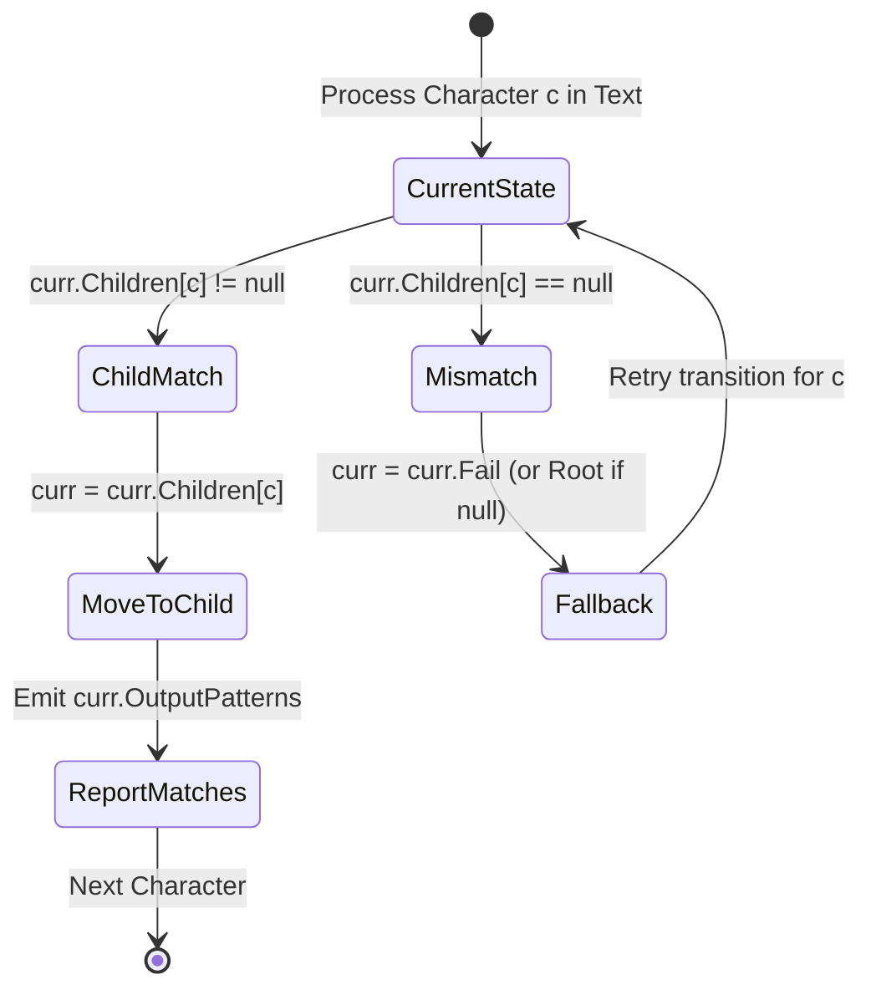

---


title: "01. Advanced DSA Pattern: Trie & Aho-Corasick Multi-Pattern String Matching"
type: "pattern_guide"
category: "dsa"
subcategory: "advanced_dsa_patterns"
created_at: 2026-08-21T23:58:16+07:00
updated_at: 2026-08-21T23:58:16+07:00
tags: [dsa, trie, aho-corasick, string-matching, automaton, bfs, failure-links, advanced-patterns, competitive-programming, algorithms, computer-science, learning-note]
aliases:
  - 01_trie_aho_corasick_multi_pattern_search
---


# 📌 01. Advanced DSA Pattern: Trie & Aho-Corasick Multi-Pattern String Matching

Searching for a dictionary of $K$ patterns within a text of length $N$ naively takes $O(N \times K \times L)$ time. A standard **Trie** optimizes single prefix queries, but **Aho-Corasick Automaton** constructs a finite state machine using BFS-generated **Failure Links** and **Dictionary Links**, enabling simultaneous multi-pattern matching in $O(N + \sum |P_i|)$ linear time! This guide covers trie mechanics, failure link transitions, state transition diagrams, idiomatic implementations in C# and Python 3, memory trade-offs, and critical pitfalls.

---

## 1. Under-the-Hood Intuition & Algorithmic Mechanics

### 1.1 Prefix Tree (Trie)

#### Intuition
A **Trie** (Prefix Tree) is an $m$-ary tree structure where each node represents a character transition. Words with common prefixes share ancestor paths:
- Node representation: Fixed array `TrieNode[26]` for lowercase English alphabet, or dynamic `Dictionary<char, TrieNode>`.
- Boolean flag `isEndOfWord` marks terminal string nodes.

```
       (Root)
      /      \
    'a'      'b'
     |        |
    'n'      'a'
    / \       |
  'd' 't'    't' (isEnd)
 (isEnd) (isEnd)
  "and"   "ant"   "bat"
```

---

### 1.2 Aho-Corasick State Machine Automaton



---

### 1.2 Aho-Corasick Automaton: Multi-Pattern Matching Mechanics

#### Intuition
Aho-Corasick extends a standard Trie into a **Deterministic Finite Automaton (DFA)** by connecting nodes across branches with **Failure Links** ($\pi$-links), conceptually similar to the KMP fallback array `pi[]`.

#### The Three Core Components:
1. **Trie Structure**: Stores the set of dictionary keywords $\{P_1, P_2, \dots, P_k\}$.
2. **Failure Link (`fail`)**: Points to the state representing the **longest proper suffix** of the current path that is also a valid prefix of some pattern in the Trie.
3. **Dictionary / Output Link (`output`)**: Points to the nearest state along the failure chain that represents a complete matched pattern, enabling multi-pattern nested match detection!

```
Text: "ushers"
Keywords: {"he", "she", "his", "hers"}

State Graph Transitions with Failure Links:
           (Root) <==================+
          /  |   \                   |
        's' 'h'  'e'                 |
        /    |                       |
      'h'   'i'                      | (Fallback)
      /      |                       |
    'e'     's'                      |
   (she)   (his)                     |
     ||                              |
   [fail link from 'e' in "she" ---> 'e' in "he"]
```

#### BFS Failure Link Construction Algorithm
1. Push all direct children of the root into a Queue. Set their `fail` links to the root node.
2. While Queue is non-empty, pop node $u$:
   - For each character branch $c$ leading to child $v$:
     - Fall back through failure links starting from $u.fail$ until finding a node $f$ that has a child for character $c$.
     - Set $v.fail = f.children[c]$ (or `root` if none found).
     - **Output Link Chain**: Merge pattern matches of $v.fail$ into $v.output$.
     - Enqueue child $v$.

---

## 2. Idiomatic Code Implementations (C# & Python 3)

### 2.1 Standard Trie (LeetCode 208)

#### C# Implementation
```csharp
using System;
using System.Collections.Generic;

public class TrieNode
{
    public TrieNode[] Children = new TrieNode[26];
    public bool IsEndOfWord;
}

public class Trie
{
    private readonly TrieNode _root = new TrieNode();

    public void Insert(string word)
    {
        TrieNode curr = _root;
        foreach (char c in word)
        {
            int idx = c - 'a';
            if (curr.Children[idx] == null)
            {
                curr.Children[idx] = new TrieNode();
            }
            curr = curr.Children[idx];
        }
        curr.IsEndOfWord = true;
    }

    public bool Search(string word)
    {
        TrieNode node = GetNode(word);
        return node != null && node.IsEndOfWord;
    }

    public bool StartsWith(string prefix)
    {
        return GetNode(prefix) != null;
    }

    private TrieNode GetNode(string str)
    {
        TrieNode curr = _root;
        foreach (char c in str)
        {
            int idx = c - 'a';
            if (curr.Children[idx] == null) return null;
            curr = curr.Children[idx];
        }
        return curr;
    }
}
```

---

### 2.2 Aho-Corasick Multi-Pattern Search Implementation

#### C# Implementation
```csharp
using System;
using System.Collections.Generic;

public class AhoCorasickNode
{
    public AhoCorasickNode[] Children = new AhoCorasickNode[26];
    public AhoCorasickNode Fail;
    public List<string> OutputPatterns = new List<string>();
}

public class AhoCorasick
{
    private readonly AhoCorasickNode _root = new AhoCorasickNode();

    public void AddPattern(string pattern)
    {
        AhoCorasickNode curr = _root;
        foreach (char c in pattern)
        {
            int idx = c - 'a';
            if (curr.Children[idx] == null)
            {
                curr.Children[idx] = new AhoCorasickNode();
            }
            curr = curr.Children[idx];
        }
        curr.OutputPatterns.Add(pattern);
    }

    public void BuildAutomaton()
    {
        Queue<AhoCorasickNode> queue = new Queue<AhoCorasickNode>();

        // Step 1: Direct children of root point fail to root
        for (int i = 0; i < 26; i++)
        {
            if (_root.Children[i] != null)
            {
                _root.Children[i].Fail = _root;
                queue.Enqueue(_root.Children[i]);
            }
        }

        // Step 2: BFS for deeper nodes
        while (queue.Count > 0)
        {
            AhoCorasickNode u = queue.Dequeue();

            for (int i = 0; i < 26; i++)
            {
                AhoCorasickNode v = u.Children[i];
                if (v == null) continue;

                // Fall back via failure links
                AhoCorasickNode fallback = u.Fail;
                while (fallback != null && fallback.Children[i] == null)
                {
                    fallback = fallback.Fail;
                }

                v.Fail = (fallback == null) ? _root : fallback.Children[i];

                // Merge matches from failure link target (Output Link chain)
                if (v.Fail != null)
                {
                    v.OutputPatterns.AddRange(v.Fail.OutputPatterns);
                }

                queue.Enqueue(v);
            }
        }
    }

    public List<(int index, string pattern)> SearchText(string text)
    {
        var matches = new List<(int index, string pattern)>();
        AhoCorasickNode curr = _root;

        for (int i = 0; i < text.Length; i++)
        {
            int idx = text[i] - 'a';

            while (curr != _root && curr.Children[idx] == null)
            {
                curr = curr.Fail ?? _root;
            }

            if (curr.Children[idx] != null)
            {
                curr = curr.Children[idx];
            }

            // Report all patterns matching at current text end-index i
            foreach (var pat in curr.OutputPatterns)
            {
                matches.Add((i - pat.Length + 1, pat));
            }
        }

        return matches;
    }

    public static void Main()
    {
        var ac = new AhoCorasick();
        string[] keywords = { "he", "she", "his", "hers" };
        foreach (var kw in keywords) ac.AddPattern(kw);
        ac.BuildAutomaton();

        string text = "ushers";
        var results = ac.SearchText(text);

        Console.WriteLine($"[C# Aho-Corasick] Matches found in '{text}':");
        foreach (var (idx, pat) in results)
        {
            Console.WriteLine($"  - Pattern '{pat}' at start index {idx}");
        }
    }
}
```

---

#### Python 3 Implementation
```python
from collections import deque
from typing import List, Tuple

class AhoCorasickNode:
    def __init__(self):
        self.children = {}  # char -> AhoCorasickNode
        self.fail = None
        self.output_patterns = []


class AhoCorasick:
    def __init__(self):
        self.root = AhoCorasickNode()

    def add_pattern(self, pattern: str) -> None:
        curr = self.root
        for char in pattern:
            if char not in curr.children:
                curr.children[char] = AhoCorasickNode()
            curr = curr.children[char]
        curr.output_patterns.append(pattern)

    def build_automaton(self) -> None:
        queue = deque()

        # Step 1: Initialize root children failure links to root
        for char, child in self.root.children.items():
            child.fail = self.root
            queue.append(child)

        # Step 2: BFS construction
        while queue:
            u = queue.popleft()

            for char, v in u.children.items():
                fallback = u.fail
                while fallback and char not in fallback.children:
                    fallback = fallback.fail

                v.fail = fallback.children[char] if fallback else self.root

                # Merge output pattern matches
                if v.fail:
                    v.output_patterns.extend(v.fail.output_patterns)

                queue.append(v)

    def search_text(self, text: str) -> List[Tuple[int, str]]:
        """Returns list of tuples (start_index, pattern) for all matches in text."""
        matches = []
        curr = self.root

        for i, char in enumerate(text):
            while curr is not self.root and char not in curr.children:
                curr = curr.fail or self.root

            if char in curr.children:
                curr = curr.children[char]

            for pat in curr.output_patterns:
                start_idx = i - len(pat) + 1
                matches.append((start_idx, pat))

        return matches


if __name__ == "__main__":
    trie = AhoCorasick()
    keywords = ["he", "she", "his", "hers"]
    for kw in keywords:
        trie.add_pattern(kw)
    trie.build_automaton()

    text = "ushers"
    results = trie.search_text(text)
    print(f"[Python Aho-Corasick] Matches in '{text}':")
    for start_idx, pat in results:
        print(f"  - Pattern '{pat}' at start index {start_idx}")
```

---

## 3. Complexity Analysis & Memory Overhead

### 3.1 Asymptotic Complexity Matrix

| Algorithm | Build Time | Search Time | Space Complexity |
| :--- | :--- | :--- | :--- |
| **Standard Trie** | $O(\sum |P_i|)$ | $O(|L|)$ per prefix | $O(\sum |P_i| \times \Sigma)$ |
| **KMP (Single Pattern)** | $O(|P|)$ | $O(|T|)$ | $O(|P|)$ |
| **Aho-Corasick (Multi-Pattern)** | $O(\sum |P_i| \times \Sigma)$ | $O(|T| + Z)$ | $O(\sum |P_i| \times \Sigma)$ |

*Where $|T|$ is text length, $\sum |P_i|$ is total length of dictionary patterns, $\Sigma$ is alphabet size, and $Z$ is total pattern occurrences reported.*

### 3.2 Memory Allocation Optimization
- **Array `TrieNode[26]` vs `Dictionary<char, Node>`**:
  - `TrieNode[26]` allocates \$26 \times 8 = 208$ bytes of object references per node. In sparse Tries, array allocation wastes substantial memory.
  - `Dictionary<char, Node>` optimizes memory for sparse child branches, but adds dictionary bucket hash overhead and potential GC pressure in C#.

---

## 4. Common Pitfalls & Off-by-One Anti-Patterns

### Pitfall 1: Missing Output Pattern Merging from Failure Targets
- ❌ **Wrong**: Only outputting `v.output_patterns` stored directly on node $v$.
- ⚡ **Symptom**: When searching text `"ushers"`, match `"she"` is found, but nested match `"he"` (which terminates on `v.fail`) is missed entirely!
- ✅ **Correct**: Always extend/merge `v.fail.output_patterns` into `v.output_patterns` during BFS construction.

### Pitfall 2: Infinite Fallback Loop on Root Node
- ❌ **Wrong**: `while (curr.Children[idx] == null) curr = curr.Fail;` when `curr.Fail` is `null` or `root`.
- ⚡ **Symptom**: Infinite loop or `NullReferenceException` at root.
- ✅ **Correct**: Terminate fallback loop when `curr == _root`.

### Pitfall 3: Alphabet Offset Error (`char - 'a'`)
- ❌ **Wrong**: Assuming input text only contains lowercase English letters when problem statement contains uppercase or special ASCII characters (\$0..255$).
- ✅ **Correct**: Use dynamic hash dictionary `Dictionary<char, Node>` for arbitrary character sets.

---

## 5. Related LeetCode Problems & Variant Patterns

| Problem | Difficulty | Structure | Key Formula / Strategy |
| :--- | :--- | :--- | :--- |
| **LC 208**: Implement Trie (Prefix Tree) | Medium | Standard Trie | Insert, search, startsWith operations |
| **LC 211**: Design Add and Search Words | Medium | Trie + DFS | Wildcard `.` matching using recursive child branch traversal |
| **LC 212**: Word Search II | Hard | Trie + Backtracking | Matrix DFS combined with Trie node pruning |
| **LC 421**: Maximum XOR of Two Numbers | Medium | Bitwise Binary Trie | 32-bit binary trie searching opposite bit `1 - bit` |
| **LC 1032**: Stream of Characters | Hard | Reversed Trie / Aho-Corasick | Character stream suffix check against reversed pattern Trie |
