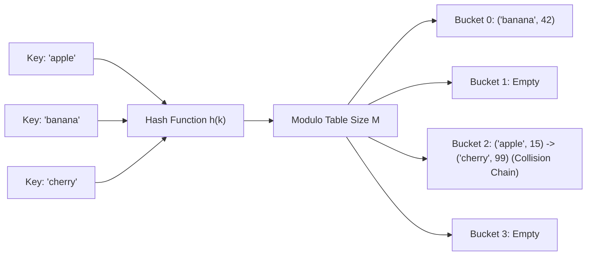

---


title: "00. 🔑 Hash Tables, Dictionaries & Hash Maps: Architectural Theory & Collision Resolution"
type: "concept_guide"
category: "dsa"
subcategory: "05_hashing"
created_at: 2026-08-22T00:00:00+07:00
updated_at: 2026-08-26T23:45:00+07:00
tags: [dsa, hashing, hash-table, hash-map, open-addressing, separate-chaining, robin-hood-hashing, cuckoo-hashing, algorithms, computer-science, learning-note]
aliases:
  - 00_overview_hash_tables_dictionary_hashmap
---

# 📌 00. 🔑 Hash Tables, Dictionaries & Hash Maps: Architectural Theory & Collision Resolution

Bảng băm (Hash Table) và Bảng ánh xạ băm (Hash Map / Dictionary) là các cấu trúc dữ liệu nền tảng cho phép thực hiện các thao tác tra cứu (lookup), thêm mới (insertion), và xóa phần tử (deletion) trong thời gian trung bình **$\mathcal{O}(1)$ hằng số**.

---

## 1. Kiến trúc Bảng băm & Nguyên lý Hoạt động

Bảng băm ánh xạ một không gian khóa vô hạn hoặc rất lớn $\mathcal{U}$ (ví dụ: chuỗi ký tự, đối tượng tùy biến) vào một không gian chỉ số nguyên hữu hạn $[0, M-1]$ của một mảng thông qua **Hàm băm (Hash Function)**:
$$\text{Index} = h(\text{key}) \pmod M$$



### 1.1 Yêu cầu Đối với Một Hàm băm Chuẩn (Good Hash Function)
1. **Tính tất định (Deterministic)**: Với cùng một khóa `key`, $h(\text{key})$ luôn phải trả về cùng một giá trị băm trong suốt vòng đời của chương trình.
2. **Phân phối đồng đều (Uniform Distribution)**: Phân bố các khóa đồng đều trên toàn bộ $M$ bucket để giảm thiểu xác suất đụng độ (Collision Probability $pprox 1/M$).
3. **Hiệu năng cao**: Tính toán cực nhanh trong vài chu kỳ CPU (\$0.5\text{--}2\text{ ns}$). Các hàm băm nổi tiếng: MurmurHash3, CityHash, xxHash, FNV-1a.

---

## 2. Các Chiến lược Xử lý Đụng độ Băm (Collision Resolution Strategies)

Khi hai khóa phân biệt $k_1 
e k_2 có cùng chỉ số bucket h(k_1) \equiv h(k_2) \pmod M$, xảy ra **Đụng độ băm (Hash Collision)**.

### 2.1 Separate Chaining (Băm nối kết rời)
- Mỗi bucket trong mảng là một danh sách liên kết (Linked List) hoặc cây đỏ đen (Red-Black Tree khi chuỗi dài $> 8$ như trong Java 8 `HashMap`).
- **Ưu điểm**: Dễ triển khai; hiệu năng suy giảm nhẹ nhàng khi hệ số tải $lpha > 1$.
- **Nhược điểm**: Bộ nhớ phân mảnh; con trỏ danh sách liên kết gây L1 Cache Miss liên tục.

### 2.2 Open Addressing (Đánh địa chỉ mở)
Tất cả các phần tử được lưu trực tiếp bên trong mảng bucket. Khi xảy ra đụng độ, thuật toán thăm dò (probe) các ô nhớ tiếp theo:
1. **Linear Probing**: Thăm dò $h(k, i) = (h(k) + i) \pmod M$.
   - *Hạn chế*: Gây ra hiện tượng **Primary Clustering** (các cụm ô nhớ bị lấp đầy nối liền nhau, làm tăng thời gian tìm kiếm).
2. **Quadratic Probing**: Thăm dò $h(k, i) = (h(k) + c_1 i + c_2 i^2) \pmod M$.
3. **Double Hashing**: Thăm dò $h(k, i) = (h_1(k) + i \cdot h_2(k)) \pmod M$.
4. **Robin Hood Hashing**: Khi chèn, nếu phần tử mới có khoảng cách thăm dò (Probe Sequence Length - PSL) lớn hơn phần tử đang nằm trong ô nhớ, phần tử mới sẽ "cướp" ô nhớ và đẩy phần tử cũ đi tiếp $\implies$ Cân bằng độ lệch chuẩn PSL, tối ưu L1 Cache cực đại.

---

## 3. Hệ số Tải (Load Factor $lpha$) & Cơ chế Tái băm (Rehashing)

\text{Load Factor } lpha = rac{N}{M} \quad (\text{với } N \text{ là số phần tử, } M \text{ là số bucket})

- **Ngưỡng kích hoạt Rehash**: Thông thường $lpha_{\text{max}} = 0.75$ cho Separate Chaining và \$0.5\text{--}0.7$ cho Open Addressing.
- **Quy trình Rehash**:
  1. Cấp phát mảng bucket mới có kích thước gấp đôi ($M' = 2M$ hoặc số nguyên tố tiếp theo).
  2. Duyệt qua toàn bộ phần tử cũ, tính toán lại chỉ số $\text{Index}' = h(k) \pmod{M'}$, và chèn vào mảng mới.
  3. Chi phí: $\mathcal{O}(N)$ thời gian, nhưng chi phí trung bình trên mỗi thao tác chèn vẫn là $\mathcal{O}(1)$ Amortized.

---

## 4. Triển khai Source Code Đa ngôn ngữ

### 4.1 Modern C++20 (Custom Hash Table with Linear Probing & Robin Hood Hashing)

```cpp
#include <iostream>
#include <vector>
#include <string>
#include <optional>
#include <functional>

template <typename K, typename V>
class RobinHoodHashMap {
private:
    struct Entry {
        K key;
        V value;
        int psl = -1; // Probe Sequence Length (-1 = empty)
    };

    std::vector<Entry> table_;
    size_t size_ = 0;
    size_t capacity_;
    float max_load_factor_ = 0.75f;

    size_t Hash(const K& key) const {
        return std::hash<K>{}(key) % capacity_;
    }

    void Rehash() {
        size_t old_cap = capacity_;
        auto old_table = std::move(table_);
        capacity_ *= 2;
        table_.assign(capacity_, Entry{});
        size_ = 0;

        for (const auto& entry : old_table) {
            if (entry.psl != -1) {
                Insert(entry.key, entry.value);
            }
        }
    }

public:
    RobinHoodHashMap(size_t initial_cap = 8) : capacity_(initial_cap) {
        table_.assign(capacity_, Entry{});
    }

    void Insert(K key, V value) {
        if (static_cast<float>(size_ + 1) / capacity_ > max_load_factor_) {
            Rehash();
        }

        size_t idx = Hash(key);
        int cur_psl = 0;
        Entry cur_entry{std::move(key), std::move(value), cur_psl};

        while (true) {
            if (table_[idx].psl == -1) {
                table_[idx] = std::move(cur_entry);
                table_[idx].psl = cur_psl;
                size_++;
                return;
            }

            if (table_[idx].key == cur_entry.key) {
                table_[idx].value = std::move(cur_entry.value);
                return;
            }

            // Robin Hood swap: Rich gives to poor
            if (table_[idx].psl < cur_psl) {
                std::swap(table_[idx], cur_entry);
                cur_psl = cur_entry.psl;
            }

            idx = (idx + 1) % capacity_;
            cur_psl++;
            cur_entry.psl = cur_psl;
        }
    }

    std::optional<V> Get(const K& key) const {
        size_t idx = Hash(key);
        int cur_psl = 0;

        while (true) {
            if (table_[idx].psl == -1 || cur_psl > table_[idx].psl) {
                return std::nullopt; // Key not found
            }
            if (table_[idx].key == key) {
                return table_[idx].value;
            }
            idx = (idx + 1) % capacity_;
            cur_psl++;
        }
    }
};

int main() {
    RobinHoodHashMap<std::string, int> map;
    map.Insert("Apple", 100);
    map.Insert("Banana", 200);
    map.Insert("Cherry", 300);

    std::cout << "Apple: " << map.Get("Apple").value_or(-1) << "
";
    std::cout << "Grape: " << map.Get("Grape").value_or(-1) << "
";
    return 0;
}
```

### 4.2 Python 3.12 (Two Sum via Hash Map $\mathcal{O}(N)$)

```python
from typing import List, Optional

class Solution:
    def twoSum(self, nums: List[int], target: int) -> List[int]:
        seen = {}
        for idx, val in enumerate(nums):
            complement = target - val
            if complement in seen:
                return [seen[complement], idx]
            seen[val] = idx
        return []

if __name__ == "__main__":
    sol = Solution()
    print("Two Sum Indices:", sol.twoSum([2, 7, 11, 15], 9))
```

### 4.3 C# (.NET 8 `Dictionary<TKey, TValue>` Internal Mechanics)

```csharp
using System;
using System.Collections.Generic;

public class HashMapDemo {
    public static void Main() {
        var dict = new Dictionary<string, int>(capacity: 100) {
            ["server_us_east"] = 8080,
            ["server_eu_central"] = 8081
        };

        if (dict.TryGetValue("server_us_east", out int port)) {
            Console.WriteLine($"Server Port: {port}");
        }
    }
}
```

---

## 🔗 Graph-Linked Knowledge Base
- 📖 Set vs Map: Set vs Map Deep Architectural Comparison
- 💬 Interview Q&A: Hashing Interview Q&A
- 📝 Module Exam: Hashing Exam
