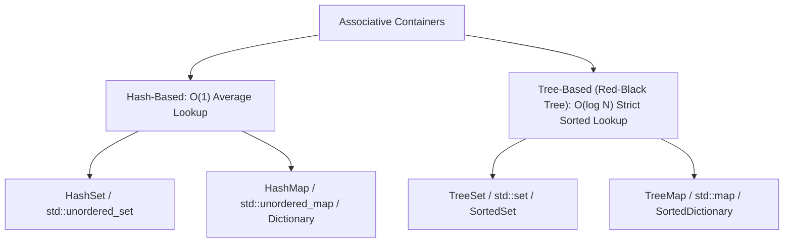

---


title: "05. ⚖️ Set vs Map: HashSet vs TreeSet, HashMap vs TreeMap — Architectural Comparison & Memory Layout"
type: "concept_guide"
category: "dsa"
subcategory: "05_hashing"
created_at: 2026-08-22T00:00:00+07:00
updated_at: 2026-08-26T23:45:00+07:00
tags: [dsa, hashing, hashset, hashmap, treeset, treemap, red-black-tree, performance, memory-layout, time-complexity, algorithms, computer-science, learning-note]
aliases:
  - 05_set_vs_map
---

# 📌 05. ⚖️ Set vs Map: HashSet vs TreeSet, HashMap vs TreeMap — Architectural Comparison & Memory Layout

Trong khoa học máy tính và kỹ nghệ phần mềm hiệu năng cao, việc lựa chọn đúng cấu trúc dữ liệu tập hợp (Set) hay ánh xạ (Map) dựa trên bảng băm (**Hash-based**) hay cây tìm kiếm nhị phân tự cân bằng (**Tree-based**) quyết định trực tiếp đến độ phức tạp thuật toán, khả năng mở rộng và hiệu năng sử dụng bộ nhớ cache của hệ thống.

---

## 1. Bảng So sánh Tổng quan Kiến trúc Toàn diện



| Đặc trưng | `HashSet` / `HashMap` (`std::unordered_map`) | `TreeSet` / `TreeMap` (`std::map`, Red-Black Tree) |
| :--- | :--- | :--- |
| **Cấu trúc Dữ liệu Nền tảng** | Mảng bucket động + Xử lý đụng độ (Separate Chaining / Open Addressing) | Cây Đỏ-Đen tự cân bằng (Self-Balancing BST) |
| **Thời gian Tra cứu (Lookup)** | $\mathcal{O}(1)$ Trung bình, $\mathcal{O}(N)$ Worst-case khi băm đụng độ tối đa | $\mathcal{O}(\log N)$ Tuyệt đối trong mọi trường hợp (Strict Worst-case) |
| **Thời gian Chèn (Insertion)** | $\mathcal{O}(1)$ Amortized | $\mathcal{O}(\log N)$ (bao gồm phép quay cây Rebalance) |
| **Thời gian Xóa (Deletion)** | $\mathcal{O}(1)$ Amortized | $\mathcal{O}(\log N)$ |
| **Thứ tự Phần tử (Ordering)** | **Hoàn toàn ngẫu nhiên / Không có thứ tự** | **Luôn duy trì thứ tự sắp xếp tăng dần theo Khóa** |
| **Truy vấn Khoảng (Range Query)**| Không hỗ trợ ($\mathcal{O}(N)$ duyệt toàn bộ) | Hỗ trợ cực mạnh $\mathcal{O}(\log N + K)$ (`lower_bound`, `upper_bound`) |
| **Tìm Phần tử Min / Max** | $\mathcal{O}(N)$ quét toàn bộ mảng | $\mathcal{O}(1)$ hoặc $\mathcal{O}(\log N)$ (`begin()`, `rbegin()`) |
| **Yêu cầu đối với Kiểu Khóa** | Cần hàm băm `hashCode()` và phép so bằng `equals()` / `operator==` | Cần toán tử so sánh thứ tự `operator<` hoặc `IComparable<T>` |
| **Mức độ Tiêu thụ Bộ nhớ** | Trung bình đến Thấp (phụ thuộc Load Factor $lpha pprox 0.75$) | Cao (Mỗi nút tốn thêm 3 con trỏ `left`, `right`, `parent` + 1 bit màu) |
| **Tận dụng CPU L1 Cache** | Phụ thuộc cách cài đặt (Open Addressing cực tốt; Chaining kém) | Kém do phân mảnh con trỏ trên Heap (Pointer Chasing) |

---

## 2. Phân tích Sâu Cơ chế Hoạt động & Cấu trúc Dữ liệu Bên dưới

### 2.1 Cây Đỏ-Đen (Red-Black Tree) trong `std::map` / `TreeMap`
Cây Đỏ-Đen là cây tìm kiếm nhị phân tự cân bằng thỏa mãn 5 bất biến (Invariants):
1. Mỗi nút là Đỏ hoặc Đen.
2. Nút gốc (`root`) luôn luôn là Đen.
3. Mọi nút lá (`NIL` / `nullptr`) đều là Đen.
4. Nếu một nút là Đỏ, cả hai nút con của nó phải là Đen (Không bao giờ có 2 nút Đỏ liền kề).
5. Mọi đường đi đơn từ một nút đến bất kỳ nút lá hậu duệ nào đều chứa cùng một số lượng nút Đen (**Black-Height**).

Nhờ các bất biến này, chiều cao của cây luôn được đảm bảo $h \le 2 \log_2(N + 1)$, giúp mọi thao tác tìm kiếm, chèn, xóa luôn kết thúc sau tối đa $\mathcal{O}(\log N)$ bước.

### 2.2 Bảng Băm Đánh địa chỉ Mở (Open Addressing) vs Nối kết Rời (Separate Chaining)
- **Separate Chaining (C++ `std::unordered_map`, Java `HashMap`)**: Mỗi bucket là một danh sách liên kết. Khi số phần tử trong 1 bucket vượt quá 8 (trong Java 8), chuỗi liên kết được chuyển thành Cây Đỏ-Đen để bảo vệ chống tấn công HashDoS.
- **Open Addressing (Python `dict`, C# `Dictionary<K,V>`, Rust `HashMap`)**: Lưu trực tiếp `(key, value)` trong mảng liên tiếp. Khi đụng độ, thuật toán thăm dò các ô nhớ tiếp theo (Linear Probing, Quadratic Probing hoặc Robin Hood Hashing), tối ưu hóa bộ nhớ L1 Data Cache lên tới \$3\times\text{--}5\times$ so với con trỏ rời rạc.

---

## 3. Polyglot Source Code & Benchmarking So sánh

### 3.1 C++20 (`std::unordered_map` vs `std::map` Performance & Range Query)

```cpp
#include <iostream>
#include <map>
#include <unordered_map>
#include <string>
#include <chrono>
#include <vector>
#include <random>

void BenchmarkMapVsUnorderedMap(int N) {
    std::unordered_map<int, int> hash_map;
    std::map<int, int> tree_map;

    std::vector<int> data(N);
    std::mt19937_64 rng(42);
    for (int i = 0; i < N; ++i) data[i] = static_cast<int>(rng() % (N * 10));

    // Benchmark Insertion
    auto t0 = std::chrono::high_resolution_clock::now();
    for (int x : data) hash_map[x] = x;
    auto t1 = std::chrono::high_resolution_clock::now();
    auto hash_insert_ms = std::chrono::duration_cast<std::chrono::milliseconds>(t1 - t0).count();

    t0 = std::chrono::high_resolution_clock::now();
    for (int x : data) tree_map[x] = x;
    t1 = std::chrono::high_resolution_clock::now();
    auto tree_insert_ms = std::chrono::duration_cast<std::chrono::milliseconds>(t1 - t0).count();

    std::cout << "N = " << N << "
"
              << "  std::unordered_map Insert: " << hash_insert_ms << " ms
"
              << "  std::map Insert (RB-Tree): " << tree_insert_ms << " ms
";

    // Range Query Demonstration on std::map: Find all keys in range [L, R]
    int L = N, R = N * 2;
    std::cout << "Range Query [" << L << ", " << R << "] in std::map: ";
    auto it_start = tree_map.lower_bound(L);
    auto it_end = tree_map.upper_bound(R);
    int count = 0;
    for (auto it = it_start; it != it_end && count < 5; ++it, ++count) {
        std::cout << it->first << " ";
    }
    std::cout << "...
";
}

int main() {
    BenchmarkMapVsUnorderedMap(500000);
    return 0;
}
```

### 3.2 Python 3.12 (`set` / `dict` vs `bisect` / `heapq`)

```python
import bisect
import time
from typing import List, Tuple

class SetMapComparisonPython:
    @staticmethod
    def demonstrate_set_operations():
        # Hash-based Set: O(1) membership test
        hash_set = {10, 50, 20, 90, 40}
        print("HashSet Membership (50 in set):", 50 in hash_set) # O(1)

        # Sorted Set Simulation using sorted list + bisect
        sorted_keys = sorted(list(hash_set)) # [10, 20, 40, 50, 90]
        
        # Range query: Keys in [20, 60] -> O(log N + K)
        left_idx = bisect.bisect_left(sorted_keys, 20)
        right_idx = bisect.bisect_right(sorted_keys, 60)
        range_keys = sorted_keys[left_idx:right_idx]
        print("Range Query [20, 60] via Binary Search:", range_keys)

if __name__ == "__main__":
    SetMapComparisonPython.demonstrate_set_operations()
```

### 3.3 C# (.NET 8 `Dictionary<TKey, TValue>` vs `SortedDictionary<TKey, TValue>`)

```csharp
using System;
using System.Collections.Generic;
using System.Diagnostics;

public class SetMapBenchmarkCSharp {
    public static void Main() {
        int N = 500_000;
        var hashDict = new Dictionary<int, int>(N);
        var sortedDict = new SortedDictionary<int, int>();

        var rand = new Random(1337);
        int[] data = new int[N];
        for (int i = 0; i < N; i++) data[i] = rand.Next(1, N * 10);

        var sw = Stopwatch.StartNew();
        for (int i = 0; i < N; i++) hashDict[data[i]] = i;
        sw.Stop();
        long hashTime = sw.ElapsedMilliseconds;

        sw.Restart();
        for (int i = 0; i < N; i++) sortedDict[data[i]] = i;
        sw.Stop();
        long sortedTime = sw.ElapsedMilliseconds;

        Console.WriteLine($"C# .NET 8 Performance Comparison (N = {N}):");
        Console.WriteLine($"  Dictionary<K, V> Insert:       {hashTime} ms");
        Console.WriteLine($"  SortedDictionary<K, V> Insert: {sortedTime} ms");
    }
}
```

---

## 4. Bẫy Thường Gặp & Chiến lược Lựa chọn Thực tế

1. **Khóa Đột Biến (Mutable Keys in Hash Table)**:
   - Nếu bạn sử dụng một đối tượng làm khóa trong `HashSet` hoặc `HashMap` và sau đó thay đổi giá trị thuộc tính của đối tượng đó làm thay đổi mã `hashCode()`, đối tượng đó sẽ bị "kẹt" vĩnh viễn trong bucket cũ. Khi tìm kiếm bằng đối tượng đó, hàm băm mới sẽ trỏ tới bucket khác $\implies$ Thất thoát dữ liệu nghiêm trọng.
   - **Quy tắc Vàng**: Khóa trong Hash Table và Tree Map **luôn luôn phải là Bất biến (Immutable)** (ví dụ: `int`, `string`, `record`, `std::string`, `tuple`).
2. **Khi nào BẮT BUỘC dùng Tree-based (TreeSet / TreeMap)**:
   - Khi bài toán yêu cầu các thao tác: `Ceiling(x)` (số nhỏ nhất $\ge x$), `Floor(x)` (số lớn nhất $\le x$), tìm Median động, hoặc liên tục duy trì thứ tự Top-K.
3. **Khi nào BẮT BUỘC dùng Hash-based (HashSet / HashMap)**:
   - Khi hệ thống yêu cầu độ trễ tối thiểu (Low Latency) $\mathcal{O}(1)$ cho các thao tác tra cứu tần số cao (High-Throughput Key-Value Caching, Routing Tables, Deduplication).

---

## 🔗 Graph-Linked Knowledge Base
- 📖 Overview: [[01_DSA/01_theory_and_patterns/05_Hashing/00_overview_hash_tables_dictionary_hashmap|Hash Tables Overview]]
- 💬 Interview Q&A: [[01_DSA/01_theory_and_patterns/05_Hashing/05_hashing_qa|Hashing Interview Q&A]]
