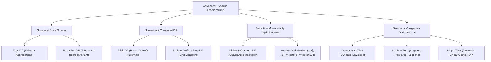
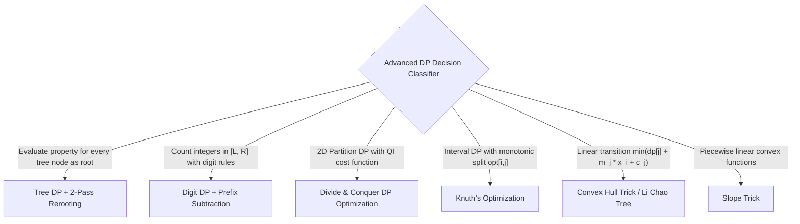

---


title: "00. 📚 06 Advanced Dynamic Programming — Master Module Overview"
type: "module_overview"
category: "dsa"
subcategory: "06_advanced_dynamic_programming"
tags: [dsa, advanced-dynamic-programming, tree-dp, rerooting, digit-dp, dnc-dp, convex-hull-trick, knuth-optimization, slope-trick, overview, roadmap, algorithms, computer-science, learning-note]
aliases:
  - 00_overview_06_advanced_dynamic_programming
---

# 📌 00. 📚 06 Advanced Dynamic Programming — Master Module Overview

## 📌 Connected Resource Graph
- 🧱 **DP Foundations**: Dynamic Programming Foundations
- 🌲 **Tree Decompositions**: Centroid Decomposition & Tree Path Queries
- 📐 **Geometry & CHT**: Convex Hull Trick & Li Chao Tree
- 📊 **Segment Tree Mechanics**: Segment Trees & Fenwick Trees
- 🎯 **Advanced Patterns**: 05 Advanced DSA Patterns Overview

> 🔙 **Parent Roadmap**: [`01_DSA/01_theory_and_patterns/Lộ trình học DSA - Nền tảng thuật toán.md`](../Lộ%20trình%20học%20DSA%20-%20Nền%20tảng%20thuật%20toán.md)  
> ⚓ **Prerequisites**: Dynamic Programming Foundations & Tree Traversals

---


## 🎯 1. Module Objective & Algorithmic Frontier

Standard Dynamic Programming operates over simple scalar dimensions (1D arrays, 2D grids, prefix substrings) using naive iteration orders, resulting in $O(N^2)$, $O(N^3)$, or exponential brute-force bounds. **Advanced Dynamic Programming** introduces sophisticated structural paradigms, geometric optimizations, and algebraic properties that break these polynomial barriers.

This master module equips engineers and competitive programmers with techniques to:
1. **Optimize Tree States**: Solve all-roots tree problems in linear $O(N)$ time via **2-Pass Tree Rerooting** instead of repeated $O(N^2)$ DFS traversals.
2. **Solve Continuous Integer Range Constraints**: Compute properties of numbers up to $10^{18}$ in $O(\text{digits} \cdot \text{states})$ time using **Digit DP**.
3. **Exploit Monotonicities**: Accelerate 2D DP transitions from $O(K \cdot N^2)$ to $O(K \cdot N \log N)$ or $O(N^2)$ using **Divide & Conquer Optimization** and **Knuth's Optimization**.
4. **Transform Recurrences Geometrically**: Compute dynamic minimums/maximums of linear functions $dp[i] = \min_{j < i} (dp[j] + m_j x_i + c_j)$ in $O(N)$ or $O(N \log N)$ using **Convex Hull Trick (CHT)** and **Li Chao Segment Trees**.



---

## 🧭 2. Sub-Module & Artifact Navigation

### 📖 Deep-Dive Technique Guides
- 🌳 **Tree DP & Rerooting Technique**: Tree DP & Rerooting Technique
- 🔢 **Digit DP & Number Range Constraints**: Digit DP & Number Range Constraints
- ⚡ **Divide and Conquer DP Optimization**: Divide & Conquer DP Optimization
- 📐 **Convex Hull Trick & Li Chao Tree**: Convex Hull Trick & Li Chao Tree

### 📦 Standard Artifact Suite
1. 📝 **Exam & Assessment**: 06 Advanced Dynamic Programming Exam Suite
2. 🧩 **Problem Set Walkthroughs**: 06 Advanced Dynamic Programming Problem Set
3. 💬 **Interview Q&A**: 06 Advanced Dynamic Programming Interview Q&A
4. 📊 **Cheat Sheet & Reference**: 06 Advanced Dynamic Programming Resource Sheet

---

## 🔬 3. Theoretical Foundations & Mathematical Invariants

### 3.1 Tree DP & The 2-Pass Rerooting Technique
When evaluating a tree metric for every vertex as a potential root (e.g., Sum of Distances, Maximum Tree Path, Subtree Independent Set), computing from scratch for each root takes $O(N \cdot N) = O(N^2)$.

**The 2-Pass Rerooting Invariant**:
1. **Pass 1 (Bottom-Up Post-Order DFS)**: Select arbitrary root $r_0$. Compute subtree sizes $\text{sz}[u]$ and aggregate metrics for the subtree rooted at $u$:
   $$\text{dp}[u] = \sum_{v \in \text{children}(u)} (\text{dp}[v] + \text{sz}[v])$$
2. **Pass 2 (Top-Down Pre-Order DFS)**: When moving the root from parent $u$ to child $v$:
   - The subtree of $v$ expands to become the entire tree of size $N$.
   - The former parent $u$ loses $v$'s contribution and retains $N - \text{sz}[v]$ nodes.
   $$\text{ans}[v] = \text{ans}[u] - \text{sz}[v] + (N - \text{sz}[v]) = \text{ans}[u] + N - 2 \cdot \text{sz}[v]$$
This achieves optimal **$O(N)$ time and $O(N)$ space** for all $N$ roots simultaneously.

```
       (u) Root State                     (v) Rerooted State
       /   \                               /   \
     [v]    [other]                      [w]   (u) Former Parent
    /   \                                     /   \
  [x]   [y]                                 [other]
```

---

### 3.2 Digit DP (Numerical Prefix DP)
Digit DP counts integers in range $[L, R]$ that satisfy complex digit constraints (e.g., no consecutive 1s, sum of digits is prime, palindrome digits).

**Prefix Reduction Invariant**:
$$\text{Count}(L, R) = \text{Solve}(R) - \text{Solve}(L - 1)$$

**State Representation $\text{DP}(\text{pos}, \text{tight}, \text{lead\_zero}, \text{state})$**:
- `pos`: Current digit position being processed from most significant digit (MSD) to least significant digit (LSD).
- `tight` (Boolean): If true, digits at `pos` are restricted to \$0 \le d \le \text{limit}[pos]$. If false, any digit \$0 \le d \le 9$ is valid.
- `lead_zero` (Boolean): Handles cases where leading zeros should not trigger pattern violations (e.g., in palindromes or alternating digits).
- `state`: Problem-specific accumulated metric (e.g., digit sum modulo $K$, bitmask of visited digits, previous digit value).

**Transition Formula**:
$$\text{DP}(\text{pos}, \text{tight}, \text{lz}, \text{st}) = \sum_{d = 0}^{\text{limit}} \text{DP}(\text{pos}+1, \text{tight} \land (d == \text{limit}), \text{lz} \land (d == 0), \text{next\_state}(\text{st}, d))$$

---

### 3.3 Divide and Conquer DP Optimization
Applies to recurrences of the form:
$$dp[i][j] = \min_{0 \le k \le j} \{ dp[i-1][k] + C(k, j) \}$$

**Condition for Applicability**: The cost function $C(k, j)$ satisfies the **Quadrangle Inequality (QI)**:
$$C(a, c) + C(b, d) \le C(a, d) + C(b, c) \quad \forall a \le b \le c \le d$$
This implies monotonicity of the optimal splitting point $opt(i, j)$:
$$opt(i, j) \le opt(i, j+1)$$

**D&C Recursion Framework**:
Instead of computing $dp[i][j]$ sequentially in $O(N^2)$ for each row $i$:
1. Compute the midpoint $mid = (L + R) / 2$.
2. Search for $opt[i][mid]$ strictly within the search interval $[opt_L, opt_R]$.
3. Divide into subproblems: solve $[L, mid-1]$ bounded by $[opt_L, opt[i][mid]]$ and $[mid+1, R]$ bounded by $[opt[i][mid], opt_R]$.
4. Reduces time complexity from $O(K \cdot N^2)$ to **$O(K \cdot N \log N)$**.

---

### 3.4 Convex Hull Trick (CHT) & Li Chao Trees
Applies to recurrences where transitions are linear functions of the current state:
$$dp[i] = \min_{j < i} \{ dp[j] + m_j \cdot x_i + c_j \}$$

Viewing each candidate $j$ as a line $y = m_j \cdot x + c_j$ with query point $x = x_i$:
- **Static / Monotonic Slopes & Queries**: Maintain the lower convex envelope of lines using a **Monotonic Deque** in amortized **$O(1)$ query / insertion** ($O(N)$ total).
- **Arbitrary Slopes / Arbitrary Queries**: Use a **Li Chao Segment Tree** or dynamic `std::set` line container (Hull Project) to insert lines and query arbitrary $x$ in **$O(\log N)$** time.

```
       Cost y
         ^          Line j1: y = m1 * x + c1
         |            \       Line j2: y = m2 * x + c2
         |             \     /
         |              \   /       Line j3: y = m3 * x + c3
         |               \ /_______/
         |               /\       /
         |              /  \_____/ <--- Lower Convex Envelope
         +---------------------------------------------> Query x
```

---

## ⚡ 4. Master Complexity & Optimization Matrix

| Advanced DP Paradigm | Naive Complexity | Optimized Complexity | Auxiliary Space | Key Requirement / Invariant |
| :--- | :---: | :---: | :---: | :--- |
| **Tree DP (Single Root)** | $O(N)$ | $O(N)$ | $O(N)$ | Subtree independence, DAG property on trees |
| **Tree Rerooting (All Roots)** | $O(N^2)$ | $O(N)$ | $O(N)$ | Invertible / associative subtree combining operator |
| **Digit DP** | $O(R - L)$ | $O(\log_{10} R \cdot |\text{States}|)$ | $O(\log_{10} R \cdot |\text{States}|)$ | Prefix independence $\text{Solve}(R) - \text{Solve}(L-1)$ |
| **D&C DP Optimization** | $O(K \cdot N^2)$ | $O(K \cdot N \log N)$ | $O(K \cdot N)$ or $O(N)$ | Quadrangle Inequality $C(a,c)+C(b,d) \le C(a,d)+C(b,c)$ |
| **Knuth's Optimization** | $O(N^3)$ | $O(N^2)$ | $O(N^2)$ | Interval DP Monotonicity $opt[i, j-1] \le opt[i, j] \le opt[i+1, j]$ |
| **Convex Hull Trick (Sorted)** | $O(N^2)$ | $O(N)$ | $O(N)$ | Monotonic slopes $m_j$ and queries $x_i$ |
| **Li Chao Tree (General CHT)** | $O(N^2)$ | $O(N \log (\text{Range}))$ | $O(\text{Range})$ or $O(N \log N)$ | Linear form $f_j(x) = m_j x + c_j$ with arbitrary order |
| **SOS (Sum Over Subsets) DP** | $O(4^N)$ or $O(3^N)$ | $O(N \cdot 2^N)$ | $O(2^N)$ | Submask bitwise aggregation along dimensions |

---

## 💻 5. Polyglot Reference Implementations

### 5.1 Tree DP & Rerooting: Sum of Distances in Tree (LeetCode 834)
Given an undirected tree of $N$ nodes, return an array `ans` where `ans[i]` is the sum of distances between node $i$ and all other nodes.

#### C++20 Implementation
```cpp
#include <vector>
#include <cstdint>

class TreeRerootingSolver {
private:
    int n;
    std::vector<std::vector<int>> adj;
    std::vector<int> count;
    std::vector<int64_t> ans;

    // Pass 1: Post-order DFS to compute subtree sizes and root 0 answer
    void dfs1(int u, int parent, int depth) {
        count[u] = 1;
        ans[0] += depth;
        for (int v : adj[u]) {
            if (v == parent) continue;
            dfs1(v, u, depth + 1);
            count[u] += count[v];
        }
    }

    // Pass 2: Pre-order DFS to reroot to every child v in O(1)
    void dfs2(int u, int parent) {
        for (int v : adj[u]) {
            if (v == parent) continue;
            // Moving root from u to v:
            // - v's subtree (count[v] nodes) get 1 unit closer (-count[v])
            // - All other nodes (n - count[v] nodes) get 1 unit further (+ (n - count[v]))
            ans[v] = ans[u] - count[v] + (n - count[v]);
            dfs2(v, u);
        }
    }

public:
    std::vector<int64_t> sumOfDistancesInTree(int num_nodes, const std::vector<std::pair<int, int>>& edges) {
        n = num_nodes;
        adj.assign(n, std::vector<int>());
        for (const auto& [u, v] : edges) {
            adj[u].push_back(v);
            adj[v].push_back(u);
        }

        count.assign(n, 0);
        ans.assign(n, 0);

        dfs1(0, -1, 0);
        dfs2(0, -1);

        return ans;
    }
};
```

#### Python 3 Implementation
```python
from typing import List, Tuple

def sum_of_distances_in_tree(n: int, edges: List[List[int]]) -> List[int]:
    """
    Computes sum of distances for all roots in O(N) time and O(N) space.
    """
    adj = [[] for _ in range(n)]
    for u, v in edges:
        adj[u].append(v)
        adj[v].append(u)

    count = [1] * n
    ans = [0] * n

    # Pass 1: Subtree count and answer for root 0
    def dfs1(u: int, parent: int, depth: int) -> None:
        ans[0] += depth
        for v in adj[u]:
            if v != parent:
                dfs1(v, u, depth + 1)
                count[u] += count[v]

    # Pass 2: Rerooting transitions
    def dfs2(u: int, parent: int) -> None:
        for v in adj[u]:
            if v != parent:
                ans[v] = ans[u] - count[v] + (n - count[v])
                dfs2(v, u)

    dfs1(0, -1, 0)
    dfs2(0, -1)
    return ans
```

#### C# Implementation
```csharp
using System;
using System.Collections.Generic;

public class TreeRerooting {
    public static long[] SumOfDistancesInTree(int n, int[][] edges) {
        var adj = new List<int>[n];
        for (int i = 0; i < n; i++) adj[i] = new List<int>();
        foreach (var edge in edges) {
            adj[edge[0]].Add(edge[1]);
            adj[edge[1]].Add(edge[0]);
        }

        int[] count = new int[n];
        long[] ans = new long[n];

        void Dfs1(int u, int parent, int depth) {
            count[u] = 1;
            ans[0] += depth;
            foreach (int v in adj[u]) {
                if (v == parent) continue;
                Dfs1(v, u, depth + 1);
                count[u] += count[v];
            }
        }

        void Dfs2(int u, int parent) {
            foreach (int v in adj[u]) {
                if (v == parent) continue;
                ans[v] = ans[u] - count[v] + (n - count[v]);
                Dfs2(v, u);
            }
        }

        Dfs1(0, -1, 0);
        Dfs2(0, -1);
        return ans;
    }
}
```

---

### 5.2 Digit DP: Numbers with No Consecutive Duplicate Digits in Range $[L, R]$

#### C++20 Implementation
```cpp
#include <string>
#include <vector>
#include <cstring>
#include <cstdint>

class DigitDPSolver {
private:
    std::string s;
    int64_t dp[20][11][2][2]; // [pos][prev_digit][tight][lead_zero]

    int64_t solve_memo(int pos, int prev_digit, bool tight, bool lead_zero) {
        if (pos == static_cast<int>(s.size())) return 1;
        if (dp[pos][prev_digit + 1][tight][lead_zero] != -1)
            return dp[pos][prev_digit + 1][tight][lead_zero];

        int limit = tight ? (s[pos] - '0') : 9;
        int64_t total = 0;

        for (int d = 0; d <= limit; ++d) {
            if (!lead_zero && d == prev_digit) continue; // Consecutive identical digits forbidden

            bool next_tight = tight && (d == limit);
            bool next_lz = lead_zero && (d == 0);
            int next_prev = next_lz ? -1 : d;

            total += solve_memo(pos + 1, next_prev, next_tight, next_lz);
        }

        return dp[pos][prev_digit + 1][tight][lead_zero] = total;
    }

    int64_t count_valid(int64_t val) {
        if (val < 0) return 0;
        s = std::to_string(val);
        std::memset(dp, -1, sizeof(dp));
        return solve_memo(0, -1, true, true);
    }

public:
    int64_t countInRange(int64_t L, int64_t R) {
        return count_valid(R) - count_valid(L - 1);
    }
};
```

---

### 5.3 Divide and Conquer DP Optimization: Split Array into $K$ Partitions

#### Python 3 Template
```python
from typing import List, Callable

def dnc_dp_optimize(n: int, k: int, cost_fn: Callable[[int, int], int]) -> int:
    """
    D&C DP Optimization solving:
    dp[i][j] = min_{k <= j} (dp[i-1][k] + cost_fn(k+1, j))
    Time Complexity: O(K * N log N)
    Auxiliary Space: O(N) (rolling array)
    """
    INF = float('inf')
    dp_prev = [cost_fn(0, j) for j in range(n)]
    dp_curr = [INF] * n

    def compute(l: int, r: int, opt_l: int, opt_r: int) -> None:
        if l > r:
            return
        mid = (l + r) // 2
        best_val = INF
        best_opt = -1

        # Search for optimal split point in [opt_l, min(mid, opt_r)]
        for p in range(opt_l, min(mid, opt_r) + 1):
            cur = (dp_prev[p] if p >= 0 else 0) + cost_fn(p + 1, mid)
            if cur < best_val:
                best_val = cur
                best_opt = p

        dp_curr[mid] = best_val

        # Divide and conquer
        compute(l, mid - 1, opt_l, best_opt)
        compute(mid + 1, r, best_opt, opt_r)

    for step in range(1, k):
        compute(0, n - 1, 0, n - 1)
        dp_prev = dp_curr[:]
        dp_curr = [INF] * n

    return dp_prev[n - 1]
```

---

## ⚠️ 6. Common Pitfalls & High-Frequency Interview Traps

1. **Digit DP Memoization Leak Across Bounds**:
   - **Crucial Rule**: Only memoize states where `tight == false` and `lead_zero == false` (or explicitly include `tight` and `lead_zero` in the memo array dimensions). Sharing cached values computed under tight constraints for loose searches results in catastrophic undercounting.
2. **Tree Rerooting Non-Invertible Aggregations**:
   - The simple rerooting subtraction $\text{ans}[v] = \text{ans}[u] - \text{contrib}(v)$ only works if the aggregator is invertible under subtraction (like addition or XOR). For non-invertible operators like $\max$, you must compute prefix and suffix maximums of child contributions to exclude child $v$ in $O(1)$.
3. **D&C Optimization Applicability Fallacy**:
   - Never apply D&C DP without formally verifying the Quadrangle Inequality $C(a, c) + C(b, d) \le C(a, d) + C(b, c)$. If $opt(i, j)$ is non-monotonic, D&C pruning will prematurely discard optimal states.
4. **Recursion Limit Exceeded in Tree DP**:
   - In Python and standard environments, deep trees (e.g., skewed line graphs with $N = 10^5$) trigger `RecursionError` / Stack Overflow. Always set `sys.setrecursionlimit(200000)` or convert to topological BFS / explicit stack post-order traversals.

---

## 🎯 7. Pattern Recognition & Problem Archetypes



---

