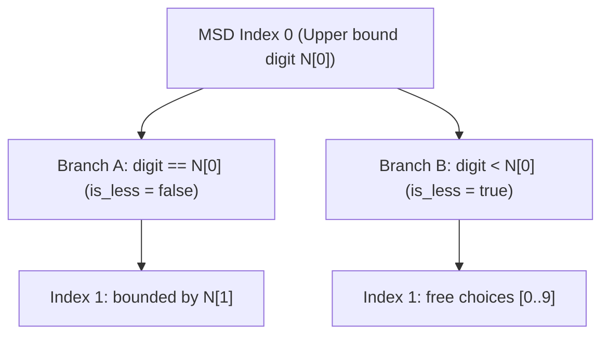

---


title: "01. Advanced DSA Pattern: Digit Dynamic Programming for Number Range Constraints"
type: "pattern_guide"
category: "dsa"
subcategory: "06_Advanced_Dynamic_Programming"
created_at: 2026-08-22T00:06:16+07:00
updated_at: 2026-08-22T00:06:16+07:00
tags: [dsa, dynamic-programming, digit-dp, number-theory, range-queries, advanced-patterns, competitive-programming, algorithms, computer-science, learning-note]
aliases:
  - 01_digit_dp_number_range_constraints
---


# 📌 01. Advanced DSA Pattern: Digit Dynamic Programming for Number Range Constraints

**Digit Dynamic Programming (Digit DP)** is a specialized sub-domain of dynamic programming used to count or evaluate properties of integers in a range $[L, R]$ (where $R$ can be as large as $10^{18}$ or $10^{100}$) based on their decimal or binary digit representations. Naive iteration over all numbers in $[L, R]$ takes $O(R)$ time, which TLEs for $R > 10^7$. Digit DP reduces this to $O(\text{digits} \times \text{states}) = O(\log_{10} R \times \text{states})$.

---

## 1. Under-the-Hood Intuition & Algorithmic Mechanics

### 1.1 Range Subtraction Transformation
Most range problems ask for the count of valid numbers $X \in [L, R]$. By applying prefix subtraction:
$$f(L, R) = f(0, R) - f(0, L - 1)$$
We reduce the problem to finding valid integers $X \le N$ for a given upper bound $N$.

### 1.2 State Abstraction & Digit Traversal Tree

Digit DP constructs numbers digit-by-digit from **Most Significant Digit (MSD)** to **Least Significant Digit (LSD)**.



```
    Upper Bound N = 3 4 2
    
    Index 0: Choice [0, 1, 2, 3]
       - If chosen digit is 3 (matches N[0]) => Next index is TIGHT (is_less = false)
       - If chosen digit is 0, 1, 2 (< N[0]) => Next index is FREE (is_less = true)
```

#### Core DP State Parameters
A standard Digit DP function is defined recursively as `Solve(idx, is_less, is_started, [custom_state])`:

1. `idx` (int): The current digit index being processed (0 to $D-1$).
2. `is_less` (bool):
   - `false` (Tight Bound): We are restricted to digits in $[0, \text{N}[idx]]$. If we pick $\text{N}[idx]$, the next state remains tight.
   - `true` (Free Bound): We can pick any digit in $[0, 9]$. All sub-branches are unrestricted.
3. `is_started` (bool): Tracks whether we have placed at least one non-zero digit. Used to distinguish leading zeros from valid digit `0`s (crucial for counting problem properties like unique digits or no consecutive zeros).
4. `custom_state` (int / bitmask): Specific problem state (e.g., bitmask of visited digits, sum of digits modulo $K$, count of target digit '1').

#### Memoization Invariant
Notice that when `is_less == true` and `is_started == true`, the subproblem depends ONLY on `(idx, custom_state)`. We memoize `dp[idx][custom_state]`. We NEVER memoize when `is_less == false` because tight choices depend strictly on the fixed prefix of upper bound $N$.

---

## 2. Idiomatic Code Implementations

### 2.1 C# 12 Implementation

```csharp
using System;
using System.Collections.Generic;

namespace DSAPatterns.AdvancedDP
{
    /// <summary>
    /// Implements Digit DP to solve LeetCode 233: Number of Digit One.
    /// Counts total occurrence of digit 1 in all non-negative integers <= N.
    /// </summary>
    public class DigitDpNumberRange
    {
        private string _s = string.Empty;
        private int[][][] _memo = null!;

        public int CountDigitOne(int n)
        {
            if (n <= 0) return 0;
            _s = n.ToString();
            int len = _s.Length;

            // _memo[idx][count1][is_started]
            _memo = new int[len][][];
            for (int i = 0; i < len; i++)
            {
                _memo[i] = new int[len + 1][];
                for (int j = 0; j <= len; j++)
                {
                    _memo[i][j] = new int[2];
                    Array.Fill(_memo[i][j], -1);
                }
            }

            return Dfs(0, count1: 0, isLess: false, isStarted: false);
        }

        private int Dfs(int idx, int count1, bool isLess, bool isStarted)
        {
            // Base Case: Reached beyond Least Significant Digit
            if (idx == _s.Length)
            {
                return count1;
            }

            int startedIdx = isStarted ? 1 : 0;
            if (isLess && _memo[idx][count1][startedIdx] != -1)
            {
                return _memo[idx][count1][startedIdx];
            }

            int limit = isLess ? 9 : (_s[idx] - '0');
            int totalOnes = 0;

            for (int digit = 0; digit <= limit; digit++)
            {
                bool nextIsLess = isLess || (digit < limit);
                bool nextIsStarted = isStarted || (digit > 0);
                int nextCount1 = count1 + ((nextIsStarted && digit == 1) ? 1 : 0);

                totalOnes += Dfs(idx + 1, nextCount1, nextIsLess, nextIsStarted);
            }

            if (isLess)
            {
                _memo[idx][count1][startedIdx] = totalOnes;
            }

            return totalOnes;
        }
    }
}
```

### 2.2 Python 3 Implementation

```python
from functools import lru_cache

class DigitDpNumberRange:
    """
    Implements Digit DP using Python functools.lru_cache for memoization.
    Counts numbers in [1, N] with no repeated digits (LeetCode 1012).
    """
    def numDupDigitsAtMostN(self, n: int) -> int:
        s = str(n)
        length = len(s)

        @lru_cache(maxsize=None)
        def dfs(idx: int, mask: int, is_less: bool, is_started: bool) -> int:
            # Base Case: Valid number constructed
            if idx == length:
                return 1 if is_started else 0

            limit = 9 if is_less else int(s[idx])
            count = 0

            for digit in range(0, limit + 1):
                next_is_less = is_less or (digit < limit)
                
                if not is_started and digit == 0:
                    # Trailing leading zero, remains unstarted
                    count += dfs(idx + 1, mask, next_is_less, False)
                else:
                    # Check bitmask for repeated digit constraint
                    if (mask & (1 << digit)) != 0:
                        continue # Skip digit if already visited
                    
                    next_mask = mask | (1 << digit)
                    count += dfs(idx + 1, next_mask, next_is_less, True)

            return count

        total_unique_digit_numbers = dfs(0, 0, False, False)
        # Total numbers with AT LEAST ONE duplicate = N - unique numbers
        return n - total_unique_digit_numbers
```

---

## 3. Complexity Analysis & Memory Overhead

| Metric / Dimension | Complexity | Description & Hardware Impact |
| :--- | :--- | :--- |
| **Number of Digits ($D$)** | $O(\log_{10} N)$ | Max digits $D \approx 18$ for 64-bit integers (`long.MaxValue`). |
| **State Space Cardinality** | $O(D \times S)$ | $S$ is state capacity (e.g., bitmask size $2^{10} = 1024$ for digits 0-9). |
| **Transitions per State** | $O(10)$ | 10 digit choices (0 through 9) per recursive step. |
| **Total Time Complexity** | $\mathcal{O}(D \times S \times 10)$ | Under $10^5$ operations, executes in $< 5\text{ms}$. |
| **Space Complexity** | $\mathcal{O}(D \times S)$ | Auxiliary memoization matrix size + call stack depth $O(D)$. |

---

## 4. Common Pitfalls & Off-by-One Anti-Patterns

1. **Memoizing Bounded (`is_less == false`) States**:
   - *Pitfall*: Storing results when `is_less == false` pollutes memo table with prefix-restricted answers, causing wrong outputs on subsequent branch lookups.
   - *Fix*: Only save to `memo` array when `is_less == true`.

2. **Negative Range Bound on $L - 1$**:
   - *Pitfall*: Computing $f(0, L - 1)$ when $L = 0$ results in $f(0, -1)$, causing index out of bounds or infinite recursion.
   - *Fix*: If $L = 0$, evaluate $f(0, R)$ directly without subtracting $f(0, -1)$.

3. **Confusing Leading Zeros with Digit Zero**:
   - *Pitfall*: For problems counting occurrences of digit `0` or tracking non-consecutive zeros, counting leading zeros as valid digits corrupts the result.
   - *Fix*: Explicitly maintain the boolean flag `is_started`. Only treat digit `0` as active if `is_started == true`.

---

## 5. Related LeetCode Problems & Variant Patterns

| LeetCode # | Problem Title | Variant Pattern / Custom State | Difficulty |
| :--- | :--- | :--- | :--- |
| **LC 233** | [Number of Digit One](https://leetcode.com/problems/number-of-digit-one/) | Digit DP counting cumulative count of digit 1. | **Hard** |
| **LC 1012** | [Numbers With Repeated Digits](https://leetcode.com/problems/numbers-with-repeated-digits/) | Digit DP with Bitmask tracking visited digits. | **Hard** |
| **LC 600** | [Non-negative Integers without Consecutive Ones](https://leetcode.com/problems/non-negative-integers-without-consecutive-ones/) | Binary Base Digit DP (bits instead of decimal digits). | **Hard** |
| **LC 2719** | [Count of Integers](https://leetcode.com/problems/count-of-integers/) | Digit DP with digit sum bounds `[min_sum, max_sum]`. | **Hard** |

---

*This guide forms part of the DSA Track Subdomain Expansion. Protect Obsidian links `[[link]]` during graph traversals.*
