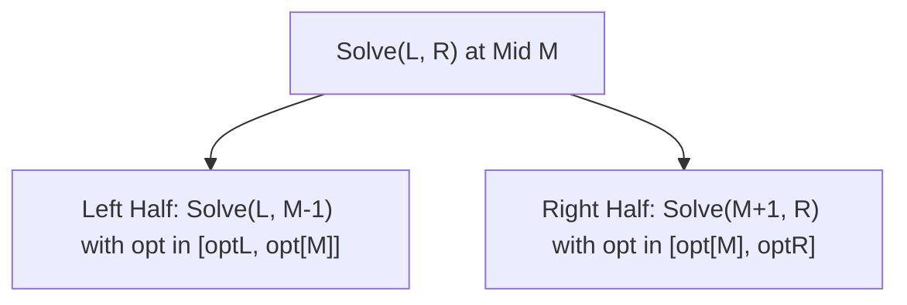

---


title: "01. Advanced DSA Pattern: Divide & Conquer Dynamic Programming Optimization"
type: "pattern_guide"
category: "dsa"
subcategory: "06_Advanced_Dynamic_Programming"
created_at: 2026-08-22T00:06:16+07:00
updated_at: 2026-08-22T00:06:16+07:00
tags: [dsa, dynamic-programming, divide-and-conquer, dp-optimization, quadrangle-inequality, advanced-patterns, competitive-programming, algorithms, computer-science, learning-note]
aliases:
  - 01_divide_and_conquer_dp_optimization
---


# 📌 01. Advanced DSA Pattern: Divide & Conquer Dynamic Programming Optimization

**Divide & Conquer DP Optimization (D&C DP)** is an advanced speedup technique that optimizes 2D Dynamic Programming recurrences from $O(K \cdot N^2)$ to $O(K \cdot N \log N)$. It applies when the optimal transition point $opt[i][j]$ for state $(i, j)$ moves monotonically with respect to $j$.

---

## 1. Under-the-Hood Intuition & Algorithmic Mechanics

### 1.1 Recurrence Structure & Monotonicity Condition

Consider dynamic programming recurrences of the partition form:
$$dp[i][j] = \min_{0 \le k < j} \left( dp[i - 1][k] + C(k + 1, j) \right)$$

Where:
- $i \in [1, K]$ is the number of partitions / subproblems (e.g., $K$ subarrays).
- $j \in [1, N]$ is the array prefix length.
- $C(k + 1, j)$ is a range cost function.

Let $opt[i][j]$ be the optimal index $k$ that minimizes the recurrence for state $(i, j)$.

#### Monotonicity Invariant
D&C DP optimization is applicable if and only if $opt[i][j]$ satisfies the monotonicity condition:
$$opt[i][j] \le opt[i][j + 1]$$

This property naturally holds if the cost function $C(a, b)$ satisfies the **Quadrangle Inequality** (Monge property):
$$C(a, c) + C(b, d) \le C(a, d) + C(b, c) \quad \forall a \le b \le c \le d$$

```
    Indices:   a       b       c       d
               |-------|-------|-------|
               C(a, c) + C(b, d)  <=  C(a, d) + C(b, c)   [Cross cost <= Overlap cost]
```

### 1.2 The Divide & Conquer State Space Evaluation

Naively evaluating each $dp[i][j]$ takes $O(N)$ scanning over candidate $k$, yielding $O(N^2)$ for layer $i$.

Using Divide & Conquer:
1. Fix layer $i$. Define recursive solver `Solve(i, L, R, optL, optR)`.
2. Compute $M = \lfloor (L + R) / 2 \rfloor$.
3. Linearly scan $k \in [\text{optL}, \min(M - 1, \text{optR})]$ to find the exact optimal split index $opt[i][M]$ for $dp[i][M]$.
4. Recurse into left range: `Solve(i, L, M - 1, optL, opt[i][M])`.
5. Recurse into right range: `Solve(i, M + 1, R, opt[i][M], optR)`.



Because the search range for candidate transition points splits along $opt[i][M]$, each level of the recursion tree takes $O(N)$ total transitions across all subproblems, with recursion depth $O(\log N)$. Thus, computing layer $i$ takes $O(N \log N)$ time.

---

## 2. Idiomatic Code Implementations

### 2.1 C# 12 Implementation

```csharp
using System;

namespace DSAPatterns.AdvancedDP
{
    /// <summary>
    /// Implements Divide & Conquer DP Optimization.
    /// Solves partitioning array into K contiguous subarrays to minimize total cost.
    /// Time Complexity: O(K * N log N), Space Complexity: O(K * N).
    /// </summary>
    public class DivideAndConquerDp
    {
        private long[][] _dp = null!;
        private long[] _prefSum = null!;

        // Sample Cost Function: Sum of squares of elements in range (k+1..j)
        private long Cost(int left, int right)
        {
            if (left > right) return 0;
            long sum = _prefSum[right] - _prefSum[left - 1];
            return sum * sum;
        }

        public long MinPartitionCost(int[] nums, int k)
        {
            int n = nums.Length;
            _prefSum = new long[n + 1];
            for (int i = 0; i < n; i++)
            {
                _prefSum[i + 1] = _prefSum[i] + nums[i];
            }

            _dp = new long[k + 1][];
            for (int i = 0; i <= k; i++)
            {
                _dp[i] = new long[n + 1];
                Array.Fill(_dp[i], long.MaxValue / 2);
            }

            // Base Case: 1 partition (k = 1)
            for (int j = 1; j <= n; j++)
            {
                _dp[1][j] = Cost(1, j);
            }

            // D&C DP for partitions 2 to K
            for (int i = 2; i <= k; i++)
            {
                Solve(i, 1, n, 1, n);
            }

            return _dp[k][n];
        }

        private void Solve(int i, int l, int r, int optL, int optR)
        {
            if (l > r) return;

            int mid = l + (r - l) / 2;
            int bestK = -1;
            long bestVal = long.MaxValue;

            // Search for optimal transition k in [optL..min(mid-1, optR)]
            int upper = Math.Min(mid - 1, optR);
            for (int k = optL; k <= upper; k++)
            {
                long current = _dp[i - 1][k] + Cost(k + 1, mid);
                if (current < bestVal)
                {
                    bestVal = current;
                    bestK = k;
                }
            }

            _dp[i][mid] = bestVal;

            if (bestK != -1)
            {
                // Recurse left and right subproblems
                Solve(i, l, mid - 1, optL, bestK);
                Solve(i, mid + 1, r, bestK, optR);
            }
        }
    }
}
```

### 2.2 Python 3 Implementation

```python
from typing import List

class DivideAndConquerDp:
    """
    Implements Divide & Conquer DP Optimization in Python 3.
    Optimizes partition DP from O(K * N^2) to O(K * N log N).
    """
    def minPartitionCost(self, nums: List[int], k_groups: int) -> int:
        n = len(nums)
        pref_sum = [0] * (n + 1)
        for i in range(n):
            pref_sum[i + 1] = pref_sum[i] + nums[i]

        def cost(left: int, right: int) -> int:
            if left > right:
                return 0
            s = pref_sum[right] - pref_sum[left - 1]
            return s * s

        INF = float('inf')
        dp = [[INF] * (n + 1) for _ in range(k_groups + 1)]

        # Base case: 1 group
        for j in range(1, n + 1):
            dp[1][j] = cost(1, j)

        def solve(i: int, l: int, r: int, opt_l: int, opt_r: int) -> None:
            if l > r:
                return

            mid = (l + r) // 2
            best_val = INF
            best_k = -1

            upper_bound = min(mid - 1, opt_r)
            for k in range(opt_l, upper_bound + 1):
                cur_cost = dp[i - 1][k] + cost(k + 1, mid)
                if cur_cost < best_val:
                    best_val = cur_cost
                    best_k = k

            dp[i][mid] = best_val

            if best_k != -1:
                # Divide & Conquer step
                solve(i, l, mid - 1, opt_l, best_k)
                solve(i, mid + 1, r, best_k, opt_r)

        # Compute DP state layers sequentially
        for i in range(2, k_groups + 1):
            solve(i, 1, n, 1, n)

        return int(dp[k_groups][n])
```

---

## 3. Complexity Analysis & Memory Overhead

| Layer / Metric | Naive DP Complexity | D&C DP Complexity | Improvement Rationale |
| :--- | :--- | :--- | :--- |
| **Layer Time** | $O(N^2)$ | $O(N \log N)$ | Transitions split monotonically across search boundaries. |
| **Total Time** | $O(K \cdot N^2)$ | $\mathcal{O}(K \cdot N \log N)$ | $\approx 20\times$ faster for $N = 5000, K = 100$. |
| **Space Complexity** | $O(K \cdot N)$ | $\mathcal{O}(N)$ | Rolling array optimization compresses table to 2 rows. |
| **Call Stack Depth** | $O(1)$ | $O(\log N)$ | Balanced divide & conquer recursion tree depth. |

---

## 4. Common Pitfalls & Off-by-One Anti-Patterns

1. **Applying D&C DP Without Valid Monotonicity**:
   - *Pitfall*: Applying D&C DP when Quadrangle Inequality fails yields invalid DP states.
   - *Fix*: Mathematically verify $opt[i][j] \le opt[i][j+1]$ before adopting this optimization.

2. **Incorrect Loop Bound `upper = Math.Min(mid - 1, optR)`**:
   - *Pitfall*: Allowing candidate $k \ge mid$ results in evaluating empty or invalid subarray intervals $C(k+1, mid)$.
   - *Fix*: Strictly bound transition index $k \le mid - 1$.

3. **Outer Loop Dependency Order**:
   - *Pitfall*: Attempting to recurse on partition count $i$ inside `solve()` instead of maintaining outer layer iteration.
   - *Fix*: Layer $i$ depends entirely on computed values of layer $i-1$. Always loop $i$ sequentially from \$2 \dots K$.

---

## 5. Related LeetCode Problems & Variant Patterns

| LeetCode # / Platform | Problem Title | Variant Pattern / Optimization Class | Difficulty |
| :--- | :--- | :--- | :--- |
| **LC 813** | [Largest Sum of Averages](https://leetcode.com/problems/largest-sum-of-averages/) | Continuous partition DP (D&C / Convex Hull Trick candidate). | **Medium** |
| **LC 410** | [Split Array Largest Sum](https://leetcode.com/problems/split-array-largest-sum/) | Min-max partition (solvable via Binary Search or D&C DP). | **Hard** |
| **LC 1335** | [Minimum Difficulty of a Job Schedule](https://leetcode.com/problems/minimum-difficulty-of-a-job-schedule/) | Partition DP with range maximum cost function. | **Hard** |
| **Codeforces 321E** | [Ciel and Numbers / Animals](https://codeforces.com/contest/321/problem/E) | Classic Quadrangle Inequality D&C DP optimization ($N = 4000$). | **Hard** |

---

*This guide forms part of the DSA Track Subdomain Expansion. Protect Obsidian links `[[link]]` during graph traversals.*
