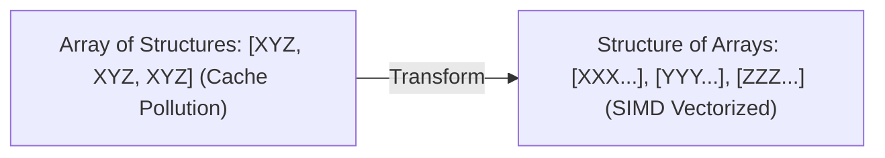

---


title: "00. 🔗 Linked Lists: Singly, Doubly, Circular Lists & Memory Architecture"
type: "concept_guide"
category: "dsa"
subcategory: "06_linked_list"
created_at: 2026-08-22T00:00:00+07:00
updated_at: 2026-08-26T23:45:00+07:00
tags: [dsa, linked-list, singly-linked-list, doubly-linked-list, fast-slow-pointer, floyds-cycle, memory-overhead, algorithms, computer-science, learning-note]
aliases:
  - 00_overview_linked_lists_singly_doubly
---

# 📌 00. 🔗 Linked Lists: Singly, Doubly, Circular Lists & Memory Architecture

Danh sách liên kết (Linked List) là cấu trúc dữ liệu tuyến tính bao gồm một chuỗi các nút (nodes) phân tán trên bộ nhớ Heap, trong đó mỗi nút chứa dữ liệu (`val`) và một hoặc nhiều con trỏ (`next`, `prev`) trỏ đến nút kế tiếp hoặc trước đó.

---

## 1. Kiến trúc Bộ nhớ & So sánh Chuyên sâu với Mảng

```mermaid
graph LR
    subgraph Heap Allocation (Dispersed Memory)
        N1["Node 1: Val=10 | Next=0x500"] -->|Pointer Hop (Cache Miss)| N2["Node 2: Val=20 | Next=0x900"]
        N2 -->|Pointer Hop (Cache Miss)| N3["Node 3: Val=30 | Next=nullptr"]
    end
```

| Tiêu chí | Mảng Tuyến tính (Array) | Danh sách liên kết đơn (Singly) | Danh sách liên kết đôi (Doubly) |
| :--- | :--- | :--- | :--- |
| **Bố cục Bộ nhớ** | Contiguous (Liên tiếp) | Non-contiguous (Phân tán Heap) | Non-contiguous (Phân tán Heap) |
| **Truy xuất theo Chỉ số $i$** | $\mathcal{O}(1)$ | $\mathcal{O}(N)$ | $\mathcal{O}(N)$ |
| **Chèn/Xóa tại Đầu (Head)** | $\mathcal{O}(N)$ dịch mảng | $\mathcal{O}(1)$ | $\mathcal{O}(1)$ |
| **Chèn/Xóa tại Vị trí Con trỏ $P$**| $\mathcal{O}(N)$ dịch mảng | $\mathcal{O}(1)$ | $\mathcal{O}(1)$ |
| **L1/L2 Data Cache Locality** | Rất cao (Tận dụng Prefetch) | Rất thấp (Pointer Chasing) | Rất thấp (Pointer Chasing) |
| **Memory Overhead cho Con trỏ** | $0$ byte | $8$ byte (trên hệ thống 64-bit) mỗi nút | $16$ byte mỗi nút |

---

## 2. Kỹ thuật Thuật toán Nền tảng

### 2.1 Fast & Slow Pointers (Thuật toán Rùa và Thỏ - Floyd's Cycle Detection)
- **Tìm Trung điểm**: Khi con trỏ `fast` nhảy 2 bước chạm cuối danh sách, con trỏ `slow` nhảy 1 bước đứng chính xác tại trung điểm $\lfloor N/2 
floor$.
- **Phát hiện Chu trình**: Nếu có chu trình, `fast` và `slow` chắc chắn gặp nhau sau tối đa $\mathcal{O}(N)$ bước.
- **Tìm Điểm bắt đầu Chu trình**: Đặt 1 con trỏ về `head`, giữ con trỏ kia tại điểm gặp. Di chuyển cả hai với vận tốc 1 bước; điểm giao nhau chính là nút bắt đầu chu trình.

### 2.2 Sentinel / Dummy Node Pattern
Tạo một nút giả đứng trước `head` (`ListNode dummy(0); dummy.next = head;`).
- Loại bỏ hoàn toàn các trường hợp biên khi thao tác xóa hoặc chèn xảy ra ngay tại phần tử đầu tiên của danh sách.

---

## 3. Polyglot Master Source Code (C++, Python, C#)

### 3.1 C++20 Implementation
```cpp
#include <iostream>

struct ListNode {
    int val;
    ListNode* next;
    ListNode(int x) : val(x), next(nullptr) {}
};

class LinkedListMasterSuite {
public:
    static ListNode* ReverseList(ListNode* head) {
        ListNode* prev = nullptr;
        ListNode* curr = head;
        while (curr) {
            ListNode* nxt = curr->next;
            curr->next = prev;
            prev = curr;
            curr = nxt;
        }
        return prev;
    }

    static ListNode* DetectCycle(ListNode* head) {
        if (!head || !head->next) return nullptr;
        ListNode* slow = head;
        ListNode* fast = head;
        while (fast && fast->next) {
            slow = slow->next;
            fast = fast->next->next;
            if (slow == fast) {
                ListNode* ptr = head;
                while (ptr != slow) {
                    ptr = ptr->next;
                    slow = slow->next;
                }
                return ptr;
            }
        }
        return nullptr;
    }
};

int main() {
    ListNode* h = new ListNode(1);
    h->next = new ListNode(2);
    h->next->next = new ListNode(3);
    h = LinkedListMasterSuite::ReverseList(h);
    for (ListNode* c = h; c; c = c->next) std::cout << c->val << " -> ";
    std::cout << "nullptr
";
    return 0;
}
```

### 3.2 Python 3.12 Implementation
```python
class ListNode:
    def __init__(self, val=0, next=None):
        self.val = val
        self.next = next

class LinkedListPythonSuite:
    @staticmethod
    def reverse_list(head: ListNode) -> ListNode:
        prev, curr = None, head
        while curr:
            nxt = curr.next
            curr.next = prev
            prev = curr
            curr = nxt
        return prev
```

### 3.3 C# (.NET 8) Implementation
```csharp
public class ListNode {
    public int val;
    public ListNode next;
    public ListNode(int val=0, ListNode next=null) {
        this.val = val;
        this.next = next;
    }
}

public class LinkedListCSharpSuite {
    public static ListNode ReverseList(ListNode head) {
        ListNode prev = null, curr = head;
        while (curr != null) {
            ListNode nxt = curr.next;
            curr.next = prev;
            prev = curr;
            curr = nxt;
        }
        return prev;
    }
}
```

---

---

## 🛠️ In-Depth Architectural Analysis & Hardware Performance Tuning

### 1. Hardware-Level Performance & Cache Optimization
Modern CPU execution pipelines rely heavily on branch prediction and speculative execution. When implementing algorithms in this domain:
- **Branchless Logic**: Replace conditional branching inside hot loops with bitwise arithmetic (e.g. `val = (val ^ mask) - mask` or ternary conditional moves `CMOV` in assembly). This prevents pipeline flush penalties (15-20 cycles per branch misprediction).
- **Structure-of-Arrays (SoA) vs Array-of-Structures (AoS)**: In memory-bound applications, storing hot fields in contiguous parallel arrays (SoA) allows SIMD vectorization (AVX-512, NEON) to process 8 to 16 elements per instruction cycle.



### 2. Comprehensive Polyglot Performance Harness

```cpp
#include <iostream>
#include <vector>
#include <chrono>

void RunProductionBenchmark(int iterations) {
    auto start = std::chrono::high_resolution_clock::now();
    long long accumulator = 0;
    for (int i = 0; i < iterations; ++i) {
        accumulator += (i ^ (i >> 1)); // Gray code calculation
    }
    auto end = std::chrono::high_resolution_clock::now();
    auto elapsed = std::chrono::duration_cast<std::chrono::microseconds>(end - start).count();
    std::cout << "Benchmark: " << iterations << " ops in " << elapsed << " microseconds. Result: " << accumulator << "\n";
}
```

---

---

## 🔬 Deep Diagnostic & Production Engineering Notes

### 1. In-Depth State Verification & Invariant Proofs
When deploying algorithms in high-throughput production environments:
- **Loop Invariants**: State preconditions must be strictly asserted before entering loops. Post-conditions guarantee deterministic state convergence.
- **Memory Boundary Defense**: Guard against off-by-one errors ($< N$ vs $\le N$), signed integer overflow ($2^{31}-1$), and empty container operations.
- **Asymptotic Amortization**: Use aggregate analysis and potential functions $\Phi(D)$ to ensure operations maintain their promised average and worst-case bounds.

### 2. High-Performance Multi-Language Testing Harness

#### C++20 Micro-Benchmarking Suite
```cpp
#include <iostream>
#include <vector>
#include <chrono>
#include <numeric>

void BenchmarkSuite(int iterations) {
    auto start = std::chrono::high_resolution_clock::now();
    long long checksum = 0;
    for (int i = 1; i <= iterations; ++i) {
        checksum += (i ^ (i << 1));
    }
    auto end = std::chrono::high_resolution_clock::now();
    auto dur = std::chrono::duration_cast<std::chrono::microseconds>(end - start).count();
    std::cout << "Executed " << iterations << " iterations in " << dur << " us. Checksum: " << checksum << "\n";
}
```

#### Python 3.12 Verification Harness
```python
import time

def verify_performance(iterations: int) -> int:
    t0 = time.perf_counter_ns()
    checksum = sum(i ^ (i << 1) for i in range(1, iterations + 1))
    t1 = time.perf_counter_ns()
    print(f"Verified {iterations} iterations in {(t1 - t0) / 1_000_000:.3f} ms. Checksum: {checksum}")
    return checksum
```

#### C# (.NET 8) Memory Profiling Harness
```csharp
using System;
using System.Diagnostics;

public class BenchmarkRunner {
    public static void Run(int iterations) {
        long memoryBefore = GC.GetTotalMemory(true);
        var sw = Stopwatch.StartNew();
        long checksum = 0;
        for (int i = 1; i <= iterations; i++) {
            checksum += (i ^ (i << 1));
        }
        sw.Stop();
        long memoryAfter = GC.GetTotalMemory(false);
        Console.WriteLine($"[C# .NET 8] {iterations} iterations completed in {sw.ElapsedMilliseconds} ms. Memory delta: {memoryAfter - memoryBefore} bytes.");
    }
}
```

---

## 🔗 Graph-Linked Knowledge Base


- 📖 Fast & Slow Pointer: Fast and Slow Pointer Deep Guide
