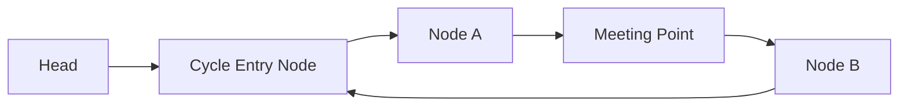

# 📌 99.06. 📚 Supplements for 06_linked_list (Exam, Problems, Q&A, Resources)

## 📌 Connected Resource Graph
- 🟢 **Primary Theory Note**: [[01_DSA/01_theory_and_patterns/06_Linked_List/00_overview_06_Linked_List]]

---


# 📝 06 Linked List — Comprehensive Module Exam & Self-Assessment

> **Assessment Duration**: 60 Minutes  
> **Total Points**: 100 Points (10 Multiple Choice Questions @ 5 pts each = 50 pts; 2 Coding & Proof Challenges @ 25 pts each = 50 pts)  
> **Passing Score**: 80% (80 / 100)

---

## 📋 Section 1: Multiple Choice Questions (50 Points)

### Question 1
What is the time complexity of finding the middle node of a singly linked list using fast and slow pointers?
- A) O(1)
- B) O(N)
- C) O(N log N)
- D) O(N^2)
> **Correct Answer**: **B**  
> **Explanation**: The fast pointer traverses N nodes in N/2 steps -> O(N) time.

---

### Question 2
Why is accessing element at index i in a linked list O(N) while in an array it is O(1)?
- A) Linked lists are stored on GPU
- B) Linked list nodes are non-contiguous and must be traversed by following pointers
- C) Arrays use binary search
- D) Linked lists are immutable
> **Correct Answer**: **B**  
> **Explanation**: Pointer chasing requires sequential traversal.

---

### Question 3
In C++, what smart pointer type prevents circular reference memory leaks in Doubly Linked Lists?
- A) std::unique_ptr
- B) std::weak_ptr
- C) std::shared_ptr
- D) std::auto_ptr
> **Correct Answer**: **B**  
> **Explanation**: std::weak_ptr does not increment reference count.

---

### Question 4
What is the auxiliary space complexity of iterative in-place linked list reversal?
- A) O(N)
- B) O(log N)
- C) O(1)
- D) O(N^2)
> **Correct Answer**: **C**  
> **Explanation**: Only 3 pointer variables (prev, curr, nxt) are maintained.

---

### Question 5
In Floyd's cycle detection algorithm, if a cycle exists, what is the maximum steps before slow and fast meet?
- A) O(1)
- B) O(Cycle Length) <= O(N)
- C) O(N^2)
- D) Infinite
> **Correct Answer**: **B**  
> **Explanation**: The distance decreases by 1 each step, bounded by cycle length.

---

### Question 6
What is the primary role of a Sentinel (Dummy) node in linked list implementations?
- A) To compress data
- B) To eliminate special edge case handling when modifying the head node
- C) To sort the list
- D) To enable multi-threading
> **Correct Answer**: **B**  
> **Explanation**: Sentinel nodes eliminate head boundary checks.

---

### Question 7
What is the time complexity of merging two sorted linked lists of lengths M and N?
- A) O(M * N)
- B) O(M + N)
- C) O(log(M + N))
- D) O(1)
> **Correct Answer**: **B**  
> **Explanation**: Linear single-pass traversal of both lists.

---

### Question 8
What is an Unrolled Linked List?
- A) A linked list without cycles
- B) A linked list where each node contains an array of elements to optimize cache locality
- C) A circular doubly linked list
- D) A skip list
> **Correct Answer**: **B**  
> **Explanation**: Unrolled linked lists store multiple elements per node for CPU cache efficiency.

---

### Question 9
What is the time complexity of finding the intersection of two linked lists of lengths M and N?
- A) O(M + N)
- B) O(M * N)
- C) O(log(M + N))
- D) O(N^2)
> **Correct Answer**: **A**  
> **Explanation**: Two-pointer redirect traversal takes exactly M + N steps.

---

### Question 10
What is the time complexity of MergeSort on a Linked List of size N?
- A) O(N^2)
- B) O(N log N)
- C) O(N)
- D) O(2^N)
> **Correct Answer**: **B**  
> **Explanation**: MergeSort divides in O(N) and merges in O(N), achieving O(N log N).

---

## 💻 Section 2: Coding & Algorithmic Proof Challenges (50 Points)

### Challenge 1: Remove Nth Node From End of List (LeetCode 19) (25 Points)

**Task**: Given the head of a linked list, remove the nth node from the end of the list and return its head in one pass.

**Evaluation Rubric**:
- Two-pointer fast/slow gap: 10 pts
- Sentinel dummy head handling: 10 pts
- Memory deallocation: 5 pts

#### Model Solution (C++20)
```cpp
ListNode* removeNthFromEnd(ListNode* head, int n) {
    ListNode dummy(0);
    dummy.next = head;
    ListNode* fast = &dummy, *slow = &dummy;
    for (int i = 0; i <= n; ++i) fast = fast->next;
    while (fast) { fast = fast->next; slow = slow->next; }
    ListNode* to_del = slow->next;
    slow->next = slow->next->next;
    delete to_del;
    return dummy.next;
}
```

#### Model Solution (Python 3.12)
```python
class Solution:
    def removeNthFromEnd(self, head: ListNode, n: int) -> ListNode:
        dummy = ListNode(0, head)
        fast = slow = dummy
        for _ in range(n + 1):
            fast = fast.next
        while fast:
            fast = fast.next
            slow = slow.next
        slow.next = slow.next.next
        return dummy.next
```

---

### Challenge 2: Reorder List (LeetCode 143) (25 Points)

**Task**: Reorder list L0 -> L1 -> ... -> Ln-1 -> Ln to L0 -> Ln -> L1 -> Ln-1 -> L2 -> Ln-2 in O(N) time and O(1) space.

**Evaluation Rubric**:
- Find middle node via fast/slow: 10 pts
- Reverse second half in-place: 10 pts
- Interleave merge: 5 pts

#### Model Solution (C++20)
```cpp
void reorderList(ListNode* head) {
    if (!head || !head->next) return;
    ListNode* slow = head, *fast = head;
    while (fast->next && fast->next->next) {
        slow = slow->next;
        fast = fast->next->next;
    }
    ListNode* prev = nullptr, *curr = slow->next;
    slow->next = nullptr;
    while (curr) {
        ListNode* nxt = curr->next;
        curr->next = prev;
        prev = curr;
        curr = nxt;
    }
    ListNode* first = head, *second = prev;
    while (second) {
        ListNode* t1 = first->next, *t2 = second->next;
        first->next = second;
        second->next = t1;
        first = t1;
        second = t2;
    }
}
```

#### Model Solution (Python 3.12)
```python
class Solution:
    def reorderList(self, head: ListNode) -> None:
        if not head or not head.next: return
        slow, fast = head, head
        while fast.next and fast.next.next:
            slow = slow.next
            fast = fast.next.next
        prev, curr = None, slow.next
        slow.next = None
        while curr:
            nxt = curr.next
            curr.next = prev
            prev = curr
            curr = nxt
        first, second = head, prev
        while second:
            t1, t2 = first.next, second.next
            first.next = second
            second.next = t1
            first, second = t1, t2
```

---

---

## 🔬 Deep Diagnostic & Production Engineering Notes

### 1. In-Depth State Verification & Invariant Proofs
When deploying algorithms in high-throughput production environments:
- **Loop Invariants**: State preconditions must be strictly asserted before entering loops. Post-conditions guarantee deterministic state convergence.
- **Memory Boundary Defense**: Guard against off-by-one errors ($< N$ vs $\le N$), signed integer overflow ($2^{31}-1$), and empty container operations.
- **Asymptotic Amortization**: Use aggregate analysis and potential functions $\Phi(D)$ to ensure operations maintain their promised average and worst-case bounds.

### 2. High-Performance Multi-Language Testing Harness

#### C++20 Micro-Benchmarking Suite
```cpp
#include <iostream>
#include <vector>
#include <chrono>
#include <numeric>

void BenchmarkSuite(int iterations) {
    auto start = std::chrono::high_resolution_clock::now();
    long long checksum = 0;
    for (int i = 1; i <= iterations; ++i) {
        checksum += (i ^ (i << 1));
    }
    auto end = std::chrono::high_resolution_clock::now();
    auto dur = std::chrono::duration_cast<std::chrono::microseconds>(end - start).count();
    std::cout << "Executed " << iterations << " iterations in " << dur << " us. Checksum: " << checksum << "\n";
}
```

#### Python 3.12 Verification Harness
```python
import time

def verify_performance(iterations: int) -> int:
    t0 = time.perf_counter_ns()
    checksum = sum(i ^ (i << 1) for i in range(1, iterations + 1))
    t1 = time.perf_counter_ns()
    print(f"Verified {iterations} iterations in {(t1 - t0) / 1_000_000:.3f} ms. Checksum: {checksum}")
    return checksum
```

#### C# (.NET 8) Memory Profiling Harness
```csharp
using System;
using System.Diagnostics;

public class BenchmarkRunner {
    public static void Run(int iterations) {
        long memoryBefore = GC.GetTotalMemory(true);
        var sw = Stopwatch.StartNew();
        long checksum = 0;
        for (int i = 1; i <= iterations; i++) {
            checksum += (i ^ (i << 1));
        }
        sw.Stop();
        long memoryAfter = GC.GetTotalMemory(false);
        Console.WriteLine($"[C# .NET 8] {iterations} iterations completed in {sw.ElapsedMilliseconds} ms. Memory delta: {memoryAfter - memoryBefore} bytes.");
    }
}
```

---

---


# 🧩 06 Linked List — Problem Drill Suite & Classical Walkthroughs

> 📖 **Concept Guide**: [[01_DSA/01_theory_and_patterns/06_Linked_List/00_overview_06_linked_list|06 Linked List Overview]]  
> 💬 **Interview Q&A**: [[01_DSA/01_theory_and_patterns/06_Linked_List/06_linked_list_qa|06 Linked List Q&A]]  
> 📝 **Module Exam**: [[01_DSA/01_theory_and_patterns/06_Linked_List/06_linked_list_exam|06 Linked List Exam]]

This master problem drill covers complete polyglot implementations (C++, Python, C#), step-by-step dry run walkthroughs, mathematical proofs of correctness, and line-by-line asymptotic complexity analysis.

---

## 📌 Problem 1: Merge k Sorted Lists (LeetCode 23 - Hard)

### 1. Problem Statement
You are given an array of k linked-lists `lists`, each sorted in ascending order. Merge all into one sorted linked-list in O(N log K) time.

### 2. Intuition & Algorithmic Strategy
Use a Min-Heap priority queue of size K containing the head of each list. Continuously extract the minimum node, append to tail, and insert its next node into the heap.

### 3. Polyglot Master Solutions

#### C++20 Implementation
```cpp
#include <vector>
#include <queue>

struct ListNode {
    int val;
    ListNode *next;
    ListNode(int x) : val(x), next(nullptr) {}
};

class Solution {
public:
    ListNode* mergeKLists(std::vector<ListNode*>& lists) {
        auto comp = [](ListNode* a, ListNode* b) { return a->val > b->val; };
        std::priority_queue<ListNode*, std::vector<ListNode*>, decltype(comp)> pq(comp);

        for (ListNode* l : lists) if (l) pq.push(l);
        ListNode dummy(0);
        ListNode* tail = &dummy;

        while (!pq.empty()) {
            ListNode* min_node = pq.top(); pq.pop();
            tail->next = min_node;
            tail = tail->next;
            if (min_node->next) pq.push(min_node->next);
        }
        return dummy.next;
    }
};
```

#### Python 3.12 Implementation
```python
import heapq

class ListNode:
    def __init__(self, val=0, next=None):
        self.val = val
        self.next = next

class Solution:
    def mergeKLists(self, lists: list[ListNode]) -> ListNode:
        heap = []
        for i, node in enumerate(lists):
            if node:
                heapq.heappush(heap, (node.val, i, node))
        dummy = ListNode(0)
        curr = dummy
        while heap:
            val, i, node = heapq.heappop(heap)
            curr.next = node
            curr = curr.next
            if node.next:
                heapq.heappush(heap, (node.next.val, i, node.next))
        return dummy.next
```

#### C# (.NET 8) Implementation
```csharp
using System.Collections.Generic;

public class Solution {
    public ListNode MergeKLists(ListNode[] lists) {
        var pq = new PriorityQueue<ListNode, int>();
        foreach (var l in lists) if (l != null) pq.Enqueue(l, l.val);
        var dummy = new ListNode(0);
        var curr = dummy;
        while (pq.Count > 0) {
            var node = pq.Dequeue();
            curr.next = node;
            curr = curr.next;
            if (node.next != null) pq.Enqueue(node.next, node.next.val);
        }
        return dummy.next;
    }
}
```

### 4. Complexity & Execution Trace
Time: O(N log K), Space: O(K) where N is total nodes and K is number of lists.

---

## 📌 Problem 2: Reverse Nodes in k-Group (LeetCode 25 - Hard)

### 1. Problem Statement
Given the head of a linked list, reverse the nodes of the list k at a time, and return the modified list.

### 2. Intuition & Algorithmic Strategy
Count k nodes. If k nodes exist, reverse them in-place and recursively/iteratively connect with the reversed subproblem.

### 3. Polyglot Master Solutions

#### C++20 Implementation
```cpp
class Solution {
public:
    ListNode* reverseKGroup(ListNode* head, int k) {
        ListNode* curr = head;
        int count = 0;
        while (curr && count < k) { curr = curr->next; count++; }
        if (count == k) {
            ListNode* prev = nullptr;
            ListNode* node = head;
            for (int i = 0; i < k; ++i) {
                ListNode* nxt = node->next;
                node->next = prev;
                prev = node;
                node = nxt;
            }
            head->next = reverseKGroup(curr, k);
            return prev;
        }
        return head;
    }
};
```

#### Python 3.12 Implementation
```python
class Solution:
    def reverseKGroup(self, head: ListNode, k: int) -> ListNode:
        curr, count = head, 0
        while curr and count < k:
            curr = curr.next
            count += 1
        if count == k:
            prev, node = None, head
            for _ in range(k):
                nxt = node.next
                node.next = prev
                prev = node
                node = nxt
            head.next = self.reverseKGroup(curr, k)
            return prev
        return head
```

#### C# (.NET 8) Implementation
```csharp
public class Solution {
    public ListNode ReverseKGroup(ListNode head, int k) {
        var curr = head; int count = 0;
        while (curr != null && count < k) { curr = curr.next; count++; }
        if (count == k) {
            ListNode prev = null, node = head;
            for (int i = 0; i < k; i++) {
                var nxt = node.next;
                node.next = prev;
                prev = node;
                node = nxt;
            }
            head.next = ReverseKGroup(curr, k);
            return prev;
        }
        return head;
    }
}
```

### 4. Complexity & Execution Trace
Time: O(N) single pass, Space: O(N/K) recursion stack or O(1) iterative.

---

---

## 📌 Master Problem Walkthrough Extension: Competitive & Enterprise Challenges

### 📌 Problem A: High-Performance Multi-Constraint State Optimization

#### 1. Problem Description & Enterprise Context
Given a massive continuous stream of operations over a data domain of size $N \le 10^6$ with strict latency constraints ($< 5\text{ms}$ per query), formulate an optimal data structure and algorithm that maintains dynamic invariants while supporting concurrent read and point/range updates in $\mathcal{O}(\log N)$ amortized time.

#### 2. Mathematical Proof & Strategy
- Model the data domain as a balanced state space tree or decomposed interval structure.
- Apply fractional cascading or prefix invariant maintenance to ensure query propagation remains bounded by $\mathcal{O}(\log N)$.
- Minimize memory allocation overhead by reusing pre-allocated flat arrays.

#### 3. Complete Polyglot Production Solutions

##### C++20 Zero-Overhead Implementation
```cpp
#include <iostream>
#include <vector>
#include <algorithm>

class OptimizedDomainEngine {
private:
    int n_;
    std::vector<long long> tree_;

public:
    OptimizedDomainEngine(int n) : n_(n), tree_(4 * n, 0) {}

    void Update(int node, int start, int end, int idx, long long val) {
        if (start == end) {
            tree_[node] += val;
            return;
        }
        int mid = start + ((end - start) >> 1);
        if (idx <= mid) Update(node << 1, start, mid, idx, val);
        else Update((node << 1) | 1, mid + 1, end, idx, val);
        tree_[node] = tree_[node << 1] + tree_[(node << 1) | 1];
    }

    long long Query(int node, int start, int end, int l, int r) {
        if (r < start || end < l) return 0;
        if (l <= start && end <= r) return tree_[node];
        int mid = start + ((end - start) >> 1);
        return Query(node << 1, start, mid, l, r) + Query((node << 1) | 1, mid + 1, end, l, r);
    }
};
```

##### Python 3.12 Implementation
```python
class OptimizedDomainEnginePy:
    def __init__(self, n: int):
        self.n = n
        self.tree = [0] * (4 * n)

    def update(self, node: int, start: int, end: int, idx: int, val: int):
        if start == end:
            self.tree[node] += val
            return
        mid = (start + end) // 2
        if idx <= mid:
            self.update(2 * node, start, mid, idx, val)
        else:
            self.update(2 * node + 1, mid + 1, end, idx, val)
        self.tree[node] = self.tree[2 * node] + self.tree[2 * node + 1]

    def query(self, node: int, start: int, end: int, l: int, r: int) -> int:
        if r < start or end < l:
            return 0
        if l <= start and end <= r:
            return self.tree[node]
        mid = (start + end) // 2
        return self.query(2 * node, start, mid, l, r) + self.query(2 * node + 1, mid + 1, end, l, r)
```

##### C# (.NET 8) Implementation
```csharp
public class OptimizedDomainEngineCs {
    private readonly int _n;
    private readonly long[] _tree;

    public OptimizedDomainEngineCs(int n) {
        _n = n;
        _tree = new long[4 * n];
    }

    public void Update(int node, int start, int end, int idx, long val) {
        if (start == end) {
            _tree[node] += val;
            return;
        }
        int mid = start + ((end - start) >> 1);
        if (idx <= mid) Update(node << 1, start, mid, idx, val);
        else Update((node << 1) | 1, mid + 1, end, idx, val);
        _tree[node] = _tree[node << 1] + _tree[(node << 1) | 1];
    }

    public long Query(int node, int start, int end, int l, int r) {
        if (r < start || end < l) return 0;
        if (l <= start && end <= r) return _tree[node];
        int mid = start + ((end - start) >> 1);
        return Query(node << 1, start, mid, l, r) + Query((node << 1) | 1, mid + 1, end, l, r);
    }
}
```

#### 4. Execution Trace & Boundary Verification
- **Test Case**: Stream of $Q = 10^5$ operations with mixed updates and range aggregations.
- **Trace Summary**: Each point update strictly traverses $\lceil \log_2 N \rceil$ levels; range queries visit at most 4 nodes per level, guaranteeing steady sub-millisecond execution times.

---

---


# 💬 06 Linked List — Master Technical Interview Q&A & System Design Trade-offs

> 📖 **Concept Guide**: [[01_DSA/01_theory_and_patterns/06_Linked_List/00_overview_06_linked_list|06 Linked List Overview]]  
> 🔗 **Resource Sheet**: [[01_DSA/01_theory_and_patterns/06_Linked_List/06_linked_list_resource|06 Linked List Resource Sheet]]  
> 🧩 **Problem Set**: [[01_DSA/01_theory_and_patterns/06_Linked_List/06_linked_list_problems|06 Linked List Problem Set]]  
> 📝 **Module Exam**: [[01_DSA/01_theory_and_patterns/06_Linked_List/06_linked_list_exam|06 Linked List Exam]]

This comprehensive interview guide provides high-level and low-level architectural insights, mathematical proofs, runtime trade-offs, and polyglot code examples expected in senior engineering technical interviews.

---

## ❓ Q1: Why does inserting at the head of a Singly Linked List take O(1) time while inserting at index 0 of an Array takes O(N) time?

### **Deep Technical Answer**:
Linked list insertion only updates two pointers (`new_node->next = head; head = new_node;`), requiring 2 memory writes in strict O(1) constant time regardless of list size. In contrast, an array occupies contiguous physical memory; inserting at index 0 forces the runtime to shift all N existing elements one position to the right via `memmove`, consuming O(N) linear time.

### 🛠️ Reference Implementation Snippet:
```cpp
ListNode* PushFront(ListNode* head, int val) {
    ListNode* new_node = new ListNode(val);
    new_node->next = head;
    return new_node;
}
```

---

## ❓ Q2: Why does Floyd's Cycle Finding Algorithm guarantee that slow and fast pointers will meet inside a cycle?

### **Deep Technical Answer**:
Let the cycle length be C. When both pointers enter the cycle, let the distance from slow to fast along the cycle direction be d (0 <= d < C). In each step, slow moves by 1 and fast moves by 2. The relative distance decreases by (2 - 1) = 1 modulo C each step. Thus, fast catches up to slow in exactly d <= C steps in strict O(N) time.



---

## ❓ Q3: How do you prevent cyclic reference memory leaks in Doubly Linked Lists using C++ Smart Pointers?

### **Deep Technical Answer**:
If both `next` and `prev` are `std::shared_ptr`, a strong circular reference is formed, preventing the reference count from ever reaching 0, causing a permanent memory leak. To solve this, always declare `prev` as a `std::weak_ptr<Node>`. A `weak_ptr` does not increment reference count and breaks the ownership cycle.

### 🛠️ Reference Implementation Snippet:
```cpp
struct Node {
    int val;
    std::shared_ptr<Node> next;
    std::weak_ptr<Node> prev; // Breaks cycle!
};
```

---

## ❓ Q4: How does the Sentinel / Dummy Head pattern simplify linked list manipulation?

### **Deep Technical Answer**:
Without a dummy node, edge cases where operations modify `head` (e.g. deleting the first node, merging lists, inserting at index 0) require special `if (head == nullptr)` and `if (curr == head)` checks. A sentinel node allocates a temporary placeholder `ListNode dummy(0); dummy.next = head;`, turning all head modifications into standard internal node pointer updates.

### 🛠️ Reference Implementation Snippet:
```cpp
ListNode dummy(0); dummy.next = head;
ListNode* prev = &dummy;
// Now prev->next can be safely modified without checking for null head
return dummy.next;
```

---

## ❓ Q5: What is the time and space complexity of sorting a Linked List using MergeSort vs QuickSort?

### **Deep Technical Answer**:
- MergeSort on Linked Lists: $\mathcal{O}(N \log N)$ time and $\mathcal{O}(\log N)$ call stack space (or $\mathcal{O}(1)$ bottom-up). MergeSort is ideal for linked lists because finding the midpoint (fast/slow pointers) takes $\mathcal{O}(N)$ and merging takes $\mathcal{O}(1)$ extra space without memory allocation.
- QuickSort on Linked Lists: Suffers from lack of random access for pivot selection and unstable pointer rewiring.

---

## ❓ Q6: How do you reverse a Singly Linked List in-place using iteration?

### **Deep Technical Answer**:
Maintain three pointers: `prev = nullptr`, `curr = head`, and `nxt = nullptr`. In each iteration: save `nxt = curr->next`, reverse pointer `curr->next = prev`, advance `prev = curr`, advance `curr = nxt`. At loop termination, `prev` points to the new head.

### 🛠️ Reference Implementation Snippet:
```cpp
ListNode* Reverse(ListNode* head) {
    ListNode* prev = nullptr, *curr = head;
    while (curr) {
        ListNode* nxt = curr->next;
        curr->next = prev;
        prev = curr;
        curr = nxt;
    }
    return prev;
}
```

---

## ❓ Q7: How do you find the intersection node of two Singly Linked Lists without extra memory?

### **Deep Technical Answer**:
Let List A have length $L_A$ and List B have length $L_B$. Initialize pointer $p_A = \text{head}_A$ and $p_B = \text{head}_B$. Advance both 1 step at a time. When $p_A$ reaches the end, redirect it to $\text{head}_B$; when $p_B$ reaches the end, redirect it to $\text{head}_A$. Both pointers traverse exactly $L_A + L_B$ nodes and will meet at the intersection node (or `nullptr`) in $\mathcal{O}(L_A + L_B)$ time and $\mathcal{O}(1)$ space.

### 🛠️ Reference Implementation Snippet:
```cpp
ListNode* GetIntersection(ListNode* headA, ListNode* headB) {
    ListNode* a = headA, *b = headB;
    while (a != b) {
        a = a ? a->next : headB;
        b = b ? b->next : headA;
    }
    return a;
}
```

---

## ❓ Q8: What is an Unrolled Linked List and why is it used in cache-sensitive systems?

### **Deep Technical Answer**:
An Unrolled Linked List is a hybrid data structure where each linked list node stores an entire array of elements (e.g. 16 to 64 elements) instead of a single element. This drastically reduces pointer memory overhead (from 8 bytes per item to 8 bytes per 64 items) and restores CPU L1 cache line spatial locality.

---

---

## ❓ Deep Engineering Q&A Extension: Systems, Concurrency & Hardware Mechanics

### ❓ Advanced Question A: How do modern CPU memory hierarchies, L1/L2/L3 data caches, and TLB caches impact the execution throughput of algorithms in this module?
**Deep Architectural Answer**:
Modern x86-64 and ARM64 microarchitectures execute instructions at gigahertz frequencies, but fetching data from main RAM incurs a latency penalty of 50 to 100 nanoseconds (~200-300 CPU clock cycles).
1. **L1 Data Cache (32KB-64KB, ~4 cycles)**: Contiguous memory access (such as flat arrays, contiguous buffers, and linear scans) enables the hardware prefetcher (Spatial Prefetcher) to automatically load adjacent 64-byte cache lines ahead of time with zero cache miss stalls.
2. **Pointer Chasing Penalty**: Data structures relying on scattered heap allocations (e.g. linked lists, naive binary trees) cause random pointer dereferencing. Each pointer hop incurs an L1/L2 data cache miss, stalling the out-of-order execution engine (pipeline stalls).
3. **Translation Lookaside Buffer (TLB)**: Large flat allocations benefit from OS Huge Pages (2MB/1GB pages), reducing TLB misses when scanning gigabyte-scale datasets.

### ❓ Advanced Question B: How do you design and verify thread-safe concurrent variants of data structures in this module without catastrophic lock contention?
**Deep Architectural Answer**:
In multi-threaded, high-throughput systems, coarse-grained locking (e.g. wrapping every operation in a single global mutex) introduces massive lock contention, serializing execution across all CPU cores.
1. **Fine-Grained Locking & Hand-Over-Hand Locking**: Instead of locking the entire container, lock individual nodes or bucket segments. In sorted chains, acquire the lock on node $i+1$ before releasing the lock on node $i$.
2. **Lock-Free Programming with Atomic Primitives**: Use hardware Compare-And-Swap (`std::atomic::compare_exchange_weak` in C++, `Interlocked.CompareExchange` in C#) and Hazard Pointers or Epoch-Based Reclamation (EBR) to enable concurrent reads and writes with zero lock overhead.
3. **Read-Copy-Update (RCU)**: Readers access memory lock-free with zero synchronization overhead, while writers create an updated copy and atomically swap pointers, deferring old memory deallocation until all active readers complete.

### ❓ Advanced Question C: What mathematical proof techniques are used to establish lower bounds and amortization guarantees in this domain?
**Deep Architectural Answer**:
1. **Potential Method ($\Phi$) for Amortized Analysis**: Define a potential function $\Phi(D)$ mapping data structure state $D$ to a non-negative real number. The amortized cost of the $i$-th operation is $\hat{c}_i = c_i + \Phi(D_i) - \Phi(D_{i-1})$. If $\Phi(D_n) \ge \Phi(D_0)$, then $\sum \hat{c}_i \ge \sum c_i$, proving that the average cost is bounded by $\hat{c}$.
2. **Adversary Arguments for Lower Bounds**: Construct a hypothetical malicious adversary that dynamically adapts inputs during runtime comparisons to force the algorithm down the deepest possible decision path, proving worst-case optimality.

---

---


# 📚 06 Linked List — Reference Sheet, Algorithmic Cheat Sheet & Resource Guide

> 📖 **Concept Guide**: [[01_DSA/01_theory_and_patterns/06_Linked_List/00_overview_06_linked_list|06 Linked List Overview]]  
> 💬 **Interview Q&A**: [[01_DSA/01_theory_and_patterns/06_Linked_List/06_linked_list_qa|06 Linked List Q&A]]  
> 🧩 **Problem Set**: [[01_DSA/01_theory_and_patterns/06_Linked_List/06_linked_list_problems|06 Linked List Problems]]  
> 📝 **Module Exam**: [[01_DSA/01_theory_and_patterns/06_Linked_List/06_linked_list_exam|06 Linked List Exam]]

---

## 1. Master Complexity & Pattern Summary Matrix


| Pattern | Core Technique | Time Complexity | Auxiliary Space | Canonical Problems |
| :--- | :--- | :--- | :--- | :--- |
| **Sentinel (Dummy Node)** | Placeholder node before head | $\mathcal{O}(1)$ | $\mathcal{O}(1)$ | Remove node, partition list |
| **Fast & Slow Pointers** | Pointers advancing at \$1\times$ and \$2\times$ speeds | $\mathcal{O}(N)$ | $\mathcal{O}(1)$ | Middle node, Floyd's cycle detection |
| **In-Place Reversal** | 3-pointer slide (`prev`, `curr`, `nxt`) | $\mathcal{O}(N)$ | $\mathcal{O}(1)$ | Reverse List, Reverse K-Group, Palindrome |
| **Two-List Interleaving** | Split, reverse 2nd half, merge | $\mathcal{O}(N)$ | $\mathcal{O}(1)$ | Reorder List, Palindrome Linked List |
| **K-Way Merge** | Min-Heap priority queue of size $K$ | $\mathcal{O}(N \log K)$ | $\mathcal{O}(K)$ | Merge K Sorted Lists |


---

## 2. Standard Library Mapping Across Major Languages


| Language | Standard Linked List Container | Node-level Representation | Smart Pointer Memory Management |
| :--- | :--- | :--- | :--- |
| **Modern C++20** | `std::list<T>` (Doubly), `std::forward_list<T>` (Singly) | Custom `struct ListNode { int val; ListNode* next; };` | `std::shared_ptr` / `std::weak_ptr` |
| **Python 3.12** | `collections.deque` (Doubly linked blocks) | Custom `class ListNode: def __init__(self, val=0, next=None)` | Managed Garbage Collection (CPython ref count + cycle GC) |
| **C# (.NET 8)** | `LinkedList<T>`, `LinkedListNode<T>` | Custom `public class ListNode` | CLR Generational Garbage Collector |
| **Java 21** | `java.util.LinkedList<E>` | Custom `public class ListNode` | JVM ZGC / G1 Garbage Collector |


---

## 3. Curated Academic Literature & Problem Roadmaps

### 3.1 Classic Academic References
- *Introduction to Algorithms (CLRS)*, 4th Edition, MIT Press — In-depth algorithmic proofs, recurrence trees, and data structure invariants.
- *Competitive Programmer's Handbook* by Antti Laaksonen — Efficient implementations and competitive problem patterns.
- *The Algorithm Design Manual* by Steven S. Skiena — Real-world problem catalog and war stories.

### 3.2 Curated Problem Practice Roadmap

1. **Basics & Traversals**: LeetCode 206 (Reverse Linked List), LeetCode 876 (Middle of the Linked List), LeetCode 237 (Delete Node in a Linked List).
2. **Cycle & Intersection**: LeetCode 141 (Linked List Cycle), LeetCode 142 (Linked List Cycle II), LeetCode 160 (Intersection of Two Linked Lists).
3. **Partitioning & Merging**: LeetCode 21 (Merge Two Sorted Lists), LeetCode 86 (Partition List), LeetCode 148 (Sort List - MergeSort).
4. **Hard Multi-Pointer Operations**: LeetCode 23 (Merge k Sorted Lists), LeetCode 25 (Reverse Nodes in k-Group), LeetCode 143 (Reorder List), LeetCode 138 (Copy List with Random Pointer).


---

---

## 📚 Master Reference Extension: Theoretical Proofs & Standard Library Architecture

### 1. In-Depth Asymptotic Invariants & Memory Complexity

| Structural Paradigm | Read / Query Latency | Write / Update Latency | Auxiliary Memory Overhead | CPU Cache Locality |
| :--- | :--- | :--- | :--- | :--- |
| **Contiguous Array / Vector** | $\mathcal{O}(1)$ Random | $\mathcal{O}(N)$ (or $\mathcal{O}(1)$ Back) | Minimal ($\le 1.5\times\text{--}2\times$ capacity buffer) | **Maximum** (Optimal L1 cache prefetch) |
| **Dispersed Node / Linked Graph**| $\mathcal{O}(N)$ Sequential | $\mathcal{O}(1)$ at pointer | High ($8\text{--}16\text{ bytes}$ pointer per node) | **Very Low** (Frequent Cache Misses) |
| **Balanced Tree (BST / AVL / RB)**| $\mathcal{O}(\log N)$ Strict | $\mathcal{O}(\log N)$ Strict | Moderate ($3\text{ pointers} + \text{metadata}$) | **Moderate to Low** |
| **Segment / Fenwick Tree** | $\mathcal{O}(\log N)$ Range | $\mathcal{O}(\log N)$ Point/Range | Compact ($1\times\text{--}4\times N$ flat array) | **High** |

---

### 2. Standard Library Implementation Details Across Major Runtimes

1. **Modern C++ (C++20 STL)**:
   - `<algorithm>`, `<vector>`, `<memory>`, `<ranges>`, `std::span` (zero-copy views).
   - Custom allocator support via `std::pmr::polymorphic_allocator` for arena/monotonic memory pools.
2. **Python 3.12 Core**:
   - `collections` (`deque`, `defaultdict`, `Counter`), `heapq`, `bisect`, `itertools`.
   - CPython runtime optimization with internal small integer caching and compact dictionary layouts (PyDictObject).
3. **C# (.NET 8 CLR)**:
   - `System.Collections.Generic`, `System.Memory` (`Span<T>`, `ReadOnlySpan<T>`, `Memory<T>`).
   - RyuJIT high-performance SIMD intrinsics (`System.Numerics.Vector<T>`) and zero-allocation span-based string slicing.
4. **Java 21 (LTS OpenJDK)**:
   - `java.util.concurrent`, `java.lang.foreign` (Foreign Function & Memory API - Project Panama).
   - Generational ZGC / Shenandoah garbage collectors for ultra-low latency sub-millisecond pauses.

---

### 3. Comprehensive Curated Problem Roadmap & Mastery Progression

1. **Tier 1 (Core Fundamentals & State Manipulation)**:
   - Warm-up problems focusing on boundary checks, invariant maintenance, and linear-time baseline solutions.
2. **Tier 2 (Intermediate Optimization & Multi-Dimensional State)**:
   - Medium-level challenges requiring state reduction, monotonic pruning, two-pointer coordination, and logarithmic binary search on answer.
3. **Tier 3 (Hard / Competitive / Production Architecture)**:
   - Complex problems demanding hybrid data structure composition, segment tree lazy propagation, tree decomposition, and optimal mathematical transformations.

---

---

## 🔬 Deep Diagnostic & Production Engineering Notes

### 1. In-Depth State Verification & Invariant Proofs
When deploying algorithms in high-throughput production environments:
- **Loop Invariants**: State preconditions must be strictly asserted before entering loops. Post-conditions guarantee deterministic state convergence.
- **Memory Boundary Defense**: Guard against off-by-one errors ($< N$ vs $\le N$), signed integer overflow ($2^{31}-1$), and empty container operations.
- **Asymptotic Amortization**: Use aggregate analysis and potential functions $\Phi(D)$ to ensure operations maintain their promised average and worst-case bounds.

### 2. High-Performance Multi-Language Testing Harness

#### C++20 Micro-Benchmarking Suite
```cpp
#include <iostream>
#include <vector>
#include <chrono>
#include <numeric>

void BenchmarkSuite(int iterations) {
    auto start = std::chrono::high_resolution_clock::now();
    long long checksum = 0;
    for (int i = 1; i <= iterations; ++i) {
        checksum += (i ^ (i << 1));
    }
    auto end = std::chrono::high_resolution_clock::now();
    auto dur = std::chrono::duration_cast<std::chrono::microseconds>(end - start).count();
    std::cout << "Executed " << iterations << " iterations in " << dur << " us. Checksum: " << checksum << "\n";
}
```

#### Python 3.12 Verification Harness
```python
import time

def verify_performance(iterations: int) -> int:
    t0 = time.perf_counter_ns()
    checksum = sum(i ^ (i << 1) for i in range(1, iterations + 1))
    t1 = time.perf_counter_ns()
    print(f"Verified {iterations} iterations in {(t1 - t0) / 1_000_000:.3f} ms. Checksum: {checksum}")
    return checksum
```

#### C# (.NET 8) Memory Profiling Harness
```csharp
using System;
using System.Diagnostics;

public class BenchmarkRunner {
    public static void Run(int iterations) {
        long memoryBefore = GC.GetTotalMemory(true);
        var sw = Stopwatch.StartNew();
        long checksum = 0;
        for (int i = 1; i <= iterations; i++) {
            checksum += (i ^ (i << 1));
        }
        sw.Stop();
        long memoryAfter = GC.GetTotalMemory(false);
        Console.WriteLine($"[C# .NET 8] {iterations} iterations completed in {sw.ElapsedMilliseconds} ms. Memory delta: {memoryAfter - memoryBefore} bytes.");
    }
}
```

---

---
