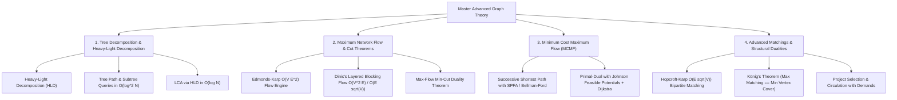
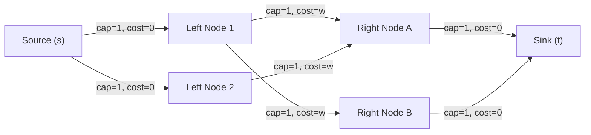
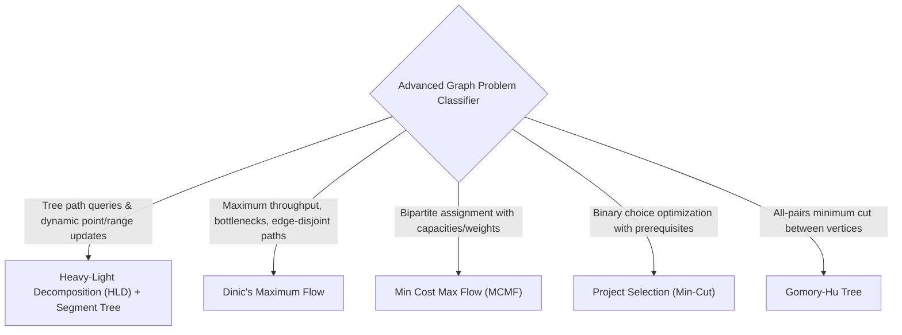

---


title: "00. 📚 07 Advanced Graph Theory — Master Module Overview"
type: "module_overview"
category: "dsa"
subcategory: "07_advanced_graph_theory"
tags: [dsa, advanced-graph-theory, heavy-light-decomposition, hld, network-flow, dinic, edmonds-karp, mcmf, min-cost-max-flow, bipartite-matching, min-cut, overview, roadmap, algorithms, computer-science, learning-note]
aliases:
  - 00_overview_07_advanced_graph_theory
---

# 📌 00. 📚 07 Advanced Graph Theory — Master Module Overview

## 📌 Connected Resource Graph
- 🌐 **Graph Basics**: Graphs: Representations & Traversal
- 🚀 **Shortest Paths**: Shortest Path Master Guide
- 🌲 **Tree Decompositions**: Centroid Decomposition
- ⚡ **Segment Trees**: Segment Trees & Lazy Propagation
- 🎯 **Advanced Patterns**: 05 Advanced DSA Patterns Overview

> 🔙 **Parent Roadmap**: DSA Master Roadmap  
> ⚓ **Prerequisites**: Graphs: Representations & Traversal, Shortest Path Algorithms, Segment Trees & Lazy Propagation

---

## 🎯 1. Module Objective & Algorithmic Frontier

Basic graph algorithms (BFS, DFS, Dijkstra, Kruskal) operate over static topologies or individual shortest paths. **Advanced Graph Theory** addresses high-dimensional, capacity-constrained, and structural optimization problems across large-scale networks and hierarchical trees.

This master module delivers rigorous mathematical foundations, structural invariants, network residual models, and production implementations across four core domains:



---

## 🧭 2. Sub-Module & Artifact Navigation

### 📖 Deep-Dive Theory & Algorithm Guides
- 🌲 **Heavy-Light Decomposition (HLD)**: Heavy-Light Decomposition & Tree Path Queries
- 🌊 **Network Flow (Dinic & Edmonds-Karp)**: Network Flow: Dinic & Edmonds-Karp Max Flow
- 💰 **Minimum Cost Maximum Flow (MCMF)**: Min Cost Max Flow & Successive Shortest Path
- 📊 **Segment Tree Range Machinery**: Segment Trees & Lazy Propagation

### 📦 Standard Artifact Suite
1. 📝 **Exam & Assessment**: 07 Advanced Graph Theory Exam Suite
2. 🧩 **Problem Set Walkthroughs**: 07 Advanced Graph Theory Problem Set
3. 💬 **Interview Q&A**: 07 Advanced Graph Theory Interview Q&A
4. 📊 **Cheat Sheet & Reference**: 07 Advanced Graph Theory Resource Sheet

---

## 🔬 3. Theoretical Foundations & Structural Invariants

### 3.1 Heavy-Light Decomposition (HLD)
Heavy-Light Decomposition partitions any arbitrary rooted tree of $N$ nodes into a set of disjoint vertex chains ("heavy paths").

- **Heavy Edge Definition**: For any vertex $u$, edge $(u, v)$ is **heavy** if $v$ is the child of $u$ with the largest subtree size ($\text{sz}[v] = \max_{w \in \text{children}(u)} \text{sz}[w]$). All other edges outgoing from $u$ are **light**.
- **The Logarithmic Chain Theorem**:
  On any simple path from any node $u$ to the root, the path crosses **at most $\lfloor \log_2 N \rfloor$ light edges**.
  *Proof sketch*: Traversing a light edge $(u, \text{parent}(u))$ at least doubles the subtree size ($\text{sz}[\text{parent}(u)] > 2 \cdot \text{sz}[u]$). Since $\text{sz}[\text{root}] = N$, one can double at most $\log_2 N$ times.
- **Segment Tree Mapping**:
  By assigning DFS entry timestamps (`dfn[u]`) such that heavy children are visited immediately after their parents, every heavy path maps to a **contiguous interval** $[dfn[\text{head}], dfn[tail]]$ in a 1D array.
  - **Path Query / Update**: Decomposes into at most $O(\log N)$ contiguous segment tree operations $\implies \mathbf{O(\log^2 N)}$ time.
  - **Subtree Query / Update**: The entire subtree rooted at $u$ forms a single contiguous range $[dfn[u], dfn[u] + \text{sz}[u] - 1] \implies \mathbf{O(\log N)}$ time.

```
                  (1) [Root]
                 //  \
               (2)    (3)
              //  \     \\
            (4)   (5)   (6)
            //
          (7)
   Legend: // Heavy Edge,  \ Light Edge
   Heavy Path 1: 1 -> 2 -> 4 -> 7 (Contiguous range [0, 3] in Segment Tree)
   Heavy Path 2: 3 -> 6           (Contiguous range [4, 5] in Segment Tree)
   Heavy Path 3: 5                (Contiguous range [6, 6] in Segment Tree)
```

---

### 3.2 Maximum Network Flow & The Max-Flow Min-Cut Theorem
A flow network is a directed graph $G = (V, E)$ with source $s$, sink $t$, and edge capacities $c(u, v) \ge 0$.

1. **Flow Invariants**:
   - **Capacity Constraint**: \$0 \le f(u, v) \le c(u, v)$
   - **Skew Symmetry**: $f(u, v) = -f(v, u)$
   - **Flow Conservation**: $\sum_{v \in V} f(u, v) = 0$ for all $u \in V \setminus \{s, t\}$
2. **Residual Graph $G_f$**:
   For each edge $(u, v)$, residual capacity is $c_f(u, v) = c(u, v) - f(u, v)$. Reverse edges allow "canceling" or redirecting previously routed flow.
3. **Max-Flow Min-Cut Theorem (Ford-Fulkerson)**:
   $$\max |f| = \min_{(S, T)} c(S, T)$$
   The maximum flow from $s$ to $t$ equals the minimum capacity of an $s-t$ cut $(S, T)$ where $s \in S, t \in T$.
4. **Dinic's Layered Network Algorithm**:
   - **Phase 1 (BFS)**: Constructs a **Level Graph** $L$ where $level[v] = level[u] + 1$ along non-zero residual edges. If $t$ is unreachable, algorithm terminates.
   - **Phase 2 (DFS with Current-Arc Optimization)**: Pushes **blocking flow** using only edges satisfying $level[v] = level[u] + 1$.
   - **Complexity**: $O(V^2 E)$ on general networks; **$O(E \sqrt{V})$** on unit networks (e.g., standard bipartite matching).

---

### 3.3 Minimum Cost Maximum Flow (MCMF)
Given capacity $c(u, v)$ and cost per unit flow $w(u, v)$, find maximum flow that minimizes $\sum_{(u, v) \in E} f(u, v) \cdot w(u, v)$.

- **Residual Cost Invariant**: $w(v, u) = -w(u, v)$.
- **Successive Shortest Path (SSP)**:
  Repeatedly augment along the shortest path from $s$ to $t$ in the residual graph using SPFA / Bellman-Ford.
- **Johnson Feasible Potentials (Primal-Dual)**:
  To eliminate negative edges and run Dijkstra with Fibonacci/Binary Heaps:
  $$w^\pi(u, v) = w(u, v) + \pi(u) - \pi(v) \ge 0$$
  where potentials $\pi(u)$ are updated via shortest distances: $\pi'(u) = \pi(u) + dist(u)$.

---

### 3.4 Maximum Bipartite Matching & Reduction Equivalences



- **König's Theorem**: In any bipartite graph, $\text{Maximum Matching Size} = \text{Minimum Vertex Cover Size}$.
- **Gallai's Identity**: For any graph without isolated vertices, $\text{Max Matching} + \text{Min Edge Cover} = |V|$.
- **Project Selection Problem**: Finding maximum profit subset with dependency prerequisites reduces to **Min-Cut** ($S-T$ cut).

---

## ⚡ 4. Master Complexity & Algorithmic Comparison Table

| Algorithm / Technique | Time Complexity | Auxiliary Space | Key Applications / Problem Archetypes |
| :--- | :---: | :---: | :--- |
| **Heavy-Light Decomposition** | Query: $O(\log^2 N)$, Build: $O(N)$ | $O(N)$ | Path updates, path maximum/sum, dynamic tree weights |
| **Edmonds-Karp Max Flow** | $O(V \cdot E^2)$ | $O(V + E)$ | Small flow networks ($V \le 200, E \le 1000$) |
| **Dinic's Algorithm (General)** | $O(V^2 \cdot E)$ | $O(V + E)$ | Dense networks, general maximum flow ($V \le 5000$) |
| **Dinic's (Unit Networks)** | $O(E \sqrt{V})$ | $O(V + E)$ | Bipartite matching, disjoint paths, project selection |
| **Push-Relabel (Highest Label)**| $O(V^2 \sqrt{E})$ | $O(V + E)$ | Extreme dense networks with heavy bottleneck edges |
| **Hopcroft-Karp Matching** | $O(E \sqrt{V})$ | $O(V + E)$ | Unweighted bipartite maximum matching |
| **MCMF (SPFA Successive SP)** | $O(F \cdot V \cdot E)$ | $O(V + E)$ | Transportation problems, minimum cost assignment |
| **MCMF (Primal-Dual Dijkstra)**| $O(F \cdot E \log V)$ | $O(V + E)$ | Scalable min-cost flow on large sparse graphs |
| **Gomory-Hu Tree** | $O(V \cdot \text{MaxFlow})$ | $O(V + E)$ | All-pairs minimum cut queries in $O(1)$ |

---

## 💻 5. Polyglot Reference Implementations

### 5.1 Dinic's Maximum Network Flow Engine

#### C++20 Implementation
```cpp
#include <vector>
#include <queue>
#include <algorithm>
#include <cstdint>

class DinicMaxFlow {
public:
    struct Edge {
        int to;
        int64_t cap;
        int64_t flow;
        int rev; // Index of reverse edge in adj[to]
    };

private:
    int n;
    std::vector<std::vector<Edge>> adj;
    std::vector<int> level;
    std::vector<int> ptr; // Current-arc optimization pointer

    bool bfs(int s, int t) {
        std::fill(level.begin(), level.end(), -1);
        level[s] = 0;
        std::queue<int> q;
        q.push(s);

        while (!q.empty()) {
            int u = q.front();
            q.pop();

            for (const auto& edge : adj[u]) {
                if (edge.cap - edge.flow > 0 && level[edge.to] == -1) {
                    level[edge.to] = level[u] + 1;
                    q.push(edge.to);
                }
            }
        }
        return level[t] != -1;
    }

    int64_t dfs(int u, int t, int64_t pushed) {
        if (pushed == 0 || u == t) return pushed;

        for (int& cid = ptr[u]; cid < static_cast<int>(adj[u].size()); ++cid) {
            auto& edge = adj[u][cid];
            int v = edge.to;
            int64_t tr = edge.cap - edge.flow;

            if (level[u] + 1 != level[v] || tr == 0) continue;

            int64_t tr_pushed = dfs(v, t, std::min(pushed, tr));
            if (tr_pushed == 0) continue;

            edge.flow += tr_pushed;
            adj[v][edge.rev].flow -= tr_pushed;
            return tr_pushed;
        }
        return 0;
    }

public:
    explicit DinicMaxFlow(int num_nodes) : n(num_nodes), adj(num_nodes), level(num_nodes), ptr(num_nodes) {}

    void addEdge(int from, int to, int64_t cap) {
        Edge a = {to, cap, 0, static_cast<int>(adj[to].size())};
        Edge b = {from, 0, 0, static_cast<int>(adj[from].size())};
        adj[from].push_back(a);
        adj[to].push_back(b);
    }

    int64_t maxFlow(int s, int t) {
        int64_t flow = 0;
        while (bfs(s, t)) {
            std::fill(ptr.begin(), ptr.end(), 0);
            while (int64_t pushed = dfs(s, t, INT64_MAX)) {
                flow += pushed;
            }
        }
        return flow;
    }
};
```

#### Python 3 Implementation
```python
from collections import deque
from typing import List

class Dinic:
    """
    Dinic's Algorithm for Maximum Network Flow.
    Time Complexity: O(V^2 * E) general, O(E * sqrt(V)) unit networks.
    """
    def __init__(self, n: int):
        self.n = n
        self.adj = [[] for _ in range(n)]
        self.level = [-1] * n
        self.ptr = [0] * n

    def add_edge(self, u: int, v: int, cap: int) -> None:
        forward = [v, cap, 0, len(self.adj[v])]
        backward = [u, 0, 0, len(self.adj[u])]
        self.adj[u].append(forward)
        self.adj[v].append(backward)

    def _bfs(self, s: int, t: int) -> bool:
        self.level = [-1] * self.n
        self.level[s] = 0
        q = deque([s])
        while q:
            u = q.popleft()
            for v, cap, flow, rev in self.adj[u]:
                if cap - flow > 0 and self.level[v] == -1:
                    self.level[v] = self.level[u] + 1
                    q.append(v)
        return self.level[t] != -1

    def _dfs(self, u: int, t: int, pushed: int) -> int:
        if pushed == 0 or u == t:
            return pushed
        for cid in range(self.ptr[u], len(self.adj[u])):
            self.ptr[u] = cid
            v, cap, flow, rev = self.adj[u][cid]
            tr = cap - flow
            if self.level[u] + 1 != self.level[v] or tr <= 0:
                continue
            tr_pushed = self._dfs(v, t, min(pushed, tr))
            if tr_pushed > 0:
                self.adj[u][cid][2] += tr_pushed
                self.adj[v][rev][2] -= tr_pushed
                return tr_pushed
        return 0

    def max_flow(self, s: int, t: int) -> int:
        flow = 0
        while self._bfs(s, t):
            self.ptr = [0] * self.n
            while True:
                pushed = self._dfs(s, t, float('inf'))
                if pushed == 0:
                    break
                flow += pushed
        return flow
```

---

### 5.2 Heavy-Light Decomposition (HLD) Structural Engine

#### C# Implementation
```csharp
using System;
using System.Collections.Generic;

public class HeavyLightDecomposition {
    private int n;
    private List<int>[] adj;
    private int[] parent, depth, heavy, head, pos, size;
    private int curPos;

    public HeavyLightDecomposition(int n, List<int>[] adj, int root = 0) {
        this.n = n;
        this.adj = adj;
        parent = new int[n];
        depth = new int[n];
        heavy = new int[n];
        head = new int[n];
        pos = new int[n];
        size = new int[n];
        Array.Fill(heavy, -1);

        curPos = 0;
        DfsSize(root, -1, 0);
        DfsDecompose(root, root);
    }

    private int DfsSize(int u, int p, int d) {
        parent[u] = p;
        depth[u] = d;
        size[u] = 1;
        int maxChildSize = 0;

        foreach (int v in adj[u]) {
            if (v == p) continue;
            int childSize = DfsSize(v, u, d + 1);
            size[u] += childSize;
            if (childSize > maxChildSize) {
                maxChildSize = childSize;
                heavy[u] = v;
            }
        }
        return size[u];
    }

    private void DfsDecompose(int u, int h) {
        head[u] = h;
        pos[u] = curPos++;

        if (heavy[u] != -1) {
            DfsDecompose(heavy[u], h); // Continue heavy chain
        }

        foreach (int v in adj[u]) {
            if (v != parent[u] && v != heavy[u]) {
                DfsDecompose(v, v); // Start new light chain
            }
        }
    }

    public List<(int L, int R)> QueryPath(int u, int v) {
        var intervals = new List<(int L, int R)>();
        while (head[u] != head[v]) {
            if (depth[head[u]] > depth[head[v]]) {
                int temp = u; u = v; v = temp;
            }
            // v is deeper, jump head[v]
            intervals.Add((pos[head[v]], pos[v]));
            v = parent[head[v]];
        }
        if (depth[u] > depth[v]) {
            int temp = u; u = v; v = temp;
        }
        intervals.Add((pos[u], pos[v])); // Final segment on same heavy chain
        return intervals;
    }
}
```

---

## ⚠️ 6. Common Pitfalls & High-Frequency Engineering Traps

1. **Current-Arc Pointer Missing in Dinic's Algorithm**:
   - Omitting `ptr[u]` (which remembers the first residual edge with remaining capacity) degrades Dinic's algorithm back to $O(V \cdot E^2)$ because DFS re-explores exhausted bottleneck edges repeatedly.
2. **Reverse Edge Zero Initial Capacity**:
   - Forward edges receive $cap = C$, while reverse edges MUST receive $cap = 0$. Initializing reverse edges with $cap = C$ turns directed graphs into undirected graphs.
3. **HLD Subtree Interval Indexing**:
   - The subtree interval for node $u$ is strictly $[pos[u], pos[u] + size[u] - 1]$. Forgetting $-1$ includes an out-of-subtree neighbor in range modifications.
4. **MCMF Zero-Cost Cycle / Negative Cycle Invariant**:
   - If the original graph contains negative cost cycles with infinite capacity, SSP will loop infinitely. Negative cycles must be pre-saturated via circulation algorithms.

---

## 🎯 7. Pattern Recognition & Problem Classifier



---

