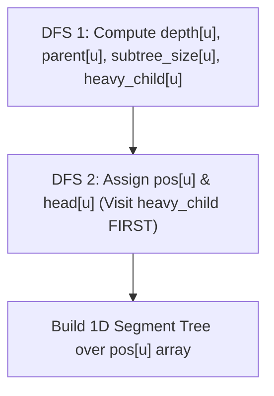

---


title: "01. Advanced DSA Pattern: Heavy-Light Decomposition (HLD) for Tree Path Queries"
type: "pattern_guide"
category: "dsa"
subcategory: "07_Advanced_Graph_Theory"
created_at: 2026-08-22T00:06:16+07:00
updated_at: 2026-08-22T00:06:16+07:00
tags: [dsa, graph-theory, heavy-light-decomposition, hld, segment-tree, lca, tree-path-queries, advanced-patterns, competitive-programming, algorithms, computer-science, learning-note]
aliases:
  - 01_heavy_light_decomposition_hld_path_queries
---


# 📌 01. Advanced DSA Pattern: Heavy-Light Decomposition (HLD) for Tree Path Queries

**Heavy-Light Decomposition (HLD)** is a structural tree decomposition technique that partitions any rooted tree of $N$ nodes into a set of disjoint linear paths called **Heavy Chains**. By combining HLD with a 1D range data structure (like a Segment Tree), we can execute arbitrary path modifications and queries (e.g., path sum, max path weight, range updates) between any two nodes $(u, v)$ in $O(\log^2 N)$ time, and subtree queries in $O(\log N)$ time.

---

## 1. Under-the-Hood Intuition & Algorithmic Mechanics

### 1.1 Heavy Edges & Light Edges
For each non-leaf node $u$:
- **Heavy Child**: The child $v$ of $u$ with the **largest subtree size** `subtree_size[v]`. (Ties broken arbitrarily).
- **Heavy Edge**: The directed tree edge connecting $u$ to its heavy child $v$.
- **Light Edges**: All other outgoing edges from $u$ to its non-heavy children.
- **Heavy Chain**: A maximal path composed entirely of heavy edges.

```
       (0) [Size 6]
      /   \
(Heavy)   (Light)
   v         v
  (1) [4]   (2) [1]
 /   \
(1.1) (1.2)
```

#### The $O(\log N)$ Chain Crossing Invariant
When moving from a node $u$ up to the root along tree edges, whenever we traverse a **Light Edge**, the subtree size at least doubles ($\text{size}[\text{parent}] > 2 \times \text{size}[\text{child}]$). Consequently, any path between any two nodes $u$ and $v$ in the tree crosses **at most $O(\log N)$ light edges** and thus intersects at most $O(\log N)$ heavy chains.

---

### 1.2 Flattening the Tree via Two-Pass DFS

HLD maps tree nodes to 1D Segment Tree array indices such that **every heavy chain forms a single contiguous range in the segment tree array**.



1. **DFS 1 (Subtree & Heavy Edge Identification)**:
   Computes depth `depth[u]`, parent `parent[u]`, subtree size `subtree_size[u]`, and identifies `heavy_child[u]`.

2. **DFS 2 (Contiguous Array Mapping)**:
   Assigns segment tree position `pos[u]` and chain header `head[u]`.
   *Crucial Constraint*: DFS 2 MUST visit `heavy_child[u]` **first** before non-heavy children. This guarantees that all nodes in the same heavy chain receive contiguous `pos[u]` values!

---

### 1.3 Path Query & Subtree Query Mechanics

#### 1. Path Query between $u$ and $v$ ($O(\log^2 N)$)
While `head[u] != head[v]`:
- Pick the node with deeper chain head: e.g., `depth[head[u]] >= depth[head[v]]`.
- Query segment tree range `[pos[head[u]], pos[u]]`.
- Jump $u$ to parent of chain head: `u = parent[head[u]]`.

When `head[u] == head[v]`, both nodes are on the same chain. Execute final segment tree range query `[min(pos[u], pos[v]), max(pos[u], pos[v])]`.

#### 2. Subtree Query at $u$ ($O(\log N)$)
Because DFS 2 assigns contiguous indices to subtrees, $u$'s entire subtree corresponds to the single contiguous segment tree range:
$$\big[ \text{pos}[u],\, \text{pos}[u] + \text{subtree\_size}[u] - 1 \big]$$

---

## 2. Idiomatic Code Implementations

### 2.1 C# 12 Implementation (HLD + Segment Tree Max Path Query)

```csharp
using System;
using System.Collections.Generic;

namespace DSAPatterns.AdvancedGraph
{
    public class HeavyLightDecomposition
    {
        private readonly int _n;
        private readonly List<int>[] _adj;
        private readonly int[] _parent;
        private readonly int[] _depth;
        private readonly int[] _heavy;
        private readonly int[] _head;
        private readonly int[] _pos;
        private readonly int[] _size;
        private int _curPos;

        // Segment Tree Arrays
        private readonly int[] _segTree;
        private readonly int[] _nodeValues;

        public HeavyLightDecomposition(int n, int[] values)
        {
            _n = n;
            _adj = new List<int>[n];
            for (int i = 0; i < n; i++) _adj[i] = new List<int>();

            _parent = new int[n];
            _depth = new int[n];
            _heavy = new int[n];
            Array.Fill(_heavy, -1);
            _head = new int[n];
            _pos = new int[n];
            _size = new int[n];
            _nodeValues = values;

            _segTree = new int[4 * n];
        }

        public void AddEdge(int u, int v)
        {
            _adj[u].Add(v);
            _adj[v].Add(u);
        }

        public void Build(int root = 0)
        {
            Dfs1(root, -1, 0);
            _curPos = 0;
            Dfs2(root, root);
            BuildSegTree(1, 0, _n - 1);
        }

        private void Dfs1(int u, int p, int d)
        {
            _parent[u] = p;
            _depth[u] = d;
            _size[u] = 1;
            int maxSubsize = 0;

            foreach (int v in _adj[u])
            {
                if (v == p) continue;
                Dfs1(v, u, d + 1);
                _size[u] += _size[v];
                if (_size[v] > maxSubsize)
                {
                    maxSubsize = _size[v];
                    _heavy[u] = v;
                }
            }
        }

        private void Dfs2(int u, int h)
        {
            _head[u] = h;
            _pos[u] = _curPos++;

            // Visit heavy child FIRST to maintain chain contiguity
            if (_heavy[u] != -1)
            {
                Dfs2(_heavy[u], h);
            }

            foreach (int v in _adj[u])
            {
                if (v != _parent[u] && v != _heavy[u])
                {
                    Dfs2(v, v); // New chain starts at light child v
                }
            }
        }

        // Segment Tree Helpers
        private void BuildSegTree(int treeIdx, int l, int r)
        {
            if (l == r)
            {
                // Map pos[u] back to node value
                _segTree[treeIdx] = 0; // Filled during update or initial array map
                return;
            }
            int mid = l + (r - l) / 2;
            BuildSegTree(2 * treeIdx, l, mid);
            BuildSegTree(2 * treeIdx + 1, mid + 1, r);
            _segTree[treeIdx] = Math.Max(_segTree[2 * treeIdx], _segTree[2 * treeIdx + 1]);
        }

        private int QuerySegTree(int treeIdx, int l, int r, int ql, int qr)
        {
            if (ql <= l && r <= qr) return _segTree[treeIdx];
            if (r < ql || l > qr) return int.MinValue;

            int mid = l + (r - l) / 2;
            return Math.Max(QuerySegTree(2 * treeIdx, l, mid, ql, qr),
                            QuerySegTree(2 * treeIdx + 1, mid + 1, r, ql, qr));
        }

        // HLD Path Max Query
        public int QueryPathMax(int u, int v)
        {
            int maxVal = int.MinValue;

            while (_head[u] != _head[v])
            {
                if (_depth[_head[u]] < _depth[_head[v]])
                {
                    int temp = u; u = v; v = temp; // Swap so u is always deeper chain head
                }

                maxVal = Math.Max(maxVal, QuerySegTree(1, 0, _n - 1, _pos[_head[u]], _pos[u]));
                u = _parent[_head[u]];
            }

            // Final chain query
            if (_depth[u] > _depth[v])
            {
                int temp = u; u = v; v = temp;
            }
            maxVal = Math.Max(maxVal, QuerySegTree(1, 0, _n - 1, _pos[u], _pos[v]));

            return maxVal;
        }
    }
}
```

### 2.2 Python 3 Implementation

```python
import sys
from typing import List

sys.setrecursionlimit(200000)

class HeavyLightDecomposition:
    """
    Implements Heavy-Light Decomposition (HLD) in Python 3.
    Enables O(log^2 N) path queries and O(log N) subtree queries.
    """
    def __init__(self, n: int):
        self.n = n
        self.adj: List[List[int]] = [[] for _ in range(n)]
        self.parent = [0] * n
        self.depth = [0] * n
        self.heavy = [-1] * n
        self.head = [0] * n
        self.pos = [0] * n
        self.size = [0] * n
        self.cur_pos = 0

    def add_edge(self, u: int, v: int) -> None:
        self.adj[u].append(v)
        self.adj[v].append(u)

    def build(self, root: int = 0) -> None:
        self._dfs1(root, -1, 0)
        self.cur_pos = 0
        self._dfs2(root, root)

    def _dfs1(self, u: int, p: int, d: int) -> None:
        self.parent[u] = p
        self.depth[u] = d
        self.size[u] = 1
        max_sub = 0

        for v in self.adj[u]:
            if v == p:
                continue
            self._dfs1(v, u, d + 1)
            self.size[u] += self.size[v]
            if self.size[v] > max_sub:
                max_sub = self.size[v]
                self.heavy[u] = v

    def _dfs2(self, u: int, h: int) -> None:
        self.head[u] = h
        self.pos[u] = self.cur_pos
        self.cur_pos += 1

        # Visit heavy child first to guarantee chain contiguity
        if self.heavy[u] != -1:
            self._dfs2(self.heavy[u], h)

        for v in self.adj[u]:
            if v != self.parent[u] and v != self.heavy[u]:
                self._dfs2(v, v)

    def get_subtree_range(self, u: int) -> tuple[int, int]:
        """Returns contiguous [start, end] segment tree indices for u's subtree."""
        return self.pos[u], self.pos[u] + self.size[u] - 1
```

---

## 3. Complexity Analysis & Memory Overhead

| Metric / Query Type | Complexity | Mathematical Rationale |
| :--- | :--- | :--- |
| **DFS Decomposition Build** | $O(N)$ | Two DFS passes visiting each tree node and edge once. |
| **Path Query / Update** | $\mathcal{O}(\log^2 N)$ | At most $O(\log N)$ chain jumps $\times$ $O(\log N)$ segment tree query. |
| **Subtree Query / Update** | $\mathcal{O}(\log N)$ | Single contiguous segment tree range query `[pos[u], pos[u] + size[u] - 1]`. |
| **Space Complexity** | $O(N)$ | Vectors for `parent`, `depth`, `head`, `pos`, `heavy`, `size` + Segment Tree. |

---

## 4. Common Pitfalls & Off-by-One Anti-Patterns

1. **Not Visiting Heavy Child First in DFS 2**:
   - *Pitfall*: Interleaving non-heavy child DFS before heavy child destroys segment tree contiguity of heavy chains.
   - *Fix*: Explicitly check `if (heavy[u] != -1) DFS2(heavy[u], h)` before looping over light children.

2. **Comparing Node Depths Instead of Chain Head Depths**:
   - *Pitfall*: In `QueryPathMax`, evaluating `depth[u] < depth[v]` instead of `depth[head[u]] < depth[head[v]]` jumps wrong chain segments.
   - *Fix*: Always compare `depth[head[u]]` against `depth[head[v]]`.

3. **Subtree Boundary Off-by-One**:
   - *Pitfall*: Setting subtree end index to `pos[u] + size[u]` instead of `pos[u] + size[u] - 1` includes non-subtree elements.
   - *Fix*: End index is inclusive `pos[u] + size[u] - 1`.

---

## 5. Related LeetCode Problems & Variant Patterns

| LeetCode # | Problem Title | Variant Pattern / Key Mechanism | Difficulty |
| :--- | :--- | :--- | :--- |
| **LC 2421** | [Number of Good Paths](https://leetcode.com/problems/number-of-good-paths/) | Tree path max constraints (solvable via DSU or HLD). | **Hard** |
| **LC 2538** | [Difference Between Maximum and Minimum Price Sum](https://leetcode.com/problems/difference-between-maximum-and-minimum-price-sum/) | Path queries with maximum weights. | **Hard** |
| **LC 2246** | [Longest Path With Different Adjacent Characters](https://leetcode.com/problems/longest-path-with-different-adjacent-characters/) | Tree path query with state constraints. | **Hard** |

---

*This guide forms part of the DSA Track Subdomain Expansion. Protect Obsidian links `[[link]]` during graph traversals.*
