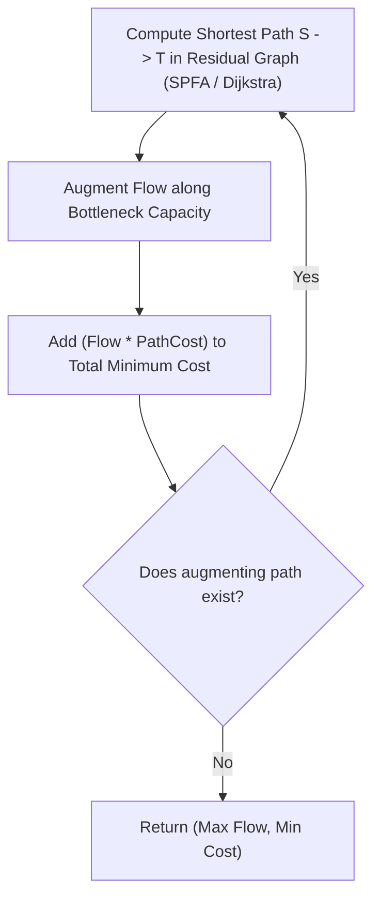

---


title: "01. Advanced DSA Pattern: Minimum Cost Maximum Flow (MCMF) - Successive Shortest Path"
type: "pattern_guide"
category: "dsa"
subcategory: "07_Advanced_Graph_Theory"
created_at: 2026-08-22T00:06:16+07:00
updated_at: 2026-08-22T00:06:16+07:00
tags: [dsa, graph-theory, network-flow, min-cost-max-flow, mcmf, successive-shortest-path, spfa, dijkstra, advanced-patterns, competitive-programming, algorithms, computer-science, learning-note]
aliases:
  - 01_min_cost_max_flow_successive_shortest_path
---


# 📌 01. Advanced DSA Pattern: Minimum Cost Maximum Flow (MCMF) - Successive Shortest Path

**Minimum Cost Maximum Flow (MCMF)** addresses networks where every edge has both a capacity constraint $c(u, v)$ and a per-unit transmission cost $\text{cost}(u, v)$. The objective is to push the maximum possible flow from source $S$ to sink $T$ while minimizing the total cost incurred across all edges:
$$\text{Total Cost} = \sum_{(u, v) \in E} f(u, v) \cdot \text{cost}(u, v)$$

---

## 1. Under-the-Hood Intuition & Algorithmic Mechanics

### 1.1 Residual Graph Edge Costs & Skew Symmetry
For a directed edge $(u, v)$ with capacity $c$, current flow $f$, and cost $w$:
- Forward edge $(u, v)$ has residual capacity $r(u, v) = c - f$ and cost $+w$.
- Reverse edge $(v, u)$ has residual capacity $r(v, u) = f$ and cost $-w$.

```
Forward Edge:   (u) ----[ cap = 10, cost = +5 ]----> (v)
Reverse Edge:   (v) ----[ cap =  0, cost = -5 ]----> (u)
```

The negative cost on the reverse edge ensures that pushing flow backward to cancel previous flow correctly **refunds** the associated unit cost!

---

### 1.2 Successive Shortest Path (SSP) Algorithm

The **Successive Shortest Path (SSP)** algorithm iteratively finds an augmenting path from $S$ to $T$ in the residual graph that minimizes total path cost, augments flow along this path, and repeats until no augmenting path exists.



#### 1. SPFA Variant ($O(F \cdot V E)$)
Uses Shortest Path Faster Algorithm (SPFA) — a queue-based Bellman-Ford variant — to handle negative edge costs produced by reverse residual edges.

#### 2. Johnson's Node Potentials ($O(F \cdot E \log V)$)
To use fast Dijkstra with Binary Heaps, we transform edge costs to non-negative reduced costs using node potentials $\pi(u)$:
$$\text{cost}_{\pi}(u, v) = \text{cost}(u, v) + \pi(u) - \pi(v) \ge 0$$
Potentials are updated after each Dijkstra pass: $\pi'(u) = \pi(u) + d(u)$.

---

## 2. Idiomatic Code Implementations

### 2.1 C# 12 Implementation (MCMF via SPFA)

```csharp
using System;
using System.Collections.Generic;

namespace DSAPatterns.AdvancedGraph
{
    public class MinCostMaxFlow
    {
        public class Edge
        {
            public int To { get; set; }
            public int RevIdx { get; set; }
            public long Capacity { get; set; }
            public long Flow { get; set; }
            public long Cost { get; set; }

            public Edge(int to, int revIdx, long capacity, long cost)
            {
                To = to;
                RevIdx = revIdx;
                Capacity = capacity;
                Cost = cost;
                Flow = 0;
            }
        }

        private readonly int _nodes;
        private readonly List<Edge>[] _adj;

        public MinCostMaxFlow(int nodes)
        {
            _nodes = nodes;
            _adj = new List<Edge>[nodes];
            for (int i = 0; i < nodes; i++)
            {
                _adj[i] = new List<Edge>();
            }
        }

        public void AddEdge(int u, int v, long cap, long cost)
        {
            Edge forward = new Edge(v, _adj[v].Count, cap, cost);
            Edge reverse = new Edge(u, _adj[u].Count, 0, -cost); // Reverse edge cost is -cost
            _adj[u].Add(forward);
            _adj[v].Add(reverse);
        }

        public (long maxFlow, long minCost) ComputeMcmf(int src, int sink)
        {
            long maxFlow = 0;
            long minCost = 0;

            long[] dist = new long[_nodes];
            int[] parentEdge = new int[_nodes];
            int[] parentNode = new int[_nodes];
            bool[] inQueue = new bool[_nodes];

            while (Spfa(src, sink, dist, parentNode, parentEdge, inQueue))
            {
                // Find bottleneck flow along shortest cost path
                long push = long.MaxValue;
                for (int curr = sink; curr != src; curr = parentNode[curr])
                {
                    int pNode = parentNode[curr];
                    int pEdge = parentEdge[curr];
                    push = Math.Min(push, _adj[pNode][pEdge].Capacity - _adj[pNode][pEdge].Flow);
                }

                // Augment flow and accumulate cost
                for (int curr = sink; curr != src; curr = parentNode[curr])
                {
                    int pNode = parentNode[curr];
                    int pEdge = parentEdge[curr];

                    _adj[pNode][pEdge].Flow += push;
                    int revIdx = _adj[pNode][pEdge].RevIdx;
                    _adj[curr][revIdx].Flow -= push;

                    minCost += push * _adj[pNode][pEdge].Cost;
                }

                maxFlow += push;
            }

            return (maxFlow, minCost);
        }

        private bool Spfa(int src, int sink, long[] dist, int[] parentNode, int[] parentEdge, bool[] inQueue)
        {
            Array.Fill(dist, long.MaxValue / 2);
            Array.Fill(inQueue, false);

            Queue<int> q = new Queue<int>();
            dist[src] = 0;
            q.Enqueue(src);
            inQueue[src] = true;

            while (q.Count > 0)
            {
                int u = q.Dequeue();
                inQueue[u] = false;

                for (int i = 0; i < _adj[u].Count; i++)
                {
                    var edge = _adj[u][i];
                    if (edge.Capacity - edge.Flow > 0 && dist[edge.To] > dist[u] + edge.Cost)
                    {
                        dist[edge.To] = dist[u] + edge.Cost;
                        parentNode[edge.To] = u;
                        parentEdge[edge.To] = i;

                        if (!inQueue[edge.To])
                        {
                            q.Enqueue(edge.To);
                            inQueue[edge.To] = true;
                        }
                    }
                }
            }

            return dist[sink] < long.MaxValue / 4;
        }
    }
}
```

### 2.2 Python 3 Implementation

```python
from collections import deque
from typing import List, Tuple

class Edge:
    def __init__(self, to: int, rev_idx: int, capacity: int, cost: int):
        self.to = to
        self.rev_idx = rev_idx
        self.capacity = capacity
        self.cost = cost
        self.flow = 0

class MinCostMaxFlow:
    """
    Implements Minimum Cost Maximum Flow using Successive Shortest Path (SPFA).
    """
    def __init__(self, n: int):
        self.n = n
        self.adj: List[List[Edge]] = [[] for _ in range(n)]

    def add_edge(self, u: int, v: int, cap: int, cost: int) -> None:
        forward = Edge(v, len(self.adj[v]), cap, cost)
        reverse = Edge(u, len(self.adj[u]), 0, -cost)
        self.adj[u].append(forward)
        self.adj[v].append(reverse)

    def compute_mcmf(self, s: int, t: int) -> Tuple[int, int]:
        max_flow = 0
        min_cost = 0

        INF = float('inf')

        while True:
            dist = [INF] * self.n
            parent_node = [-1] * self.n
            parent_edge = [-1] * self.n
            in_queue = [False] * self.n

            q = deque([s])
            dist[s] = 0
            in_queue[s] = True

            # SPFA to find shortest path in terms of edge cost
            while q:
                u = q.popleft()
                in_queue[u] = False

                for i, edge in enumerate(self.adj[u]):
                    if edge.capacity - edge.flow > 0 and dist[edge.to] > dist[u] + edge.cost:
                        dist[edge.to] = dist[u] + edge.cost
                        parent_node[edge.to] = u
                        parent_edge[edge.to] = i

                        if not in_queue[edge.to]:
                            q.append(edge.to)
                            in_queue[edge.to] = True

            if dist[t] == INF:
                break

            # Find bottleneck flow along path
            push = INF
            curr = t
            while curr != s:
                p_node = parent_node[curr]
                p_edge = parent_edge[curr]
                edge = self.adj[p_node][p_edge]
                push = min(push, edge.capacity - edge.flow)
                curr = p_node

            # Augment flow
            curr = t
            while curr != s:
                p_node = parent_node[curr]
                p_edge = parent_edge[curr]
                edge = self.adj[p_node][p_edge]

                edge.flow += push
                self.adj[curr][edge.rev_idx].flow -= push
                min_cost += push * edge.cost
                curr = p_node

            max_flow += push

        return max_flow, min_cost
```

---

## 3. Complexity Analysis & Memory Overhead

| Metric / Variant | Complexity | Detailed Analysis |
| :--- | :--- | :--- |
| **SPFA MCMF Time** | $O(F \cdot V E)$ | $F$ is max flow value; SPFA takes $O(VE)$ per augmentation. |
| **Dijkstra + Potentials** | $\mathcal{O}(F \cdot E \log V)$ | Reduced costs allow $O(E \log V)$ Dijkstra passes. |
| **Space Complexity** | $O(V + E)$ | Adjacency list storing dual edge objects (forward + reverse). |
| **Memory Overhead** | $O(V + E)$ | Flat distance array + parent pointer vectors per iteration. |

---

## 4. Common Pitfalls & Off-by-One Anti-Patterns

1. **Incorrect Reverse Edge Cost Sign**:
   - *Pitfall*: Assigning positive cost $+w$ to reverse edge instead of $-w$ invalidates cost cancellation mechanics.
   - *Fix*: Reverse edge cost MUST be `-cost`.

2. **Infinity Constant Overflow in SPFA**:
   - *Pitfall*: Initializing `dist` array with `long.MaxValue` and evaluating `dist[u] + edge.Cost` causes 64-bit integer wraparound to negative values.
   - *Fix*: Initialize `dist` with `long.MaxValue / 2`.

3. **Failing to Reset Queue Tracking Array (`inQueue`)**:
   - *Pitfall*: Leaving `inQueue[u] = true` after popping $u$ prevents re-enqueuing $u$ when a shorter negative cost path is found.
   - *Fix*: Set `inQueue[u] = false` immediately upon popping $u$ from queue.

---

## 5. Related LeetCode Problems & Variant Patterns

| LeetCode # | Problem Title | Variant Pattern / Reduction | Difficulty |
| :--- | :--- | :--- | :--- |
| **LC 1947** | [Maximum Compatibility Score Sum](https://leetcode.com/problems/maximum-compatibility-score-sum/) | Min-Cost Perfect Bipartite Matching (MCMF reduction). | **Medium** |
| **LC 1879** | [Minimum XOR Sum of Two Arrays](https://leetcode.com/problems/minimum-xor-sum-of-two-arrays/) | Minimum Weight Assignment problem. | **Hard** |
| **Competitive** | Minimum Cost Flow with Demands | MCMF with lower bound demand constraints. | **Hard** |

---

*This guide forms part of the DSA Track Subdomain Expansion. Protect Obsidian links `[[link]]` during graph traversals.*
