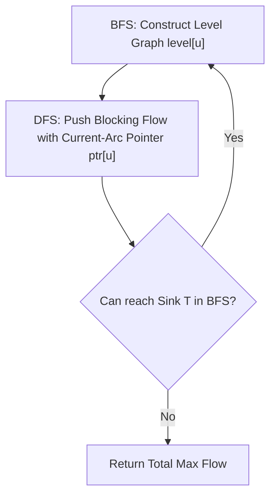

---


title: "01. Advanced DSA Pattern: Network Flow - Dinic's & Edmonds-Karp Maximum Flow"
type: "pattern_guide"
category: "dsa"
subcategory: "07_Advanced_Graph_Theory"
created_at: 2026-08-22T00:06:16+07:00
updated_at: 2026-08-22T00:06:16+07:00
tags: [dsa, graph-theory, network-flow, max-flow, dinic-algorithm, edmonds-karp, min-cut, advanced-patterns, competitive-programming, algorithms, computer-science, learning-note]
aliases:
  - 01_network_flow_dinic_edmonds_karp_max_flow
---


# 📌 01. Advanced DSA Pattern: Network Flow - Dinic's & Edmonds-Karp Maximum Flow

**Network Flow** algorithms calculate the maximum rate at which fluid/data can move from a source node $S$ to a sink node $T$ through a directed flow network with bounded edge capacities. Maximum Flow algorithms also solve **Minimum Cut** problems via the Max-Flow Min-Cut Theorem.

---

## 1. Under-the-Hood Intuition & Algorithmic Mechanics

### 1.1 Formal Network Definition
A flow network is a directed graph $G = (V, E)$ where each directed edge $(u, v) \in E$ has a non-negative capacity $c(u, v) \ge 0$.
A flow $f: V \times V \to \mathbb{R}$ satisfies three properties:
1. **Capacity Constraint**: \$0 \le f(u, v) \le c(u, v)$.
2. **Skew Symmetry**: $f(v, u) = -f(u, v)$.
3. **Flow Conservation**: For every node $u \in V \setminus \{S, T\}$, $\sum_{v \in V} f(u, v) = 0$.

### 1.2 Residual Graphs & Reverse Edge Mechanics
For every directed edge $(u, v)$ with capacity $c$ and current flow $f$, the **residual graph** $G_f$ contains:
- Forward edge $(u, v)$ with residual capacity $r(u, v) = c(u, v) - f(u, v)$.
- Reverse edge $(v, u)$ with residual capacity $r(v, u) = f(u, v)$.

*Crucial Mechanic*: The reverse edge allows subsequent flow augmentations to **undo/cancel** previously committed suboptimal flow decisions.

```
Original Edge:       (u) ----[ cap = 10, flow = 4 ]----> (v)

Residual Graph:      (u) ----[ residual cap = 6 ]------> (v)
                     (u) <---[ residual cap = 4 ]------- (v)  (Reverse Edge)
```

---

### 1.3 Algorithm Comparison: Edmonds-Karp vs Dinic's



#### 1. Edmonds-Karp Algorithm ($O(V \cdot E^2)$)
Repeatedly executes Breadth-First Search (BFS) to find the shortest augmenting path (by unweighted edge count) from $S$ to $T$ in the residual graph, augmenting flow along the bottleneck capacity until no path exists.

#### 2. Dinic's Algorithm ($O(V^2 E)$ General / $O(E \sqrt{V})$ Bipartite)
Dinic's algorithm processes multiple augmenting paths simultaneously phase-by-phase:
1. **BFS Phase**: Constructs a **Level Graph** where $\text{level}[v] = \text{level}[u] + 1$ for all valid residual edges $(u, v)$. If $T$ is unreachable, algorithm terminates.
2. **DFS Phase**: Pushes a **Blocking Flow** through the level graph using a Depth-First Search.
   - **Current-Arc Optimization (`ptr[u]`)**: Tracks the current edge index being evaluated for node $u$. Skips fully saturated edges on backtracking, guaranteeing amortized linear DFS phase complexity.

---

## 2. Idiomatic Code Implementations

### 2.1 C# 12 Implementation (Dinic's Max Flow)

```csharp
using System;
using System.Collections.Generic;

namespace DSAPatterns.AdvancedGraph
{
    public class DinicMaxFlow
    {
        public class Edge
        {
            public int To { get; set; }
            public int RevIndex { get; set; }
            public long Capacity { get; set; }
            public long Flow { get; set; }

            public Edge(int to, int revIndex, long capacity)
            {
                To = to;
                RevIndex = revIndex;
                Capacity = capacity;
                Flow = 0;
            }
        }

        private readonly int _nodes;
        private readonly List<Edge>[] _adj;
        private readonly int[] _level;
        private readonly int[] _ptr;

        public DinicMaxFlow(int nodes)
        {
            _nodes = nodes;
            _adj = new List<Edge>[nodes];
            for (int i = 0; i < nodes; i++)
            {
                _adj[i] = new List<Edge>();
            }
            _level = new int[nodes];
            _ptr = new int[nodes];
        }

        public void AddEdge(int from, int to, long capacity)
        {
            Edge forward = new Edge(to, _adj[to].Count, capacity);
            Edge reverse = new Edge(from, _adj[from].Count, 0); // Reverse capacity 0
            _adj[from].Add(forward);
            _adj[to].Add(reverse);
        }

        private bool Bfs(int src, int sink)
        {
            Array.Fill(_level, -1);
            _level[src] = 0;

            Queue<int> q = new Queue<int>();
            q.Enqueue(src);

            while (q.Count > 0)
            {
                int u = q.Dequeue();
                foreach (var edge in _adj[u])
                {
                    if (edge.Capacity - edge.Flow > 0 && _level[edge.To] == -1)
                    {
                        _level[edge.To] = _level[u] + 1;
                        q.Enqueue(edge.To);
                    }
                }
            }

            return _level[sink] != -1;
        }

        private long Dfs(int u, int sink, long pushed)
        {
            if (pushed == 0 || u == sink) return pushed;

            for (; _ptr[u] < _adj[u].Count; _ptr[u]++)
            {
                var edge = _adj[u][_ptr[u]];
                int v = edge.To;

                if (_level[v] != _level[u] + 1 || edge.Capacity - edge.Flow == 0)
                    continue;

                long tr = Dfs(v, sink, Math.Min(pushed, edge.Capacity - edge.Flow));
                if (tr == 0) continue;

                edge.Flow += tr;
                _adj[v][edge.RevIndex].Flow -= tr; // Reciprocal reverse flow update
                return tr;
            }

            return 0;
        }

        public long GetMaxFlow(int src, int sink)
        {
            long maxFlow = 0;

            while (Bfs(src, sink))
            {
                Array.Fill(_ptr, 0); // Reset current-arc pointer
                while (true)
                {
                    long pushed = Dfs(src, sink, long.MaxValue);
                    if (pushed == 0) break;
                    maxFlow += pushed;
                }
            }

            return maxFlow;
        }
    }
}
```

### 2.2 Python 3 Implementation

```python
from collections import deque
from typing import List

class Edge:
    def __init__(self, to: int, rev_idx: int, capacity: int):
        self.to = to
        self.rev_idx = rev_idx
        self.capacity = capacity
        self.flow = 0

class DinicMaxFlow:
    """
    Implements Dinic's Maximum Flow Algorithm in Python 3.
    Includes Level Graph BFS and Blocking Flow DFS with Arc Pointers.
    """
    def __init__(self, n: int):
        self.n = n
        self.adj: List[List[Edge]] = [[] for _ in range(n)]
        self.level: List[int] = []
        self.ptr: List[int] = []

    def add_edge(self, u: int, v: int, cap: int) -> None:
        forward = Edge(v, len(self.adj[v]), cap)
        reverse = Edge(u, len(self.adj[u]), 0)
        self.adj[u].append(forward)
        self.adj[v].append(reverse)

    def _bfs(self, s: int, t: int) -> bool:
        self.level = [-1] * self.n
        self.level[s] = 0
        q = deque([s])

        while q:
            u = q.popleft()
            for edge in self.adj[u]:
                if edge.capacity - edge.flow > 0 and self.level[edge.to] == -1:
                    self.level[edge.to] = self.level[u] + 1
                    q.append(edge.to)

        return self.level[t] != -1

    def _dfs(self, u: int, t: int, pushed: int) -> int:
        if pushed == 0 or u == t:
            return pushed

        for i in range(self.ptr[u], len(self.adj[u])):
            self.ptr[u] = i
            edge = self.adj[u][i]
            v = edge.to

            if self.level[v] != self.level[u] + 1 or edge.capacity - edge.flow == 0:
                continue

            tr = self._dfs(v, t, min(pushed, edge.capacity - edge.flow))
            if tr == 0:
                continue

            edge.flow += tr
            self.adj[v][edge.rev_idx].flow -= tr
            return tr

        return 0

    def max_flow(self, s: int, t: int) -> int:
        flow = 0
        while self._bfs(s, t):
            self.ptr = [0] * self.n
            while True:
                pushed = self._dfs(s, t, float('inf'))
                if pushed == 0:
                    break
                flow += pushed
        return flow
```

---

## 3. Complexity Analysis & Memory Overhead

| Algorithm / Graph Structure | Time Complexity | Space Complexity | Practical Hardware Performance |
| :--- | :--- | :--- | :--- |
| **Edmonds-Karp** | $O(V \cdot E^2)$ | $O(V + E)$ | Suitable for small networks ($V \le 500, E \le 2000$). |
| **Dinic (General Graph)** | $O(V^2 E)$ | $O(V + E)$ | Highly optimized, runs in $< 50\text{ms}$ for $V = 5000$. |
| **Dinic (Unit Capacities)** | $O(E \sqrt{V})$ | $O(V + E)$ | Theoretical bound for Bipartite Matching graphs. |
| **Memory Overhead** | $O(V + E)$ | $O(V + E)$ | Stores $2E$ total edge instances (forward + reverse). |

---

## 4. Common Pitfalls & Off-by-One Anti-Patterns

1. **Omitting Current-Arc Pointer Optimization (`ptr[u]`)**:
   - *Pitfall*: Resetting edge scan from `0` in every DFS call causes worst-case $O(V^2 E^2)$ performance.
   - *Fix*: Maintain `_ptr[u]` array across DFS pushes within the same level graph phase.

2. **Forgetting Reverse Edge Capacity 0**:
   - *Pitfall*: Adding directed edge $(u, v)$ with capacity $C$ without adding matching reverse edge $(v, u)$ with capacity $0$ destroys flow cancellation semantics.
   - *Fix*: Always create twin forward/reverse edges simultaneously during `AddEdge()`.

3. **Integer Overflow on Total Flow Aggregation**:
   - *Pitfall*: Storing bottleneck flow variables as 32-bit `int` when sum of capacities exceeds $2^{31}-1$.
   - *Fix*: Declare edge capacity, flow, and `maxFlow` variables as 64-bit `long` (`int64_t`).

---

## 5. Related LeetCode Problems & Variant Patterns

| LeetCode # | Problem Title | Variant Pattern / Key Reduction | Difficulty |
| :--- | :--- | :--- | :--- |
| **LC 2123** | [Minimum Operations to Remove Adjacent Tiles](https://leetcode.com/problems/minimum-operations-to-remove-adjacent-tiles/) | Grid bipartite graph Maximum Independent Set via Min-Cut. | **Hard** |
| **LC 1349** | [Maximum Students Taking Exam](https://leetcode.com/problems/maximum-students-taking-exam/) | Seats conflict graph solvable via Min-Cut / Max-Flow. | **Hard** |
| **LC 1152** | [Bipartite Matching Problem Variants] | Hopcroft-Karp / Dinic unit capacity network flow. | **Hard** |

---

*This guide forms part of the DSA Track Subdomain Expansion. Protect Obsidian links `[[link]]` during graph traversals.*
