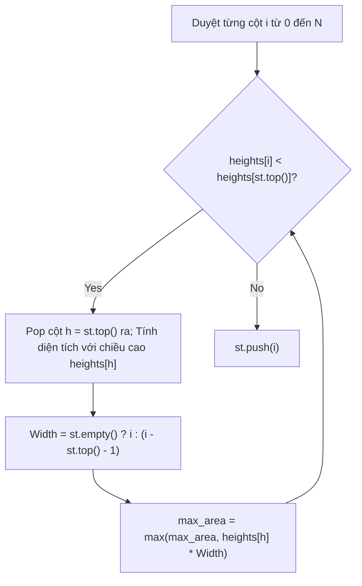

---


title: "04. 🥞 Monotonic Stack (Ngăn xếp Đơn điệu) — Lý thuyết Toàn diện, Chứng minh & Ứng dụng"
type: "concept_guide"
category: "dsa"
subcategory: "07_stack_queue"
created_at: 2026-08-22T00:00:00+07:00
updated_at: 2026-08-26T23:45:00+07:00
tags: [dsa, stack, monotonic-stack, next-greater-element, histogram, trapping-rain-water, algorithms, computer-science, learning-note]
aliases:
  - 04_monotonic_stack
---

# 📌 04. 🥞 Monotonic Stack (Ngăn xếp Đơn điệu) — Lý thuyết Toàn diện, Chứng minh & Ứng dụng

Ngăn xếp Đơn điệu (Monotonic Stack) là một cấu trúc dữ liệu đặc biệt duy trì các phần tử theo thứ tự đơn điệu tăng dần (Monotonically Increasing) hoặc đơn điệu giảm dần (Monotonically Decreasing). Đây là vũ khí tối thượng giúp giải quyết các bài toán tìm phần tử biên gần nhất trong thời gian tuyến tính **$\mathcal{O}(N)$**, thay thế các vòng lặp lồng nhau $\mathcal{O}(N^2)$.

---

## 1. Định nghĩa Toán học & Cơ chế Hoạt động

```mermaid
graph TD
    subgraph Monotonic Increasing Stack (Values Increase from Bottom to Top)
        Top["Top: 18"] --> Mid["Mid: 12"]
        Mid --> Bottom["Bottom: 5"]
    end
    
    subgraph Incoming Element: 9
        In["Value 9 arrives"] --> Comp["9 < 18 (Pops 18), 9 < 12 (Pops 12), 9 > 5 (Pushes 9)"]
        Comp --> NewStack["New Stack: [5, 9]"]
    end
```

### 1.1 Bốn Biến thể Chính của Monotonic Stack

| Loại Ngăn xếp | Thứ tự từ Đáy $	o$ Đỉnh | Thao tác khi gặp $x$ | Mục đích Sử dụng |
| :--- | :--- | :--- | :--- |
| **Đơn điệu Tăng Nghiêm ngặt** | $S[0] < S[1] < \dots < S[\text{top}]$ | `while (!st.empty() && st.top() >= x) st.pop();` | Tìm **Previous / Next Smaller Element** |
| **Đơn điệu Tăng Không giảm** | $S[0] \le S[1] \le \dots \le S[\text{top}]$ | `while (!st.empty() && st.top() > x) st.pop();` | Tìm phần tử nhỏ hơn nghiêm ngặt |
| **Đơn điệu Giảm Nghiêm ngặt** | $S[0] > S[1] > \dots > S[\text{top}]$ | `while (!st.empty() && st.top() <= x) st.pop();` | Tìm **Previous / Next Greater Element** |
| **Đơn điệu Giảm Không tăng** | $S[0] \ge S[1] \ge \dots \ge S[\text{top}]$ | `while (!st.empty() && st.top() < x) st.pop();` | Tìm phần tử lớn hơn nghiêm ngặt |

---

## 2. Chứng minh Độ phức tạp Tuyến tính $\mathcal{O}(N)$ bằng Phân tích Phí tổn (Amortized Analysis)

Một câu hỏi phổ biến trong phỏng vấn: *"Tại sao mã nguồn chứa vòng lặp `while` lồng bên trong vòng lặp `for` nhưng độ phức tạp vẫn là $\mathcal{O}(N)$ thay vì $\mathcal{O}(N^2)$?"*

### **Chứng minh bằng Phương pháp Kế toán (Accounting Method)**:
1. Mỗi phần tử $A[i]$ trong mảng kích thước $N$ được duyệt qua bởi vòng lặp `for` đúng 1 lần.
2. Tại mỗi bước, $A[i]$ được `push` vào ngăn xếp tối đa **1 lần**.
3. Một phần tử chỉ có thể bị `pop` ra khỏi ngăn xếp khi gặp một phần tử vi phạm tính đơn điệu. Khi đã bị `pop`, nó biến mất vĩnh viễn khỏi ngăn xếp và không bao giờ bị `pop` lại lần thứ hai.
4. Tổng số thao tác `push` trên toàn bộ thuật toán $\le N$.
5. Tổng số thao tác `pop` trên toàn bộ thuật toán $\le N$.
6. Tổng số thao tác trên ngăn xếp:
   $$T(N) = \text{Count}(\text{push}) + \text{Count}(\text{pop}) \le N + N = 2N = \mathcal{O}(N)$$

---

## 3. Các Bài toán Kinh điển & Phân tích Chi tiết

### 3.1 Largest Rectangle in Histogram (LeetCode 84 - Hard)
Cho mảng `heights` chứa chiều cao của các cột histogram có độ rộng 1. Tìm diện tích hình chữ nhật lớn nhất có thể tạo thành.

**Ý tưởng**: Với mỗi cột $i$, hình chữ nhật lớn nhất lấy chiều cao `heights[i]` làm chặn trên sẽ kéo dài từ phần tử nhỏ hơn đầu tiên bên trái (`left_smaller`) đến phần tử nhỏ hơn đầu tiên bên phải (`right_smaller`):
$$\text{Area}[i] = \text{heights}[i] \times (\text{right\_smaller}[i] - \text{left\_smaller}[i] - 1)$$
Sử dụng Monotonic Increasing Stack giúp tính toán toàn bộ các biên này trong một lượt duyệt duy nhất.



---

## 4. Triển khai Source Code Đa ngôn ngữ Hoàn chỉnh

### 4.1 C++20 (Largest Rectangle in Histogram & Daily Temperatures)

```cpp
#include <iostream>
#include <vector>
#include <stack>
#include <algorithm>

class MonotonicStackMasterSuite {
public:
    // LeetCode 84: Largest Rectangle in Histogram O(N) Time, O(N) Space
    static int LargestRectangleArea(std::vector<int> heights) {
        heights.push_back(0); // Dummy sentinel to flush remaining elements in stack
        int n = static_cast<int>(heights.size());
        std::stack<int> st;
        int max_area = 0;

        for (int i = 0; i < n; ++i) {
            while (!st.empty() && heights[i] < heights[st.top()]) {
                int h = heights[st.top()];
                st.pop();
                int width = st.empty() ? i : (i - st.top() - 1);
                max_area = std::max(max_area, h * width);
            }
            st.push(i);
        }
        return max_area;
    }

    // LeetCode 739: Daily Temperatures (Days until warmer weather)
    static std::vector<int> DailyTemperatures(const std::vector<int>& temperatures) {
        int n = static_cast<int>(temperatures.size());
        std::vector<int> answer(n, 0);
        std::stack<int> st; // Monotonic decreasing stack of indices

        for (int i = 0; i < n; ++i) {
            while (!st.empty() && temperatures[i] > temperatures[st.top()]) {
                int prev_day = st.top();
                st.pop();
                answer[prev_day] = i - prev_day;
            }
            st.push(i);
        }
        return answer;
    }
};

int main() {
    std::vector<int> heights = {2, 1, 5, 6, 2, 3};
    std::cout << "Largest Rectangle Area: " 
              << MonotonicStackMasterSuite::LargestRectangleArea(heights) 
              << " (Expected: 10)
";

    std::vector<int> temps = {73, 74, 75, 71, 69, 72, 76, 73};
    auto days = MonotonicStackMasterSuite::DailyTemperatures(temps);
    std::cout << "Daily Temperatures Wait Days: ";
    for (int d : days) std::cout << d << " ";
    std::cout << "
";
    return 0;
}
```

### 4.2 Python 3.12 (Trapping Rain Water via Monotonic Decreasing Stack)

```python
from typing import List

class Solution:
    def trap(self, height: List[int]) -> int:
        st = [] # Monotonic decreasing stack of indices
        water = 0
        
        for current_idx, current_h in enumerate(height):
            while st and current_h > height[st[-1]]:
                bottom_idx = st.pop()
                if not st:
                    break
                left_idx = st[-1]
                bounded_height = min(current_h, height[left_idx]) - height[bottom_idx]
                distance = current_idx - left_idx - 1
                water += bounded_height * distance
                
            st.append(current_idx)
            
        return water

if __name__ == "__main__":
    sol = Solution()
    print("Trapped Water:", sol.trap([0,1,0,2,1,0,1,3,2,1,2,1]))
```

### 4.3 C# (.NET 8 Maximal Rectangle in 2D Binary Matrix)

```csharp
using System;
using System.Collections.Generic;

public class Solution {
    // LeetCode 85: Maximal Rectangle in 2D Binary Matrix O(R * C)
    public int MaximalRectangle(char[][] matrix) {
        if (matrix.Length == 0 || matrix[0].Length == 0) return 0;
        int rows = matrix.Length, cols = matrix[0].Length;
        int[] heights = new int[cols];
        int maxArea = 0;

        for (int r = 0; r < rows; r++) {
            for (int c = 0; c < cols; c++) {
                if (matrix[r][c] == '1') heights[c]++;
                else heights[c] = 0;
            }
            maxArea = Math.Max(maxArea, LargestRectangleArea(heights));
        }
        return maxArea;
    }

    private int LargestRectangleArea(int[] heights) {
        var stack = new Stack<int>();
        int maxArea = 0;
        int n = heights.Length;

        for (int i = 0; i <= n; i++) {
            int curH = (i == n) ? 0 : heights[i];
            while (stack.Count > 0 && curH < heights[stack.Peek()]) {
                int h = heights[stack.Pop()];
                int w = (stack.Count == 0) ? i : (i - stack.Peek() - 1);
                maxArea = Math.Max(maxArea, h * w);
            }
            stack.Push(i);
        }
        return maxArea;
    }
}
```

---

## 🔗 Graph-Linked Knowledge Base
- 📖 Stacks & Queues Overview: [[01_DSA/01_theory_and_patterns/07_Stack_Queue/00_overview_stacks_queues|Stacks & Queues Master Overview]]
- 💬 Interview Q&A: [[01_DSA/01_theory_and_patterns/07_Stack_Queue/02_monotonic_stack_qa|Monotonic Stack Q&A]]
