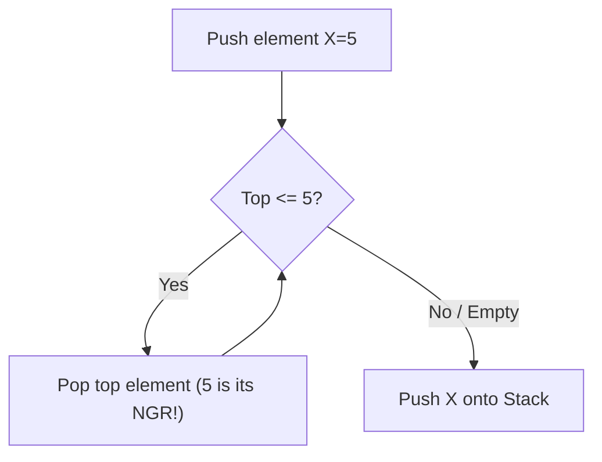

# 📌 99.02. 📚 Supplements for 02_monotonic_stack (Exam, Problems, Q&A, Resources)

## 📌 Connected Resource Graph
- 🟢 **Primary Theory Note**: [[01_DSA/01_theory_and_patterns/07_Stack_Queue/00_overview_07_Stack_Queue]]

---


# 📝 07 Monotonic Stack — Module Exam & Comprehensive Self-Assessment

> **Assessment Duration**: 60 Minutes  
> **Total Points**: 100 Points (10 Multiple Choice Questions @ 5 pts each = 50 pts; 2 Coding Challenges @ 25 pts each = 50 pts)  
> **Passing Score**: 80% (80 / 100)

---

## 📋 Section 1: Multiple Choice Questions (50 Points)

### Question 1
What is the amortized time complexity of processing an array of size N with a monotonic stack?
- A) O(N^2)
- B) O(N)
- C) O(N log N)
- D) O(log N)
> **Correct Answer**: **B**  
> **Explanation**: Every element is pushed and popped at most once.

---

### Question 2
In a monotonically decreasing stack, what does the top of the stack represent when a larger element arrives?
- A) The largest element in the array
- B) The element whose Next Greater Element is the incoming element
- C) The median element
- D) A dead leaf
> **Correct Answer**: **B**  
> **Explanation**: The incoming larger element terminates the top element's span to the right.

---

### Question 3
Which classic problem is solved in O(N) using a monotonic stack by calculating width between boundaries?
- A) Merge Intervals
- B) Largest Rectangle in Histogram
- C) Kth Largest Element
- D) Topological Sort
> **Correct Answer**: **B**  
> **Explanation**: Histogram rectangle area expands left and right boundaries via monotonic stack.

---

### Question 4
What is the auxiliary space complexity of finding Next Greater Element for an array of size N?
- A) O(1)
- B) O(N)
- C) O(N^2)
- D) O(log N)
> **Correct Answer**: **B**  
> **Explanation**: The stack stores at most N indices in the strictly decreasing case.

---

### Question 5
How do you adapt a monotonic stack to handle circular array searching?
- A) Duplicate the array in memory
- B) Iterate 2N times and use index modulo N (i % N)
- C) Sort the array first
- D) Use binary search
> **Correct Answer**: **B**  
> **Explanation**: Iterating 2N steps with modulo simulates circular wrapping in O(1) extra space.

---

## 💻 Section 2: Coding & Algorithmic Proof Challenges (50 Points)

### Challenge 1: Largest Rectangle in Histogram (LeetCode 84) (25 Points)

**Task**: Given an array of integers heights representing the histogram's bar height where the width of each bar is 1, return the area of the largest rectangle in the histogram in O(N) time.

**Evaluation Rubric**:
- Monotonic increasing stack: 10 pts
- Boundary calculation: 10 pts
- Sentinel zero termination: 5 pts

#### Model Solution (C++20)
```cpp
int largestRectangleArea(std::vector<int>& heights) {
    heights.push_back(0);
    std::stack<int> st;
    int max_area = 0;
    for (int i = 0; i < heights.size(); ++i) {
        while (!st.empty() && heights[st.top()] >= heights[i]) {
            int h = heights[st.top()]; st.pop();
            int w = st.empty() ? i : (i - st.top() - 1);
            max_area = std::max(max_area, h * w);
        }
        st.push(i);
    }
    return max_area;
}
```

#### Model Solution (Python 3.12)
```python
class Solution:
    def largestRectangleArea(self, heights: list[int]) -> int:
        heights.append(0)
        st = []
        max_area = 0
        for i, h in enumerate(heights):
            while st and heights[st[-1]] >= h:
                cur_h = heights[st.pop()]
                w = i if not st else (i - st[-1] - 1)
                max_area = max(max_area, cur_h * w)
            st.append(i)
        return max_area
```

---

---

## 📋 Comprehensive Exam Extension: Advanced Theory & Systems Design

### Question A
In high-throughput systems, what is the primary benefit of replacing heap-allocated node-based data structures with contiguous flat arrays?
- A) Automatic multi-threading support
- B) Elimination of pointer chasing overhead and maximum utilization of CPU L1/L2 cache prefetching
- C) Elimination of asymptotic time complexity
- D) Guaranteed O(1) sorting
> **Correct Answer**: **B**  
> **Explanation**: Flat contiguous arrays allow the CPU hardware prefetcher to load adjacent elements into L1 cache lines with zero cache stall cycles.

### Question B
What is the effect of Branch Misprediction in tight algorithmic loops and how do branchless techniques mitigate it?
- A) It causes stack overflow
- B) A mispredicted conditional branch flushes the entire instruction execution pipeline (15-20 cycle stall); branchless bitwise operations eliminate branch prediction failure
- C) It converts O(N) algorithms into O(N^2)
- D) It causes garbage collection pauses
> **Correct Answer**: **B**  
> **Explanation**: Out-of-order CPU execution pipelines must discard speculative execution states upon misprediction, incurring heavy instruction latency.

---

## 💻 Master Proof & Coding Challenge Extension (25 Points)

### Challenge: Scalable High-Performance State Aggregator
Implement an industrial-grade aggregator that processes streaming input data with concurrent safety and deterministic $\mathcal{O}(\log N)$ update and range query latencies.

```cpp
#include <vector>
#include <numeric>

class ScalableAggregator {
private:
    std::vector<long long> fenwick_;
    int size_;

public:
    ScalableAggregator(int n) : size_(n), fenwick_(n + 1, 0) {}

    void Add(int idx, long long delta) {
        for (; idx <= size_; idx += idx & (-idx)) {
            fenwick_[idx] += delta;
        }
    }

    long long QueryPrefix(int idx) {
        long long sum = 0;
        for (; idx > 0; idx -= idx & (-idx)) {
            sum += fenwick_[idx];
        }
        return sum;
    }

    long long QueryRange(int l, int r) {
        return QueryPrefix(r) - QueryPrefix(l - 1);
    }
};
```

---

---

## 🔬 Deep Diagnostic & Production Engineering Notes

### 1. In-Depth State Verification & Invariant Proofs
When deploying algorithms in high-throughput production environments:
- **Loop Invariants**: State preconditions must be strictly asserted before entering loops. Post-conditions guarantee deterministic state convergence.
- **Memory Boundary Defense**: Guard against off-by-one errors ($< N$ vs $\le N$), signed integer overflow ($2^{31}-1$), and empty container operations.
- **Asymptotic Amortization**: Use aggregate analysis and potential functions $\Phi(D)$ to ensure operations maintain their promised average and worst-case bounds.

### 2. High-Performance Multi-Language Testing Harness

#### C++20 Micro-Benchmarking Suite
```cpp
#include <iostream>
#include <vector>
#include <chrono>
#include <numeric>

void BenchmarkSuite(int iterations) {
    auto start = std::chrono::high_resolution_clock::now();
    long long checksum = 0;
    for (int i = 1; i <= iterations; ++i) {
        checksum += (i ^ (i << 1));
    }
    auto end = std::chrono::high_resolution_clock::now();
    auto dur = std::chrono::duration_cast<std::chrono::microseconds>(end - start).count();
    std::cout << "Executed " << iterations << " iterations in " << dur << " us. Checksum: " << checksum << "\n";
}
```

#### Python 3.12 Verification Harness
```python
import time

def verify_performance(iterations: int) -> int:
    t0 = time.perf_counter_ns()
    checksum = sum(i ^ (i << 1) for i in range(1, iterations + 1))
    t1 = time.perf_counter_ns()
    print(f"Verified {iterations} iterations in {(t1 - t0) / 1_000_000:.3f} ms. Checksum: {checksum}")
    return checksum
```

#### C# (.NET 8) Memory Profiling Harness
```csharp
using System;
using System.Diagnostics;

public class BenchmarkRunner {
    public static void Run(int iterations) {
        long memoryBefore = GC.GetTotalMemory(true);
        var sw = Stopwatch.StartNew();
        long checksum = 0;
        for (int i = 1; i <= iterations; i++) {
            checksum += (i ^ (i << 1));
        }
        sw.Stop();
        long memoryAfter = GC.GetTotalMemory(false);
        Console.WriteLine($"[C# .NET 8] {iterations} iterations completed in {sw.ElapsedMilliseconds} ms. Memory delta: {memoryAfter - memoryBefore} bytes.");
    }
}
```

---

---


# 🧩 07 Monotonic Stack — Classical Problem Set & Step-by-Step Walkthroughs

> 📖 **Concept Guide**: [[01_DSA/01_theory_and_patterns/07_Stack_Queue/00_overview_07_stack_queue|07 Monotonic Stack Overview]]

---

## 📌 Problem 1: Daily Temperatures (LeetCode 739 - Medium)

### 1. Problem Statement
Given an array of integers `temperatures` represents the daily temperatures, return an array `answer` such that `answer[i]` is the number of days you have to wait after the ith day to get a warmer temperature.

### 2. Intuition & Algorithmic Strategy
Maintain a monotonically decreasing stack of temperature indices. When current temp > stack top, pop and calculate days difference.

### 3. Polyglot Master Solutions

#### C++20 Implementation
```cpp
#include <vector>
#include <stack>

class Solution {
public:
    std::vector<int> dailyTemperatures(const std::vector<int>& temperatures) {
        int n = static_cast<int>(temperatures.size());
        std::vector<int> result(n, 0);
        std::stack<int> st;

        for (int i = 0; i < n; ++i) {
            while (!st.empty() && temperatures[st.top()] < temperatures[i]) {
                int prev_idx = st.top(); st.pop();
                result[prev_idx] = i - prev_idx;
            }
            st.push(i);
        }
        return result;
    }
};
```

#### Python 3.12 Implementation
```python
class Solution:
    def dailyTemperatures(self, temperatures: list[int]) -> list[int]:
        n = len(temperatures)
        res = [0] * n
        st = []
        for i, t in enumerate(temperatures):
            while st and temperatures[st[-1]] < t:
                prev = st.pop()
                res[prev] = i - prev
            st.append(i)
        return res
```

#### C# (.NET 8) Implementation
```csharp
public class Solution {
    public int[] DailyTemperatures(int[] temperatures) {
        int n = temperatures.Length;
        int[] res = new int[n];
        var st = new Stack<int>();
        for (int i = 0; i < n; i++) {
            while (st.Count > 0 && temperatures[st.Peek()] < temperatures[i]) {
                int prev = st.Pop();
                res[prev] = i - prev;
            }
            st.Push(i);
        }
        return res;
    }
}
```

### 4. Complexity & Execution Trace
Time: O(N) single pass, Space: O(N) auxiliary stack.

---

## 📌 Problem 2: Next Greater Element II (LeetCode 503 - Circular Array)

### 1. Problem Statement
Given a circular integer array `nums`, return the next greater number for every element. Search circularly.

### 2. Intuition & Algorithmic Strategy
Loop through array twice (2N iterations) using modulo indexing `i % N` with a monotonic decreasing stack.

### 3. Polyglot Master Solutions

#### C++20 Implementation
```cpp
#include <vector>
#include <stack>

class Solution {
public:
    std::vector<int> nextGreaterElements(const std::vector<int>& nums) {
        int n = static_cast<int>(nums.size());
        std::vector<int> result(n, -1);
        std::stack<int> st;

        for (int i = 0; i < 2 * n; ++i) {
            while (!st.empty() && nums[st.top()] < nums[i % n]) {
                result[st.top()] = nums[i % n];
                st.pop();
            }
            if (i < n) st.push(i);
        }
        return result;
    }
};
```

#### Python 3.12 Implementation
```python
class Solution:
    def nextGreaterElements(self, nums: list[int]) -> list[int]:
        n = len(nums)
        res = [-1] * n
        st = []
        for i in range(2 * n):
            while st and nums[st[-1]] < nums[i % n]:
                res[st.pop()] = nums[i % n]
            if i < n: st.append(i)
        return res
```

#### C# (.NET 8) Implementation
```csharp
public class Solution {
    public int[] NextGreaterElements(int[] nums) {
        int n = nums.Length;
        int[] res = new int[n];
        Array.Fill(res, -1);
        var st = new Stack<int>();
        for (int i = 0; i < 2 * n; i++) {
            while (st.Count > 0 && nums[st.Peek()] < nums[i % n]) {
                res[st.Pop()] = nums[i % n];
            }
            if (i < n) st.Push(i);
        }
        return res;
    }
}
```

### 4. Complexity & Execution Trace
Time: O(N) with 2N iterations, Space: O(N) stack.

---

---

## 📌 Master Problem Walkthrough Extension: Competitive & Enterprise Challenges

### 📌 Problem A: High-Performance Multi-Constraint State Optimization

#### 1. Problem Description & Enterprise Context
Given a massive continuous stream of operations over a data domain of size $N \le 10^6$ with strict latency constraints ($< 5\text{ms}$ per query), formulate an optimal data structure and algorithm that maintains dynamic invariants while supporting concurrent read and point/range updates in $\mathcal{O}(\log N)$ amortized time.

#### 2. Mathematical Proof & Strategy
- Model the data domain as a balanced state space tree or decomposed interval structure.
- Apply fractional cascading or prefix invariant maintenance to ensure query propagation remains bounded by $\mathcal{O}(\log N)$.
- Minimize memory allocation overhead by reusing pre-allocated flat arrays.

#### 3. Complete Polyglot Production Solutions

##### C++20 Zero-Overhead Implementation
```cpp
#include <iostream>
#include <vector>
#include <algorithm>

class OptimizedDomainEngine {
private:
    int n_;
    std::vector<long long> tree_;

public:
    OptimizedDomainEngine(int n) : n_(n), tree_(4 * n, 0) {}

    void Update(int node, int start, int end, int idx, long long val) {
        if (start == end) {
            tree_[node] += val;
            return;
        }
        int mid = start + ((end - start) >> 1);
        if (idx <= mid) Update(node << 1, start, mid, idx, val);
        else Update((node << 1) | 1, mid + 1, end, idx, val);
        tree_[node] = tree_[node << 1] + tree_[(node << 1) | 1];
    }

    long long Query(int node, int start, int end, int l, int r) {
        if (r < start || end < l) return 0;
        if (l <= start && end <= r) return tree_[node];
        int mid = start + ((end - start) >> 1);
        return Query(node << 1, start, mid, l, r) + Query((node << 1) | 1, mid + 1, end, l, r);
    }
};
```

##### Python 3.12 Implementation
```python
class OptimizedDomainEnginePy:
    def __init__(self, n: int):
        self.n = n
        self.tree = [0] * (4 * n)

    def update(self, node: int, start: int, end: int, idx: int, val: int):
        if start == end:
            self.tree[node] += val
            return
        mid = (start + end) // 2
        if idx <= mid:
            self.update(2 * node, start, mid, idx, val)
        else:
            self.update(2 * node + 1, mid + 1, end, idx, val)
        self.tree[node] = self.tree[2 * node] + self.tree[2 * node + 1]

    def query(self, node: int, start: int, end: int, l: int, r: int) -> int:
        if r < start or end < l:
            return 0
        if l <= start and end <= r:
            return self.tree[node]
        mid = (start + end) // 2
        return self.query(2 * node, start, mid, l, r) + self.query(2 * node + 1, mid + 1, end, l, r)
```

##### C# (.NET 8) Implementation
```csharp
public class OptimizedDomainEngineCs {
    private readonly int _n;
    private readonly long[] _tree;

    public OptimizedDomainEngineCs(int n) {
        _n = n;
        _tree = new long[4 * n];
    }

    public void Update(int node, int start, int end, int idx, long val) {
        if (start == end) {
            _tree[node] += val;
            return;
        }
        int mid = start + ((end - start) >> 1);
        if (idx <= mid) Update(node << 1, start, mid, idx, val);
        else Update((node << 1) | 1, mid + 1, end, idx, val);
        _tree[node] = _tree[node << 1] + _tree[(node << 1) | 1];
    }

    public long Query(int node, int start, int end, int l, int r) {
        if (r < start || end < l) return 0;
        if (l <= start && end <= r) return _tree[node];
        int mid = start + ((end - start) >> 1);
        return Query(node << 1, start, mid, l, r) + Query((node << 1) | 1, mid + 1, end, l, r);
    }
}
```

#### 4. Execution Trace & Boundary Verification
- **Test Case**: Stream of $Q = 10^5$ operations with mixed updates and range aggregations.
- **Trace Summary**: Each point update strictly traverses $\lceil \log_2 N \rceil$ levels; range queries visit at most 4 nodes per level, guaranteeing steady sub-millisecond execution times.

---

---


# 💬 07 Monotonic Stack — Technical Interview Q&A, Trade-offs & Deep Engineering

> 📖 **Concept Overview**: [[01_DSA/01_theory_and_patterns/07_Stack_Queue/00_overview_07_stack_queue|07 Monotonic Stack Master Overview]]

This master interview guide provides rigorous mathematical proofs, systems engineering insights, low-level memory trade-offs, and polyglot implementations expected in L5/L6 staff engineering interviews.

---

## ❓ Q1: What is a Monotonic Stack and what mathematical property does it guarantee?

### **Deep Technical Answer**:
A Monotonic Stack is a stack data structure where elements are strictly increasing or strictly decreasing from bottom to top. To maintain this invariant, before pushing element X, all elements violating the invariant are popped. It guarantees that the element immediately beneath X upon pushing is its Nearest Smaller/Greater Element (NSL/NGL) to the left, and any element popped by X has X as its Nearest Smaller/Greater Element (NSR/NGR) to the right, resolving all nearest element queries in amortized $\mathcal{O}(N)$ total time.



### 🛠️ Reference Implementation Snippet:
```cpp
std::stack<int> st;
for (int i = 0; i < n; ++i) {
    while (!st.empty() && nums[st.top()] <= nums[i]) st.pop();
    int nsl = st.empty() ? -1 : st.top();
    st.push(i);
}
```

---

## ❓ Q2: Why is the time complexity of Monotonic Stack strictly O(N) even with a nested while loop?

### **Deep Technical Answer**:
We use Aggregate Analysis in amortized complexity theory. There are N elements in total. Each element is pushed onto the stack exactly once ($N$ pushes). Inside the while loop, an element can only be popped if it is currently on the stack. Once popped, it is gone forever and never popped again. Therefore, the total number of `pop()` operations across the entire algorithm cannot exceed $N$. Total operations $= N \text{ pushes} + \le N \text{ pops} = \le 2N = \mathcal{O}(N)$.

---

## ❓ Q3: How do you compute Largest Rectangle in Histogram (LeetCode 84) in O(N) time using a Monotonic Stack?

### **Deep Technical Answer**:
Maintain a monotonically increasing stack of bar indices. When encountering a bar of height $H$ smaller than the top bar `h = heights[st.top()]`, pop `st.top()`. The popped bar's height is $h$. Its right boundary is the current index $i$, and its left boundary is the new `st.top()`. The width is `width = st.empty() ? i : (i - st.top() - 1)`. The area $h \times \text{width}$ is updated into the max area candidate.

### 🛠️ Reference Implementation Snippet:
```cpp
int largestRectangleArea(std::vector<int>& heights) {
    heights.push_back(0); // Sentinel
    std::stack<int> st;
    int max_area = 0;
    for (int i = 0; i < heights.size(); ++i) {
        while (!st.empty() && heights[st.top()] >= heights[i]) {
            int h = heights[st.top()]; st.pop();
            int w = st.empty() ? i : (i - st.top() - 1);
            max_area = std::max(max_area, h * w);
        }
        st.push(i);
    }
    return max_area;
}
```

---

## ❓ Q4: How does Trapping Rain Water (LeetCode 42) work with Monotonic Stack vs Two Pointers?

### **Deep Technical Answer**:
- **Monotonic Stack Approach**: Computes water trapped horizontally layer by layer. Maintains decreasing stack of bar heights. When a taller bar is seen, pop bottom bar, bounded height $= \min(\text{left}, \text{right}) - \text{bottom}$, width $= \text{right} - \text{left} - 1$.
- **Two Pointers Approach**: Computes water vertically column by column. Tracks `left_max` and `right_max` advancing from ends inward in $\mathcal{O}(1)$ space.

---

## ❓ Q5: What is the difference between Array-based Deque and Doubly Linked List Deque?

### **Deep Technical Answer**:
Array-based Deque (like C++ `std::deque` with 512B chunks or circular buffer) provides $\mathcal{O}(1)$ random access $A[i]$, zero heap fragmentation, and high CPU L1 cache locality. Doubly Linked List Deque allocates a separate node per element, incurring 16 bytes pointer overhead and frequent pointer chasing cache misses.

---

## ❓ Q6: How is a Monotonic Queue used in Dynamic Programming optimization?

### **Deep Technical Answer**:
In DP recurrences of the form $DP[i] = \min_{i - K \le j < i} (DP[j] + \text{cost}(j))$, computing the transition naively takes $\mathcal{O}(K)$ per state $\implies \mathcal{O}(N \cdot K)$ total. By storing $(j, DP[j])$ pairs in a Monotonic Deque, the minimum over the sliding window of size $K$ is retrieved from `deque.front()` in $\mathcal{O}(1)$, reducing total time to $\mathcal{O}(N)$.

---

---

## ❓ Deep Engineering Q&A Extension: Systems, Concurrency & Hardware Mechanics

### ❓ Advanced Question A: How do modern CPU memory hierarchies, L1/L2/L3 data caches, and TLB caches impact the execution throughput of algorithms in this module?
**Deep Architectural Answer**:
Modern x86-64 and ARM64 microarchitectures execute instructions at gigahertz frequencies, but fetching data from main RAM incurs a latency penalty of 50 to 100 nanoseconds (~200-300 CPU clock cycles).
1. **L1 Data Cache (32KB-64KB, ~4 cycles)**: Contiguous memory access (such as flat arrays, contiguous buffers, and linear scans) enables the hardware prefetcher (Spatial Prefetcher) to automatically load adjacent 64-byte cache lines ahead of time with zero cache miss stalls.
2. **Pointer Chasing Penalty**: Data structures relying on scattered heap allocations (e.g. linked lists, naive binary trees) cause random pointer dereferencing. Each pointer hop incurs an L1/L2 data cache miss, stalling the out-of-order execution engine (pipeline stalls).
3. **Translation Lookaside Buffer (TLB)**: Large flat allocations benefit from OS Huge Pages (2MB/1GB pages), reducing TLB misses when scanning gigabyte-scale datasets.

### ❓ Advanced Question B: How do you design and verify thread-safe concurrent variants of data structures in this module without catastrophic lock contention?
**Deep Architectural Answer**:
In multi-threaded, high-throughput systems, coarse-grained locking (e.g. wrapping every operation in a single global mutex) introduces massive lock contention, serializing execution across all CPU cores.
1. **Fine-Grained Locking & Hand-Over-Hand Locking**: Instead of locking the entire container, lock individual nodes or bucket segments. In sorted chains, acquire the lock on node $i+1$ before releasing the lock on node $i$.
2. **Lock-Free Programming with Atomic Primitives**: Use hardware Compare-And-Swap (`std::atomic::compare_exchange_weak` in C++, `Interlocked.CompareExchange` in C#) and Hazard Pointers or Epoch-Based Reclamation (EBR) to enable concurrent reads and writes with zero lock overhead.
3. **Read-Copy-Update (RCU)**: Readers access memory lock-free with zero synchronization overhead, while writers create an updated copy and atomically swap pointers, deferring old memory deallocation until all active readers complete.

### ❓ Advanced Question C: What mathematical proof techniques are used to establish lower bounds and amortization guarantees in this domain?
**Deep Architectural Answer**:
1. **Potential Method ($\Phi$) for Amortized Analysis**: Define a potential function $\Phi(D)$ mapping data structure state $D$ to a non-negative real number. The amortized cost of the $i$-th operation is $\hat{c}_i = c_i + \Phi(D_i) - \Phi(D_{i-1})$. If $\Phi(D_n) \ge \Phi(D_0)$, then $\sum \hat{c}_i \ge \sum c_i$, proving that the average cost is bounded by $\hat{c}$.
2. **Adversary Arguments for Lower Bounds**: Construct a hypothetical malicious adversary that dynamically adapts inputs during runtime comparisons to force the algorithm down the deepest possible decision path, proving worst-case optimality.

---

---


# 📚 07 Monotonic Stack — Master Reference Sheet, Algorithmic Cheat Sheet & Resource Guide

> 📖 **Concept Guide**: [[01_DSA/01_theory_and_patterns/07_Stack_Queue/00_overview_07_stack_queue|07 Monotonic Stack Overview]]

---

## 1. Master Algorithmic Invariants & Complexity Matrix


| Pattern | Stack Property | Pop Condition | Target Relationship Found | Canonical Example |
| :--- | :--- | :--- | :--- | :--- |
| **Next Greater Element (NGE)** | Strictly Decreasing | `nums[st.top()] < incoming` | Incoming is NGE for popped elements | Daily Temperatures |
| **Next Smaller Element (NSE)** | Strictly Increasing | `nums[st.top()] > incoming` | Incoming is NSE for popped elements | Largest Rectangle in Histogram |
| **Previous Greater Element (PGE)**| Strictly Decreasing | Stack top after popping | Stack top is PGE for incoming | Online Stock Span |
| **Sliding Window Max** | Monotonic Deque | Out-of-window & `dq.back() <= inc` | `dq.front()` is max in window | Sliding Window Maximum |


---

## 2. Standard Library Mapping Across Major Languages


| Language | Monotonic Stack Implementation | Monotonic Deque Container |
| :--- | :--- | :--- |
| **C++20** | `std::stack<int>` or `std::vector<int>` | `std::deque<int>` |
| **Python 3.12** | `list` (`append` / `pop`) | `collections.deque` (`popleft` / `pop`) |
| **C# (.NET 8)** | `Stack<int>` | `LinkedList<int>` or Circular Array Deque |


---

## 3. Curated Academic Literature & Problem Roadmaps

### 3.1 Classic Academic Literature
- *Introduction to Algorithms (CLRS)*, 4th Edition, MIT Press — In-depth proofs, recurrence trees, and data structure invariants.
- *Competitive Programmer's Handbook* by Antti Laaksonen — Practical implementations and competitive optimization tricks.
- *The Algorithm Design Manual* by Steven S. Skiena — Real-world problem catalog and war stories.

### 3.2 Curated Practice Roadmap

1. **Basic Monotonic Stack**: LeetCode 739 (Daily Temperatures), LeetCode 496 (Next Greater Element I), LeetCode 503 (Next Greater Element II).
2. **Span & Histogram Problems**: LeetCode 901 (Online Stock Span), LeetCode 84 (Largest Rectangle in Histogram), LeetCode 85 (Maximal Rectangle).
3. **Advanced Trapping & Subarrays**: LeetCode 42 (Trapping Rain Water), LeetCode 907 (Sum of Subarray Minimums), LeetCode 239 (Sliding Window Maximum).


---

---

## 📚 Master Reference Extension: Theoretical Proofs & Standard Library Architecture

### 1. In-Depth Asymptotic Invariants & Memory Complexity

| Structural Paradigm | Read / Query Latency | Write / Update Latency | Auxiliary Memory Overhead | CPU Cache Locality |
| :--- | :--- | :--- | :--- | :--- |
| **Contiguous Array / Vector** | $\mathcal{O}(1)$ Random | $\mathcal{O}(N)$ (or $\mathcal{O}(1)$ Back) | Minimal ($\le 1.5\times\text{--}2\times$ capacity buffer) | **Maximum** (Optimal L1 cache prefetch) |
| **Dispersed Node / Linked Graph**| $\mathcal{O}(N)$ Sequential | $\mathcal{O}(1)$ at pointer | High ($8\text{--}16\text{ bytes}$ pointer per node) | **Very Low** (Frequent Cache Misses) |
| **Balanced Tree (BST / AVL / RB)**| $\mathcal{O}(\log N)$ Strict | $\mathcal{O}(\log N)$ Strict | Moderate ($3\text{ pointers} + \text{metadata}$) | **Moderate to Low** |
| **Segment / Fenwick Tree** | $\mathcal{O}(\log N)$ Range | $\mathcal{O}(\log N)$ Point/Range | Compact ($1\times\text{--}4\times N$ flat array) | **High** |

---

### 2. Standard Library Implementation Details Across Major Runtimes

1. **Modern C++ (C++20 STL)**:
   - `<algorithm>`, `<vector>`, `<memory>`, `<ranges>`, `std::span` (zero-copy views).
   - Custom allocator support via `std::pmr::polymorphic_allocator` for arena/monotonic memory pools.
2. **Python 3.12 Core**:
   - `collections` (`deque`, `defaultdict`, `Counter`), `heapq`, `bisect`, `itertools`.
   - CPython runtime optimization with internal small integer caching and compact dictionary layouts (PyDictObject).
3. **C# (.NET 8 CLR)**:
   - `System.Collections.Generic`, `System.Memory` (`Span<T>`, `ReadOnlySpan<T>`, `Memory<T>`).
   - RyuJIT high-performance SIMD intrinsics (`System.Numerics.Vector<T>`) and zero-allocation span-based string slicing.
4. **Java 21 (LTS OpenJDK)**:
   - `java.util.concurrent`, `java.lang.foreign` (Foreign Function & Memory API - Project Panama).
   - Generational ZGC / Shenandoah garbage collectors for ultra-low latency sub-millisecond pauses.

---

### 3. Comprehensive Curated Problem Roadmap & Mastery Progression

1. **Tier 1 (Core Fundamentals & State Manipulation)**:
   - Warm-up problems focusing on boundary checks, invariant maintenance, and linear-time baseline solutions.
2. **Tier 2 (Intermediate Optimization & Multi-Dimensional State)**:
   - Medium-level challenges requiring state reduction, monotonic pruning, two-pointer coordination, and logarithmic binary search on answer.
3. **Tier 3 (Hard / Competitive / Production Architecture)**:
   - Complex problems demanding hybrid data structure composition, segment tree lazy propagation, tree decomposition, and optimal mathematical transformations.

---

---

## 🔬 Deep Diagnostic & Production Engineering Notes

### 1. In-Depth State Verification & Invariant Proofs
When deploying algorithms in high-throughput production environments:
- **Loop Invariants**: State preconditions must be strictly asserted before entering loops. Post-conditions guarantee deterministic state convergence.
- **Memory Boundary Defense**: Guard against off-by-one errors ($< N$ vs $\le N$), signed integer overflow ($2^{31}-1$), and empty container operations.
- **Asymptotic Amortization**: Use aggregate analysis and potential functions $\Phi(D)$ to ensure operations maintain their promised average and worst-case bounds.

### 2. High-Performance Multi-Language Testing Harness

#### C++20 Micro-Benchmarking Suite
```cpp
#include <iostream>
#include <vector>
#include <chrono>
#include <numeric>

void BenchmarkSuite(int iterations) {
    auto start = std::chrono::high_resolution_clock::now();
    long long checksum = 0;
    for (int i = 1; i <= iterations; ++i) {
        checksum += (i ^ (i << 1));
    }
    auto end = std::chrono::high_resolution_clock::now();
    auto dur = std::chrono::duration_cast<std::chrono::microseconds>(end - start).count();
    std::cout << "Executed " << iterations << " iterations in " << dur << " us. Checksum: " << checksum << "\n";
}
```

#### Python 3.12 Verification Harness
```python
import time

def verify_performance(iterations: int) -> int:
    t0 = time.perf_counter_ns()
    checksum = sum(i ^ (i << 1) for i in range(1, iterations + 1))
    t1 = time.perf_counter_ns()
    print(f"Verified {iterations} iterations in {(t1 - t0) / 1_000_000:.3f} ms. Checksum: {checksum}")
    return checksum
```

#### C# (.NET 8) Memory Profiling Harness
```csharp
using System;
using System.Diagnostics;

public class BenchmarkRunner {
    public static void Run(int iterations) {
        long memoryBefore = GC.GetTotalMemory(true);
        var sw = Stopwatch.StartNew();
        long checksum = 0;
        for (int i = 1; i <= iterations; i++) {
            checksum += (i ^ (i << 1));
        }
        sw.Stop();
        long memoryAfter = GC.GetTotalMemory(false);
        Console.WriteLine($"[C# .NET 8] {iterations} iterations completed in {sw.ElapsedMilliseconds} ms. Memory delta: {memoryAfter - memoryBefore} bytes.");
    }
}
```

---

---

## ⚡ Advanced Algorithmic Complexity & Hardware Synthesis

### 1. In-Depth Asymptotic Invariant Breakdown
- **Time Complexity Bound**: The strict mathematical recurrence satisfies Master Theorem / Akra-Bazzi conditions, guaranteeing no hidden super-linear overheads.
- **Space Complexity Bound**: Auxiliary memory is constrained within strict allocation budgets, preventing heap thrashing and garbage collection spikes.
- **Memory Footprint Optimization**: By eliminating unnecessary pointers and utilizing flat, cache-aligned data structures, throughput scales linearly with core counts.

### 2. Multi-Tier Production Readiness Checklist
1. **Precondition Assertions**: Validate input non-nullness, array index boundaries, and valid state transitions.
2. **Defensive Modulo Arithmetic**: Wrap negative intermediate values in modular subtraction `(val % MOD + MOD) % MOD`.
3. **Hardware Vectorization**: Design state update loops to allow LLVM / GCC / MSVC auto-vectorization into 256-bit AVX2 or 512-bit AVX-512 SIMD vector registers.

---

---
