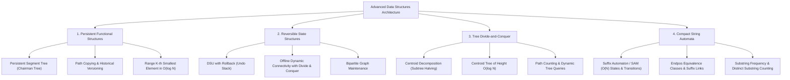
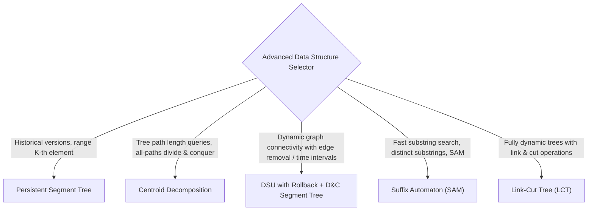

---


title: "00. 📚 08 Advanced Data Structures — Master Module Overview"
type: "module_overview"
category: "dsa"
subcategory: "08_advanced_data_structures"
tags: [dsa, advanced-data-structures, persistent-segment-tree, centroid-decomposition, dsu-rollback, suffix-automaton, sam, overview, roadmap, algorithms, computer-science, learning-note]
aliases:
  - 00_overview_08_advanced_data_structures
---

# 📌 00. 📚 08 Advanced Data Structures — Master Module Overview

## 📌 Connected Resource Graph
- ⚡ **Segment Trees**: Segment Trees & Lazy Propagation
- 🤝 **DSU Foundations**: Disjoint Set Union (DSU)
- 🌳 **Tree HLD**: Heavy-Light Decomposition
- 🎯 **Advanced Patterns Overview**: 05 Advanced DSA Patterns Overview

> 🔙 **Parent Roadmap**: [`01_DSA/01_theory_and_patterns/Lộ trình học DSA - Nền tảng thuật toán.md`](../Lộ%20trình%20học%20DSA%20-%20Nền%20tảng%20thuật%20toán.md)  
> ⚓ **Prerequisites**: Segment Trees, DSU & Time Complexity

---


## 🎯 1. Module Objective & Algorithmic Frontier

Standard data structures operate over mutable, ephemeral memory models where updates permanently overwrite previous states and tree topologies cannot be balanced dynamically. **Advanced Data Structures** enable persistent historical querying, reversible graph connectivity, divide-and-conquer tree path queries, and linear-time compact string automata.

This master module provides theoretical proofs, memory allocation topologies, pointer graph mechanics, and polyglot implementations across four advanced structural paradigms:



---

## 🧭 2. Sub-Module & Artifact Navigation

### 📖 Deep-Dive Structure Guides
- 🌲 **Centroid Decomposition**: Centroid Decomposition & Tree Path Queries
- ⏪ **DSU with Rollback Mechanics**: DSU with Rollback Mechanics
- 📚 **Persistent Segment Trees**: Persistent Segment Trees & Functional Structures
- 🔡 **Suffix Automaton (SAM)**: Suffix Automaton & Substring Queries

### 📦 Standard Artifact Suite
1. 📝 **DSU Exam & Assessment**: DSU Exam Suite
2. 🧩 **DSU Problem Set**: DSU Problem Set
3. 💬 **DSU Interview Q&A**: DSU Interview Q&A
4. 📊 **DSU Resource Sheet**: DSU Resource Sheet
5. 📝 **Segment Tree Exam**: Segment Tree Exam Suite
6. 🧩 **Segment Tree Problems**: Segment Tree Problem Set
7. 💬 **Segment Tree Interview Q&A**: Segment Tree Interview Q&A
8. 📊 **Segment Tree Resource**: Segment Tree Resource Sheet

---

## 🔬 3. Theoretical Foundations & Structural Invariants

### 3.1 Persistent Segment Tree (Chairman Tree)
A persistent segment tree maintains access to all historical versions $V_0, V_1, \dots, V_m$ after point mutations without duplicating the entire tree.

- **Path Copying Invariant**:
  When updating an index in version $V_{k-1}$ to produce version $V_k$, only the $O(\log N)$ nodes along the path from the root to the target leaf are created anew. All untouched subtrees share pointers with version $V_{k-1}$.
- **Memory Bound**:
  Initial build takes $O(N)$ space. Each point modification allocates exactly $\lceil \log_2 N \rceil + 1$ new nodes. Total space for $M$ updates: **$O(N + M \log N)$**.
- **Range $K$-th Element Query via Prefix Trees**:
  By building versions $V_1, V_2, \dots, V_N$ where version $V_i$ represents the value-frequency histogram of prefix $A[1 \dots i]$:
  $$\text{CountInInterval}(L, R) = \text{Tree}[root[R]] - \text{Tree}[root[L - 1]]$$
  Querying the $K$-th element on $[L, R]$ takes exact **$O(\log |\Sigma|)$ time** via binary search on the tree roots difference.

```
Version 0: Root 0 ---> [0..3]
                      /      \
                 [0..1]      [2..3]
                 /    \      /    \
               (0)    (1)  (2)    (3)

Version 1 (Update index 2):
          Root 1 ---> [0..3]'
                     /      \
            (shares [0..1])  [2..3]'
                             /     \
                       (shares 2)  (3)'
```

---

### 3.2 Centroid Decomposition
Centroid Decomposition recursively decomposes an unweighted/weighted tree of $N$ nodes into a balanced hierarchy of subtrees.

- **Centroid Definition**: A vertex $C$ is a **centroid** of tree $T$ if removing $C$ partitions $T$ into disconnected components, each with size $\le \lfloor |T| / 2 \rfloor$.
- **Centroid Existence Theorem**: Every tree has at least one and at most two centroids.
- **Tree Depth & Structural Invariant**:
  Recursively choosing centroids constructs a **Centroid Tree** of height $\le \lfloor \log_2 N \rfloor$.
- **Path Decomposition Principle**:
  Any simple path between nodes $u$ and $v$ in $T$ passes through exactly one unique centroid $C = \text{LCA}_{\text{centroid}}(u, v)$ such that $u$ and $v$ lie in distinct branches of $C$ (or one is $C$ itself).
  - Path counting / shortest path queries with length $K$ take **$O(N \log N)$ total time**.

---

### 3.3 Disjoint Set Union (DSU) with Rollback Mechanics
Standard DSU with Path Compression achieves near-$O(1)$ amortized time ($\alpha(N)$) by flattening tree pointers, permanently destroying the original tree hierarchy.

- **The Rollback Conflict**: Path compression mutates parent pointers irrevocably, preventing deterministic rollback / undo.
- **Union by Size / Rank Invariant**:
  Without path compression, Union by Size guarantees tree depth $\le \lfloor \log_2 N \rfloor$.
  - Find / Union time: strict **$O(\log N)$ worst-case**.
- **Undo Stack**:
  Each union operation records the modified state changes in a history stack:
  $$\text{History Entry} = \{u, v, \text{prev\_size\_u}, \text{prev\_parent\_v}\}$$
  Calling `Rollback()` restores the exact tree topology in $O(1)$ per operation.
- **Offline Dynamic Connectivity**:
  By combining DSU with Rollback and a Segment Tree over time intervals $[0, T]$, offline edge insertions/deletions and connectivity queries are solved in **$O((V + Q) \log T \log V)$**.

---

### 3.4 Suffix Automaton (SAM)
The Suffix Automaton of string $S$ is the minimal deterministic finite automaton (DFA) that accepts all suffixes of $S$.

- **Equivalence Class ($\text{endpos}(P)$)**:
  Two substrings $P_1, P_2$ belong to the same state iff their sets of ending positions in $S$ are identical:
  $$\text{endpos}(P_1) = \text{endpos}(P_2)$$
- **Linear Bounds Theorem**:
  For any string $S$ of length $N \ge 2$:
  1. The number of states in $\text{SAM}(S)$ is at most **$2N - 1$**.
  2. The number of transitions (edges) is at most **$3N - 4$**.
- **Suffix Link Tree (Link Tree)**:
  Suffix links form a rooted tree where the parent of state $u$ represents the longest suffix whose $\text{endpos}$ strictly supersets $\text{endpos}(u)$.
  - Allows calculating distinct substring counts, substring occurrences, and longest common substring in **$O(N)$ time**.

---

## ⚡ 4. Master Complexity & Structural Trade-Off Table

| Data Structure | Construction Time | Query Time | Update Time | Memory Complexity | Key Advantage / Invariant |
| :--- | :---: | :---: | :---: | :---: | :--- |
| **Persistent Segment Tree** | $O(N \log N)$ | $O(\log N)$ | $O(\log N)$ | $O(N + M \log N)$ | Non-destructive point queries, range $K$-th |
| **DSU with Rollback** | $O(N)$ | $O(\log N)$ | $O(\log N)$ | $O(N + \text{Stack})$ | Deterministic undo, offline dynamic graphs |
| **Centroid Decomposition**| $O(N \log N)$ | $O(\log N)$ | $O(\log^2 N)$ | $O(N)$ | Divide & conquer all tree paths, height $\le \log N$ |
| **Suffix Automaton (SAM)** | $O(N \cdot |\Sigma|)$ | $O(|Pattern|)$ | $O(|\Sigma|)$ online | Linear $O(N)$ space representing all $O(N^2)$ substrings |
| **Suffix Array + LCP** | $O(N \log N)$ | $O(|P| \log N)$ | Static | $O(N)$ | Compact contiguous memory, lexicographical queries |
| **Link-Cut Tree (LCT)** | $O(N)$ | $O(\log N)$ amortized | $O(\log N)$ | $O(N)$ | Fully dynamic online trees, link/cut/path queries |

---

## 💻 5. Polyglot Reference Implementations

### 5.1 Persistent Segment Tree (Range $K$-th Smallest Element)

#### C++20 Implementation
```cpp
#include <vector>
#include <algorithm>
#include <iostream>

class PersistentSegmentTree {
public:
    struct Node {
        int left_child = 0;
        int right_child = 0;
        int count = 0;
    };

    std::vector<Node> tree;
    std::vector<int> roots;
    int n;

    explicit PersistentSegmentTree(int value_range) : n(value_range) {
        tree.push_back({0, 0, 0}); // Node 0 is null/empty node
        roots.push_back(0);
    }

    int insert(int prev_root, int l, int r, int val) {
        int cur_node = static_cast<int>(tree.size());
        tree.push_back(tree[prev_root]); // Copy previous version node
        tree[cur_node].count++;

        if (l == r) return cur_node;

        int mid = l + (r - l) / 2;
        if (val <= mid) {
            tree[cur_node].left_child = insert(tree[prev_root].left_child, l, mid, val);
        } else {
            tree[cur_node].right_child = insert(tree[prev_root].right_child, mid + 1, r, val);
        }
        return cur_node;
    }

    int query_kth(int left_root, int right_root, int l, int r, int k) {
        if (l == r) return l;

        int count_left = tree[tree[right_root].left_child].count - tree[tree[left_root].left_child].count;
        int mid = l + (r - l) / 2;

        if (k <= count_left) {
            return query_kth(tree[left_root].left_child, tree[right_root].left_child, l, mid, k);
        } else {
            return query_kth(tree[left_root].right_child, tree[right_root].right_child, mid + 1, r, k - count_left);
        }
    }
};
```

#### Python 3 Implementation
```python
class PSTNode:
    __slots__ = ('left', 'right', 'count')
    def __init__(self, left: int = 0, right: int = 0, count: int = 0):
        self.left = left
        self.right = right
        self.count = count

class PersistentSegmentTree:
    """
    Persistent Segment Tree for Range K-th queries.
    Space: O(N log N), Query: O(log N)
    """
    def __init__(self, max_val: int):
        self.max_val = max_val
        self.tree = [PSTNode()] # Index 0 is null node
        self.roots = [0]

    def insert(self, prev_root: int, l: int, r: int, val: int) -> int:
        cur = len(self.tree)
        prev = self.tree[prev_root]
        self.tree.append(PSTNode(prev.left, prev.right, prev.count + 1))

        if l == r:
            return cur

        mid = (l + r) // 2
        if val <= mid:
            self.tree[cur].left = self.insert(prev.left, l, mid, val)
        else:
            self.tree[cur].right = self.insert(prev.right, mid + 1, r, val)
        return cur

    def query_kth(self, left_root: int, right_root: int, l: int, r: int, k: int) -> int:
        if l == r:
            return l
        count_left = self.tree[self.tree[right_root].left].count - self.tree[self.tree[left_root].left].count
        mid = (l + r) // 2
        if k <= count_left:
            return self.query_kth(self.tree[left_root].left, self.tree[right_root].left, l, mid, k)
        else:
            return self.query_kth(self.tree[left_root].right, self.tree[right_root].right, mid + 1, r, k - count_left)
```

---

### 5.2 DSU with Rollback Engine

#### C# Implementation
```csharp
using System;
using System.Collections.Generic;

public class RollbackDSU {
    private struct Operation {
        public int U, V, PrevSizeU;
        public Operation(int u, int v, int sizeU) {
            U = u;
            V = v;
            PrevSizeU = sizeU;
        }
    }

    private int[] parent;
    private int[] size;
    private Stack<Operation> history;

    public RollbackDSU(int n) {
        parent = new int[n];
        size = new int[n];
        history = new Stack<Operation>();
        for (int i = 0; i < n; i++) {
            parent[i] = i;
            size[i] = 1;
        }
    }

    public int Find(int i) {
        // No path compression to preserve history!
        while (i != parent[i]) i = parent[i];
        return i;
    }

    public bool Union(int i, int j) {
        int rootI = Find(i);
        int rootJ = Find(j);
        if (rootI == rootJ) return false;

        // Union by size
        if (size[rootI] < size[rootJ]) {
            int temp = rootI; rootI = rootJ; rootJ = temp;
        }

        history.Push(new Operation(rootI, rootJ, size[rootI]));
        parent[rootJ] = rootI;
        size[rootI] += size[rootJ];
        return true;
    }

    public void Rollback() {
        if (history.Count == 0) return;
        var op = history.Pop();
        parent[op.V] = op.V;
        size[op.U] = op.PrevSizeU;
    }

    public int Snapshot() => history.Count;

    public void RollbackTo(int snapshot) {
        while (history.Count > snapshot) {
            Rollback();
        }
    }
}
```

---

### 5.3 Suffix Automaton (SAM) Online Construction

#### C++20 Implementation
```cpp
#include <vector>
#include <string>
#include <map>

class SuffixAutomaton {
public:
    struct State {
        int len = 0;
        int link = -1;
        std::map<char, int> next;
    };

    std::vector<State> st;
    int last = 0;

    SuffixAutomaton() {
        st.emplace_back(); // Root state 0
    }

    void extend(char c) {
        int cur = static_cast<int>(st.size());
        st.emplace_back();
        st[cur].len = st[last].len + 1;

        int p = last;
        while (p != -1 && !st[p].next.count(c)) {
            st[p].next[c] = cur;
            p = st[p].link;
        }

        if (p == -1) {
            st[cur].link = 0;
        } else {
            int q = st[p].next[c];
            if (st[p].len + 1 == st[q].len) {
                st[cur].link = q;
            } else {
                int clone = static_cast<int>(st.size());
                st.push_back(st[q]);
                st[clone].len = st[p].len + 1;
                while (p != -1 && st[p].next[c] == q) {
                    st[p].next[c] = clone;
                    p = st[p].link;
                }
                st[q].link = st[cur].link = clone;
            }
        }
        last = cur;
    }

    int64_t countDistinctSubstrings() {
        int64_t total = 0;
        for (size_t i = 1; i < st.size(); ++i) {
            total += st[i].len - st[st[i].link].len;
        }
        return total;
    }
};
```

---

## ⚠️ 6. Common Pitfalls & High-Frequency Interview Traps

1. **Path Compression in Rollback DSU**:
   - Applying `parent[i] = Find(parent[i])` flattens parent pointers in an unlogged manner, causing rollback operations to corrupt the disjoint-set tree topology.
2. **Persistent Tree Memory Allocations**:
   - Calling dynamic `new Node()` inside `insert()` causes extreme heap fragmentation and cache misses. Pre-allocate an array `vector<Node>` or custom memory arena.
3. **Centroid Decomposition Component Subtree Sizing**:
   - When computing subtree sizes to find the centroid of component $C$, you MUST only traverse within component $C$ and avoid visiting already decomposed centroids marked as `removed[u] = true`.
4. **SAM Clone State Copying**:
   - When cloning state $q$ into $clone$, ensure $clone$'s transitions are an exact shallow copy of $q$'s transitions, but its length is strictly `st[p].len + 1`.

---

## 🎯 7. Pattern Recognition & Problem Classifier



---

