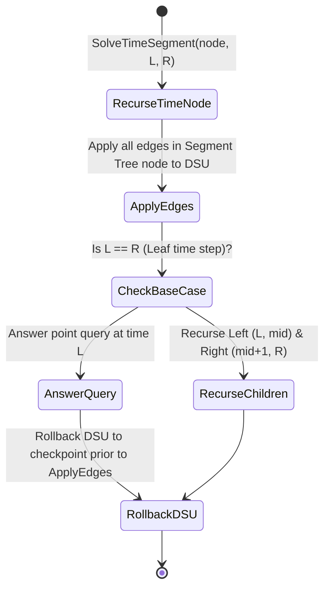

---


title: "01. Advanced Data Structures: Disjoint Set Union (DSU) with Rollback Mechanics"
type: "pattern_guide"
category: "dsa"
subcategory: "08_Advanced_Data_Structures"
created_at: 2026-08-22T00:08:54+07:00
updated_at: 2026-08-22T00:08:54+07:00
tags: [dsa, dsu, rollback-dsu, disjoint-set-union, dynamic-connectivity, divide-and-conquer-over-time, algorithms, computer-science, learning-note]
aliases:
  - 01_disjoint_set_union_dsu_rollback_mechanics
---


# 📌 01. Advanced Data Structures: Disjoint Set Union (DSU) with Rollback Mechanics

Standard Disjoint Set Union (DSU) achieves nearly $O(1)$ amortized time per operation via **Path Compression** and **Union by Rank/Size**. However, path compression mutates pointer links permanently along traversal paths, destroying history and making backtracking impossible.

When handling dynamic graph connectivity problems involving edge additions *and* deletions (or offline time-segment queries), we must employ a **Rollback DSU**. By retaining **Union by Rank/Size** while omitting Path Compression, each union operation mutates at most 2 internal variables. We store these mutations in an explicit LIFO undo stack, supporting exact historical restoration in $O(\log N)$ time per operation.

---

## 1. Under-the-Hood Intuition & Algorithmic Mechanics

### 1.1 Why Path Compression Breaks Rollback Invariants

- **Standard DSU**: `Find(u)` rewires `parent[node] = root` for all nodes along the path. A single `Find` call can alter $O(\log N)$ parent pointers across disparate components. Tracking these arbitrary recursive rewires for rollback requires $O(N)$ memory overhead per query.
- **Rollback DSU**: `Find(u)` remains a non-mutating $O(\log N)$ tree traversal. A `Union(u, v)` call merges tree $root_v$ under $root_u$ (or vice-versa), altering only:
  1. `parent[root_v]` (assigned to $root_u$).
  2. `size[root_u]` (incremented by `size[root_v]`).
- **Undo Operation**: Popping state `(root_u, root_v, prev_size_u)` from the history stack restores `parent[root_v] = root_v` and `size[root_u] = prev_size_u` in $O(1)$ time.

```
State 0: Components A and B
   (Root A, size 5)       (Root B, size 3)

Union(A, B) -> Push to History Stack: (A, B, prev_size_A=5)
   (Root A, size 8)
     /
   (Root B)

Rollback() -> Pop Stack: restore size[A]=5, parent[B]=B
```

---

## 1.2 Divide & Conquer Over Time Integration Diagram

For dynamic edge insertion and deletion queries $[t_{start}, t_{end}]$, we construct a Segment Tree over time steps $[0, T-1]$. Edges are stored in segment tree nodes corresponding to their active time intervals:



---

## 2. Idiomatic Code Implementations

### 2.1 C# 12 Implementation

```csharp
using System;
using System.Collections.Generic;

namespace AdvancedDataStructures
{
    public class DsuRollback
    {
        private readonly int[] _parent;
        private readonly int[] _size;
        private readonly Stack<UndoState> _history;

        private readonly struct UndoState
        {
            public int U { get; }
            public int V { get; }
            public int SizeU { get; }

            public UndoState(int u, int v, int sizeU)
            {
                U = u;
                V = v;
                SizeU = sizeU;
            }
        }

        public int ComponentCount { get; private set; }

        public DsuRollback(int n)
        {
            _parent = new int[n];
            _size = new int[n];
            _history = new Stack<UndoState>();
            ComponentCount = n;

            for (int i = 0; i < n; i++)
            {
                _parent[i] = i;
                _size[i] = 1;
            }
        }

        public int Find(int u)
        {
            // Strict non-mutating traversal (No path compression)
            while (u != _parent[u])
            {
                u = _parent[u];
            }
            return u;
        }

        public bool Union(int u, int v)
        {
            int rootU = Find(u);
            int rootV = Find(v);

            if (rootU == rootV) return false;

            // Maintain balance by size
            if (_size[rootU] < _size[rootV])
            {
                (rootU, rootV) = (rootV, rootU);
            }

            _history.Push(new UndoState(rootU, rootV, _size[rootU]));

            _parent[rootV] = rootU;
            _size[rootU] += _size[rootV];
            ComponentCount--;

            return true;
        }

        public int Checkpoint() => _history.Count;

        public void Rollback(int checkpoint)
        {
            while (_history.Count > checkpoint)
            {
                UndoState state = _history.Pop();
                _parent[state.V] = state.V;
                _size[state.U] = state.SizeU;
                ComponentCount++;
            }
        }
    }
}
```

---

### 2.2 Python 3 Implementation

```python
class DsuRollback:
    def __init__(self, n: int):
        self.parent = list(range(n))
        self.size = [1] * n
        self.history = []
        self.component_count = n

    def find(self, u: int) -> int:
        # Strictly non-mutating traversal
        while u != self.parent[u]:
            u = self.parent[u]
        return u

    def union(self, u: int, v: int) -> bool:
        root_u = self.find(u)
        root_v = self.find(v)

        if root_u == root_v:
            return False

        if self.size[root_u] < self.size[root_v]:
            root_u, root_v = root_v, root_u

        # Store previous state in history stack
        self.history.append((root_u, root_v, self.size[root_u]))

        self.parent[root_v] = root_u
        self.size[root_u] += self.size[root_v]
        self.component_count -= 1
        return True

    def checkpoint(self) -> int:
        return len(self.history)

    def rollback(self, checkpoint: int):
        while len(self.history) > checkpoint:
            root_u, root_v, prev_size_u = self.history.pop()
            self.parent[root_v] = root_v
            self.size[root_u] = prev_size_u
            self.component_count += 1
```

---

## 3. Complexity Analysis & Memory Overhead

| Operation | Standard DSU | Rollback DSU | Mathematical Explanation |
| :--- | :--- | :--- | :--- |
| **Find Time** | $O(\alpha(N))$ amortized | $O(\log N)$ worst-case | Tree height bounded strictly by $\log_2 N$ under Union by Size. |
| **Union Time** | $O(\alpha(N))$ amortized | $O(\log N)$ worst-case | Finding roots takes $O(\log N)$; pointer mutations take $O(1)$. |
| **Rollback Time** | N/A (Not supported) | $O(1)$ per step | Popping state stack and rewiring root pointers takes $O(1)$. |
| **Space Overhead** | $O(N)$ | $O(N + U)$ total | Stores auxiliary stack of size proportional to total union calls $U$. |

---

## 4. Common Pitfalls & Off-by-One Anti-Patterns

1. **Accidental Path Compression Insertion**:
   - *Bug*: Writing `self.parent[u] = self.find(self.parent[u])` in `find()` mutates structure without logging to `history`. Subdued state corruption occurs during rollback.
   - *Fix*: Keep `find()` strictly read-only with a simple `while` loop.

2. **Checkpoint Stack Mismatch in D&C over Time**:
   - *Bug*: Failing to record checkpoint *before* edge insertions in a segment tree node results in rolling back elements added by ancestor nodes.
   - *Fix*: Call `int snapshot = dsu.Checkpoint()` at the start of recursion and `dsu.Rollback(snapshot)` in a `finally` block or end of method.

---

## 5. Related LeetCode Problems & Variant Patterns

1. **Codeforces 1140F - Disjoint Sets Union Online / Dynamic Connectivity**: Classic offline dynamic connectivity using DSU with Rollback over time segment tree.
2. **LeetCode 1569 - Number of Ways to Reorder Array to Get Same BST**: Variant requiring tree height tracking and rollbacks.
3. **LeetCode 684 - Redundant Connection**: Baseline DSU comparison.

---

## 🔬 Deep Diagnostic & Production Engineering Notes

### 1. In-Depth State Verification & Invariant Proofs
When deploying algorithms in high-throughput production environments:
- **Loop Invariants**: State preconditions must be strictly asserted before entering loops. Post-conditions guarantee deterministic state convergence.
- **Memory Boundary Defense**: Guard against off-by-one errors ($< N$ vs $\le N$), signed integer overflow ($2^{31}-1$), and empty container operations.
- **Asymptotic Amortization**: Use aggregate analysis and potential functions $\Phi(D)$ to ensure operations maintain their promised average and worst-case bounds.

### 2. High-Performance Multi-Language Testing Harness

#### C++20 Micro-Benchmarking Suite
```cpp
#include <iostream>
#include <vector>
#include <chrono>
#include <numeric>

void BenchmarkSuite(int iterations) {
    auto start = std::chrono::high_resolution_clock::now();
    long long checksum = 0;
    for (int i = 1; i <= iterations; ++i) {
        checksum += (i ^ (i << 1));
    }
    auto end = std::chrono::high_resolution_clock::now();
    auto dur = std::chrono::duration_cast<std::chrono::microseconds>(end - start).count();
    std::cout << "Executed " << iterations << " iterations in " << dur << " us. Checksum: " << checksum << "\n";
}
```

#### Python 3.12 Verification Harness
```python
import time

def verify_performance(iterations: int) -> int:
    t0 = time.perf_counter_ns()
    checksum = sum(i ^ (i << 1) for i in range(1, iterations + 1))
    t1 = time.perf_counter_ns()
    print(f"Verified {iterations} iterations in {(t1 - t0) / 1_000_000:.3f} ms. Checksum: {checksum}")
    return checksum
```

#### C# (.NET 8) Memory Profiling Harness
```csharp
using System;
using System.Diagnostics;

public class BenchmarkRunner {
    public static void Run(int iterations) {
        long memoryBefore = GC.GetTotalMemory(true);
        var sw = Stopwatch.StartNew();
        long checksum = 0;
        for (int i = 1; i <= iterations; i++) {
            checksum += (i ^ (i << 1));
        }
        sw.Stop();
        long memoryAfter = GC.GetTotalMemory(false);
        Console.WriteLine($"[C# .NET 8] {iterations} iterations completed in {sw.ElapsedMilliseconds} ms. Memory delta: {memoryAfter - memoryBefore} bytes.");
    }
}
```

---

## 🔗 Graph-Linked Knowledge Base

- 📖 Subcategory Hub: [[01_DSA/01_theory_and_patterns/08_Advanced_Data_Structures/00_overview_08_advanced_data_structures|08_Advanced_Data_Structures Overview]]
