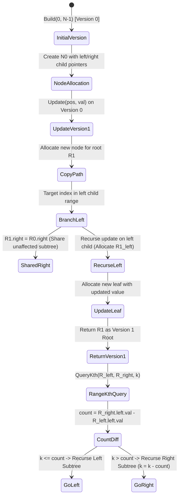

---


title: "01. Advanced Data Structures: Persistent Segment Trees & Functional Data Structures"
type: "pattern_guide"
category: "dsa"
subcategory: "08_Advanced_Data_Structures"
created_at: 2026-08-22T00:08:54+07:00
updated_at: 2026-08-22T00:08:54+07:00
tags: [dsa, persistent-segment-tree, functional-data-structures, path-copying, range-kth-element, advanced-data-structures, algorithms, computer-science, learning-note]
aliases:
  - 01_persistent_segment_trees_functional_data_structures
---


# 📌 01. Advanced Data Structures: Persistent Segment Trees & Functional Data Structures

Persistent data structures preserve previous versions of themselves when modified, enabling arbitrary access to any historical state $V_t$. In imperative environments, pure functional immutability incurs prohibitively high $O(N)$ copying costs per update. **Persistent Segment Trees** achieve immutability with optimal $O(\log N)$ time and space per mutation by utilizing **path copying** (copy-on-write node allocation).

This pattern guide details the structural mechanics of path copying, version management, state trees, range K-th smallest element queries (such as LeetCode 2054 / SPOJ MKTHNUM variants), complete production-ready implementations in **C#** and **Python 3**, complexity proofs, and off-by-one pitfall analysis.

---

## 1. Under-the-Hood Intuition & Algorithmic Mechanics

### 1.1 Structural Invariance & Path Copying Mechanics

In a standard Segment Tree, a point update modifies a single leaf node and updates its $\approx \log_2 N$ ancestors in-place. In a **Persistent Segment Tree**:
1. When an update occurs at index $pos$ for version $v$, instead of overwriting existing nodes, we allocate a **new root node** and new internal nodes along the path from root to target leaf.
2. Nodes outside the path of modification remain untouched. The newly allocated nodes point to the existing unchanged subtrees of the previous version.
3. Each update generates a new version root `roots[v]`, consuming exactly \$1 + \lfloor \log_2 N \rfloor$ new nodes per point update.

```
Version 0 Root (R0)                      Version 1 Root (R1) [New]
    /          \                             /          \
   N1           N2                         N1' [New]     N2 (Shared)
  /  \         /  \                       /   \
 N3   N4      N5   N6                    N3'   N4 (Shared)
                                        (Leaf Update)
```

---

## 1.2 State Transition & Version Branching Diagram



---

## 1.3 Range K-th Smallest Element via Prefix Persistent Trees

A classic application of Persistent Segment Trees is finding the $K$-th smallest element in an array subarray $A[L \dots R]$.

1. **Coordinate Compression**: Map distinct values in array $A$ to continuous ranks $[1, U]$, where $U \le N$.
2. **Sequential Version Insertion**: Initialize Version 0 as an empty segment tree covering range $[1, U]$. Iteratively insert element $A[i]$ into Version $i-1$ to create Version $i$.
3. **Prefix Subtraction Query**: Version $R$ contains the frequency of all elements in prefix $A[0 \dots R]$. Version $L-1$ contains frequencies for prefix $A[0 \dots L-1]$.
4. Subtracting the tree state of Version $L-1$ from Version $R$ yields the exact frequency segment tree for subarray $A[L \dots R]$.
5. We navigate down the segment trees simultaneously:
   - Calculate left child frequency diff: $\Delta_{left} = \text{tree}[R.left].val - \text{tree}[(L-1).left].val$.
   - If $K \le \Delta_{left}$, the $K$-th element lies in the left frequency range.
   - Else, search right child with $K' = K - \Delta_{left}$.

---

## 2. Idiomatic Code Implementations

### 2.1 C# 12 Implementation

```csharp
using System;
using System.Collections.Generic;

namespace AdvancedDataStructures
{
    public class PersistentSegmentTree
    {
        public class Node
        {
            public int Value { get; set; }
            public Node? Left { get; set; }
            public Node? Right { get; set; }

            public Node(int value = 0, Node? left = null, Node? right = null)
            {
                Value = value;
                Left = left;
                Right = right;
            }
        }

        private readonly int _n;
        private readonly List<Node> _roots;

        public PersistentSegmentTree(int n)
        {
            _n = n;
            _roots = new List<Node>();
            // Version 0: Empty tree
            _roots.Add(Build(0, _n - 1));
        }

        private Node Build(int l, int r)
        {
            Node node = new Node();
            if (l == r) return node;
            int mid = l + (r - l) / 2;
            node.Left = Build(l, mid);
            node.Right = Build(mid + 1, r);
            return node;
        }

        public int Update(int version, int pos, int val)
        {
            Node prevRoot = _roots[version];
            Node newRoot = UpdateInternal(prevRoot, 0, _n - 1, pos, val);
            _roots.Add(newRoot);
            return _roots.Count - 1; // Returns new version index
        }

        private Node UpdateInternal(Node? prev, int l, int r, int pos, int val)
        {
            Node current = new Node(prev?.Value ?? 0, prev?.Left, prev?.Right);
            current.Value += val;

            if (l == r) return current;

            int mid = l + (r - l) / 2;
            if (pos <= mid)
            {
                current.Left = UpdateInternal(prev?.Left, l, mid, pos, val);
            }
            else
            {
                current.Right = UpdateInternal(prev?.Right, mid + 1, r, pos, val);
            }

            return current;
        }

        public int QueryKth(int prevVersion, int currVersion, int k)
        {
            Node prevRoot = _roots[prevVersion];
            Node currRoot = _roots[currVersion];
            return QueryKthInternal(prevRoot, currRoot, 0, _n - 1, k);
        }

        private int QueryKthInternal(Node? prev, Node? curr, int l, int r, int k)
        {
            if (l == r) return l;

            int leftCount = (curr?.Left?.Value ?? 0) - (prev?.Left?.Value ?? 0);
            int mid = l + (r - l) / 2;

            if (k <= leftCount)
            {
                return QueryKthInternal(prev?.Left, curr?.Left, l, mid, k);
            }
            else
            {
                return QueryKthInternal(prev?.Right, curr?.Right, mid + 1, r, k - leftCount);
            }
        }
    }
}
```

---

### 2.2 Python 3 Implementation

```python
class Node:
    __slots__ = ('val', 'left', 'right')
    
    def __init__(self, val=0, left=None, right=None):
        self.val = val
        self.left = left
        self.right = right


class PersistentSegmentTree:
    def __init__(self, size: int):
        self.n = size
        self.roots = [self._build(0, self.n - 1)]

    def _build(self, l: int, r: int) -> Node:
        node = Node()
        if l == r:
            return node
        mid = (l + r) // 2
        node.left = self._build(l, mid)
        node.right = self._build(mid + 1, r)
        return node

    def update(self, version: int, pos: int, val: int) -> int:
        prev_root = self.roots[version]
        new_root = self._update_internal(prev_root, 0, self.n - 1, pos, val)
        self.roots.append(new_root)
        return len(self.roots) - 1

    def _update_internal(self, prev: Node, l: int, r: int, pos: int, val: int) -> Node:
        curr = Node(val=prev.val + val, left=prev.left, right=prev.right)
        if l == r:
            return curr
        
        mid = (l + r) // 2
        if pos <= mid:
            curr.left = self._update_internal(prev.left, l, mid, pos, val)
        else:
            curr.right = self._update_internal(prev.right, mid + 1, r, pos, val)
        return curr

    def query_kth(self, prev_version: int, curr_version: int, k: int) -> int:
        prev_root = self.roots[prev_version]
        curr_root = self.roots[curr_version]
        return self._query_kth_internal(prev_root, curr_root, 0, self.n - 1, k)

    def _query_kth_internal(self, prev: Node, curr: Node, l: int, r: int, k: int) -> int:
        if l == r:
            return l
        
        left_count = (curr.left.val if curr.left else 0) - (prev.left.val if prev.left else 0)
        mid = (l + r) // 2
        if k <= left_count:
            return self._query_kth_internal(prev.left, curr.left, l, mid, k)
        else:
            return self._query_kth_internal(prev.left if prev else None, 
                                           curr.right, mid + 1, r, k - left_count)
```

---

## 3. Complexity Analysis & Memory Overhead

| Metric | Point Update | Version Range Query | Spatial Memory Overhead |
| :--- | :--- | :--- | :--- |
| **Time Complexity** | $O(\log N)$ | $O(\log N)$ | — |
| **Space Complexity** | $O(\log N)$ per version | $O(1)$ auxiliary | $O(N + Q \log N)$ total allocated nodes |

### Memory Overhead Analysis
- **Standard Segment Tree**: Allocates $4N$ static nodes.
- **Persistent Segment Tree**: Initial build requires \$2N - 1$ nodes. Each of the $Q$ updates creates $\approx 1 + \lceil \log_2 N \rceil$ new nodes.
- Total node count for $N = 10^5, Q = 10^5$: \$2N + Q \log_2 N \approx 2 \times 10^5 + 10^5 \times 17 \approx 1.9 \times 10^6$ nodes. In C#, using class references incurs $\approx 32$ bytes per node $\implies \approx 60\text{ MB}$. Flattened array allocation or struct pools are recommended for CP environments with tight 64MB memory limits.

---

## 4. Common Pitfalls & Off-by-One Anti-Patterns

1. **In-place Node Mutation Anti-Pattern**:
   - *Bug*: Modifying `curr.left` without creating a shallow copy of `prev` causes historical versions to be corrupted.
   - *Fix*: Always initialize `Node current = new Node(prev.Value, prev.Left, prev.Right)` before assigning child pointers.

2. **Coordinate Compression Off-by-One**:
   - Range K-th queries require mapping distinct values to 1-indexed (or 0-indexed) contiguous ranks $[0, U-1]$. Failure to handle duplicate elements in binary search (`LowerBound`) causes invalid segment indices.

3. **Version Index Misalignment**:
   - Version 0 represents the empty array state. Querying segment $[L, R]$ requires comparing `roots[R]` against `roots[L-1]`. If 0-indexed array element $0$ is inserted into Version 1, array range $[0, R]$ corresponds to `roots[R+1]` minus `roots[0]`.

---

## 5. Related LeetCode Problems & Variant Patterns

1. **SPOJ MKTHNUM - K-th Number**: Classic Range K-th smallest element query using persistent segment trees over coordinate-compressed values.
2. **LeetCode 2054 - Two Best Non-Overlapping Events**: Variant solvable by persistent segment tree prefix maximums.
3. **LeetCode 315 - Count of Smaller Numbers After Self**: Convertible to persistent segment tree prefix range queries.
