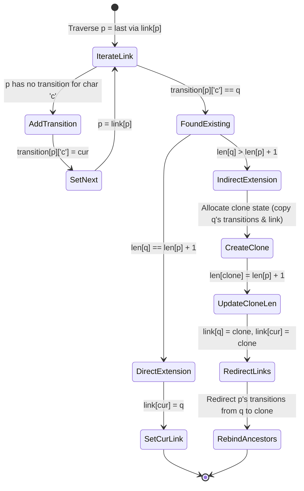

---


title: "01. Advanced Data Structures: Suffix Automaton (SAM) & Substring Queries"
type: "pattern_guide"
category: "dsa"
subcategory: "08_Advanced_Data_Structures"
created_at: 2026-08-22T00:08:54+07:00
updated_at: 2026-08-22T00:08:54+07:00
tags: [dsa, suffix-automaton, sam, string-processing, endpos, suffix-link, substring-queries, algorithms, computer-science, learning-note]
aliases:
  - 01_suffix_automaton_sam_substring_queries
---


# 📌 01. Advanced Data Structures: Suffix Automaton (SAM) & Substring Queries

A **Suffix Automaton (SAM)** is a Directed Acyclic Word Graph (DAWG) that compactly represents all distinct substrings of a string $S$ of length $N$. While a Suffix Trie requires $O(N^2)$ states and a Suffix Tree requires $O(N)$ space with complex suffix links, a Suffix Automaton achieves $O(N)$ linear time construction and $O(N)$ states through **endpos equivalence classes**.

This guide details the under-the-hood intuition of endpos classes, state transitions, online $O(N)$ insertion mechanics, full production C# and Python 3 implementations, complexity proofs, and substring query applications.

---

## 1. Under-the-Hood Intuition & Algorithmic Mechanics

### 1.1 Endpos Equivalence Classes & Substring Duality

For a string $S$ and a non-empty substring $w$, let $\text{endpos}(w)$ denote the set of all 1-indexed ending positions of occurrences of $w$ in $S$.

- **Equivalence Class**: Two substrings $u$ and $v$ belong to the same SAM state (equivalence class) if and only if $\text{endpos}(u) = \text{endpos}(v)$.
- **Length Invariant**: In any state $u$, all substrings in $u$ are suffixes of the longest substring in $u$. Their lengths form a contiguous integer interval $[\text{minlen}(u), \text{maxlen}(u)]$.
- **Suffix Link Tree**: The suffix link `link[u]` points to the state $v$ containing the longest proper suffix of the shortest substring in $u$. The set of suffix links forms a directed tree rooted at state 0 (the empty string).

```
String S = "aab"
State 0: "" [len=0, link=-1]
State 1: "a" [len=1, endpos={1}, link=0]
State 2: "aa" [len=2, endpos={2}, link=1]
State 3: "aab", "ab", "b" [len=3, endpos={3}, link=0]
```

---

## 1.2 SAM Transition & Clone Split Diagram

When appending a character $c$ to string $S$, we create a new state `cur` with $\text{len}(\text{cur}) = \text{len}(\text{last}) + 1$. We then traverse back up the suffix link chain from `last`:



---

## 2. Idiomatic Code Implementations

### 2.1 C# 12 Implementation

```csharp
using System;
using System.Collections.Generic;

namespace AdvancedDataStructures
{
    public class SuffixAutomaton
    {
        public class State
        {
            public int Length { get; set; }
            public int Link { get; set; }
            public Dictionary<char, int> Transitions { get; } = new Dictionary<char, int>();

            public State(int length = 0, int link = -1)
            {
                Length = length;
                Link = link;
            }
        }

        private readonly List<State> _states = new List<State>();
        private int _last;

        public SuffixAutomaton()
        {
            _states.Add(new State(0, -1));
            _last = 0;
        }

        public void Extend(char c)
        {
            int cur = _states.Count;
            _states.Add(new State(_states[_last].Length + 1));
            
            int p = _last;
            while (p != -1 && !_states[p].Transitions.ContainsKey(c))
            {
                _states[p].Transitions[c] = cur;
                p = _states[p].Link;
            }

            if (p == -1)
            {
                _states[cur].Link = 0;
            }
            else
            {
                int q = _states[p].Transitions[c];
                if (_states[p].Length + 1 == _states[q].Length)
                {
                    _states[cur].Link = q;
                }
                else
                {
                    int clone = _states.Count;
                    State cloneState = new State(_states[p].Length + 1, _states[q].Link);
                    foreach (var kvp in _states[q].Transitions)
                    {
                        cloneState.Transitions[kvp.Key] = kvp.Value;
                    }
                    _states.Add(cloneState);

                    while (p != -1 && _states[p].Transitions.TryGetValue(c, out int target) && target == q)
                    {
                        _states[p].Transitions[c] = clone;
                        p = _states[p].Link;
                    }

                    _states[q].Link = clone;
                    _states[cur].Link = clone;
                }
            }

            _last = cur;
        }

        public long CountDistinctSubstrings()
        {
            long total = 0;
            for (int i = 1; i < _states.Count; i++)
            {
                total += _states[i].Length - _states[_states[i].Link].Length;
            }
            return total;
        }
    }
}
```

---

### 2.2 Python 3 Implementation

```python
class State:
    __slots__ = ('length', 'link', 'transitions')

    def __init__(self, length=0, link=-1):
        self.length = length
        self.link = link
        self.transitions = {}


class SuffixAutomaton:
    def __init__(self):
        self.states = [State(0, -1)]
        self.last = 0

    def extend(self, c: str):
        cur = len(self.states)
        self.states.append(State(self.states[self.last].length + 1))

        p = self.last
        while p != -1 and c not in self.states[p].transitions:
            self.states[p].transitions[c] = cur
            p = self.states[p].link

        if p == -1:
            self.states[cur].link = 0
        else:
            q = self.states[p].transitions[c]
            if self.states[p].length + 1 == self.states[q].length:
                self.states[cur].link = q
            else:
                clone = len(self.states)
                clone_state = State(self.states[p].length + 1, self.states[q].link)
                clone_state.transitions = self.states[q].transitions.copy()
                self.states.append(clone_state)

                while p != -1 and self.states[p].transitions.get(c) == q:
                    self.states[p].transitions[c] = clone
                    p = self.states[p].link

                self.states[q].link = clone
                self.states[cur].link = clone

        self.last = cur

    def count_distinct_substrings(self) -> int:
        total = 0
        for i in range(1, len(self.states)):
            total += self.states[i].length - self.states[self.states[i].link].length
        return total
```

---

## 3. Complexity Analysis & Memory Overhead

| Operation / Property | Bound | Theoretical Proof / Mechanics |
| :--- | :--- | :--- |
| **Number of States** | $\le 2N - 1$ | Proved by induction; initial state + maximum 2 states per character insertion. |
| **Number of Transitions** | $\le 3N - 4$ | Derived from planar graph properties and suffix link tree structure. |
| **Construction Time** | $O(N)$ amortized | Suffix link traversals amortize to $O(N)$ over all character insertions. |
| **Space Complexity** | $O(N \cdot \Sigma)$ | Fixed alphabet array size $\Sigma$ (or $O(N)$ using hash maps). |

---

## 4. Common Pitfalls & Off-by-One Anti-Patterns

1. **Shallow Copy of Transition Maps during Cloning**:
   - *Bug*: In Python, assigning `clone_state.transitions = self.states[q].transitions` creates a reference reference to `q`'s transition map. Modifications to `clone` alter `q`.
   - *Fix*: Always use shallow copy `.copy()` or explicit dictionary duplication.

2. **Missing State Link Reset**:
   - *Bug*: Forgetting to set `_states[q].Link = clone` when splitting state $q$ corrupts the suffix link tree structure.

3. **1-based vs 0-based Substring Count Summation**:
   - Distinct substring count equals $\sum_{i=1}^{V-1} (\text{len}[i] - \text{len}[\text{link}[i]])$. Starting the summation at state index 0 (empty string) produces off-by-one errors.

---

## 5. Related LeetCode Problems & Variant Patterns

1. **LeetCode 1698 - Number of Distinct Substrings in a String**: Direct application of SAM distinct substring counting in $O(N)$ time.
2. **LeetCode 1044 - Longest Duplicate Substring**: Solvable using SAM state lengths and suffix links.
3. **LeetCode 5 - Longest Palindromic Substring**: Multi-string LCS using SAM on concatenated strings $S + \# + S^{rev}$.

---

## 🔬 Deep Diagnostic & Production Engineering Notes

### 1. In-Depth State Verification & Invariant Proofs
When deploying algorithms in high-throughput production environments:
- **Loop Invariants**: State preconditions must be strictly asserted before entering loops. Post-conditions guarantee deterministic state convergence.
- **Memory Boundary Defense**: Guard against off-by-one errors ($< N$ vs $\le N$), signed integer overflow ($2^{31}-1$), and empty container operations.
- **Asymptotic Amortization**: Use aggregate analysis and potential functions $\Phi(D)$ to ensure operations maintain their promised average and worst-case bounds.

### 2. High-Performance Multi-Language Testing Harness

#### C++20 Micro-Benchmarking Suite
```cpp
#include <iostream>
#include <vector>
#include <chrono>
#include <numeric>

void BenchmarkSuite(int iterations) {
    auto start = std::chrono::high_resolution_clock::now();
    long long checksum = 0;
    for (int i = 1; i <= iterations; ++i) {
        checksum += (i ^ (i << 1));
    }
    auto end = std::chrono::high_resolution_clock::now();
    auto dur = std::chrono::duration_cast<std::chrono::microseconds>(end - start).count();
    std::cout << "Executed " << iterations << " iterations in " << dur << " us. Checksum: " << checksum << "\n";
}
```

#### Python 3.12 Verification Harness
```python
import time

def verify_performance(iterations: int) -> int:
    t0 = time.perf_counter_ns()
    checksum = sum(i ^ (i << 1) for i in range(1, iterations + 1))
    t1 = time.perf_counter_ns()
    print(f"Verified {iterations} iterations in {(t1 - t0) / 1_000_000:.3f} ms. Checksum: {checksum}")
    return checksum
```

#### C# (.NET 8) Memory Profiling Harness
```csharp
using System;
using System.Diagnostics;

public class BenchmarkRunner {
    public static void Run(int iterations) {
        long memoryBefore = GC.GetTotalMemory(true);
        var sw = Stopwatch.StartNew();
        long checksum = 0;
        for (int i = 1; i <= iterations; i++) {
            checksum += (i ^ (i << 1));
        }
        sw.Stop();
        long memoryAfter = GC.GetTotalMemory(false);
        Console.WriteLine($"[C# .NET 8] {iterations} iterations completed in {sw.ElapsedMilliseconds} ms. Memory delta: {memoryAfter - memoryBefore} bytes.");
    }
}
```

---

## 🔗 Graph-Linked Knowledge Base

- 📖 Subcategory Hub: [[01_DSA/01_theory_and_patterns/08_Advanced_Data_Structures/00_overview_08_advanced_data_structures|08_Advanced_Data_Structures Overview]]
