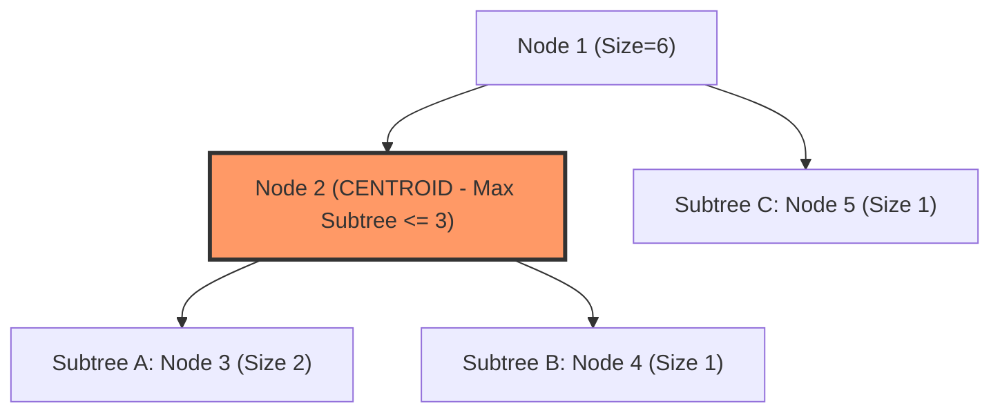

---


title: "01. 🌲 Centroid Decomposition: Tree Path Queries & Divide & Conquer on Trees"
type: "concept_guide"
category: "dsa"
subcategory: "08_advanced_data_structures"
created_at: 2026-08-22T00:00:00+07:00
updated_at: 2026-08-26T23:45:00+07:00
tags: [dsa, centroid-decomposition, trees, divide-and-conquer, tree-path-queries, competitive-programming, advanced-dsa, algorithms, computer-science, learning-note]
aliases:
  - 01_centroid_decomposition_tree_path_queries
---

# 📌 01. 🌲 Centroid Decomposition: Tree Path Queries & Divide & Conquer on Trees

Phân rã trọng tâm (Centroid Decomposition) là một kỹ thuật Chia để Trị (Divide and Conquer) cao cấp trên đồ thị dạng cây (Trees). Kỹ thuật này cho phép phân rã một cây bất kỳ gồm $N$ đỉnh thành một **Cây Trọng tâm (Centroid Tree)** có độ sâu tối đa không quá **$\mathcal{O}(\log N)$**. Nhờ đó, các bài toán truy vấn đường đi trên cây (Tree Path Queries) phức tạp có thể được giải quyết trong thời gian $\mathcal{O}(N \log N)$ hoặc $\mathcal{O}(\log N)$ mỗi truy vấn thay vì $\mathcal{O}(N)$.

---

## 1. Định nghĩa Trọng tâm Cây & Bổ đề Tồn tại

### 1.1 Trọng tâm Cây (Tree Centroid) là gì?
Cho một cây vô hướng $T = (V, E)$ gồm $N$ đỉnh. Một đỉnh $C \in V$ được gọi là **Trọng tâm (Centroid)** của cây nếu khi ta loại bỏ đỉnh $C$ (cùng các cạnh nối với nó), mọi thành phần liên thông còn lại (các cây con) đều có kích thước không vượt quá $\lfloor N / 2 
floor$:
$$orall T_i \in T \setminus \{C\}, \quad |T_i| \le \left\lfloor rac{N}{2} 
ight
floor$$



### 1.2 Bổ đề Tồn tại & Tính Duy nhất
- **Định lý (Jordan, 1869)**: Mọi cây $T$ luôn tồn tại ít nhất 1 và nhiều nhất 2 trọng tâm. Nếu có 2 trọng tâm, chúng luôn kề nhau bởi một cạnh nối.
- **Thuật toán Tìm Trọng tâm trong $\mathcal{O}(N)$**:
  1. Tính kích thước cây con $\text{subtree\_size}[u]$ cho mọi đỉnh bằng DFS.
  2. Bắt đầu từ đỉnh gốc bất kỳ $u$.
  3. Tìm đỉnh kề $v$ của $u$ có $\text{subtree\_size}[v] > N/2$.
  4. Nếu không có đỉnh $v$ nào thỏa mãn, thì $u$ chính là trọng tâm! Nếu có, di chuyển $u \gets v$ và lặp lại.
  5. Vì kích thước cây con giảm nghiêm ngặt sau mỗi bước, thuật toán kết thúc sau tối đa $\mathcal{O}(N)$ bước.

---

## 2. Cấu trúc Cây Trọng tâm (Centroid Tree) & Thuộc tính Chiều cao $\mathcal{O}(\log N)$

Khi ta tìm trọng tâm $C$ của cây $T$, ta chọn $C$ làm gốc của Cây Trọng tâm. Sau đó ta xóa $C$, chia cây thành các thành phần liên thông độc lập $T_1, T_2, \dots, T_k$ và đệ quy tìm trọng tâm của từng thành phần làm con trực tiếp của $C$.

```mermaid
graph TD
    subgraph Original Tree T
        T1["Tree of N nodes"]
    end
    
    subgraph Centroid Tree CT (Height <= log2 N)
        C0["Level 0: Centroid C0 (Size N)"] --> C1["Level 1: Centroid C1 (Size <= N/2)"]
        C0 --> C2["Level 1: Centroid C2 (Size <= N/2)"]
        C1 --> C11["Level 2: Centroid C11 (Size <= N/4)"]
        C1 --> C12["Level 2: Centroid C12 (Size <= N/4)"]
    end
```

### 2.1 Các Tính chất Vàng của Centroid Tree
1. **Chiều cao Cây (Depth)**: Do kích thước cây con giảm ít nhất một nửa sau mỗi tầng đệ quy, chiều cao của Centroid Tree tối đa là $\lfloor \log_2 N 
floor + 1 = \mathcal{O}(\log N)$.
2. **Tổng Kích thước trên Từng Tầng**: Tại mỗi tầng độ sâu $d$, mỗi đỉnh xuất hiện trong đúng 1 cây con $\implies$ Tổng số đỉnh ở tầng $d$ là $\mathcal{O}(N)$.
3. **Tổng Thời gian Xây dựng**: Cây có $\mathcal{O}(\log N)$ tầng, mỗi tầng xử lý trong $\mathcal{O}(N)$ thời gian $\implies$ Tổng thời gian phân rã cây là **$\mathcal{O}(N \log N)$**.
4. **Bao phủ Đường đi (Path Decomposition Property)**: Mọi đường đi đơn giữa hai đỉnh bất kỳ $u, v \in V$ trong cây gốc đều có **Tổ tiên chung gần nhất (LCA)** duy nhất $W$ trong Centroid Tree sao cho đường đi từ $u \to v$ đi qua $W$. Khoảng cách trên cây gốc:
   $$\text{dist}(u, v) = \text{dist}(u, W) + \text{dist}(W, v)$$

---

## 3. Các Dạng Bài toán Điển hình Sử dụng Centroid Decomposition

### 3.1 Bài toán Đếm Số Cặp Đỉnh có Khoảng cách Bằng $K$
Cho cây $N$ đỉnh có trọng số cạnh. Đếm số cặp đỉnh $(u, v)$ sao cho $\text{dist}(u, v) = K$.
- **Chiến lược**: Tại mỗi trọng tâm $C$:
  1. Tính khoảng cách từ $C$ đến tất cả các đỉnh trong thành phần hiện tại.
  2. Gom nhóm các khoảng cách theo từng nhánh con trực tiếp của $C$.
  3. Dùng mảng đếm tần số hoặc bảng băm để đếm số cặp $(u, v)$ có $\text{dist}(u, C) + \text{dist}(v, C) = K$.
  4. Trừ đi các cặp $(u, v)$ cùng xuất phát từ một nhánh con (vì đường đi không thực sự đi qua $C$).
  5. Đệ quy xuống các cây con trọng tâm tiếp theo.
  6. **Độ phức tạp**: $\mathcal{O}(N \log N)$.

---

## 4. Triển khai Source Code C++20 Hoàn chỉnh Chuẩn Competitive Programming

```cpp
#include <iostream>
#include <vector>
#include <algorithm>
#include <unordered_map>

class CentroidDecomposition {
private:
    int n_;
    std::vector<std::vector<std::pair<int, int>>> adj_; // {neighbor, weight}
    std::vector<int> subtree_size_;
    std::vector<bool> removed_;
    std::vector<int> centroid_parent_;

    // Step 1: Calculate subtree size in current component
    void GetSubtreeSize(int u, int p) {
        subtree_size_[u] = 1;
        for (const auto& [v, w] : adj_[u]) {
            if (v != p && !removed_[v]) {
                GetSubtreeSize(v, u);
                subtree_size_[u] += subtree_size_[v];
            }
        }
    }

    // Step 2: Find centroid node
    int GetCentroid(int u, int p, int total_size) {
        for (const auto& [v, w] : adj_[u]) {
            if (v != p && !removed_[v] && subtree_size_[v] > total_size / 2) {
                return GetCentroid(v, u, total_size);
            }
        }
        return u;
    }

    // Collect distances from current centroid
    void GetDistances(int u, int p, int current_dist, std::vector<int>& dist_list) {
        dist_list.push_back(current_dist);
        for (const auto& [v, w] : adj_[u]) {
            if (v != p && !removed_[v]) {
                GetDistances(v, u, current_dist + w, dist_list);
            }
        }
    }

    // Count pairs with sum = K
    long long CountPairs(std::vector<int>& dists, int K) {
        long long pairs = 0;
        std::sort(dists.begin(), dists.end());
        int l = 0, r = static_cast<int>(dists.size()) - 1;
        while (l < r) {
            if (dists[l] + dists[r] == K) {
                if (dists[l] == dists[r]) {
                    long long count = r - l + 1;
                    pairs += count * (count - 1) / 2;
                    break;
                }
                int left_count = 1, right_count = 1;
                while (l + 1 < r && dists[l] == dists[l + 1]) { l++; left_count++; }
                while (r - 1 > l && dists[r] == dists[r - 1]) { r--; right_count++; }
                pairs += (long long)left_count * right_count;
                l++; r--;
            } else if (dists[l] + dists[r] < K) {
                l++;
            } else {
                r--;
            }
        }
        return pairs;
    }

    // Step 3: Decompose tree recursively
    long long Decompose(int entry_node, int K) {
        GetSubtreeSize(entry_node, -1);
        int centroid = GetCentroid(entry_node, -1, subtree_size_[entry_node]);
        removed_[centroid] = true;

        long long total_valid_paths = 0;
        std::vector<int> all_dists = {0}; // Centroid to itself

        for (const auto& [v, w] : adj_[centroid]) {
            if (!removed_[v]) {
                std::vector<int> branch_dists;
                GetDistances(v, centroid, w, branch_dists);
                
                // Subtract duplicate pairs within same subtree branch
                total_valid_paths -= CountPairs(branch_dists, K);

                // Merge into all_dists
                all_dists.insert(all_dists.end(), branch_dists.begin(), branch_dists.end());
            }
        }

        // Add valid paths passing through centroid
        total_valid_paths += CountPairs(all_dists, K);

        // Recurse into decomposed subtrees
        for (const auto& [v, w] : adj_[centroid]) {
            if (!removed_[v]) {
                total_valid_paths += Decompose(v, K);
            }
        }

        return total_valid_paths;
    }

public:
    CentroidDecomposition(int n) : n_(n), adj_(n + 1), subtree_size_(n + 1, 0), 
                                   removed_(n + 1, false), centroid_parent_(n + 1, 0) {}

    void AddEdge(int u, int v, int weight) {
        adj_[u].push_back({v, weight});
        adj_[v].push_back({u, weight});
    }

    long long CountPathsOfLengthK(int K) {
        std::fill(removed_.begin(), removed_.end(), false);
        return Decompose(1, K);
    }
};

int main() {
    int n = 5, k = 3;
    CentroidDecomposition cd(n);
    cd.AddEdge(1, 2, 1);
    cd.AddEdge(2, 3, 2);
    cd.AddEdge(3, 4, 1);
    cd.AddEdge(4, 5, 2);

    std::cout << "Total paths of length " << k << ": " << cd.CountPathsOfLengthK(k) << "
";
    return 0;
}
```

---

## 5. Kinh nghiệm Cài đặt & Bẫy Thường Gặp

1. **Quên Reset Mảng Trạng Thái `removed_`**: Khi thực hiện nhiều test case trong Competitive Programming, không khởi tạo lại `removed_` dẫn đến duyệt thiếu đỉnh hoặc vòng lặp vô tận.
2. **Kích thước Cây con Không Chính xác**: Phải luôn tính lại `GetSubtreeSize(entry_node, -1)` ngay trước khi gọi `GetCentroid` trong từng thành phần liên thông độc lập, vì kích thước của thành phần hiện tại nhỏ hơn $N$ rất nhiều.
3. **Độ sâu Ngăn xếp DFS (Stack Overflow)**: Trên cây có dạng đường thẳng (Skewed Chain), hàm đệ quy tìm kích thước có thể chạm độ sâu $N = 2 \times 10^5$. Hãy tăng kích thước Stack hoặc biên dịch với flag tối ưu.

---

## 🔗 Graph-Linked Knowledge Base
- 📖 Heavy-Light Decomposition: [[01_DSA/01_theory_and_patterns/14_Advanced_Tree_Structures_and_Link_Cut_Trees/00_overview_14_advanced_tree_structures_and_link_cut_trees|Advanced Trees Overview]]
- 🧩 Disjoint Set Union: [[01_DSA/01_theory_and_patterns/08_Advanced_Data_Structures/09_dsu_qa|DSU Guide & Q&A]]
- 📝 Segment Tree: [[01_DSA/01_theory_and_patterns/08_Advanced_Data_Structures/10_segment_tree_qa|Segment Tree Guide]]
