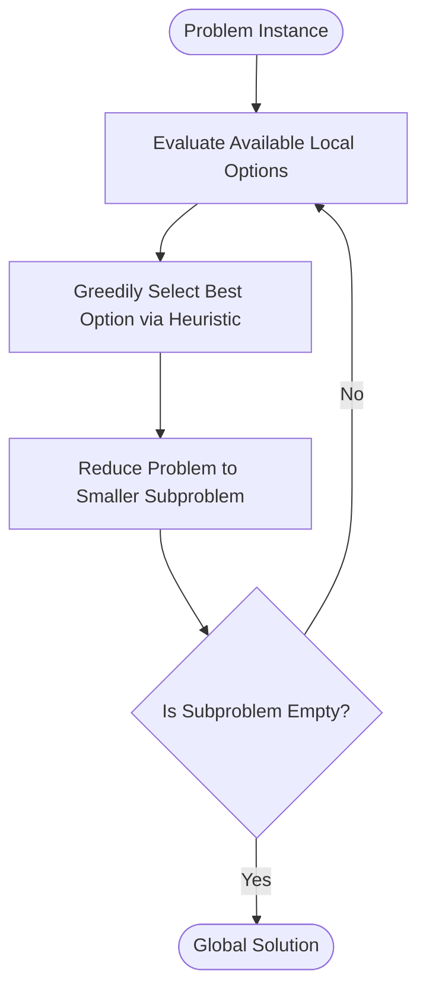
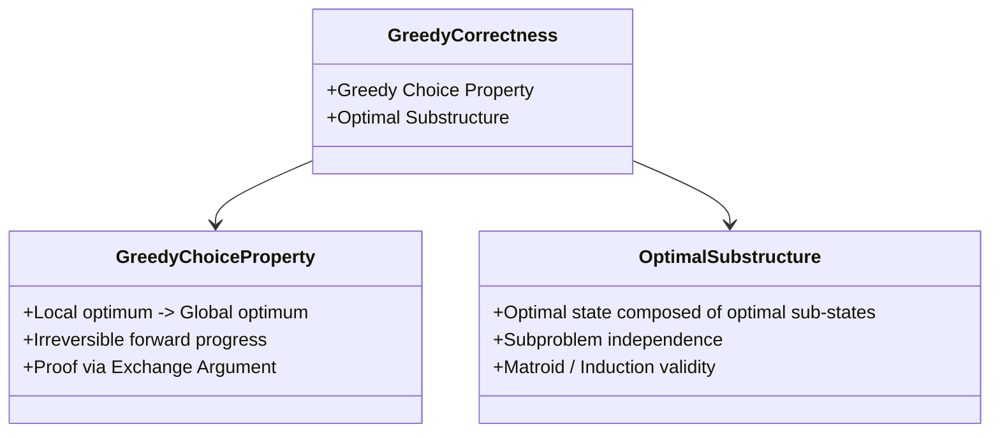
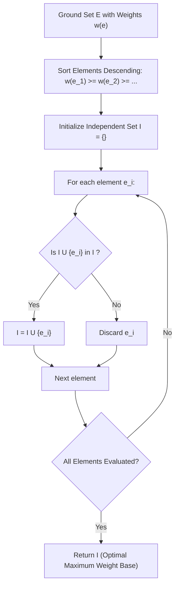
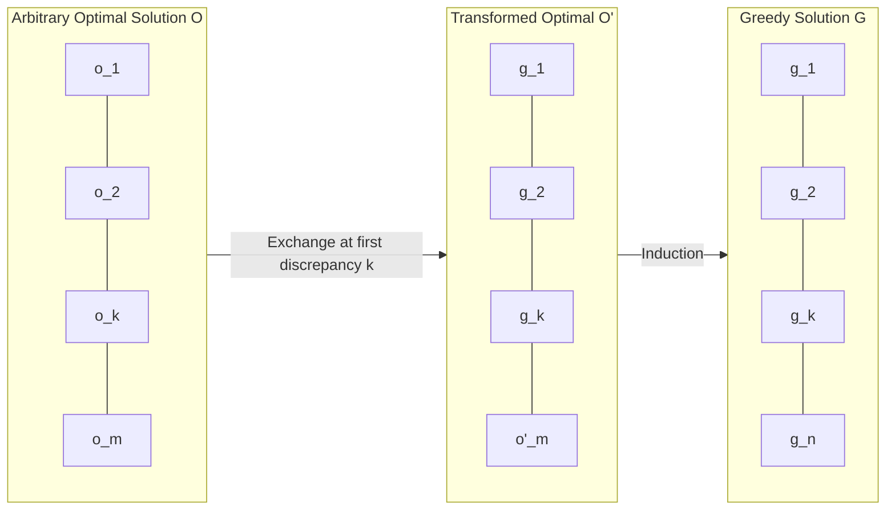
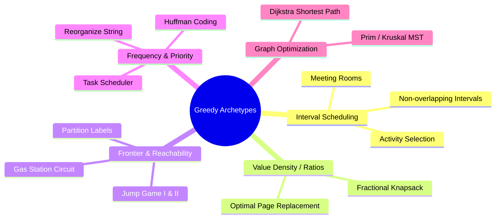

---


title: "00. 🧭 Greedy Algorithms: Theoretical Foundations, Matroid Theory & Design Patterns"
description: "Comprehensive guide to greedy algorithms, Matroid theory, Rado-Edmonds theorem, the exchange argument proof recipe, and the Greedy vs Dynamic Programming decision framework."
category: "Data Structures & Algorithms"
tags: [dsa, greedy, matroid-theory, rado-edmonds, exchange-argument, dynamic-programming, algorithms, computer-science, learning-note]
date: "2026-08-26"
aliases:
  - 00_overview_greedy_algorithms
---

# 📌 00. 🧭 Greedy Algorithms: Theoretical Foundations, Matroid Theory & Design Patterns

## 📌 Connected Resource Graph
- 🟢 **Primary Theory Note**: Greedy Algorithms Overview
- 🟡 **Topic Overview Node**: Activity Selection & Interval Scheduling, Fractional vs 0/1 Knapsack, Dynamic Programming Overview


---

## 1. Executive Summary & The Greedy Paradigm

A **Greedy Algorithm** is an algorithmic paradigm that constructs a global solution incrementally by making a sequence of **locally optimal choices** at each decision point, without ever backtracking or revising previous decisions. 

While exhaustive search and dynamic programming evaluate entire state spaces and subproblem trade-offs, greedy algorithms commit irreversibly to the immediate best choice based on a fixed ranking heuristic or priority function.



### When is Greedy Applicable?
Greedy algorithms are exceptionally fast—typically operating in $\mathcal{O}(N)$ or $\mathcal{O}(N \log N)$ time. However, their correctness is not universal. A greedy strategy is provably optimal **if and only if** the underlying combinatorial structure satisfies two fundamental mathematical properties:
1. **The Greedy Choice Property**: A globally optimal solution can be arrived at by making locally optimal (greedy) choices.
2. **Optimal Substructure**: An optimal solution to the overall problem contains optimal solutions to its constituent subproblems.

---

## 2. The Dual Pillars of Greedy Algorithms



### 2.1 The Greedy Choice Property
Under the greedy choice property, we can assemble a global optimum without solving subproblems first. Unlike Dynamic Programming—which solves subproblems bottom-up before making an informed top-level decision—a greedy algorithm makes its first choice **top-down** before solving any subproblems.

> [!NOTE]
> **Key Difference from Dynamic Programming**: Dynamic Programming makes decisions based on the optimal values of all dependent subproblems ($V(i) = \max_{j} \{ \dots \}$). Greedy makes a decision based solely on immediate local metrics (e.g., maximum ratio, earliest finish time, minimum edge weight) and then solves the single remaining subproblem.

### 2.2 Optimal Substructure
A problem exhibits optimal substructure if an optimal solution to the problem instance of size $N$ contains within it optimal solutions to subproblem instances of size $< N$.
- **Shortest Path Example**: If the shortest path from $A$ to $C$ passes through $B$, then the sub-path from $A$ to $B$ must be the shortest path from $A$ to $B$.
- **Longest Simple Path Counterexample**: The longest simple path from $A$ to $C$ through $B$ does *not* necessarily contain the longest simple path from $A$ to $B$, because combining two longest simple sub-paths may introduce cycles (violating simplicity).

---

## 3. Formal Mathematical Foundation: Matroid Theory

The mathematical foundation that characterizes when greedy algorithms guarantee global optimality is **Matroid Theory**, pioneered by Hassler Whitney (1935) and extended to combinatorial optimization by Jack Edmonds and Richard Rado.

### 3.1 Definition of a Matroid
A **Matroid** is an ordered pair $M = (E, \mathcal{I})$, where:
- $E$ is a finite non-empty ground set of elements.
- $\mathcal{I}$ is a non-empty family of subsets of $E$ (called **independent sets**), satisfying two fundamental axioms:

$$\mathcal{I} \subseteq 2^E, \quad \emptyset \in \mathcal{I}$$

#### Axiom 1: The Hereditary Property (Downwards Closure)
If set $B \in \mathcal{I}$ and $A \subseteq B$, then $A \in \mathcal{I}$. Any subset of an independent set is independent.

#### Axiom 2: The Exchange Property (Augmentation Property)
If $A \in \mathcal{I}$, $B \in \mathcal{I}$, and $|A| < |B|$, then there exists an element $x \in B \setminus A$ such that:

$$A \cup \{x\} \in \mathcal{I}$$

### 3.2 The Rado-Edmonds Theorem
Let $M = (E, \mathcal{I})$ be a matroid, and let $w: E \to \mathbb{R}^+$ be a weight function assigning a positive weight to every element in $E$. The weight of an independent set $I \in \mathcal{I}$ is:

$$w(I) = \sum_{e \in I} w(e)$$

> [!IMPORTANT]
> **Rado-Edmonds Theorem (Edmonds, 1971)**:
> The generic greedy algorithm (sorting elements by weight descending and iteratively adding element $e$ if $I \cup \{e\} \in \mathcal{I}$) finds an independent set of **maximum total weight** for *any* weight function $w$ **if and only if** $(E, \mathcal{I})$ is a matroid.



### 3.3 Classical Matroid Archetypes

| Matroid Type | Ground Set $E$ | Independent Sets $\mathcal{I}$ | Greedy Algorithm Application |
| :--- | :--- | :--- | :--- |
| **Graphic Matroid** | Edges of an undirected graph $G=(V, E)$ | Forest subgraphs (acyclic edge sets) | **Kruskal's Algorithm** (Minimum Spanning Tree) |
| **Uniform Matroid** | Any finite set $E$ | Subsets of size $\le k$ ($\{S \subseteq E : \|S\| \le k\}$) | Top-$k$ largest elements / Fractional selection |
| **Vector Matroid** | Vectors in a vector space $V$ | Linearly independent vector subsets | Matrix Rank / Basis selection |
| **Transversal Matroid** | Elements of a bipartite graph part | Subsets that can be matched | Maximum Bipartite Matching / Job Assignment |

### 3.4 Why Greedy Fails on Non-Matroids

When a problem's independent set system violates the Exchange Property, greedy heuristics get trapped in local optima:

#### 1. The Coin Change Problem (Non-canonical coin systems)
- **Coins**: $\{1, 3, 4\}$, Target: $6$.
- **Greedy Choice**: Pick largest coin $\le 6 \implies 4$. Remaining target: \$2 \implies 1 + 1$. Total = $3$ coins $\{4, 1, 1\}$.
- **Global Optimum**: Pick $\{3, 3\} \implies 2$ coins.
- **Root Cause**: The set system of valid coin combinations does not satisfy the matroid exchange property under general denominations.

#### 2. The 0/1 Knapsack Problem
- **Capacity**: $50$.
- **Item A**: Weight $30$, Value $\$60$ (Ratio $\$2.0/\text{kg}$).
- **Item B**: Weight $25$, Value $\$45$ (Ratio $\$1.8/\text{kg}$).
- **Item C**: Weight $25$, Value $\$45$ (Ratio $\$1.8/\text{kg}$).
- **Greedy Choice**: Picks Item A (highest ratio), capacity remaining = $20$. Cannot fit B or C. Total Value = $\$60$.
- **Global Optimum**: Picks Items B + C, total weight = $50$, total value = $\$90$.
- **Root Cause**: Discrete item boundaries create capacity "slack" that cannot be filled without fractional division, violating continuous exchange.

---

## 4. The Universal Proof Recipe: The Exchange Argument

To prove mathematically that a greedy algorithm produces an optimal solution, the standard, most robust technique is the **Exchange Argument** (also known as "Greedy Stays Ahead").



### The 4-Step Exchange Argument Framework

```
┌────────────────────────────────────────────────────────────────────────┐
│                      EXCHANGE ARGUMENT PROOF RECIPE                    │
├────────────────────────────────────────────────────────────────────────┤
│ 1. Define Candidate Solutions:                                         │
│    Let G = (g_1, g_2, ..., g_k) be the greedy solution.                │
│    Let O = (o_1, o_2, ..., o_m) be an arbitrary optimal solution.      │
│                                                                        │
│ 2. Find the First Discrepancy:                                         │
│    Assume O != G. Let index i be the first index where g_i != o_i.     │
│                                                                        │
│ 3. Execute the Exchange:                                               │
│    Construct a new solution O' by replacing o_i with g_i               │
│    (i.e., O' = (O \ {o_i}) U {g_i} or tailored swap).                  │
│                                                                        │
│ 4. Prove Feasibility & Non-Degradation:                                │
│    a) Prove O' is valid and satisfies all problem constraints.         │
│    b) Prove Cost(O') <= Cost(O) or Value(O') >= Value(O).              │
│    By induction, O can be transformed into G without degrading quality.│
│    Therefore, G is optimal.                                            │
└────────────────────────────────────────────────────────────────────────┘
```

---

## 5. Algorithmic Paradigm Decision Matrix

Choosing the right paradigm requires evaluating optimal substructure, overlapping subproblems, and decision reversibility.

```mermaid
flowchart TD
    Q1{Does the problem have Optimal Substructure?}
    Q1 -- No --> Brute[Backtracking / Branch & Bound / Heuristics]
    Q1 -- Yes --> Q2{Does the Greedy Choice Property hold?}
    Q2 -- Yes --> Greedy[Greedy Algorithm - O(N log N) or O(N)]
    Q2 -- No --> Q3{Are subproblems overlapping?}
    Q3 -- Yes --> DP[Dynamic Programming - Memoization / Tabulation]
    Q3 -- No --> DC[Divide & Conquer - MergeSort / Binary Search]
```

### Comparative Decision Matrix

| Dimension | Greedy Algorithms | Dynamic Programming | Divide & Conquer | Backtracking / Exhaustive |
| :--- | :--- | :--- | :--- | :--- |
| **Choice Mechanism** | Single local choice made top-down | Evaluates all sub-choices bottom-up | Splits problem into independent parts | Explores all possibilities with undo |
| **Reversibility** | **Irreversible** (never backtracks) | Reversible via table lookup | Reversible via recursion stack | **Fully Reversible** (state backtrack) |
| **Subproblem Overlap** | Irrelevant (solves only 1 subproblem) | **High overlap** (memoized table) | **Zero overlap** (disjoint subproblems) | High overlap or tree explosion |
| **Typical Time** | $\mathcal{O}(N)$ to $\mathcal{O}(N \log N)$ | $\mathcal{O}(N^2)$, $\mathcal{O}(N \cdot W)$, $\mathcal{O}(N^3)$ | $\mathcal{O}(N \log N)$ | $\mathcal{O}(2^N)$ or $\mathcal{O}(N!)$ |
| **Typical Space** | $\mathcal{O}(1)$ to $\mathcal{O}(N)$ | $\mathcal{O}(N)$ to $\mathcal{O}(N^2)$ table | $\mathcal{O}(\log N)$ stack | $\mathcal{O}(N)$ stack depth |
| **Optimality Guarantee** | Only if Matroid / Greedy property holds | Guaranteed if Bellman equation holds | Guaranteed if split covers entire space | Guaranteed exact search |

---

## 6. Classical Greedy Problem Archetypes



---

## 7. Production Implementations (C# & Python 3)

### 7.1 Generic Greedy Strategy: Activity Selection Problem
Given $N$ activities with start time $s_i$ and finish time $f_i$, select the maximum cardinality set of mutually compatible activities.

#### C# Production Implementation (.NET 8 Zero-Allocation Struct)
```csharp
using System;
using System.Buffers;
using System.Collections.Generic;

public static class GreedyActivitySelector
{
    public readonly record struct Activity(int Start, int Finish) : IComparable<Activity>
    {
        public int CompareTo(Activity other) => Finish.CompareTo(other.Finish);
    }

    /// <summary>
    /// Selects maximum mutually compatible activities in O(N log N) time and O(1) auxiliary space.
    /// </summary>
    public static ReadOnlySpan<Activity> SelectMaxActivities(Activity[] activities, out int selectedCount)
    {
        if (activities == null || activities.Length == 0)
        {
            selectedCount = 0;
            return ReadOnlySpan<Activity>.Empty;
        }

        // Sort in-place by finish time ascending: O(N log N)
        Array.Sort(activities);

        int writeIdx = 0;
        activities[writeIdx++] = activities[0];
        int lastFinish = activities[0].Finish;

        for (int i = 1; i < activities.Length; i++)
        {
            if (activities[i].Start >= lastFinish)
            {
                activities[writeIdx++] = activities[i];
                lastFinish = activities[i].Finish;
            }
        }

        selectedCount = writeIdx;
        return activities.AsSpan(0, selectedCount);
    }
}
```

#### Python 3 Implementation
```python
from typing import List, Tuple

def select_max_activities(activities: List[Tuple[int, int]]) -> List[Tuple[int, int]]:
    """
    Selects maximum number of non-overlapping activities.
    activities: List of (start_time, finish_time)
    Time Complexity: O(N log N)
    Space Complexity: O(N) for result list
    """
    if not activities:
        return []

    # Sort strictly by finish time ascending
    sorted_activities = sorted(activities, key=lambda x: x[1])
    
    selected = [sorted_activities[0]]
    last_finish = sorted_activities[0][1]

    for start, finish in sorted_activities[1:]:
        if start >= last_finish:
            selected.append((start, finish))
            last_finish = finish

    return selected

# Verification
if __name__ == "__main__":
    test_data = [(1, 4), (3, 5), (0, 6), (5, 7), (3, 9), (5, 9), (6, 10), (8, 11), (8, 12), (2, 14), (12, 16)]
    result = select_max_activities(test_data)
    print(f"Selected {len(result)} activities: {result}")
    # Output: [(1, 4), (5, 7), (8, 11), (12, 16)]
```

---

## 8. Common Anti-Patterns & Verification Checklist

> [!WARNING]
> **Common Greedy Pitfalls**:
> 1. **Assuming Sorting by Value Always Works**: Sorting by pure value ignores weight/cost footprint (e.g. 0/1 Knapsack failure).
> 2. **Neglecting Constraint Side-Effects**: In graph coloring or TSP, an early greedy choice severely constrains subsequent options, leading to catastrophic global cost.
> 3. **Failing to Test Non-Canonical Inputs**: Greedy coin change passes tests for US coins $\{1, 5, 10, 25\}$ because US coins form a canonical coin system, but silently fails for arbitrary currency sets like $\{1, 6, 10\}$ with target $12$.

### Greedy Verification Checklist Before Writing Code
- [ ] Have you identified a strict total ordering (sorting key or priority function)?
- [ ] Can you formulate a counterexample where the greedy choice blocks the global optimum?
- [ ] Can you construct an **Exchange Argument** proving $O'$ is at least as good as $O$?
- [ ] Does the problem structure map to a **Matroid** or **Greedoid**?
- [ ] If constraints are discrete and indivisible with capacity limits, have you evaluated **Dynamic Programming** instead?

---

## 9. Comprehensive Problem Index

| Topic / Problem | LeetCode # | Optimal Complexity | Core Pattern |
| :--- | :--- | :--- | :--- |
| **Interval Scheduling** | LC 435 / LC 252 | $\mathcal{O}(N \log N)$ | Sort by finish time |
| **Meeting Rooms II** | LC 253 | $\mathcal{O}(N \log N)$ | Sweep-line / Min-Heap |
| **Gas Station** | LC 134 | $\mathcal{O}(N)$ | Prefix sum deficit reset |
| **Candy Distribution** | LC 135 | $\mathcal{O}(N)$ | Two-pass slope tracking |
| **Task Scheduler** | LC 621 | $\mathcal{O}(N)$ | Max frequency frame math |
| **Reorganize String** | LC 767 | $\mathcal{O}(N)$ | Parity index / Max-Heap |
| **Jump Game I / II** | LC 55 / LC 45 | $\mathcal{O}(N)$ | Greedy reach frontier expansion |
