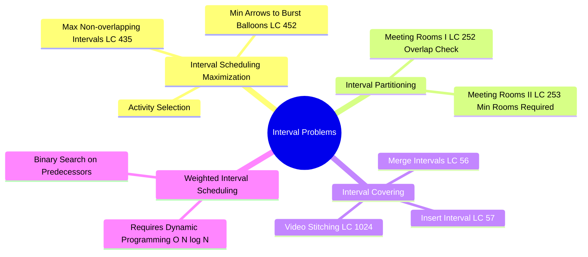
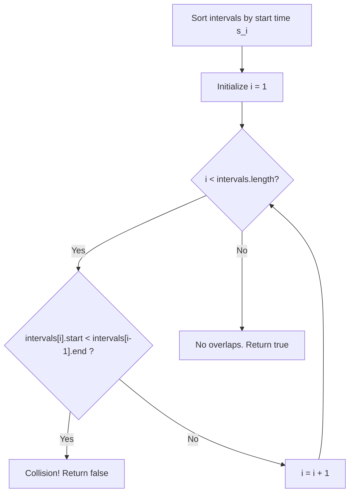
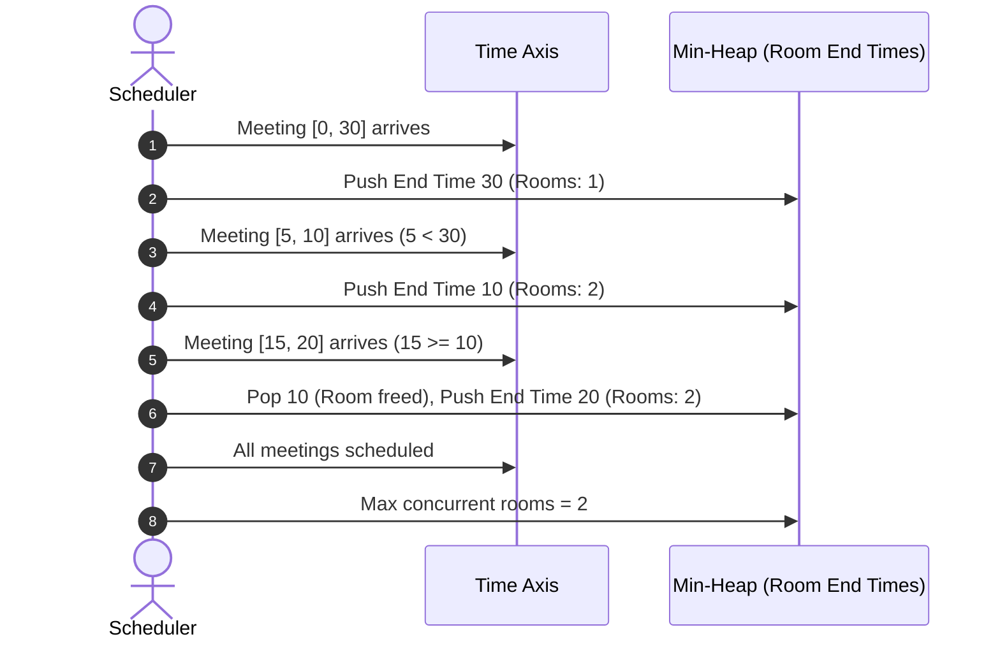

---


title: "01. 🎯 Activity Selection & Interval Scheduling Algorithms"
description: "Deep dive into interval scheduling maximization, exchange argument proofs, Meeting Rooms I & II, Non-overlapping intervals, and balloon bursting algorithms in C# and Python 3."
category: "Data Structures & Algorithms"
tags: [dsa, greedy, interval-scheduling, activity-selection, meeting-rooms, sweep-line, algorithms, computer-science, learning-note]
date: "2026-08-26"
aliases:
  - 01_activity_selection_interval_scheduling
---

# 📌 01. 🎯 Activity Selection & Interval Scheduling Algorithms

## 📌 Connected Resource Graph
- 🟢 **Primary Theory Note**: [[01_DSA/01_theory_and_patterns/08_Greedy/00_overview_greedy_algorithms|Greedy Algorithms Overview]]
- 🟡 **Topic Overview Node**: [[01_DSA/01_theory_and_patterns/08_Greedy/06_leetcode_practice_greedy_problems|LeetCode Practice: Greedy Problems]]
- 🟡 **Topic Overview Node**: [[01_DSA/01_theory_and_patterns/09_Dynamic_Programming/00_overview_dynamic_programming|Dynamic Programming Overview]]


---

## 1. Problem Formulations & Taxonomy

Interval scheduling problems form one of the most fundamental classes of combinatorial optimization problems in computer science. Given a collection of intervals $I = \{[s_1, f_1), [s_2, f_2), \dots, [s_n, f_n)\}$ representing tasks or events requesting access to a shared resource:



### The 4 Major Interval Variations

| Variant | Objective | Optimal Strategy | Complexity |
| :--- | :--- | :--- | :--- |
| **Activity Selection / ISMP** | Maximize cardinality of non-overlapping intervals | Greedy (Sort by Finish Time $f_i$) | $\mathcal{O}(N \log N)$ |
| **Interval Partitioning (Meeting Rooms II)** | Minimize resource count (rooms/processors) to schedule all | Greedy / Sweep-line (Sort by Start Time $s_i$ + Min-Heap) | $\mathcal{O}(N \log N)$ |
| **Interval Removal (LC 435)** | Minimize intervals to delete to remove overlaps | Greedy (Equivalent to $N - \text{ISMP}$) | $\mathcal{O}(N \log N)$ |
| **Weighted Interval Scheduling** | Maximize sum of weights of non-overlapping intervals | Dynamic Programming + Binary Search | $\mathcal{O}(N \log N)$ |

---

## 2. Activity Selection Problem: Intuition & Greedy Rule

Given $N$ activities with start times $s_i$ and finish times $f_i$ ($s_i < f_i$), two activities $i$ and $j$ are compatible if they do not overlap: $[s_i, f_i) \cap [s_j, f_j) = \emptyset \iff f_i \le s_j \lor f_j \le s_i$.

```mermaid
gantt
    title Interval Scheduling Timeline: Sorted by Finish Time
    dateFormat X
    axisFormat %s
    section Selected
    Activity 1 [1, 4) :active, a1, 1, 4
    Activity 4 [5, 7) :active, a4, 5, 7
    Activity 8 [8, 11) :active, a8, 8, 11
    Activity 11 [12, 16) :active, a11, 12, 16
    section Conflicting
    Activity 2 [3, 5) :crit, a2, 3, 5
    Activity 3 [0, 6) :crit, a3, 0, 6
    Activity 5 [3, 9) :crit, a5, 3, 9
    Activity 6 [5, 9) :crit, a6, 5, 9
    Activity 7 [6, 10) :crit, a7, 6, 10
    Activity 9 [8, 12) :crit, a9, 8, 12
    Activity 10 [2, 14) :crit, a10, 2, 14
```



### Why Do Other Intuitive Heuristics Fail?

Before proving why sorting by **Earliest Finish Time** works, consider why other "obvious" greedy heuristics fail:

#### 1. Sort by Earliest Start Time ($s_i$) — FAILS
- **Counterexample**: Interval $A = [0, 100)$, $B = [1, 2)$, $C = [2, 3)$.
- Sorting by start time picks $A$ first. Once $A$ is picked, neither $B$ nor $C$ can be scheduled. Output = $1$.
- Optimal choice: Pick $B$ and $C$. Output = $2$.

#### 2. Sort by Shortest Duration ($f_i - s_i$) — FAILS
- **Counterexample**: Interval $A = [0, 5)$, $B = [4, 6)$, $C = [5, 11)$.
- $B$ has duration $2$, while $A$ and $C$ have duration $5$ and $6$.
- Greedy picks $B$ (shortest duration), which blocks both $A$ and $C$. Output = $1$.
- Optimal choice: Pick $A$ and $C$. Output = $2$.

#### 3. Sort by Fewest Overlaps / Minimum Conflicts — FAILS
- **Counterexample**: A cluster of 11 intervals where an interval with 2 conflicts blocks 4 disjoint compatible intervals across 2 rows. Finding minimum conflicts dynamically is also computationally expensive ($\mathcal{O}(N^2)$).

---

## 3. Formal Mathematical Proof: Exchange Argument

We now formally prove that selecting intervals ordered by earliest finish time $f_i$ produces an optimal solution of maximum cardinality.

```
Theorem: The greedy algorithm that iteratively selects the compatible activity 
with the earliest finish time yields a maximum-size set of mutually compatible activities.
```

### Step 1: Notation & Setup
- Let $S = \{1, 2, \dots, n\}$ be the set of activities sorted such that $f_1 \le f_2 \le \dots \le f_n$.
- Let $G = \{g_1, g_2, \dots, g_k\}$ be the set of activities selected by the Greedy algorithm, ordered by finish time: $f(g_1) \le f(g_2) \le \dots \le f(g_k)$.
- Let $O = \{o_1, o_2, \dots, o_m\}$ be an arbitrary optimal solution of maximum size $m \ge k$, also ordered by finish time: $f(o_1) \le f(o_2) \le \dots \le f(o_m)$.

### Step 2: Invariant Claim ("Greedy Stays Ahead")
We prove by induction on $r$ that for all $r \in \{1, 2, \dots, k\}$:

$$f(g_r) \le f(o_r)$$

- **Base Case ($r = 1$)**: The greedy algorithm selects $g_1$ as the activity with the minimum finish time among all activities in $S$. Thus, $f(g_1) \le f(o_1)$ by definition.
- **Inductive Step**: Assume the claim holds for $r-1$, so $f(g_{r-1}) \le f(o_{r-1})$.
  - In the optimal solution $O$, activity $o_r$ is compatible with $o_{r-1}$, which means $s(o_r) \ge f(o_{r-1})$.
  - Applying the induction hypothesis: $s(o_r) \ge f(o_{r-1}) \ge f(g_{r-1})$.
  - This proves that $o_r$ is compatible with $g_{r-1}$, meaning $o_r$ was an available candidate when the greedy algorithm chose $g_r$.
  - Since greedy always picks the available candidate with the smallest finish time, it must be that $f(g_r) \le f(o_r)$.
  - The inductive step holds for all $r \le k$.

```mermaid
flowchart LR
    subgraph Optimal["Optimal Timeline O"]
        O1["o_1"] -->|f(o_1)| O2["o_2"] -->|f(o_2)| Or["o_r"]
    end
    subgraph Greedy["Greedy Timeline G"]
        G1["g_1"] -->|f(g_1) <= f(o_1)| G2["g_2"] -->|f(g_2) <= f(o_2)| Gr["g_r"]
    end
    Gr -.->|"Freed up capacity: f(g_r) <= f(o_r)"| Or
```

### Step 3: Contradiction on Cardinality
Assume for contradiction that greedy is not optimal, meaning $m > k$.
- Since $m > k$, there exists an activity $o_{k+1}$ in the optimal solution $O$.
- By our invariant for $r = k$, we know $f(g_k) \le f(o_k)$.
- Since $o_{k+1}$ follows $o_k$ in $O$, we have $s(o_{k+1}) \ge f(o_k) \ge f(g_k)$.
- This implies $o_{k+1}$ is compatible with $g_k$ and was available for greedy selection.
- However, the greedy algorithm terminated after selecting $g_k$, meaning no available compatible activities remained.
- This contradiction establishes that $m = k$. Hence, the greedy solution $G$ is optimal. $\blacksquare$

---

## 4. Deep Dive: Classical Interval Problems

### 4.1 Problem 1: Meeting Rooms I (LeetCode 252)
Given an array of meeting time intervals `intervals` where `intervals[i] = [start_i, end_i]`, determine if a person could attend all meetings (i.e. no two intervals overlap).

#### Algorithm
1. Sort intervals by start time $s_i$.
2. Traverse from $i = 1$ to $N-1$. If $s_i < f_{i-1}$, an overlap exists $\implies$ return `false`.
3. If no overlap detected throughout, return `true`.



---

### 4.2 Problem 2: Meeting Rooms II (LeetCode 253 / Interval Partitioning)
Given an array of meeting time intervals `intervals`, find the **minimum number of conference rooms** required.

#### Approaches
1. **Min-Heap Approach ($\mathcal{O}(N \log N)$)**:
   - Sort intervals by start time $s_i$.
   - Maintain a min-heap storing the end times of active meetings in each room.
   - For each interval, if its start time $\ge$ top of heap (earliest available room), reuse that room (`heap.pop()`).
   - Push the current interval's end time onto the heap.
   - Size of heap at any time represents active rooms; maximum heap size is the answer.

2. **Chronological Sweep-Line / Two-Pointer Approach ($\mathcal{O}(N \log N)$ time, $\mathcal{O}(N)$ space)**:
   - Separate start times and end times into two arrays and sort both independently.
   - Iterate through start times: if $s[\text{startPtr}] < f[\text{endPtr}]$, a new room is required (`usedRooms++`).
   - Otherwise, a meeting ended (`usedRooms--`, `endPtr++`).
   - Track `maxRooms`.



---

### 4.3 Problem 3: Non-Overlapping Intervals (LeetCode 435)
Given an array of intervals `intervals`, return the minimum number of intervals you need to remove to make the rest of the intervals non-overlapping.

#### Mathematical Equivalence
$$\text{Min Removed} = N - \text{Max Compatible Intervals (ISMP)}$$

Sort by finish time $f_i$. Count how many non-overlapping intervals can be kept greedily. Subtract this count from total intervals $N$.

---

### 4.4 Problem 4: Minimum Number of Arrows to Burst Balloons (LeetCode 452)
Balloons are represented as 2D intervals $[x_{\text{start}}, x_{\text{end}}]$. An arrow shot vertically at $x$ bursts all balloons with $x_{\text{start}} \le x \le x_{\text{end}}$.

#### Greedy Strategy
Sort balloons by finish coordinate $x_{\text{end}}$. Shoot an arrow at the end coordinate of the first balloon. This greedily bursts the first balloon and every subsequent overlapping balloon. When a balloon has start coordinate $>$ current arrow position, shoot a new arrow at that balloon's end coordinate.

---

## 5. Production Implementations (C# & Python 3)

### 5.1 Meeting Rooms I & II in C# (.NET 8 Zero-Allocation Structs & Heap)

```csharp
using System;
using System.Collections.Generic;

public static class MeetingRooms
{
    public readonly record struct Interval(int Start, int End);

    /// <summary>
    /// LC 252: Can Attend Meetings - O(N log N) time, O(1) auxiliary space.
    /// </summary>
    public static bool CanAttendMeetings(Interval[] intervals)
    {
        if (intervals == null || intervals.Length <= 1) return true;

        Array.Sort(intervals, (a, b) => a.Start.CompareTo(b.Start));

        for (int i = 1; i < intervals.Length; i++)
        {
            if (intervals[i].Start < intervals[i - 1].End)
                return false;
        }

        return true;
    }

    /// <summary>
    /// LC 253: Meeting Rooms II (Min Rooms Required) - O(N log N) time, O(N) space.
    /// Uses PriorityQueue (Min-Heap).
    /// </summary>
    public static int MinMeetingRooms(Interval[] intervals)
    {
        if (intervals == null || intervals.Length == 0) return 0;

        // Sort by start time ascending
        Array.Sort(intervals, (a, b) => a.Start.CompareTo(b.Start));

        // Min-heap storing finish times of active rooms
        var minHeap = new PriorityQueue<int, int>();

        foreach (var interval in intervals)
        {
            if (minHeap.Count > 0 && minHeap.Peek() <= interval.Start)
            {
                // Room became free, reuse it
                minHeap.Dequeue();
            }

            minHeap.Enqueue(interval.End, interval.End);
        }

        return minHeap.Count;
    }

    /// <summary>
    /// LC 253: Meeting Rooms II Two-Pointer Sweep-line - O(N log N) time, O(N) space.
    /// </summary>
    public static int MinMeetingRoomsSweepLine(Interval[] intervals)
    {
        if (intervals == null || intervals.Length == 0) return 0;

        int n = intervals.Length;
        int[] starts = new int[n];
        int[] ends = new int[n];

        for (int i = 0; i < n; i++)
        {
            starts[i] = intervals[i].Start;
            ends[i] = intervals[i].End;
        }

        Array.Sort(starts);
        Array.Sort(ends);

        int rooms = 0;
        int endPtr = 0;

        for (int startPtr = 0; startPtr < n; startPtr++)
        {
            if (starts[startPtr] < ends[endPtr])
            {
                rooms++;
            }
            else
            {
                endPtr++;
            }
        }

        return rooms;
    }
}
```

### 5.2 Non-Overlapping Intervals & Burst Balloons in C#

```csharp
using System;

public static class IntervalOptimization
{
    /// <summary>
    /// LC 435: Non-overlapping Intervals - O(N log N) time, O(1) space.
    /// </summary>
    public static int EraseOverlapIntervals(int[][] intervals)
    {
        if (intervals == null || intervals.Length <= 1) return 0;

        // Sort by finish time ascending
        Array.Sort(intervals, (a, b) => a[1].CompareTo(b[1]));

        int nonOverlapCount = 1;
        int lastEnd = intervals[0][1];

        for (int i = 1; i < intervals.Length; i++)
        {
            if (intervals[i][0] >= lastEnd)
            {
                nonOverlapCount++;
                lastEnd = intervals[i][1];
            }
        }

        return intervals.Length - nonOverlapCount;
    }

    /// <summary>
    /// LC 452: Minimum Number of Arrows to Burst Balloons - O(N log N) time, O(1) space.
    /// Handles 32-bit integer overflow properly.
    /// </summary>
    public static int FindMinArrowShots(int[][] points)
    {
        if (points == null || points.Length == 0) return 0;

        // Sort by end coordinate ascending without integer subtraction overflow
        Array.Sort(points, (a, b) => a[1].CompareTo(b[1]));

        int arrows = 1;
        int currentArrowPos = points[0][1];

        for (int i = 1; i < points.Length; i++)
        {
            if (points[i][0] > currentArrowPos)
            {
                arrows++;
                currentArrowPos = points[i][1];
            }
        }

        return arrows;
    }
}
```

---

### 5.3 Complete Python 3 Implementations

```python
import heapq
from typing import List

class IntervalSolutions:
    @staticmethod
    def can_attend_meetings(intervals: List[List[int]]) -> bool:
        """LC 252: Meeting Rooms I - O(N log N)"""
        intervals.sort(key=lambda x: x[0])
        for i in range(1, len(intervals)):
            if intervals[i][0] < intervals[i - 1][1]:
                return False
        return True

    @staticmethod
    def min_meeting_rooms(intervals: List[List[int]]) -> int:
        """LC 253: Meeting Rooms II (Min-Heap) - O(N log N)"""
        if not intervals:
            return 0

        # Sort by start time
        intervals.sort(key=lambda x: x[0])
        
        # Min-heap of end times
        rooms_heap = []
        heapq.heappush(rooms_heap, intervals[0][1])

        for start, end in intervals[1:]:
            if rooms_heap[0] <= start:
                heapq.heappop(rooms_heap)
            heapq.heappush(rooms_heap, end)

        return len(rooms_heap)

    @staticmethod
    def erase_overlap_intervals(intervals: List[List[int]]) -> int:
        """LC 435: Non-overlapping Intervals - O(N log N)"""
        if not intervals:
            return 0
            
        # Sort by finish time ascending
        intervals.sort(key=lambda x: x[1])
        
        kept = 1
        last_end = intervals[0][1]
        
        for start, end in intervals[1:]:
            if start >= last_end:
                kept += 1
                last_end = end
                
        return len(intervals) - kept

    @staticmethod
    def find_min_arrow_shots(points: List[List[int]]) -> int:
        """LC 452: Minimum Arrows to Burst Balloons - O(N log N)"""
        if not points:
            return 0
            
        points.sort(key=lambda x: x[1])
        
        arrows = 1
        arrow_pos = points[0][1]
        
        for start, end in points[1:]:
            if start > arrow_pos:
                arrows += 1
                arrow_pos = end
                
        return arrows


if __name__ == "__main__":
    solver = IntervalSolutions()
    print("Can attend meetings:", solver.can_attend_meetings([[0, 30], [5, 10], [15, 20]])) # False
    print("Min meeting rooms:", solver.min_meeting_rooms([[0, 30], [5, 10], [15, 20]]))   # 2
    print("Min removals:", solver.erase_overlap_intervals([[1, 2], [2, 3], [3, 4], [1, 3]])) # 1
    print("Min arrows:", solver.find_min_arrow_shots([[10, 16], [2, 8], [1, 6], [7, 12]]))   # 2
```

---

## 6. Comprehensive Complexity Matrix

| Problem | Primary Sorting Key | Auxiliary Data Structure | Time Complexity | Space Complexity |
| :--- | :--- | :--- | :--- | :--- |
| **Activity Selection** | Finish time $f_i \uparrow$ | None | $\mathcal{O}(N \log N)$ | $\mathcal{O}(1)$ |
| **Meeting Rooms I (LC 252)** | Start time $s_i \uparrow$ | None | $\mathcal{O}(N \log N)$ | $\mathcal{O}(1)$ |
| **Meeting Rooms II (LC 253)** | Start time $s_i \uparrow$ | Min-Heap / Two arrays | $\mathcal{O}(N \log N)$ | $\mathcal{O}(N)$ |
| **Non-overlapping Intervals (LC 435)** | Finish time $f_i \uparrow$ | None | $\mathcal{O}(N \log N)$ | $\mathcal{O}(1)$ |
| **Burst Balloons (LC 452)** | End coordinate $x_e \uparrow$ | None | $\mathcal{O}(N \log N)$ | $\mathcal{O}(1)$ |
| **Merge Intervals (LC 56)** | Start time $s_i \uparrow$ | Result buffer | $\mathcal{O}(N \log N)$ | $\mathcal{O}(N)$ |

---

## 7. Edge Cases & Defensive Engineering Checklist

> [!CAUTION]
> **Edge Cases in Interval Algorithms**:
> 1. **Integer Overflow in Sorting Comparators**: Writing `(a, b) => a[1] - b[1]` causes 32-bit integer underflow when coordinates span `[-2147483648, 2147483647]`. Always use `a[1].CompareTo(b[1])` or `(a[1] < b[1] ? -1 : 1)`.
> 2. **Touching Boundaries ($s_j = f_i$)**: Distinguish whether intervals touching at points are considered overlapping:
>    - In LeetCode 435, `[1, 2]` and `[2, 3]` are non-overlapping ($s_j \ge f_i$).
>    - In LeetCode 452, balloons touching at `[1, 2]` and `[2, 3]` are pierced by a single arrow at $x = 2$ ($s_j \le x \le f_i$).
> 3. **Duplicate / Zero-Length Intervals**: Ensure intervals with identical start and end points (`[4, 4]`) are properly handled.
