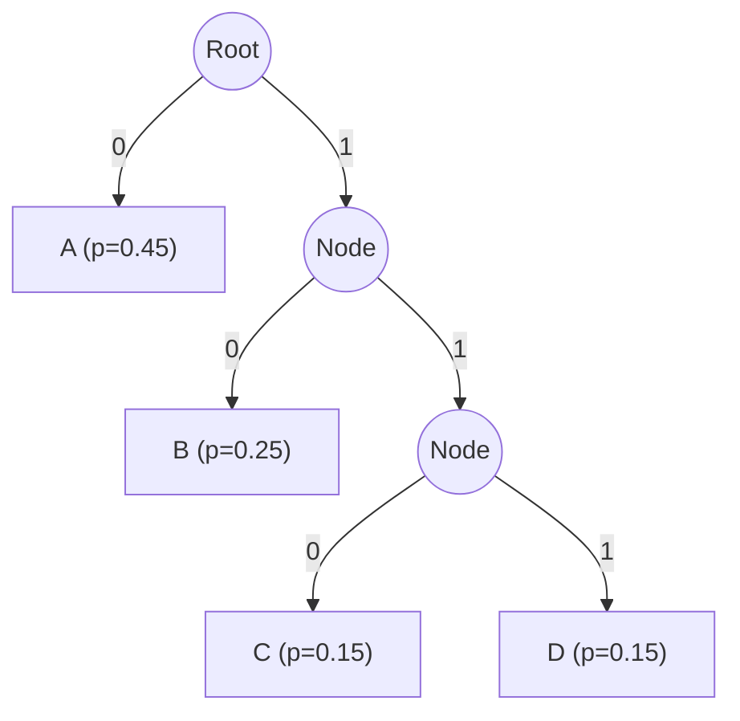
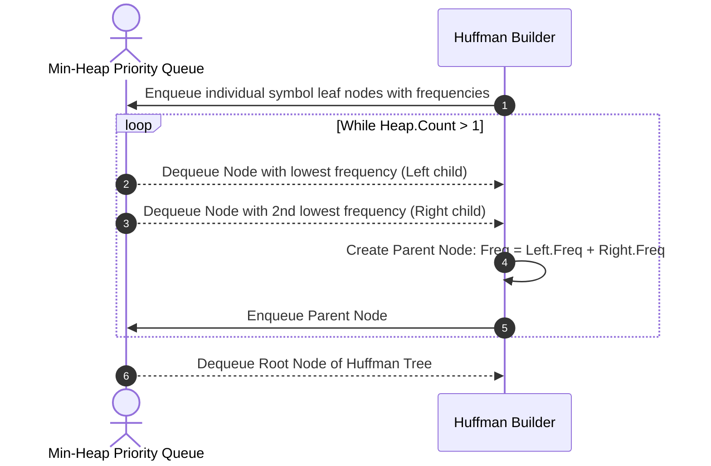
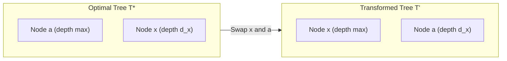

---


title: "02. 🗜️ Huffman Coding & Lossless Data Compression"
description: "Information theory foundations, Shannon entropy, Kraft-McMillan inequality, Huffman tree construction proof, and complete production BitStream Encoder/Decoder in C# and Python 3."
category: "Data Structures & Algorithms"
tags: [dsa, greedy, huffman-coding, compression, information-theory, priority-queue, binary-tree, bit-manipulation, algorithms, computer-science, learning-note]
date: "2026-08-26"
aliases:
  - 02_huffman_coding_lossless_compression
---

# 📌 02. 🗜️ Huffman Coding & Lossless Data Compression

## 📌 Connected Resource Graph
- 🟢 **Primary Theory Note**: [[01_DSA/01_theory_and_patterns/08_Greedy/00_overview_greedy_algorithms|Greedy Algorithms Overview]]
- 🟡 **Topic Overview Node**: [[01_DSA/01_theory_and_patterns/05_Trees_and_Hierarchical_Structures/00_overview_trees|Tree Data Structures]]
- 🟡 **Topic Overview Node**: [[01_DSA/01_theory_and_patterns/06_Heaps_and_Priority_Queues/00_overview_heaps|Heaps & Priority Queues]]


---

## 1. Information Theory Foundations

**Huffman Coding** (developed by David A. Huffman in 1952) is an optimal greedy algorithm for constructing **variable-length prefix-free codes** for lossless data compression. It forms the core entropy-coding engine in widely used formats including DEFLATE (ZIP, GZIP, PNG), JPEG, and MP3.


### 1.1 Claude Shannon's Source Coding Theorem & Entropy
Let $X$ be a discrete random variable over an alphabet $\Sigma = \{s_1, s_2, \dots, s_n\}$ with probability distribution $P(X = s_i) = p_i$.

The **Shannon Entropy** $H(X)$ represents the fundamental physical limit of lossless data compression (the expected amount of information per symbol, measured in bits):

$$H(X) = - \sum_{i=1}^n p_i \log_2 p_i$$

For any uniquely decodable binary code where symbol $s_i$ is assigned a codeword of length $l_i$, the **Expected (Average) Codeword Length** $L(C)$ is:

$$L(C) = \sum_{i=1}^n p_i \cdot l_i$$

> [!IMPORTANT]
> **Shannon's Noiseless Source Coding Theorem**:
> $$L(C) \ge H(X)$$
> Furthermore, an optimal prefix-free code constructed by Huffman's algorithm satisfies:
> $$H(X) \le L_{\text{Huffman}} < H(X) + 1$$

---

### 1.2 Prefix-Free Property & The Kraft-McMillan Inequality

A code is **prefix-free** (or prefix code) if no codeword is a proper prefix of any other valid codeword in the codebook.
- Example: $\{A: 0, B: 10, C: 110, D: 111\}$ is prefix-free.
- If we receive the bit sequence `0101100`, it unambiguously decodes to `A-B-C-A` without any delimiters or lookahead.



> [!NOTE]
> **Kraft-McMillan Inequality**:
> A uniquely decodable binary code with codeword lengths $l_1, l_2, \dots, l_n$ exists if and only if:
> $$\sum_{i=1}^n 2^{-l_i} \le 1$$
> Huffman coding achieves the minimum expected codeword length $\sum p_i l_i$ among all codes satisfying this inequality.

---

## 2. The Huffman Algorithm Mechanics

The algorithm builds an optimal full binary trie bottom-up using a Min-Priority Queue.



### Algorithm Steps
1. Count the occurrence frequency $f(c)$ of every unique character in the input stream.
2. For each unique character, instantiate a leaf node with frequency $f(c)$ and push it into a Min-Heap.
3. While the Min-Heap contains more than 1 node:
   - Extract the two nodes $u$ and $v$ with the smallest frequencies.
   - Create an internal node $z$ with left child $u$, right child $v$, and frequency $f(z) = f(u) + f(v)$.
   - Insert $z$ back into the Min-Heap.
4. The single remaining node in the heap is the root of the optimal Huffman Tree.
5. Traverse the tree to assign binary prefixes ($0$ for left branch, $1$ for right branch).

---

## 3. Mathematical Proof of Correctness (Exchange Argument)

We prove that the Huffman greedy tree construction produces an optimal prefix-free tree $T$ minimizing the Weighted External Path Length:

$$B(T) = \sum_{c \in C} f(c) \cdot d_T(c)$$

where $d_T(c)$ is the depth of leaf $c$ in tree $T$.

### Lemma 1: Sibling Property of Lowest Frequencies
Let $x$ and $y$ be two symbols with the lowest frequencies in alphabet $C$. There exists an optimal prefix code tree $T$ in which $x$ and $y$ are sibling leaves at maximum depth.

#### Proof:
- Let $T^*$ be an optimal binary tree. Let $a$ and $b$ be two sibling leaves of maximum depth in $T^*$, with $f(a) \le f(b)$.
- Without loss of generality, assume $f(x) \le f(y)$ and $f(x) \le f(a)$, $f(y) \le f(b)$ (since $x$ and $y$ have the lowest frequencies in the alphabet).
- Construct tree $T'$ by swapping the positions of $x$ and $a$ in $T^*$.
- Construct tree $T''$ by swapping the positions of $y$ and $b$ in $T'$.



The difference in cost between $T^*$ and $T'$ is:

$$\begin{aligned}
B(T^*) - B(T') &= f(x) d_{T^*}(x) + f(a) d_{T^*}(a) - (f(x) d_{T'}(x) + f(a) d_{T'}(a)) \\
&= f(x) d_{T^*}(x) + f(a) d_{T^*}(a) - (f(x) d_{T^*}(a) + f(a) d_{T^*}(x)) \\
&= (f(a) - f(x))(d_{T^*}(a) - d_{T^*}(x))
\end{aligned}$$

Since $a$ is at maximum depth, $d_{T^*}(a) \ge d_{T^*}(x)$. Since $x$ has the lowest frequency, $f(a) \ge f(x)$.  
Both factors are non-negative, which means:

$$B(T^*) - B(T') \ge 0 \implies B(T') \le B(T^*)$$

Since $T^*$ was optimal, $B(T') = B(T^*)$, meaning $T'$ is also optimal.  
Repeating the identical swap between $y$ and $b$ produces $T''$ where $x$ and $y$ are sibling leaves at maximum depth with $B(T'') \le B(T')$, proving optimality.

---

## 4. End-to-End Production Implementation in C# (.NET 8)

This implementation includes custom `BitWriter` and `BitReader` classes to perform actual bit-level packing and byte serialization.

```csharp
using System;
using System.Collections.Generic;
using System.IO;
using System.Text;

public class HuffmanNode : IComparable<HuffmanNode>
{
    public char Symbol { get; set; }
    public int Frequency { get; set; }
    public HuffmanNode? Left { get; set; }
    public HuffmanNode? Right { get; set; }
    public bool IsLeaf => Left == null && Right == null;

    public int CompareTo(HuffmanNode? other)
    {
        if (other == null) return 1;
        return Frequency.CompareTo(other.Frequency);
    }
}

public class BitWriter
{
    private readonly MemoryStream _stream = new();
    private byte _currentByte;
    private int _bitCount;

    public void WriteBit(int bit)
    {
        _currentByte = (byte)((_currentByte << 1) | (bit & 1));
        _bitCount++;

        if (_bitCount == 8)
        {
            _stream.WriteByte(_currentByte);
            _currentByte = 0;
            _bitCount = 0;
        }
    }

    public void WriteBits(string bitString)
    {
        foreach (char c in bitString)
        {
            WriteBit(c == '1' ? 1 : 0);
        }
    }

    public byte[] ToArray(out int validBitsInLastByte)
    {
        validBitsInLastByte = _bitCount == 0 ? 8 : _bitCount;
        if (_bitCount > 0)
        {
            _currentByte <<= (8 - _bitCount); // Align left
            _stream.WriteByte(_currentByte);
        }
        return _stream.ToArray();
    }
}

public class BitReader
{
    private readonly byte[] _data;
    private int _byteIndex;
    private int _bitIndex;
    private readonly int _totalBits;

    public BitReader(byte[] data, int validBitsInLastByte)
    {
        _data = data;
        _totalBits = data.Length == 0 ? 0 : (data.Length - 1) * 8 + validBitsInLastByte;
    }

    public bool HasMoreBits => (_byteIndex * 8 + _bitIndex) < _totalBits;

    public int ReadBit()
    {
        if (!HasMoreBits) throw new InvalidOperationException("End of bitstream.");

        int bit = (_data[_byteIndex] >> (7 - _bitIndex)) & 1;
        _bitIndex++;
        if (_bitIndex == 8)
        {
            _bitIndex = 0;
            _byteIndex++;
        }
        return bit;
    }
}

public class HuffmanCompressor
{
    public static (byte[] CompressedBytes, HuffmanNode Root, int ValidBitsInLastByte) Compress(string text)
    {
        if (string.IsNullOrEmpty(text))
            throw new ArgumentException("Input text cannot be empty.");

        // 1. Frequency Map
        var freqs = new Dictionary<char, int>();
        foreach (char c in text)
        {
            freqs[c] = freqs.GetValueOrDefault(c, 0) + 1;
        }

        // 2. Priority Queue (Min-Heap)
        var pq = new PriorityQueue<HuffmanNode, int>();
        foreach (var (ch, freq) in freqs)
        {
            var node = new HuffmanNode { Symbol = ch, Frequency = freq };
            pq.Enqueue(node, freq);
        }

        // Handle single-character edge case
        if (pq.Count == 1)
        {
            var single = pq.Dequeue();
            var dummyRoot = new HuffmanNode
            {
                Symbol = '\0',
                Frequency = single.Frequency,
                Left = single
            };
            pq.Enqueue(dummyRoot, dummyRoot.Frequency);
        }

        // 3. Build Tree
        while (pq.Count > 1)
        {
            var left = pq.Dequeue();
            var right = pq.Dequeue();
            var parent = new HuffmanNode
            {
                Symbol = '\0',
                Frequency = left.Frequency + right.Frequency,
                Left = left,
                Right = right
            };
            pq.Enqueue(parent, parent.Frequency);
        }

        var root = pq.Dequeue();

        // 4. Generate Codewords
        var codeTable = new Dictionary<char, string>();
        GenerateCodes(root, "", codeTable);

        // 5. Pack into BitStream
        var writer = new BitWriter();
        foreach (char c in text)
        {
            writer.WriteBits(codeTable[c]);
        }

        byte[] compressed = writer.ToArray(out int validBitsInLastByte);
        return (compressed, root, validBitsInLastByte);
    }

    public static string Decompress(byte[] compressed, HuffmanNode root, int validBitsInLastByte)
    {
        if (compressed.Length == 0 || root == null) return string.Empty;

        var reader = new BitReader(compressed, validBitsInLastByte);
        var sb = new StringBuilder();
        var current = root;

        while (reader.HasMoreBits)
        {
            int bit = reader.ReadBit();
            current = (bit == 0) ? current.Left : current.Right;

            if (current != null && current.IsLeaf)
            {
                sb.Append(current.Symbol);
                current = root;
            }
        }

        return sb.ToString();
    }

    private static void GenerateCodes(HuffmanNode? node, string code, Dictionary<char, string> table)
    {
        if (node == null) return;
        if (node.IsLeaf)
        {
            table[node.Symbol] = code.Length > 0 ? code : "0";
            return;
        }
        GenerateCodes(node.Left, code + "0", table);
        GenerateCodes(node.Right, code + "1", table);
    }
}
```

---

## 5. Production Implementation in Python 3

```python
import heapq
from collections import Counter
from typing import Dict, Optional, Tuple

class HuffmanNode:
    def __init__(self, char: Optional[str], freq: int):
        self.char = char
        self.freq = freq
        self.left: Optional['HuffmanNode'] = None
        self.right: Optional['HuffmanNode'] = None

    def __lt__(self, other: 'HuffmanNode') -> bool:
        return self.freq < other.freq

    @property
    def is_leaf(self) -> bool:
        return self.left is None and self.right is None


class HuffmanCoding:
    @classmethod
    def build_tree(cls, text: str) -> Optional[HuffmanNode]:
        if not text:
            return None

        freqs = Counter(text)
        heap = [HuffmanNode(char, freq) for char, freq in freqs.items()]
        heapq.heapify(heap)

        if len(heap) == 1:
            single = heapq.heappop(heap)
            root = HuffmanNode(None, single.freq)
            root.left = single
            return root

        while len(heap) > 1:
            left = heapq.heappop(heap)
            right = heapq.heappop(heap)

            parent = HuffmanNode(None, left.freq + right.freq)
            parent.left = left
            parent.right = right
            heapq.heappush(heap, parent)

        return heap[0]

    @classmethod
    def _build_codes(cls, node: Optional[HuffmanNode], current_code: str, code_map: Dict[str, str]):
        if not node:
            return
        if node.is_leaf and node.char is not None:
            code_map[node.char] = current_code if current_code else "0"
            return

        cls._build_codes(node.left, current_code + "0", code_map)
        cls._build_codes(node.right, current_code + "1", code_map)

    @classmethod
    def compress(cls, text: str) -> Tuple[bytes, HuffmanNode, int]:
        if not text:
            return b"", None, 0

        root = cls.build_tree(text)
        code_map: Dict[str, str] = {}
        cls._build_codes(root, "", code_map)

        encoded_bits = "".join(code_map[ch] for ch in text)
        valid_bits_last = len(encoded_bits) % 8
        if valid_bits_last == 0:
            valid_bits_last = 8

        # Pad to full byte
        padding = (8 - len(encoded_bits) % 8) % 8
        encoded_bits += "0" * padding

        byte_arr = bytearray()
        for i in range(0, len(encoded_bits), 8):
            byte_val = int(encoded_bits[i:i+8], 2)
            byte_arr.append(byte_val)

        return bytes(byte_arr), root, valid_bits_last

    @classmethod
    def decompress(cls, compressed: bytes, root: HuffmanNode, valid_bits_last: int) -> str:
        if not compressed or not root:
            return ""

        total_bits = (len(compressed) - 1) * 8 + valid_bits_last if len(compressed) > 0 else 0
        bit_str = "".join(f"{byte:08b}" for byte in compressed)[:total_bits]

        decoded_chars = []
        curr = root
        for bit in bit_str:
            curr = curr.left if bit == "0" else curr.right
            if curr.is_leaf and curr.char is not None:
                decoded_chars.append(curr.char)
                curr = root

        return "".join(decoded_chars)


if __name__ == "__main__":
    sample = "ABRACADABRA_ABRACADABRA_FULL_COMPRESSION_TEST"
    compressed_data, tree_root, valid_bits = HuffmanCoding.compress(sample)
    decompressed = HuffmanCoding.decompress(compressed_data, tree_root, valid_bits)

    print(f"Original Length   : {len(sample.encode('utf-8'))} bytes")
    print(f"Compressed Length : {len(compressed_data)} bytes")
    print(f"Match Verified    : {sample == decompressed}")
```

---

## 6. Complexity Analysis & Comparative Benchmarks

| Operation | Time Complexity | Space Complexity | Details |
| :--- | :---: | :---: | :--- |
| **Frequency Counting** | $\mathcal{O}(N)$ | $\mathcal{O}(|\Sigma|)$ | Single linear scan of input string |
| **Tree Construction** | $\mathcal{O}(|\Sigma| \log |\Sigma|)$ | $\mathcal{O}(|\Sigma|)$ | $|\Sigma|$ priority queue operations |
| **Codebook Generation** | $\mathcal{O}(|\Sigma|)$ | $\mathcal{O}(|\Sigma|)$ | DFS traversal over full binary tree ($2|\Sigma|-1$ nodes) |
| **Bit Encoding** | $\mathcal{O}(N)$ | $\mathcal{O}(N)$ bits | Linear lookup and bit packaging |
| **Bit Decoding** | $\mathcal{O}(N)$ | $\mathcal{O}(N)$ chars | Tree traversal per bit |

---

## 7. Canonical Huffman Codes (Industry Standard: DEFLATE/GZIP)

In production standards (such as **DEFLATE**, RFC 1951), transmitting the entire tree topology in the compressed header creates unnecessary overhead. Instead, **Canonical Huffman Codes** standardize codeword assignments using only the **bit-lengths** of each symbol:
1. Codewords of the same length are assigned in increasing numerical order of their character lexicographical sort.
2. The first codeword of length $L$ is calculated from the last codeword of length $L-1$: $c_L = 2 \cdot (c_{L-1} + 1)$.

This allows transmitting only an array of code lengths (e.g. $[A: 1, B: 2, C: 3, D: 3]$), drastically reducing header size.
