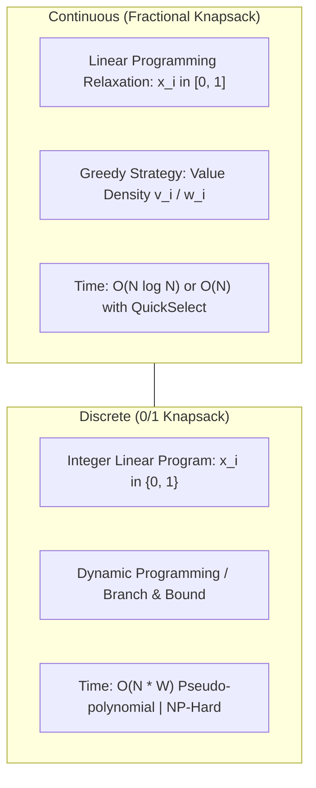
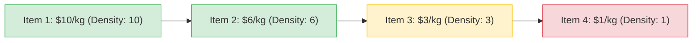
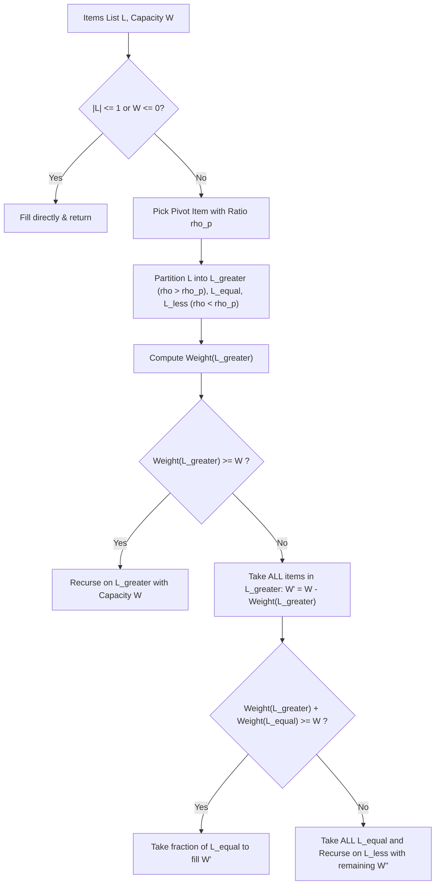

---


title: "Fractional Knapsack vs 0/1 Knapsack: LP Relaxation, QuickSelect O(N) & Dynamic Programming"
description: "Mathematical formulation of continuous LP relaxation vs discrete 0/1 knapsack, exchange argument proofs, O(N) QuickSelect optimization, and DP space reduction in C# and Python 3."
category: "Data Structures & Algorithms"
tags: [dsa, greedy, knapsack, linear-programming, quickselect, dynamic-programming, optimization, algorithms, computer-science, learning-note]
date: "2026-08-26"
---

# 🎒 Fractional Knapsack vs 0/1 Knapsack: LP Relaxation, QuickSelect $\mathcal{O}(N)$ & Dynamic Programming

## 📌 Connected Resource Graph
- 🟢 **Primary Theory Note**: [[01_DSA/01_theory_and_patterns/08_Greedy/00_overview_greedy_algorithms|Greedy Algorithms Overview]]
- 🟡 **Topic Overview Node**: [[01_DSA/01_theory_and_patterns/09_Dynamic_Programming/00_overview_dynamic_programming|Dynamic Programming Overview]]
- 🟡 **Topic Overview Node**: [[01_DSA/01_theory_and_patterns/09_Dynamic_Programming/02_knapsack_patterns_01_unbounded_bounded|Knapsack DP Patterns]]


---

## 1. Problem Formulations: Continuous vs. Discrete Optimization

The Knapsack problem is a cornerstone problem in combinatorial optimization. We are given $n$ items, where item $i$ has weight $w_i > 0$ and value $v_i > 0$, and a knapsack with maximum total weight capacity $W$.



### 1.1 Mathematical Formulation

#### Fractional Knapsack (Linear Program Relaxation)
$$\begin{aligned}
\text{Maximize} \quad & \sum_{i=1}^n v_i x_i \\
\text{Subject to} \quad & \sum_{i=1}^n w_i x_i \le W, \quad x_i \in [0, 1] \quad \forall i \in \{1, \dots, n\}
\end{aligned}$$

#### 0/1 Knapsack (Integer Linear Program - ILP)
$$\begin{aligned}
\text{Maximize} \quad & \sum_{i=1}^n v_i x_i \\
\text{Subject to} \quad & \sum_{i=1}^n w_i x_i \le W, \quad x_i \in \{0, 1\} \quad \forall i \in \{1, \dots, n\}
\end{aligned}$$

---

## 2. Why Greedy Works for Fractional but Fails for 0/1

### 2.1 The Value Density Metric
Define the **value density** (value-to-weight ratio) of item $i$ as:

$$\rho_i = \frac{v_i}{w_i}$$

Sort items in decreasing order of value density: $\rho_1 \ge \rho_2 \ge \dots \ge \rho_n$.



### 2.2 Proof of Optimality for Fractional Knapsack (Exchange Argument)
Let $G = (g_1, g_2, \dots, g_n)$ be the greedy solution and $O = (o_1, o_2, \dots, o_n)$ be an arbitrary optimal solution (\$0 \le g_i, o_i \le 1$).

1. Let $k$ be the first index where $g_k \ne o_k$.
2. By the greedy strategy, $g_k > o_k$ because greedy takes as much of item $k$ (the highest remaining density) as capacity permits.
3. Since $\sum w_i g_i = W$ (assuming total weight $\ge W$) and $\sum w_i o_i \le W$, there must exist some index $j > k$ where $o_j > 0$ and $\rho_j \le \rho_k$.
4. Replace an amount $\delta = \min(w_k(g_k - o_k), w_j o_j)$ of item $j$ in $O$ with an equal weight of item $k$, producing new feasible solution $O'$.
5. The change in total value is:
   $$\Delta V = \delta \cdot \rho_k - \delta \cdot \rho_j = \delta(\rho_k - \rho_j) \ge 0$$
6. Since $\rho_k \ge \rho_j$, the value cannot decrease ($V(O') \ge V(O)$). By repeated transformation, $O$ transforms into $G$ without losing value. Thus, $G$ is optimal. $\blacksquare$

---

### 2.3 Why Greedy Fails for 0/1 Knapsack: The Discrete Packing Trap

In 0/1 knapsack, items cannot be subdivided. A high-density item may consume just enough capacity to block a combination of slightly lower-density items that collectively yield a far higher total value.

```mermaid
gantt
    title Capacity Utilization (Knapsack Capacity W = 50)
    dateFormat X
    axisFormat %s
    section Greedy Pick
    Item A (wt=30, val=60, density=2.0) :active, g1, 0, 30
    Empty Slack (wt=20, val=0) :crit, g2, 30, 50
    section Optimal DP Pick
    Item B (wt=25, val=45, density=1.8) :done, o1, 0, 25
    Item C (wt=25, val=45, density=1.8) :done, o2, 25, 50
```



- **Greedy Total Value**: $\$60$ (Wastes 20kg of capacity).
- **DP Optimal Total Value**: $\$45 + \$45 = \$90$ (100% capacity utilization).

---

## 3. $\mathcal{O}(N)$ Linear-Time Fractional Knapsack via QuickSelect

While sorting requires $\mathcal{O}(N \log N)$ time, we can solve Fractional Knapsack in **$\mathcal{O}(N)$ expected time** using a **QuickSelect Partitioning** technique (similar to Hoare's selection / Median of Medians).



### Recurrence Relation for Time Complexity
$$T(N) = T(N/2) + \mathcal{O}(N) \implies T(N) = \mathcal{O}(N)$$

---

## 4. Comprehensive Implementations (C# & Python 3)

### 4.1 Fractional Knapsack $\mathcal{O}(N \log N)$ & $\mathcal{O}(N)$ QuickSelect in C#

```csharp
using System;
using System.Collections.Generic;

public static class KnapsackSolvers
{
    public readonly record struct Item(double Weight, double Value)
    {
        public double Ratio => Value / Weight;
    }

    /// <summary>
    /// Standard O(N log N) Greedy Fractional Knapsack.
    /// </summary>
    public static double FractionalKnapsackSort(Item[] items, double capacity)
    {
        if (items == null || items.Length == 0 || capacity <= 0) return 0.0;

        // Sort descending by value density ratio
        Array.Sort(items, (a, b) => b.Ratio.CompareTo(a.Ratio));

        double totalValue = 0.0;
        double remainingCapacity = capacity;

        foreach (var item in items)
        {
            if (remainingCapacity <= 0) break;

            if (item.Weight <= remainingCapacity)
            {
                totalValue += item.Value;
                remainingCapacity -= item.Weight;
            }
            else
            {
                // Take fraction
                totalValue += item.Value * (remainingCapacity / item.Weight);
                remainingCapacity = 0;
            }
        }

        return totalValue;
    }

    /// <summary>
    /// Linear O(N) Expected Time Fractional Knapsack using QuickSelect Partitioning.
    /// </summary>
    public static double FractionalKnapsackQuickSelect(Item[] items, double capacity)
    {
        if (items == null || items.Length == 0 || capacity <= 0) return 0.0;
        return QuickSelectKnapsack(items.AsSpan(), capacity);
    }

    private static double QuickSelectKnapsack(Span<Item> items, double capacity)
    {
        if (items.Length == 0 || capacity <= 0) return 0.0;
        if (items.Length == 1)
        {
            return items[0].Weight <= capacity
                ? items[0].Value
                : items[0].Value * (capacity / items[0].Weight);
        }

        // Choose median/middle element as pivot
        int pivotIndex = items.Length / 2;
        double pivotRatio = items[pivotIndex].Ratio;

        // 3-way partition
        var left = new List<Item>();
        var mid = new List<Item>();
        var right = new List<Item>();

        foreach (var item in items)
        {
            if (item.Ratio > pivotRatio) left.Add(item);
            else if (item.Ratio == pivotRatio) mid.Add(item);
            else right.Add(item);
        }

        double leftWeight = 0;
        double leftValue = 0;
        foreach (var item in left)
        {
            leftWeight += item.Weight;
            leftValue += item.Value;
        }

        if (leftWeight >= capacity)
        {
            // The knapsack is filled purely by items in left partition
            return QuickSelectKnapsack(left.ToArray().AsSpan(), capacity);
        }

        double midWeight = 0;
        double midValue = 0;
        foreach (var item in mid)
        {
            midWeight += item.Weight;
            midValue += item.Value;
        }

        if (leftWeight + midWeight >= capacity)
        {
            double remaining = capacity - leftWeight;
            return leftValue + (pivotRatio * remaining);
        }

        // Take both left and mid completely, recurse on right partition
        double remainingCapacity = capacity - leftWeight - midWeight;
        return leftValue + midValue + QuickSelectKnapsack(right.ToArray().AsSpan(), remainingCapacity);
    }
}
```

---

### 4.2 0/1 Knapsack Dynamic Programming ($\mathcal{O}(N \cdot W)$ Time, $\mathcal{O}(W)$ Space) in C#

```csharp
public static class Knapsack01DP
{
    /// <summary>
    /// Solves 0/1 Knapsack with 1D Array Space Optimization.
    /// Time: O(N * W), Space: O(W)
    /// </summary>
    public static int Solve01Knapsack(int[] values, int[] weights, int capacity)
    {
        if (values == null || weights == null || values.Length != weights.Length || capacity <= 0)
            return 0;

        int n = values.Length;
        int[] dp = new int[capacity + 1];

        for (int i = 0; i < n; i++)
        {
            int v = values[i];
            int w = weights[i];

            // Traverse capacity backwards to ensure each item is picked at most once
            for (int cap = capacity; cap >= w; cap--)
            {
                dp[cap] = Math.Max(dp[cap], dp[cap - w] + v);
            }
        }

        return dp[capacity];
    }
}
```

---

### 4.3 Complete Python 3 Implementations

```python
from typing import List, Tuple
import random

class KnapsackSolvers:
    @staticmethod
    def fractional_knapsack_sort(weights: List[float], values: List[float], capacity: float) -> float:
        """O(N log N) Greedy Fractional Knapsack"""
        items = sorted(zip(weights, values), key=lambda x: x[1] / x[0], reverse=True)
        total_val = 0.0
        rem_cap = capacity

        for w, v in items:
            if rem_cap <= 0:
                break
            if w <= rem_cap:
                total_val += v
                rem_cap -= w
            else:
                total_val += v * (rem_cap / w)
                rem_cap = 0

        return total_val

    @staticmethod
    def fractional_knapsack_quickselect(weights: List[float], values: List[float], capacity: float) -> float:
        """O(N) Expected Time Fractional Knapsack using QuickSelect Partitioning"""
        items = list(zip(weights, values))

        def select(sub_items: List[Tuple[float, float]], cap: float) -> float:
            if not sub_items or cap <= 0:
                return 0.0
            if len(sub_items) == 1:
                w, v = sub_items[0]
                return v if w <= cap else v * (cap / w)

            pivot_w, pivot_v = random.choice(sub_items)
            pivot_ratio = pivot_v / pivot_w

            left = [item for item in sub_items if (item[1] / item[0]) > pivot_ratio]
            mid = [item for item in sub_items if (item[1] / item[0]) == pivot_ratio]
            right = [item for item in sub_items if (item[1] / item[0]) < pivot_ratio]

            left_weight = sum(w for w, v in left)
            left_val = sum(v for w, v in left)

            if left_weight >= cap:
                return select(left, cap)

            mid_weight = sum(w for w, v in mid)
            mid_val = sum(v for w, v in mid)

            if left_weight + mid_weight >= cap:
                return left_val + pivot_ratio * (cap - left_weight)

            return left_val + mid_val + select(right, cap - left_weight - mid_weight)

        return select(items, capacity)

    @staticmethod
    def knapsack_01_dp(weights: List[int], values: List[int], capacity: int) -> int:
        """O(N * W) 0/1 Knapsack DP with O(W) Space"""
        dp = [0] * (capacity + 1)
        for w, v in zip(weights, values):
            for cap in range(capacity, w - 1, -1):
                dp[cap] = max(dp[cap], dp[cap - w] + v)
        return dp[capacity]


if __name__ == "__main__":
    w = [10, 20, 30]
    v = [60, 100, 120]
    cap = 50

    solver = KnapsackSolvers()
    print("Fractional (Sort):", solver.fractional_knapsack_sort(w, v, cap))           # 240.0
    print("Fractional (QuickSelect):", solver.fractional_knapsack_quickselect(w, v, cap)) # 240.0
    print("0/1 Knapsack (DP):", solver.knapsack_01_dp(w, v, cap))                     # 220
```

---

## 5. Knapsack Family Comparison Matrix

| Problem Variant | Item Constraint | Decision Space | Optimal Algorithm | Complexity |
| :--- | :--- | :--- | :--- | :--- |
| **Fractional Knapsack** | $x_i \in [0, 1]$ (Continuous) | Convex Polytope | Greedy (Density Sort / QuickSelect) | $\mathcal{O}(N)$ or $\mathcal{O}(N \log N)$ |
| **0/1 Knapsack** | $x_i \in \{0, 1\}$ (Discrete) | Boolean Hypercube $\{0, 1\}^N$ | Dynamic Programming / Branch & Bound | $\mathcal{O}(N \cdot W)$ |
| **Unbounded Knapsack** | $x_i \in \{0, 1, 2, \dots\}$ | Infinite Grid Lattice | Dynamic Programming (Forward loop) | $\mathcal{O}(N \cdot W)$ |
| **Bounded Knapsack** | $x_i \in \{0, 1, \dots, c_i\}$ | Bounded Integer | Binary Splitting + 0/1 DP | $\mathcal{O}(W \sum \log c_i)$ |
| **Multiple Choice Knapsack** | Pick exactly 1 per group | Group Mutex | Group-wise DP | $\mathcal{O}(N \cdot W)$ |
