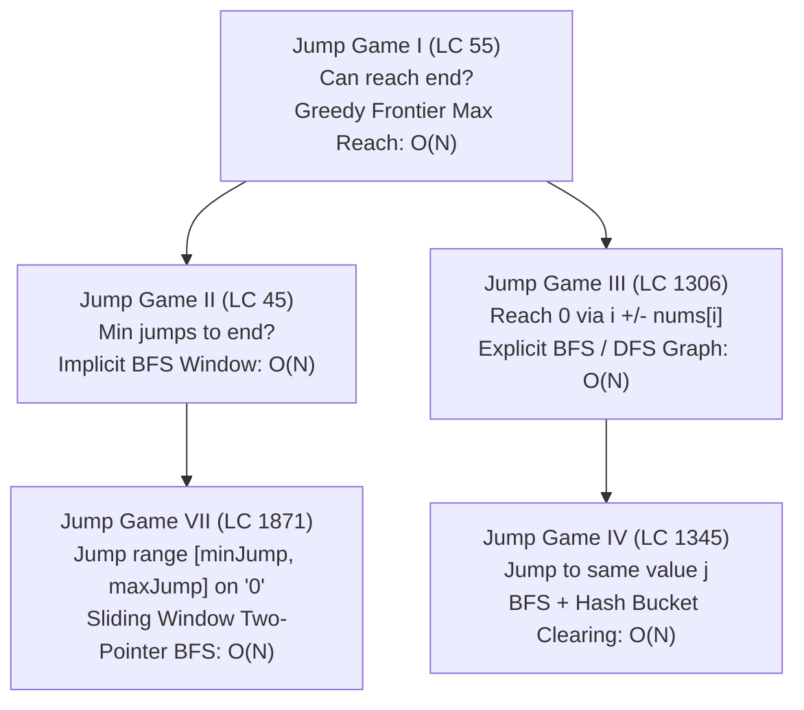
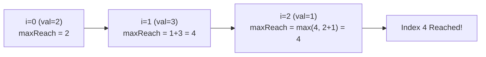
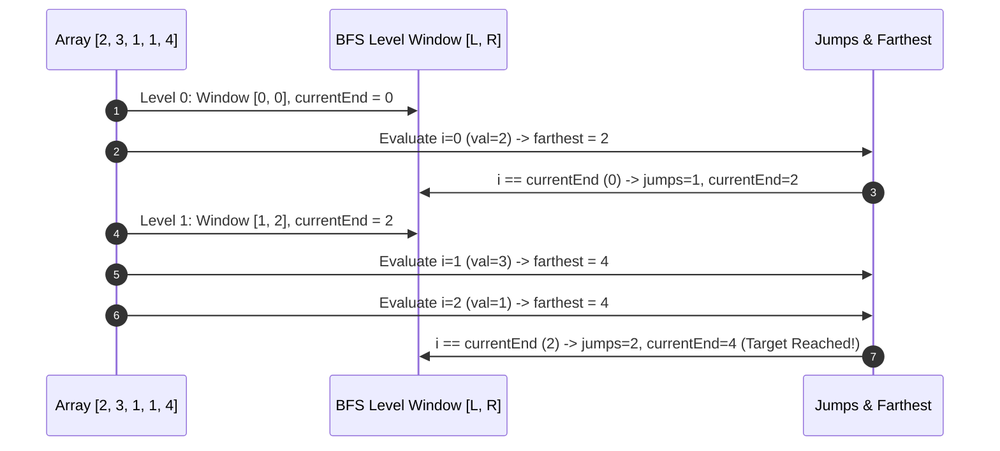
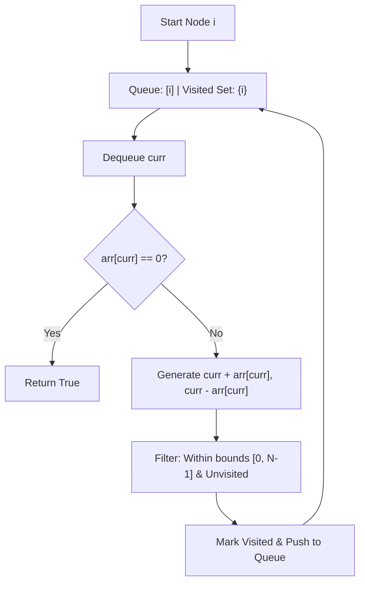
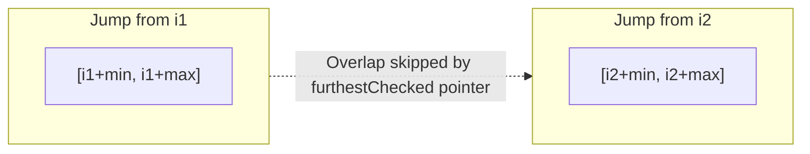

---


title: "Jump Game & Greedy Reachability Algorithms: From Linear Frontiers to Sliding Window BFS"
description: "Master Jump Game I, II, III, IV, and VII with greedy frontier expansion, implicit BFS level mechanics, and graph reachability in C# and Python 3."
category: "Data Structures & Algorithms"
tags: [dsa, greedy, jump-game, reachability, sliding-window, bfs, leetcode, algorithms, computer-science, learning-note]
date: "2026-08-26"
---

# 🏃 Jump Game & Greedy Reachability Algorithms

## 📌 Connected Resource Graph
- 🟢 **Primary Theory Note**: [[01_DSA/01_theory_and_patterns/08_Greedy/00_overview_greedy_algorithms|Greedy Algorithms Overview]]
- 🟡 **Topic Overview Node**: [[01_DSA/01_theory_and_patterns/04_Queue_and_Deque/00_overview_queue|Queue & BFS Traversal]]
- 🟡 **Topic Overview Node**: [[01_DSA/01_theory_and_patterns/06_Graph_Algorithms/00_overview_graphs|Graph Reachability]]


---

## 1. The Jump Game Taxonomy

The LeetCode **Jump Game** series illustrates the progression from simple greedy linear scanning to implicit level-order BFS, explicit graph traversal with bucket clearing, and sliding window interval queues.



### Comprehensive Variant Comparison

| Problem | Goal | Core Pattern | Time Complexity | Space Complexity |
| :--- | :--- | :--- | :--- | :--- |
| **Jump Game I (LC 55)** | Boolean reachability to $N-1$ | Running `maxReach` frontier | $\mathcal{O}(N)$ | $\mathcal{O}(1)$ |
| **Jump Game II (LC 45)** | Minimum jump count to $N-1$ | Implicit BFS level window `[curStart, curEnd]` | $\mathcal{O}(N)$ | $\mathcal{O}(1)$ |
| **Jump Game III (LC 1306)** | Reach any index with `val == 0` | Graph BFS / DFS with Visited Array | $\mathcal{O}(N)$ | $\mathcal{O}(N)$ |
| **Jump Game IV (LC 1345)** | Min jumps with value teleports | BFS + Value Hash Map + Cleared Edges | $\mathcal{O}(N)$ | $\mathcal{O}(N)$ |
| **Jump Game VII (LC 1871)** | Reach $N-1$ on `'0'` within range | Sliding Window Two-Pointer BFS | $\mathcal{O}(N)$ | $\mathcal{O}(N)$ |

---

## 2. Deep Dive: Jump Game I & II

### 2.1 Jump Game I (LeetCode 55: Can Reach End?)
Given an array `nums` where `nums[i]` is the maximum jump length from $i$, return `true` if you can reach index $N-1$.

#### Greedy Frontier Mechanism
Maintain a variable `maxReach` tracking the furthest index reachable so far. At each index $i$:
1. If $i > \text{maxReach}$, the current index is unreachable $\implies$ return `false`.
2. Update `maxReach = max(maxReach, i + nums[i])`.
3. If `maxReach >= n - 1`, early exit with `true`.



---

### 2.2 Jump Game II (LeetCode 45: Minimum Jumps)
Given `nums`, find the minimum number of jumps to reach $N-1$. Assume $N-1$ is always reachable.

#### Implicit BFS Level Window
Instead of maintaining an explicit BFS queue, treat the range of reachable indices at the current jump count as a **level window** $[L, R]$.
- At jump level $k$, our current window ends at `currentEnd`.
- As we iterate $i$ from $0$ up to $N-2$, we accumulate the furthest reach possible for the *next* jump (`farthest = max(farthest, i + nums[i])`).
- When index $i$ hits `currentEnd`, we **must** take another jump:
  $$\text{jumps} \leftarrow \text{jumps} + 1, \quad \text{currentEnd} \leftarrow \text{farthest}$$



---

## 3. Advanced Jump Variants: Jump Game III, IV & VII

### 3.1 Jump Game III (LeetCode 1306: Graph Reachability)
From index $i$, you can jump to $i + \text{arr}[i]$ or $i - \text{arr}[i]$. Determine if you can reach any index containing $0$.



---

### 3.2 Jump Game IV (LeetCode 1345: Hash Bucket BFS)
From index $i$, you can jump to $i+1$, $i-1$, or any index $j$ where $\text{arr}[i] == \text{arr}[j]$.

> [!IMPORTANT]
> **The $\mathcal{O}(N^2)$ to $\mathcal{O}(N)$ Optimization**:
> If many elements share the same value (e.g. $[7, 7, 7, \dots, 7]$), exploring all same-value edges repeatedly yields $\mathcal{O}(N^2)$ time.
> **Solution**: Once all indices sharing value $v$ are added to the BFS queue from the first occurrence, **clear the list for value $v$ from the dictionary** (`map[arr[i]].clear()`). Each node and edge is processed at most once.

---

### 3.3 Jump Game VII (LeetCode 1871: Sliding Window Reachability)
Given binary string $s$ where $s[0] == \text{'0'}$, you can jump from $i$ to $j$ if $s[j] == \text{'0'}$ and $i + \text{minJump} \le j \le \min(i + \text{maxJump}, N-1)$.

#### The Two-Pointer Sliding Window Frontier
A naive BFS can check overlapping ranges repeatedly, resulting in $\mathcal{O}(N \cdot (\text{maxJump} - \text{minJump})) = \mathcal{O}(N^2)$.  
By maintaining a pointer `furthestChecked = 0`, we only inspect indices $j \in [\max(i + \text{minJump}, \text{furthestChecked} + 1), \min(i + \text{maxJump}, N-1)]$. Every index in the string is visited at most once $\implies \mathcal{O}(N)$ time.



---

## 4. Production Implementations (C# .NET 8)

```csharp
using System;
using System.Collections.Generic;

public static class JumpGameSuite
{
    /// <summary>
    /// LC 55: Jump Game I - O(N) time, O(1) space.
    /// </summary>
    public static bool CanJump(int[] nums)
    {
        if (nums == null || nums.Length == 0) return false;

        int maxReach = 0;
        for (int i = 0; i < nums.Length; i++)
        {
            if (i > maxReach) return false;
            maxReach = Math.Max(maxReach, i + nums[i]);
            if (maxReach >= nums.Length - 1) return true;
        }

        return true;
    }

    /// <summary>
    /// LC 45: Jump Game II - O(N) time, O(1) space (Implicit BFS).
    /// </summary>
    public static int Jump(int[] nums)
    {
        if (nums == null || nums.Length <= 1) return 0;

        int jumps = 0;
        int currentEnd = 0;
        int farthest = 0;

        for (int i = 0; i < nums.Length - 1; i++)
        {
            farthest = Math.Max(farthest, i + nums[i]);

            if (i == currentEnd)
            {
                jumps++;
                currentEnd = farthest;
                if (currentEnd >= nums.Length - 1) break;
            }
        }

        return jumps;
    }

    /// <summary>
    /// LC 1306: Jump Game III - O(N) time, O(N) space (BFS Graph Reachability).
    /// </summary>
    public static bool CanReach(int[] arr, int start)
    {
        if (arr == null || start < 0 || start >= arr.Length) return false;

        int n = arr.Length;
        var queue = new Queue<int>();
        var visited = new bool[n];

        queue.Enqueue(start);
        visited[start] = true;

        while (queue.Count > 0)
        {
            int curr = queue.Dequeue();
            if (arr[curr] == 0) return true;

            int forward = curr + arr[curr];
            int backward = curr - arr[curr];

            if (forward < n && !visited[forward])
            {
                visited[forward] = true;
                queue.Enqueue(forward);
            }

            if (backward >= 0 && !visited[backward])
            {
                visited[backward] = true;
                queue.Enqueue(backward);
            }
        }

        return false;
    }

    /// <summary>
    /// LC 1345: Jump Game IV - O(N) time, O(N) space (BFS with Bucket Deletion).
    /// </summary>
    public static int MinJumpsIV(int[] arr)
    {
        if (arr == null || arr.Length <= 1) return 0;
        int n = arr.Length;

        // Value -> List of indices
        var graph = new Dictionary<int, List<int>>();
        for (int i = 0; i < n; i++)
        {
            if (!graph.ContainsKey(arr[i]))
                graph[arr[i]] = new List<int>();
            graph[arr[i]].Add(i);
        }

        var queue = new Queue<int>();
        var visited = new bool[n];

        queue.Enqueue(0);
        visited[0] = true;
        int steps = 0;

        while (queue.Count > 0)
        {
            int size = queue.Count;
            for (int k = 0; k < size; k++)
            {
                int curr = queue.Dequeue();
                if (curr == n - 1) return steps;

                // 1. Jump forward
                if (curr + 1 < n && !visited[curr + 1])
                {
                    visited[curr + 1] = true;
                    queue.Enqueue(curr + 1);
                }

                // 2. Jump backward
                if (curr - 1 >= 0 && !visited[curr - 1])
                {
                    visited[curr - 1] = true;
                    queue.Enqueue(curr - 1);
                }

                // 3. Jump to same value
                if (graph.TryGetValue(arr[curr], out var sameValIndices))
                {
                    foreach (int next in sameValIndices)
                    {
                        if (!visited[next])
                        {
                            visited[next] = true;
                            queue.Enqueue(next);
                        }
                    }
                    // CRITICAL: Clear bucket to prevent O(N^2)
                    graph.Remove(arr[curr]);
                }
            }
            steps++;
        }

        return -1;
    }

    /// <summary>
    /// LC 1871: Jump Game VII - O(N) time, O(N) space (Sliding Window Two-Pointer BFS).
    /// </summary>
    public static bool CanReachVII(string s, int minJump, int maxJump)
    {
        if (string.IsNullOrEmpty(s) || s[^1] != '0') return false;
        int n = s.Length;

        var queue = new Queue<int>();
        queue.Enqueue(0);
        int furthestChecked = 0;

        while (queue.Count > 0)
        {
            int curr = queue.Dequeue();
            if (curr == n - 1) return true;

            int start = Math.Max(curr + minJump, furthestChecked + 1);
            int end = Math.Min(curr + maxJump, n - 1);

            for (int j = start; j <= end; j++)
            {
                if (s[j] == '0')
                {
                    if (j == n - 1) return true;
                    queue.Enqueue(j);
                }
            }

            furthestChecked = Math.Max(furthestChecked, curr + maxJump);
        }

        return false;
    }
}
```

---

## 5. Production Implementations (Python 3)

```python
from collections import deque, defaultdict
from typing import List

class JumpGameSolutions:
    @staticmethod
    def can_jump(nums: List[int]) -> bool:
        """LC 55: Jump Game I - O(N) time, O(1) space"""
        max_reach = 0
        for i, val in enumerate(nums):
            if i > max_reach:
                return False
            max_reach = max(max_reach, i + val)
            if max_reach >= len(nums) - 1:
                return True
        return True

    @staticmethod
    def min_jump(nums: List[int]) -> int:
        """LC 45: Jump Game II - O(N) time, O(1) space"""
        if len(nums) <= 1:
            return 0
            
        jumps = 0
        current_end = 0
        farthest = 0
        
        for i in range(len(nums) - 1):
            farthest = max(farthest, i + nums[i])
            if i == current_end:
                jumps += 1
                current_end = farthest
                if current_end >= len(nums) - 1:
                    break
        return jumps

    @staticmethod
    def can_reach_iii(arr: List[int], start: int) -> bool:
        """LC 1306: Jump Game III - O(N) time, O(N) space"""
        n = len(arr)
        queue = deque([start])
        visited = {start}

        while queue:
            curr = queue.popleft()
            if arr[curr] == 0:
                return True

            for nxt in (curr + arr[curr], curr - arr[curr]):
                if 0 <= nxt < n and nxt not in visited:
                    visited.add(nxt)
                    queue.append(nxt)

        return False

    @staticmethod
    def min_jumps_iv(arr: List[int]) -> int:
        """LC 1345: Jump Game IV - O(N) time, O(N) space"""
        n = len(arr)
        if n <= 1:
            return 0

        val_map = defaultdict(list)
        for i, val in enumerate(arr):
            val_map[val].append(i)

        queue = deque([0])
        visited = {0}
        steps = 0

        while queue:
            for _ in range(len(queue)):
                curr = queue.popleft()
                if curr == n - 1:
                    return steps

                # Check neighbors
                for nxt in (curr - 1, curr + 1):
                    if 0 <= nxt < n and nxt not in visited:
                        visited.add(nxt)
                        queue.append(nxt)

                # Check same value bucket
                if arr[curr] in val_map:
                    for nxt in val_map[arr[curr]]:
                        if nxt not in visited:
                            visited.add(nxt)
                            queue.append(nxt)
                    del val_map[arr[curr]] # Clear bucket to avoid O(N^2)

            steps += 1

        return -1

    @staticmethod
    def can_reach_vii(s: str, min_jump: int, max_jump: int) -> bool:
        """LC 1871: Jump Game VII - O(N) time, O(N) space"""
        if s[-1] != '0':
            return False

        n = len(s)
        queue = deque([0])
        furthest_checked = 0

        while queue:
            curr = queue.popleft()
            if curr == n - 1:
                return True

            start = max(curr + min_jump, furthest_checked + 1)
            end = min(curr + max_jump, n - 1)

            for j in range(start, end + 1):
                if s[j] == '0':
                    if j == n - 1:
                        return True
                    queue.append(j)

            furthest_checked = max(furthest_checked, curr + max_jump)

        return False


if __name__ == "__main__":
    solver = JumpGameSolutions()
    print("JG1 Can Jump:", solver.can_jump([2, 3, 1, 1, 4]))            # True
    print("JG2 Min Jumps:", solver.min_jump([2, 3, 1, 1, 4]))           # 2
    print("JG3 Can Reach 0:", solver.can_reach_iii([4, 2, 3, 0, 3, 1, 2], 5)) # True
    print("JG4 Min Jumps:", solver.min_jumps_iv([100, -23, -23, 404, 100, 23, 23, 23, 3, 404])) # 3
    print("JG7 Can Reach:", solver.can_reach_vii("011010", 2, 3))       # True
```

---

## 6. Edge Cases & Defensive Patterns

> [!WARNING]
> **Key Jump Game Pitfalls**:
> 1. **Zero Trap in Jump Game I**: When encountering `nums[i] == 0`, if `maxReach <= i`, forward progress is completely halted.
> 2. **Looping in Jump Game III / IV**: Failure to maintain a `visited` array or delete processed hash buckets results in infinite cycles or memory exhaustion ($\mathcal{O}(N^2)$).
> 3. **Interval Re-scanning in Jump Game VII**: Iterating over `range(curr + minJump, curr + maxJump + 1)` without a `furthestChecked` pointer causes Timeout (TLE) on dense strings like `"000...000"`.
