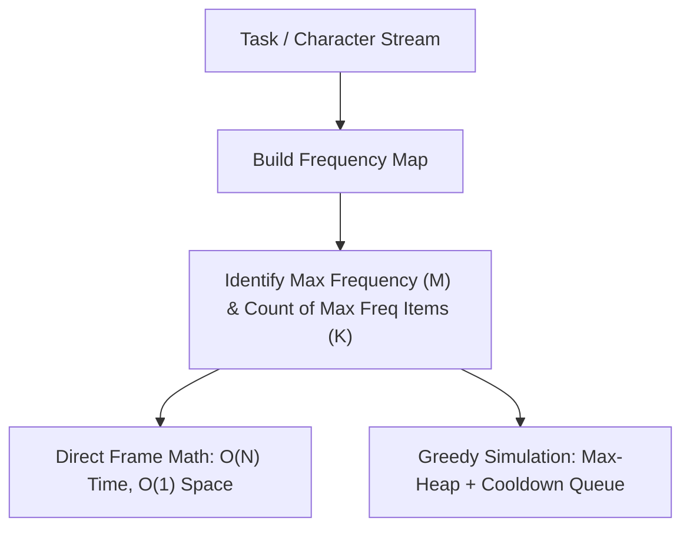
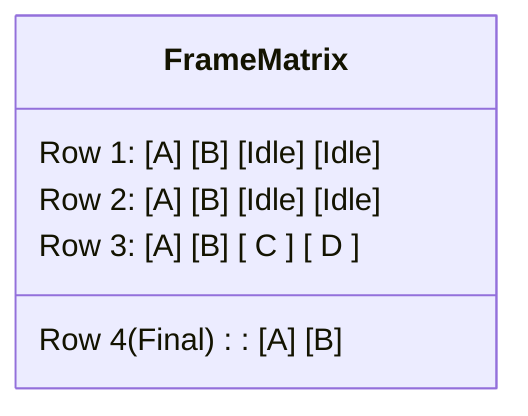
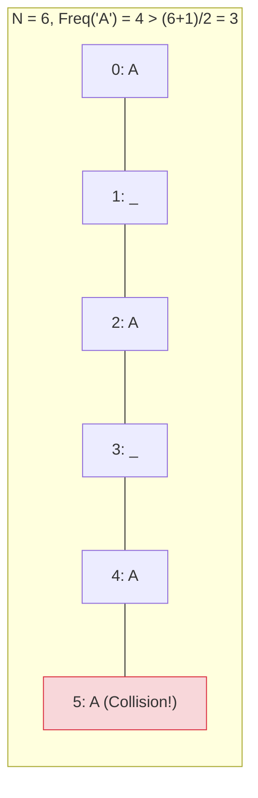
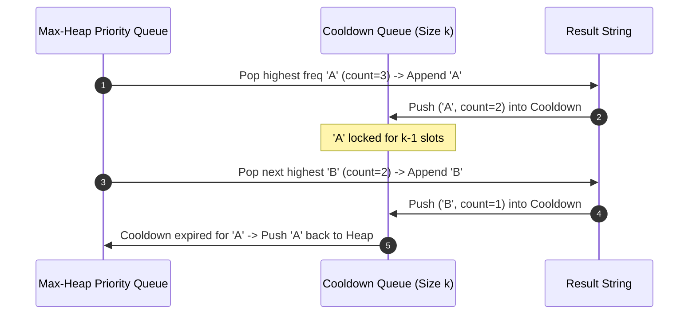

---


title: "Task Scheduler & String Reorganization: Frequency Prioritization & Cooldown Mechanics"
description: "Master CPU task scheduling frames, LeetCode 621, LeetCode 767 Reorganize String, and LeetCode 358 k-Distance spacing algorithms in C# and Python 3."
category: "Data Structures & Algorithms"
tags: [dsa, greedy, task-scheduler, reorganize-string, priority-queue, frequency-table, leetcode, algorithms, computer-science, learning-note]
date: "2026-08-26"
---

# ⏱️ Task Scheduler & String Reorganization: Frequency Prioritization & Cooldown Mechanics

## 📌 Connected Resource Graph
- 🟢 **Primary Theory Note**: [[01_DSA/01_theory_and_patterns/08_Greedy/00_overview_greedy_algorithms|Greedy Algorithms Overview]]
- 🟡 **Topic Overview Node**: [[01_DSA/01_theory_and_patterns/06_Heaps_and_Priority_Queues/00_overview_heaps|Heaps & Priority Queues]]
- 🟡 **Topic Overview Node**: [[01_DSA/01_theory_and_patterns/01_Strings/00_overview_strings|String Manipulation]]


---

## 1. The Frequency Prioritization Principle

Problems involving recurring execution constraints (such as CPU cooling intervals or string adjacency avoidance) share a common greedy invariant:

> [!IMPORTANT]
> **The Most Frequent Element Invariant**:
> Always allocate and interleave the highest-frequency elements first. The highest-frequency element dictates the minimum structural framework (or frame count) required to satisfy cooldown constraints.



---

## 2. Task Scheduler (LeetCode 621)

Given an array of CPU tasks represented by uppercase letters and a cooling period $n$, identical tasks must be separated by at least $n$ units of time. Return the minimum CPU cycles required.

### 2.1 The Matrix Frame Model

Let $M = \max_{c} \{ \text{count}(c) \}$ be the highest frequency of any task, and let $K$ be the number of distinct tasks having this maximum frequency $M$.

We construct an execution grid with $M$ rows and $(n + 1)$ columns:
- The first $M - 1$ rows represent complete frames of length $n + 1$.
- The last ($M$-th) row contains only the $K$ tasks that have frequency $M$.



```
Example: Tasks = [A, A, A, A, B, B, B, B, C, D], n = 3
Max Freq M = 4 (Tasks A and B), K = 2

Frame Layout (Columns = n + 1 = 4):
Row 1: | A | B | Idle | Idle |  (Length = 4)
Row 2: | A | B | Idle | Idle |  (Length = 4)
Row 3: | A | B |  C   |  D   |  (Length = 4)
Row 4: | A | B |                (Length = K = 2)

Empty Slots = (M - 1) * (n + 1 - K) = 3 * (4 - 2) = 6
Remaining Tasks to fill empty slots = len(tasks) - (M * K) = 10 - 8 = 2 (C and D)
Remaining Idles = max(0, 6 - 2) = 4
Total Time = len(tasks) + Idles = 10 + 4 = 14
```

### 2.2 The Closed-Form Formula
The total required time is determined by whichever is larger: the structural frame requirement or the total number of tasks (when available tasks completely saturate all idle slots):

$$\text{Total Time} = \max\Big(\text{len}(tasks), \, (M - 1) \times (n + 1) + K\Big)$$

---

## 3. Reorganize String (LeetCode 767)

Given a string `s`, rearrange the characters such that no two adjacent characters are identical ($k = 2$). Return `""` if impossible.

### 3.1 Impossibility Condition (The Pigeonhole Principle)
If any character appears with frequency $f > \lfloor (N + 1) / 2 \rfloor$, it is mathematically impossible to place them without adjacency, because even using every alternating slot $(0, 2, 4, \dots)$ leaves insufficient separator slots.



### 3.2 Approach 1: $O(N)$ Parity-Indexed Placement
1. Build character frequency table. Find character with maximum frequency.
2. If max frequency $> (N + 1) / 2$, return `""`.
3. Allocate result array of size $N$. Maintain index pointer `idx = 0`.
4. Place the most frequent character into even indices (\$0, 2, 4, \dots$).
5. Fill remaining characters into remaining even indices; once `idx >= N`, reset `idx = 1` and fill odd indices (\$1, 3, 5, \dots$).

```mermaid
gantt
    title Parity Index Filling (N = 6, 'A': 3, 'B': 2, 'C': 1)
    dateFormat X
    axisFormat %s
    section Even Indices First
    Index 0 [A] :active, e0, 0, 1
    Index 2 [A] :active, e2, 2, 3
    Index 4 [A] :active, e4, 4, 5
    section Odd Indices
    Index 1 [B] :done, o1, 1, 2
    Index 3 [B] :done, o3, 3, 4
    Index 5 [C] :done, o5, 5, 6
```



---

## 4. Rearrange String $k$ Distance Apart (LeetCode 358)

Given a string `s` and integer `k`, rearrange `s` so that identical characters are at least $k$ distance apart.

### 4.1 Max-Heap with Sliding Cooldown Queue
- Maintain a **Max-Heap** prioritized by remaining character frequency.
- Maintain a **Cooldown Queue** storing characters temporarily locked out during their $k-1$ cooldown period.
- In each iteration:
  1. Pop the character with highest remaining frequency from Max-Heap.
  2. Append it to the result string.
  3. Decrement its count. Push it into Cooldown Queue with its available release time ($idx + k$).
  4. If Cooldown Queue has elements ready for release (queue size $\ge k$), pop and push back into Max-Heap.
- If Max-Heap becomes empty while characters remain locked, string reconstruction is impossible $\implies$ return `""`.



---

## 5. Production Implementations (C# .NET 8)

```csharp
using System;
using System.Collections.Generic;
using System.Text;

public static class TaskAndStringScheduler
{
    /// <summary>
    /// LC 621: Task Scheduler - O(N) time, O(1) space (Math Formula).
    /// </summary>
    public static int LeastIntervalMath(char[] tasks, int n)
    {
        if (tasks == null || tasks.Length == 0) return 0;
        if (n == 0) return tasks.Length;

        int[] counts = new int[26];
        int maxFreq = 0;

        foreach (char c in tasks)
        {
            counts[c - 'A']++;
            maxFreq = Math.Max(maxFreq, counts[c - 'A']);
        }

        int maxFreqCount = 0;
        foreach (int c in counts)
        {
            if (c == maxFreq) maxFreqCount++;
        }

        int frameTime = (maxFreq - 1) * (n + 1) + maxFreqCount;
        return Math.Max(tasks.Length, frameTime);
    }

    /// <summary>
    /// LC 767: Reorganize String - O(N) time, O(1) auxiliary space (Parity Indexing).
    /// </summary>
    public static string ReorganizeString(string s)
    {
        if (string.IsNullOrEmpty(s)) return string.Empty;

        int n = s.Length;
        int[] counts = new int[26];
        int maxFreq = 0;
        char maxChar = ' ';

        foreach (char c in s)
        {
            counts[c - 'a']++;
            if (counts[c - 'a'] > maxFreq)
            {
                maxFreq = counts[c - 'a'];
                maxChar = c;
            }
        }

        if (maxFreq > (n + 1) / 2) return string.Empty;

        char[] result = new char[n];
        int idx = 0;

        // 1. Fill most frequent character in even indices
        while (counts[maxChar - 'a'] > 0)
        {
            result[idx] = maxChar;
            idx += 2;
            counts[maxChar - 'a']--;
        }

        // 2. Fill remaining characters
        for (int i = 0; i < 26; i++)
        {
            while (counts[i] > 0)
            {
                if (idx >= n) idx = 1; // Switch to odd indices
                result[idx] = (char)('a' + i);
                idx += 2;
                counts[i]--;
            }
        }

        return new string(result);
    }

    /// <summary>
    /// LC 358: Rearrange String k Distance Apart - O(N log |Sigma|) time, O(|Sigma|) space.
    /// </summary>
    public static string RearrangeStringKDistance(string s, int k)
    {
        if (string.IsNullOrEmpty(s)) return string.Empty;
        if (k <= 1) return s;

        int n = s.Length;
        int[] counts = new int[26];
        foreach (char c in s) counts[c - 'a']++;

        // Max-heap: PriorityQueue in .NET is min-heap by default, invert priority with -count
        var maxHeap = new PriorityQueue<char, int>();
        for (int i = 0; i < 26; i++)
        {
            if (counts[i] > 0)
            {
                maxHeap.Enqueue((char)('a' + i), -counts[i]);
            }
        }

        var cooldownQueue = new Queue<(char Ch, int RemainingCount)>();
        var sb = new StringBuilder(n);

        while (maxHeap.Count > 0)
        {
            char curr = maxHeap.Dequeue();
            sb.Append(curr);
            counts[curr - 'a']--;

            cooldownQueue.Enqueue((curr, counts[curr - 'a']));

            if (cooldownQueue.Count >= k)
            {
                var (releasedChar, remaining) = cooldownQueue.Dequeue();
                if (remaining > 0)
                {
                    maxHeap.Enqueue(releasedChar, -remaining);
                }
            }
        }

        return sb.Length == n ? sb.ToString() : string.Empty;
    }
}
```

---

## 6. Complete Python 3 Implementations

```python
import heapq
from collections import Counter, deque
from typing import List

class TaskAndStringSchedulers:
    @staticmethod
    def least_interval_math(tasks: List[str], n: int) -> int:
        """LC 621: Task Scheduler (O(N) Math Formula)"""
        counts = Counter(tasks)
        max_freq = max(counts.values())
        max_freq_count = sum(1 for v in counts.values() if v == max_freq)

        frame_time = (max_freq - 1) * (n + 1) + max_freq_count
        return max(len(tasks), frame_time)

    @staticmethod
    def reorganize_string_parity(s: str) -> str:
        """LC 767: Reorganize String (O(N) Parity Indexing)"""
        n = len(s)
        counts = Counter(s)
        max_char, max_freq = counts.most_common(1)[0]

        if max_freq > (n + 1) // 2:
            return ""

        result = [''] * n
        idx = 0

        # Fill most frequent character on even indices
        for _ in range(max_freq):
            result[idx] = max_char
            idx += 2
        del counts[max_char]

        # Fill remaining characters
        for ch, count in counts.items():
            for _ in range(count):
                if idx >= n:
                    idx = 1
                result[idx] = ch
                idx += 2

        return "".join(result)

    @staticmethod
    def rearrange_string_k_distance(s: str, k: int) -> str:
        """LC 358: Rearrange String k Distance Apart (Max-Heap + Cooldown Queue)"""
        if k <= 1:
            return s

        n = len(s)
        counts = Counter(s)
        # Max-heap storing (-count, char)
        max_heap = [(-count, ch) for ch, count in counts.items()]
        heapq.heapify(max_heap)

        cooldown_queue = deque()
        result = []

        while max_heap:
            neg_count, ch = heapq.heappop(max_heap)
            result.append(ch)
            rem_count = -neg_count - 1

            cooldown_queue.append((ch, rem_count))

            if len(cooldown_queue) >= k:
                released_char, remaining = cooldown_queue.popleft()
                if remaining > 0:
                    heapq.heappush(max_heap, (-remaining, released_char))

        return "".join(result) if len(result) == n else ""


if __name__ == "__main__":
    scheduler = TaskAndStringSchedulers()
    print("Task Scheduler Time:", scheduler.least_interval_math(["A","A","A","B","B","B"], 2)) # 8
    print("Reorganize String:", scheduler.reorganize_string_parity("aab"))                      # "aba"
    print("Reorganize String (Impossible):", scheduler.reorganize_string_parity("aaab"))          # ""
    print("Rearrange k=3 Distance:", scheduler.rearrange_string_k_distance("aabbcc", 3))         # "abcabc"
```

---

## 7. Comparative Algorithm Matrix

| Algorithm | Mechanism | Time Complexity | Auxiliary Space | Key Advantage |
| :--- | :--- | :---: | :---: | :--- |
| **Task Scheduler (Math)** | Direct Frame Formula | $\mathcal{O}(N)$ | $\mathcal{O}(1)$ | Zero allocation, instant computation |
| **Task Scheduler (Sim)** | Max-Heap + Cooldown Queue | $\mathcal{O}(N \log |\Sigma|)$ | $\mathcal{O}(|\Sigma|)$ | Can yield actual execution schedule string |
| **Reorganize String** | Parity Indexing (\$0, 2, \dots$ then \$1, 3, \dots$) | $\mathcal{O}(N)$ | $\mathcal{O}(N)$ | Strict linear time without heap overhead |
| **Rearrange $k$-Distance** | Max-Heap + Sliding Cooldown | $\mathcal{O}(N \log |\Sigma|)$ | $\mathcal{O}(|\Sigma| + k)$ | Generalizes to arbitrary integer distance $k$ |
