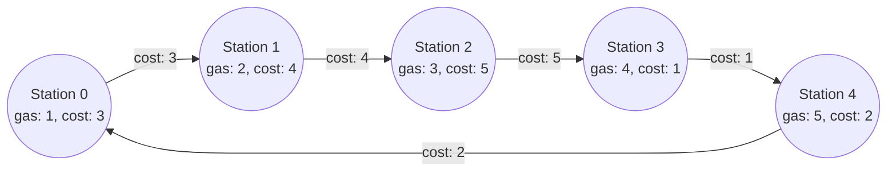
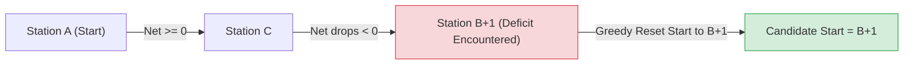
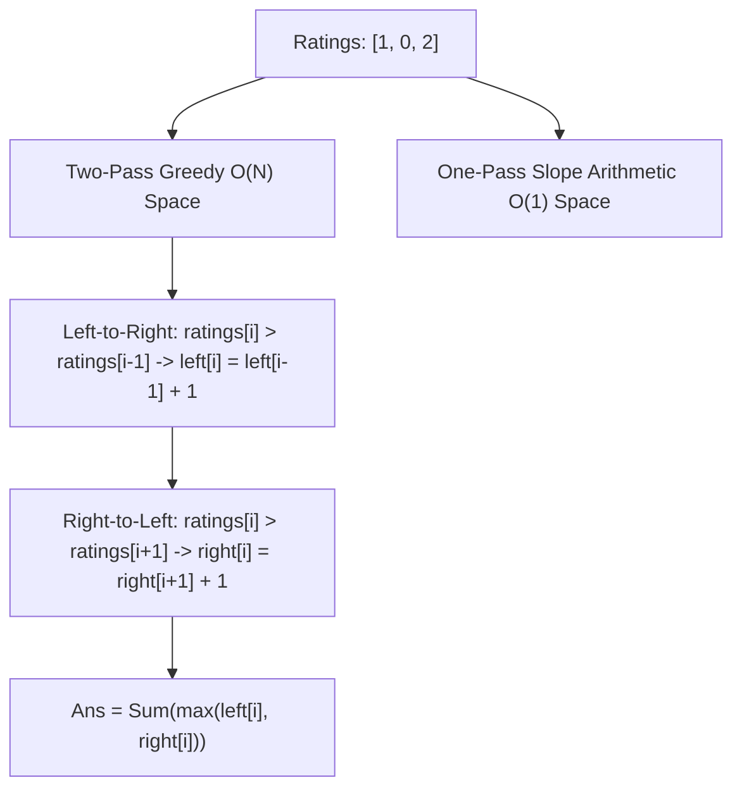
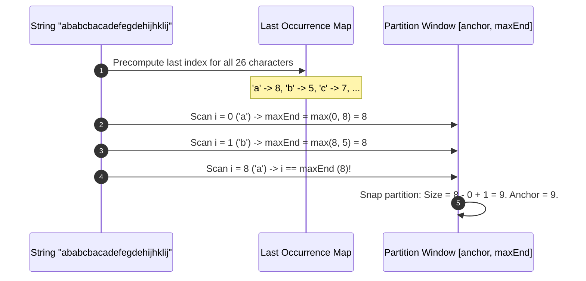

---


title: "Classical LeetCode Greedy Problem Walkthroughs: Deep Proofs & Optimal Solutions"
description: "Master hard greedy problems including Gas Station (LC 134), Candy 1-pass & 2-pass (LC 135), Non-overlapping Intervals (LC 435), Partition Labels (LC 763), and Burst Balloons (LC 452) in C# and Python 3."
category: "Data Structures & Algorithms"
tags: [dsa, greedy, leetcode, gas-station, candy, partition-labels, non-overlapping-intervals, algorithms, computer-science, learning-note]
date: "2026-08-26"
---

# 🧩 Classical LeetCode Greedy Problem Walkthroughs: Deep Proofs & Optimal Solutions

## 📌 Connected Resource Graph
- 🟢 **Primary Theory Note**: [[01_DSA/01_theory_and_patterns/08_Greedy/00_overview_greedy_algorithms|Greedy Algorithms Overview]]
- 🟡 **Topic Overview Node**: [[01_DSA/01_theory_and_patterns/08_Greedy/01_activity_selection_interval_scheduling|Activity Selection & Intervals]]
- 🟡 **Topic Overview Node**: [[01_DSA/01_theory_and_patterns/08_Greedy/04_jump_game_greedy_reachability|Jump Game Reachability]]


---

## 1. Problem 1: Gas Station Circuit (LeetCode 134)

### Problem Statement
There are $N$ gas stations along a circular route, where the amount of gas at station $i$ is `gas[i]`. It costs `cost[i]` of gas to travel from station $i$ to station $i+1$. Return the starting gas station's index if you can travel around the circuit once in the clockwise direction, otherwise return $-1$.



### 1.1 Mathematical Proof of Correctness

#### Theorem 1: Global Feasibility Condition
A valid starting station exists if and only if the total gas available across all stations is greater than or equal to the total cost required:

$$\sum_{i=0}^{n-1} (\text{gas}[i] - \text{cost}[i]) \ge 0$$

#### Theorem 2: Starting Station Invariant
If starting at station $A$ allows reaching station $B$ but fails at $B+1$ (i.e. $\sum_{k=A}^{B} (\text{gas}[k] - \text{cost}[k]) < 0$), **no station between $A$ and $B$ can be a valid starting point**.

*Proof*:
For any intermediate station $C$ where $A < C \le B$:
$$\sum_{k=C}^{B} (\text{gas}[k] - \text{cost}[k]) = \sum_{k=A}^{B} (\text{gas}[k] - \text{cost}[k]) - \sum_{k=A}^{C-1} (\text{gas}[k] - \text{cost}[k])$$
Since station $A$ successfully reached station $C$, the gas accumulated upon reaching $C$ was non-negative: $\sum_{k=A}^{C-1} (\text{gas}[k] - \text{cost}[k]) \ge 0$.  
Therefore, starting at $C$ with $0$ initial gas will accumulate **even less** net gas than starting at $A$. Since $A$ could not reach $B+1$, $C$ cannot reach $B+1$ either.  
We can safely jump our candidate start directly to $B+1$. $\blacksquare$



---

## 2. Problem 2: Candy Distribution (LeetCode 135 - Hard)

### Problem Statement
There are $N$ children standing in a line. Each child is assigned a rating value given in the integer array `ratings`. You are giving candies to these children subjected to the following requirements:
1. Each child must have at least one candy.
2. Children with a higher rating get more candies than their immediate neighbors.

Return the *minimum number of candies* you need to distribute.



### 2.1 Approach A: Two-Pass Greedy ($\mathcal{O}(N)$ Time, $\mathcal{O}(N)$ Space)
- Pass 1 (Left to Right): Ensure any child with higher rating than their left neighbor receives more candies.
- Pass 2 (Right to Left): Ensure any child with higher rating than their right neighbor receives more candies (`candies[i] = max(candies[i], candies[i+1] + 1)`).

---

### 2.2 Approach B: One-Pass Slope Arithmetic ($\mathcal{O}(N)$ Time, $\mathcal{O}(1)$ Space)
Model the ratings sequence as alternating **increasing slopes (up)**, **decreasing slopes (down)**, and **flat valleys**:

```
Ratings:   1    2    3    2    1    0
Slope:        /    /    \    \    \
Length:     up=1 up=2  down=1 down=2 down=3
Peak = 3, Down = 3.
```

- When moving **up**: increment `up`, reset `down = 0`, `peak = up + 1`, add `peak` candies.
- When moving **down**: increment `down`, reset `up = 0`, add `down` candies. If `down >= peak`, the peak must be retroactively enlarged by $1$ to maintain the gradient constraint.
- When **flat**: reset `up = down = peak = 0`, add $1$ candy.

```mermaid
gantt
    title Candy Distribution Slope Tracking
    dateFormat X
    axisFormat %s
    section Up Slope
    Rating 1 to 2 :active, u1, 0, 1
    Rating 2 to 3 :active, u2, 1, 2
    section Down Slope (Valley)
    Rating 3 to 2 :crit, d1, 2, 3
    Rating 2 to 1 :crit, d2, 3, 4
    Rating 1 to 0 :crit, d3, 4, 5
```



---

## 3. Problem 3: Partition Labels (LeetCode 763)

### Problem Statement
Given a string `s` of lowercase English letters, partition the string into as many parts as possible so that each letter appears in at most one part. Return a list of integers representing the size of these parts.



---

## 4. Problem 4: Minimum Number of Arrows to Burst Balloons (LeetCode 452)

### Problem Statement
Given an array `points` where `points[i] = [x_start, x_end]`, an arrow shot horizontally at $x$ bursts all balloons where $x_{\text{start}} \le x \le x_{\text{end}}$. Find the minimum arrows required.

#### Strategy
Sort balloons by ending coordinate $x_{\text{end}}$. Shoot an arrow at the end coordinate of the first balloon. Skip all subsequent balloons whose start coordinate $x_{\text{start}} \le \text{arrowPos}$. When $x_{\text{start}} > \text{arrowPos}$, fire another arrow at that balloon's end coordinate.

---

## 5. Production Implementations (C# .NET 8)

```csharp
using System;
using System.Collections.Generic;

public static class LeetCodeGreedySolutions
{
    /// <summary>
    /// LC 134: Gas Station - O(N) time, O(1) space.
    /// </summary>
    public static int CanCompleteCircuit(int[] gas, int[] cost)
    {
        int totalGas = 0;
        int currentGas = 0;
        int startStation = 0;

        for (int i = 0; i < gas.Length; i++)
        {
            int net = gas[i] - cost[i];
            totalGas += net;
            currentGas += net;

            if (currentGas < 0)
            {
                startStation = i + 1;
                currentGas = 0;
            }
        }

        return totalGas >= 0 ? startStation : -1;
    }

    /// <summary>
    /// LC 135: Candy (Two-Pass) - O(N) time, O(N) space.
    /// </summary>
    public static int CandyTwoPass(int[] ratings)
    {
        if (ratings == null || ratings.Length == 0) return 0;
        int n = ratings.Length;
        int[] candies = new int[n];
        Array.Fill(candies, 1);

        // Left to right
        for (int i = 1; i < n; i++)
        {
            if (ratings[i] > ratings[i - 1])
                candies[i] = candies[i - 1] + 1;
        }

        // Right to left
        for (int i = n - 2; i >= 0; i--)
        {
            if (ratings[i] > ratings[i + 1])
                candies[i] = Math.Max(candies[i], candies[i + 1] + 1);
        }

        int total = 0;
        foreach (int c in candies) total += c;
        return total;
    }

    /// <summary>
    /// LC 135: Candy (One-Pass Slope Arithmetic) - O(N) time, O(1) space.
    /// </summary>
    public static int CandyOnePass(int[] ratings)
    {
        if (ratings == null || ratings.Length == 0) return 0;
        int n = ratings.Length;
        if (n == 1) return 1;

        int total = 1;
        int up = 0;
        int down = 0;
        int peak = 0;

        for (int i = 1; i < n; i++)
        {
            if (ratings[i] > ratings[i - 1])
            {
                up++;
                down = 0;
                peak = up;
                total += 1 + up;
            }
            else if (ratings[i] == ratings[i - 1])
            {
                up = 0;
                down = 0;
                peak = 0;
                total += 1;
            }
            else
            {
                down++;
                up = 0;
                total += down + (down > peak ? 1 : 0);
            }
        }

        return total;
    }

    /// <summary>
    /// LC 763: Partition Labels - O(N) time, O(1) space (26 chars).
    /// </summary>
    public static IList<int> PartitionLabels(string s)
    {
        var result = new List<int>();
        if (string.IsNullOrEmpty(s)) return result;

        int[] lastIndex = new int[26];
        for (int i = 0; i < s.Length; i++)
        {
            lastIndex[s[i] - 'a'] = i;
        }

        int anchor = 0;
        int maxEnd = 0;

        for (int i = 0; i < s.Length; i++)
        {
            maxEnd = Math.Max(maxEnd, lastIndex[s[i] - 'a']);
            if (i == maxEnd)
            {
                result.Add(i - anchor + 1);
                anchor = i + 1;
            }
        }

        return result;
    }
}
```

---

## 6. Complete Python 3 Implementations

```python
from typing import List

class ClassicalGreedySolutions:
    @staticmethod
    def can_complete_circuit(gas: List[int], cost: List[int]) -> int:
        """LC 134: Gas Station Circuit - O(N) time, O(1) space"""
        total_tank = 0
        curr_tank = 0
        start_station = 0

        for i in range(len(gas)):
            net = gas[i] - cost[i]
            total_tank += net
            curr_tank += net

            if curr_tank < 0:
                start_station = i + 1
                curr_tank = 0

        return start_station if total_tank >= 0 else -1

    @staticmethod
    def candy_two_pass(ratings: List[int]) -> int:
        """LC 135: Candy (Two-Pass) - O(N) time, O(N) space"""
        n = len(ratings)
        candies = [1] * n

        for i in range(1, n):
            if ratings[i] > ratings[i - 1]:
                candies[i] = candies[i - 1] + 1

        for i in range(n - 2, -1, -1):
            if ratings[i] > ratings[i + 1]:
                candies[i] = max(candies[i], candies[i + 1] + 1)

        return sum(candies)

    @staticmethod
    def candy_one_pass(ratings: List[int]) -> int:
        """LC 135: Candy (One-Pass Slope Arithmetic) - O(N) time, O(1) space"""
        n = len(ratings)
        if n <= 1:
            return n

        total = 1
        up = 0
        down = 0
        peak = 0

        for i in range(1, n):
            if ratings[i] > ratings[i - 1]:
                up += 1
                down = 0
                peak = up
                total += 1 + up
            elif ratings[i] == ratings[i - 1]:
                up = down = peak = 0
                total += 1
            else:
                down += 1
                up = 0
                total += down + (1 if down > peak else 0)

        return total

    @staticmethod
    def partition_labels(s: str) -> List[int]:
        """LC 763: Partition Labels - O(N) time, O(1) space"""
        last_occurrence = {ch: i for i, ch in enumerate(s)}
        result = []
        anchor = 0
        max_end = 0

        for i, ch in enumerate(s):
            max_end = max(max_end, last_occurrence[ch])
            if i == max_end:
                result.append(i - anchor + 1)
                anchor = i + 1

        return result


if __name__ == "__main__":
    solver = ClassicalGreedySolutions()
    print("Gas Station Start:", solver.can_complete_circuit([1, 2, 3, 4, 5], [3, 4, 5, 1, 2])) # 3
    print("Candy (Two-Pass):", solver.candy_two_pass([1, 0, 2]))                                 # 5
    print("Candy (One-Pass):", solver.candy_one_pass([1, 2, 87, 87, 87, 2, 1]))                 # 13
    print("Partition Labels:", solver.partition_labels("ababcbacadefegdehijhklij"))              # [9, 7, 8]
```

---

## 7. Master Pattern Synthesis & Decision Guide

| Problem Pattern | Representative Problems | Key State Variable | Greedy Transition Rule |
| :--- | :--- | :--- | :--- |
| **Deficit Reset** | LC 134 Gas Station | `currTank`, `startStation` | If `currTank < 0`, reset start to `i + 1` |
| **Peak-Valley Slopes** | LC 135 Candy, LC 122 Stock II | `up`, `down`, `peak` | Increment slopes; retroactively lift peak on valley overflow |
| **Frontier Window Snapping** | LC 763 Partition Labels | `maxEnd`, `anchor` | Expand `maxEnd = max(maxEnd, last[c])`; snap partition at `i == maxEnd` |
| **Interval Collapse** | LC 435 Non-overlapping, LC 452 Balloons | `lastEnd` / `arrowPos` | Sort by end; collapse overlapping intervals into single trigger |
