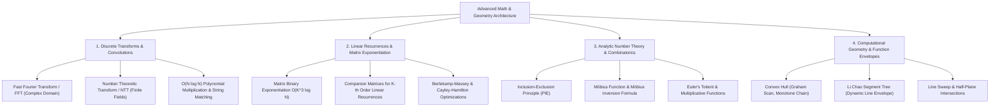
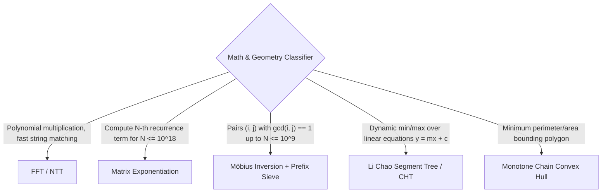

---


title: "09 Advanced Math And Geometry - Master Module Overview"
type: "module_overview"
category: "dsa"
subcategory: "09_advanced_math_and_geometry"
tags: [dsa, advanced-math, geometry, fft, ntt, polynomial-multiplication, matrix-exponentiation, inclusion-exclusion, mobius-inversion, convex-hull, lichao-tree, overview, roadmap, algorithms, computer-science, learning-note]
---

# 📚 09 Advanced Math And Geometry — Master Module Overview

## 📌 Connected Resource Graph
- 📐 **CHT & Li Chao Guide**: Convex Hull Trick Deep Dive
- ⚡ **Segment Tree Range Machinery**: Segment Trees & Lazy Propagation
- 🧩 **Advanced DP Overview**: Advanced Dynamic Programming Overview
- 🕸️ **Advanced Graphs**: Advanced Graph Theory Overview

> 🔙 **Parent Roadmap**: DSA Master Roadmap  
> ⚓ **Prerequisites**: Time & Space Complexity, Dynamic Programming

---

## 🎯 1. Module Objective & Algorithmic Frontier

Modern computational science, algorithmic trading, signal processing, and competitive programming rely heavily on mathematical and geometric transformations. Problems involving massive polynomial convolutions, high-order linear recurrence relations ($N \approx 10^{18}$), complex analytic number theory, and geometric envelope queries are impossible to brute-force.

This master module provides formal algebraic formulations, number-theoretic transforms, geometric invariants, and polyglot implementations across four fundamental mathematical pillars:



---

## 🧭 2. Sub-Module & Artifact Navigation

### 📖 Deep-Dive Theory & Algorithm Guides
- ⚡ **Fast Fourier Transform (FFT & NTT)**: Fast Fourier Transform & Polynomial Multiplication
- 📐 **Convex Hull Trick & Li Chao Tree**: Convex Hull Trick & Li Chao Tree
- 🔢 **Inclusion-Exclusion & Möbius Inversion**: Inclusion-Exclusion & Möbius Inversion
- 🔢 **Matrix Exponentiation & Recurrences**: Matrix Exponentiation & Linear Recurrence

### 📦 Standard Artifact Suite
1. 📝 **Exam & Assessment**: 09 Advanced Math & Geometry Exam Suite
2. 🧩 **Problem Set Walkthroughs**: 09 Advanced Math & Geometry Problem Set
3. 💬 **Interview Q&A**: 09 Advanced Math & Geometry Interview Q&A
4. 📊 **Cheat Sheet & Reference**: 09 Advanced Math & Geometry Resource Sheet

---

## 🔬 3. Theoretical Foundations & Mathematical Invariants

### 3.1 Fast Fourier Transform (FFT) & Convolution
Given two polynomials $A(x) = \sum_{i=0}^{n-1} a_i x^i$ and $B(x) = \sum_{j=0}^{m-1} b_j x^j$, their product $C(x) = A(x) \cdot B(x)$ requires $O(N \cdot M)$ naively.

- **The Convolution Theorem**:
  Multiplication in the coefficient domain is equivalent to point-wise multiplication in the point-value domain:
  $$C(x) = \text{IFFT}(\text{FFT}(A) \odot \text{FFT}(B))$$
- **Roots of Unity**:
  FFT evaluates polynomials at $N$-th complex roots of unity $\omega_N^k = e^{2\pi i k / N} = \cos(2\pi k / N) + i \sin(2\pi k / N)$.
- **Cooley-Tukey Radix-2 Decimation-in-Time (DIT)**:
  Splitting $A(x) = A_{\text{even}}(x^2) + x A_{\text{odd}}(x^2)$ yields:
  $$A(\omega_N^k) = A_{\text{even}}(\omega_{N/2}^k) + \omega_N^k A_{\text{odd}}(\omega_{N/2}^k)$$
  $$A(\omega_N^{k + N/2}) = A_{\text{even}}(\omega_{N/2}^k) - \omega_N^k A_{\text{odd}}(\omega_{N/2}^k)$$
  Achieves **$O(N \log N)$** runtime using bit-reversal permutations.
- **Number Theoretic Transform (NTT)**:
  Replaces complex roots $\omega_N$ with primitive roots $g$ in finite prime fields $\mathbb{F}_p$ (e.g., $p = 998244353 = 119 \cdot 2^{23} + 1$), eliminating floating-point precision loss.

```
Coefficient Representation: A = [a0, a1, ...], B = [b0, b1, ...]
      | (FFT O(N log N))                     | (FFT O(N log N))
Point-Value Evaluation: A(omega^k),           B(omega^k)
      \                                     /
       ---> Point-wise Multiply: C(omega^k) = A(omega^k) * B(omega^k)  (O(N))
                         |
                         V (Inverse FFT O(N log N))
Coefficient Representation: C = A * B
```

---

### 3.2 Matrix Exponentiation & Linear Recurrences
For any $K$-th order linear homogeneous recurrence relation:
$$f(n) = c_1 f(n-1) + c_2 f(n-2) + \dots + c_k f(n-k)$$

- **Matrix Formulation**:
  $$\begin{bmatrix} f(n) \\ f(n-1) \\ \vdots \\ f(n-k+1) \end{bmatrix} = \begin{bmatrix} c_1 & c_2 & \dots & c_{k-1} & c_k \\ 1 & 0 & \dots & 0 & 0 \\ 0 & 1 & \dots & 0 & 0 \\ \vdots & \vdots & \ddots & \vdots & \vdots \\ 0 & 0 & \dots & 1 & 0 \end{bmatrix} \begin{bmatrix} f(n-1) \\ f(n-2) \\ \vdots \\ f(n-k) \end{bmatrix}$$
- **Binary Exponentiation Invariant**:
  Using exponentiation by squaring, $M^N$ is computed in **$O(K^3 \log N)$** time.
  For $K \le 100$ and $N \le 10^{18}$, this computes $f(N) \pmod P$ in milliseconds.

---

### 3.3 Inclusion-Exclusion & Möbius Inversion
1. **Principle of Inclusion-Exclusion (PIE)**:
   $$|\bigcup_{i=1}^n A_i| = \sum_{\emptyset \ne J \subseteq \{1,\dots,n\}} (-1)^{|J|-1} |\bigcap_{j \in J} A_j|$$
2. **Möbius Function $\mu(n)$**:
   $$\mu(n) = \begin{cases} 1 & \text{if } n = 1 \\ (-1)^k & \text{if } n \text{ is product of } k \text{ distinct primes} \\ 0 & \text{if } n \text{ has a squared prime factor} \end{cases}$$
3. **Möbius Inversion Theorem**:
   For any number-theoretic arithmetic functions $f$ and $g$:
   $$g(n) = \sum_{d \mid n} f(d) \iff f(n) = \sum_{d \mid n} \mu(d) g\left(\frac{n}{d}\right)$$
   Crucial for computing coprime pairs, square-free integers, and multi-variable GCD summations $\sum_{i=1}^N \sum_{j=1}^M [\gcd(i, j) == 1]$ in $O(N)$ or $O(\sqrt{N})$.

---

### 3.4 Computational Geometry & Convex Envelope
- **Cross Product Orientation Test**:
  For 2D points $P_1, P_2, P_3$:
  $$\vec{v}_1 \times \vec{v}_2 = (x_2 - x_1)(y_3 - y_1) - (y_2 - y_1)(x_3 - x_1)$$
  - $> 0$: Counter-clockwise (CCW / Left turn)
  - $< 0$: Clockwise (CW / Right turn)
  - $= 0$: Collinear
- **Monotone Chain Algorithm (Andrew's Convex Hull)**:
  Sort points by $X$ (then $Y$). Construct lower and upper hulls via Monotonic Stack in **$O(N \log N)$** time.
- **Li Chao Segment Tree**:
  A segment tree that stores line functions $y = mx + c$ at each interval node.
  - At any node $[L, R]$, the line with the superior midpoint value is retained; the subordinate line is pushed down to the child where it may still dominate.
  - **Insertion**: $O(\log (\text{Coordinate Range}))$.
  - **Evaluation at $x$**: $O(\log (\text{Coordinate Range}))$.

---

## ⚡ 4. Master Complexity & Mathematical Methods Table

| Algorithmic Technique | Time Complexity | Auxiliary Space | Key Applications / Problem Archetypes |
| :--- | :---: | :---: | :--- |
| **Fast Fourier Transform (FFT)** | $O(N \log N)$ | $O(N)$ | BigInt multiplication, signal cross-correlation, string wildcards |
| **Number Theoretic Transform (NTT)**| $O(N \log N)$ | $O(N)$ | Exact modulo polynomial convolutions (mod 998244353) |
| **Matrix Exponentiation** | $O(K^3 \log N)$ | $O(K^2)$ | High-degree Fibonacci, graph walk path counting, linear DP |
| **Möbius Inversion + Sieve** | Pre: $O(N)$, Query: $O(\sqrt{N})$ | $O(N)$ | Coprime counting, Dirichlet convolution, GCD summations |
| **Andrew's Monotone Chain (Hull)** | $O(N \log N)$ | $O(N)$ | Minimum enclosing convex polygon, diameter of point sets |
| **Li Chao Segment Tree** | $O(\log \text{Range})$ | $O(4N)$ | Dynamic line insertion, CHT with arbitrary slopes/queries |
| **Berlekamp-Massey Algorithm** | $O(K^2 + K \log K \log N)$ | $O(K)$ | Guessing recurrences from sequence samples, $O(K \log N)$ evaluation |

---

## 💻 5. Polyglot Reference Implementations

### 5.1 Fast Fourier Transform (Cooley-Tukey In-Place)

#### C++20 Implementation
```cpp
#include <vector>
#include <complex>
#include <cmath>
#include <numbers>

using cd = std::complex<double>;

void fft(std::vector<cd>& a, bool invert) {
    int n = a.size();

    // Bit-reversal permutation
    for (int i = 1, j = 0; i < n; ++i) {
        int bit = n >> 1;
        for (; j & bit; bit >>= 1) j ^= bit;
        j ^= bit;
        if (i < j) std::swap(a[i], a[j]);
    }

    // Butterfly operations
    for (int len = 2; len <= n; len <<= 1) {
        double ang = 2 * std::numbers::pi / len * (invert ? -1 : 1);
        cd wlen(std::cos(ang), std::sin(ang));
        for (int i = 0; i < n; i += len) {
            cd w(1);
            for (int j = 0; j < len / 2; ++j) {
                cd u = a[i + j];
                cd v = a[i + j + len / 2] * w;
                a[i + j] = u + v;
                a[i + j + len / 2] = u - v;
                w *= wlen;
            }
        }
    }

    if (invert) {
        for (cd& x : a) x /= n;
    }
}
```

---

### 5.2 Matrix Exponentiation Engine for Linear Recurrences

#### Python 3 Implementation
```python
from typing import List

MOD = 1_000_000_007

def matrix_multiply(A: List[List[int]], B: List[List[int]], mod: int = MOD) -> List[List[int]]:
    """Multiplies two square matrices A and B modulo mod."""
    n = len(A)
    C = [[0] * n for _ in range(n)]
    for i in range(n):
        for k in range(n):
            if A[i][k] == 0:
                continue
            for j in range(n):
                C[i][j] = (C[i][j] + A[i][k] * B[k][j]) % mod
    return C

def matrix_power(M: List[List[int]], power: int, mod: int = MOD) -> List[List[int]]:
    """Computes M^power modulo mod in O(K^3 * log(power)) time."""
    n = len(M)
    result = [[int(i == j) for j in range(n)] for i in range(n)]
    base = [row[:] for row in M]

    while power > 0:
        if power & 1:
            result = matrix_multiply(result, base, mod)
        base = matrix_multiply(base, base, mod)
        power >>= 1
    return result

def fibonacci_matrix(n: int, mod: int = MOD) -> int:
    """Computes F(n) in O(log n) time using matrix exponentiation."""
    if n <= 0: return 0
    if n == 1: return 1
    # [[1, 1], [1, 0]]
    T = [[1, 1], [1, 0]]
    Tn = matrix_power(T, n - 1, mod)
    return Tn[0][0] # F(n) = Tn[0][0] * F(1) + Tn[0][1] * F(0)
```

---

### 5.3 Li Chao Tree for Dynamic Line Maintenance & Min Query

#### C# Implementation
```csharp
using System;

public class LiChaoTree {
    public struct Line {
        public long M, C;
        public Line(long m, long c) { M = m; C = c; }
        public long Eval(long x) => M * x + C;
    }

    private struct Node {
        public Line line;
        public int left, right;
    }

    private Node[] tree;
    private int nodeCount;
    private const long INF = (long)4e18;

    public LiChaoTree(int maxNodes = 200000) {
        tree = new Node[maxNodes];
        nodeCount = 1;
        tree[1].line = new Line(0, INF);
    }

    public void InsertLine(Line newLine, int node, long l, long r) {
        long mid = l + (r - l) / 2;
        bool leftBetter = newLine.Eval(l) < tree[node].line.Eval(l);
        bool midBetter = newLine.Eval(mid) < tree[node].line.Eval(mid);

        if (midBetter) {
            var temp = tree[node].line;
            tree[node].line = newLine;
            newLine = temp;
        }

        if (l == r || newLine.C >= INF) return;

        if (leftBetter != midBetter) {
            if (tree[node].left == 0) tree[node].left = ++nodeCount;
            InsertLine(newLine, tree[node].left, l, mid);
        } else {
            if (tree[node].right == 0) tree[node].right = ++nodeCount;
            InsertLine(newLine, tree[node].right, mid + 1, r);
        }
    }

    public long Query(long x, int node, long l, long r) {
        if (node == 0) return INF;
        long res = tree[node].line.Eval(x);
        if (l == r) return res;

        long mid = l + (r - l) / 2;
        if (x <= mid) {
            return Math.Min(res, Query(x, tree[node].left, l, mid));
        } else {
            return Math.Min(res, Query(x, tree[node].right, mid + 1, r));
        }
    }
}
```

---

## ⚠️ 6. Common Pitfalls & Precision Hazards

1. **Floating-Point Drift in FFT**:
   - Complex multiplication in double precision accumulates rounding error. When multiplying polynomials with integer coefficients $\approx 10^9$, rounding errors cause wrong results. Use **NTT (Number Theoretic Transform)** or split polynomial coefficients modulo $P$.
2. **Matrix Exponentiation Non-Commutativity**:
   - Matrix multiplication is NOT commutative ($A \cdot B \ne B \cdot A$). Ensure the transition matrix multiplies the state column vector from the left: $\vec{S}_{n} = M \cdot \vec{S}_{n-1}$.
3. **Möbius Inversion Sieve Bounds**:
   - When precomputing $\mu(d)$, always compute the linear sieve up to $\max(\sqrt{N}, M)$. Failing to initialize $\mu(1) = 1$ zeroes out all subsequent Dirichlet convolutions.
4. **Collinear Points in Convex Hull**:
   - If strict convex hulls are required, ensure cross-product checks use strictly $> 0$ rather than $\ge 0$ to discard intermediate collinear vertices.

---

## 🎯 7. Pattern Recognition & Problem Classifier



---

