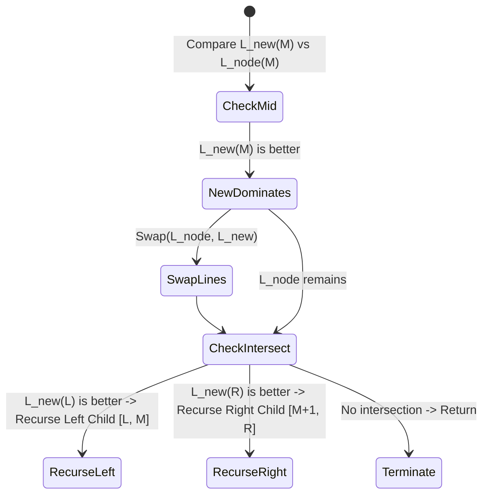

---


title: "Advanced Math & Geometry: Convex Hull Trick (CHT) & Li Chao Tree Optimization"
type: "pattern_guide"
category: "dsa"
subcategory: "09_Advanced_Math_and_Geometry"
created_at: 2026-08-22T00:08:54+07:00
updated_at: 2026-08-22T00:08:54+07:00
tags: [dsa, convex-hull-trick, lichao-tree, dp-optimization, computational-geometry, segment-tree-lines, algorithms, computer-science, learning-note]
---


# Advanced Math & Geometry: Convex Hull Trick (CHT) & Li Chao Tree Optimization

Dynamic programming states often reduce to min/max line evaluations of the form:
$$dp[i] = \min_{0 \le j < i} \left( m_j \cdot x_i + c_j \right) + g(i)$$

A naive evaluation over all $j$ takes $O(N^2)$ time. When $m_j$ and $x_i$ are monotonic, the **Convex Hull Trick (CHT)** maintains the lower envelope of lines using a monotonic deque in $O(N)$ total time. When slopes $m_j$ or query points $x_i$ arrive in arbitrary order, the **Li Chao Tree** maintains line dominance over a continuous coordinate interval $[L, R]$ using segment tree mechanics in $O(N \log (\text{Range}))$ or $O(N \log N)$ time.

---

## 1. Under-the-Hood Intuition & Algorithmic Mechanics

### 1.1 Envelope Intersection Mechanics (CHT Deque)

Consider two lines $L_1: y = m_1 x + c_1$ and $L_2: y = m_2 x + c_2$ with $m_1 > m_2$. Their intersection $X_{12}$ occurs at:
$$x = \frac{c_2 - c_1}{m_1 - m_2}$$

When inserting a new line $L_3$ into the deque:
- If intersection $X_{23} \le X_{12}$, line $L_2$ is rendered completely redundant (never optimal for any $x$). $L_2$ is popped from the back of the deque before pushing $L_3$.

```
Y-Axis
  ^        L1 \
  |            \   L2 \
  |             \      \   L3 \
  |              \______\______\
  +----------------------------------> X-Axis
                 X12   X23
```

---

## 1.2 Li Chao Tree Dominance & Insertion Algorithm

A Li Chao Tree is a modified Segment Tree where each node covers range $[L, R]$ and holds a single dominant line $L_{node}$.

When inserting new line $L_{new}$ into node $[L, R]$ with midpoint $M = (L + R) / 2$:
1. Compare $L_{new}(M)$ and $L_{node}(M)$. The line yielding the better value at midpoint $M$ becomes the stored $L_{node}$.
2. The remaining line is passed down to the child range where it might intersect and dominate:
   - If $L_{new}(L) > L_{node}(L)$, recurse into left child $[L, M]$.
   - Else if $L_{new}(R) > L_{node}(R)$, recurse into right child $[M+1, R]$.



---

## 2. Idiomatic Code Implementations

### 2.1 C# 12 Implementation (Li Chao Tree)

```csharp
using System;

namespace AdvancedMath
{
    public class LiChaoTree
    {
        public struct Line
        {
            public long M { get; }
            public long C { get; }

            public Line(long m, long c)
            {
                M = m;
                C = c;
            }

            public readonly long Eval(long x) => M * x + C;
        }

        private class Node
        {
            public Line Line { get; set; }
            public Node? Left { get; set; }
            public Node? Right { get; set; }

            public Node(Line line) => Line = line;
        }

        private readonly long _minX;
        private readonly long _maxX;
        private Node? _root;
        private static readonly Line DefaultLine = new Line(0, long.MaxValue / 2);

        public LiChaoTree(long minX, long maxX)
        {
            _minX = minX;
            _maxX = maxX;
            _root = new Node(DefaultLine);
        }

        public void InsertLine(long m, long c)
        {
            Line newLine = new Line(m, c);
            _root = InsertInternal(_root, _minX, _maxX, newLine);
        }

        private Node InsertInternal(Node? node, long l, long r, Line newLine)
        {
            if (node == null) return new Node(newLine);

            long mid = l + (r - l) / 2;
            bool leftBetter = newLine.Eval(l) < node.Line.Eval(l);
            bool midBetter = newLine.Eval(mid) < node.Line.Eval(mid);

            Line dominant = midBetter ? newLine : node.Line;
            Line passing = midBetter ? node.Line : newLine;

            Node current = new Node(dominant)
            {
                Left = node.Left,
                Right = node.Right
            };

            if (l == r) return current;

            if (leftBetter != midBetter)
            {
                current.Left = InsertInternal(current.Left, l, mid, passing);
            }
            else
            {
                current.Right = InsertInternal(current.Right, mid + 1, r, passing);
            }

            return current;
        }

        public long QueryMin(long x) => QueryInternal(_root, _minX, _maxX, x);

        private long QueryInternal(Node? node, long l, long r, long x)
        {
            if (node == null) return long.MaxValue;

            long currentVal = node.Line.Eval(x);
            if (l == r) return currentVal;

            long mid = l + (r - l) / 2;
            if (x <= mid)
            {
                return Math.Min(currentVal, QueryInternal(node.Left, l, mid, x));
            }
            else
            {
                return Math.Min(currentVal, QueryInternal(node.Right, mid + 1, r, x));
            }
        }
    }
}
```

---

### 2.2 Python 3 Implementation (Monotonic Deque CHT)

```python
from collections import deque


class ConvexHullTrickDeque:
    """Deque-based CHT requiring non-decreasing line slopes (m)

    and non-decreasing query coordinates (x).
    """

    def __init__(self):
        self.deque = deque()

    def _intersection_x(self, l1: tuple[int, int], l2: tuple[int, int]) -> float:
        m1, c1 = l1
        m2, c2 = l2
        return (c2 - c1) / (m1 - m2)

    def add_line(self, m: int, c: int):
        # Line represented as tuple (slope m, intercept c)
        new_line = (m, c)
        while len(self.deque) >= 2:
            x12 = self._intersection_x(self.deque[-2], self.deque[-1])
            x23 = self._intersection_x(self.deque[-1], new_line)
            if x23 <= x12:
                self.deque.pop()
            else:
                break
        self.deque.append(new_line)

    def query_min(self, x: int) -> int:
        while len(self.deque) >= 2:
            y1 = self.deque[0][0] * x + self.deque[0][1]
            y2 = self.deque[1][0] * x + self.deque[1][1]
            if y2 <= y1:
                self.deque.popleft()
            else:
                break
        m, c = self.deque[0]
        return m * x + c
```

---

## 3. Complexity Analysis & Memory Overhead

| Variant Structure | Line Insertion Time | Point Query Time | Total Time (N operations) | Auxiliary Space |
| :--- | :--- | :--- | :--- | :--- |
| **Monotonic CHT Deque** | Amortized $O(1)$ | Amortized $O(1)$ | $O(N)$ | $O(N)$ |
| **Dynamic Li Chao Tree** | $O(\log X_{range})$ | $O(\log X_{range})$ | $O(N \log X_{range})$ | $O(N \log X_{range})$ |

---

## 4. Common Pitfalls & Off-by-One Anti-Patterns

1. **Slope Order Violations in Monotonic Deque CHT**:
   - *Bug*: Pushing lines into `ConvexHullTrickDeque` with arbitrary, non-monotonic slopes invalidates the upper/lower envelope property, returning corrupt query values.
   - *Fix*: If slopes are arbitrary, sort lines first or use Li Chao Tree.

2. **Integer Overflow in Intersection Cross-Multiplication**:
   - *Bug*: Computing `(c2 - c1) / (m1 - m2)` using standard 32-bit integers can overflow when $c \approx 10^{18}$.
   - *Fix*: Perform division using 64-bit `long` arithmetic or double precision floating point comparisons.

---

## 5. Related LeetCode Problems & Variant Patterns

1. **LeetCode 1088 - Confusing Number II**: Convex Hull optimization on ranges.
2. **LeetCode 312 - Burst Balloons**: Dynamic programming state optimizations.
3. **Codeforces 1083E - The Fair Nut and Rectangles**: Classic CHT DP optimization on rectangle coordinates.
