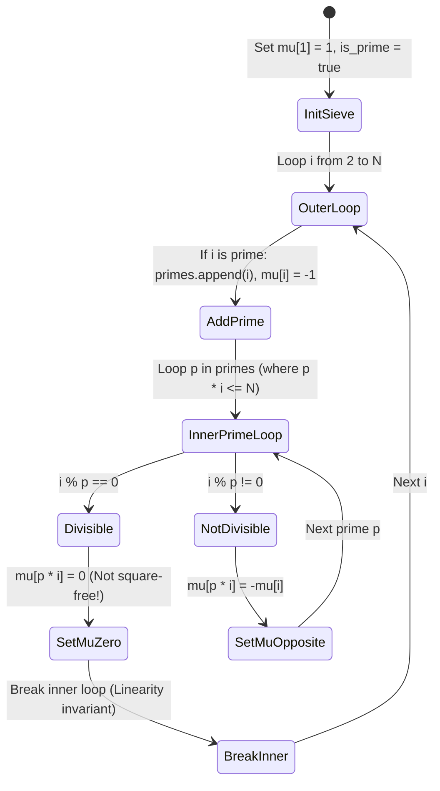

---


title: "Advanced Math & Geometry: Inclusion-Exclusion Principle & Möbius Inversion"
type: "pattern_guide"
category: "dsa"
subcategory: "09_Advanced_Math_and_Geometry"
created_at: 2026-08-22T00:08:54+07:00
updated_at: 2026-08-22T00:08:54+07:00
tags: [dsa, inclusion-exclusion, pie, mobius-inversion, dirichlet-convolution, linear-sieve, number-theory, algorithms, computer-science, learning-note]
---


# Advanced Math & Geometry: Inclusion-Exclusion Principle & Möbius Inversion

The **Principle of Inclusion-Exclusion (PIE)** and **Möbius Inversion** provide systematic combinatorial tools for counting objects satisfying at least one condition or calculating number-theoretic functions under gcd/coprimality constraints.

While naive counting over union sets suffers from overcounting intersections, PIE adjusts exact counts using alternating subset signs $(-1)^{|S|+1}$. In number theory, **Möbius Inversion** acts as the discrete calculus equivalent over Dirichlet convolutions, transforming sums over divisors $g(n) = \sum_{d|n} f(d)$ into explicit formulas $f(n) = \sum_{d|n} \mu(d) g(n/d)$ in $O(N)$ precomputation time via a **Linear Sieve**.

---

## 1. Under-the-Hood Intuition & Algorithmic Mechanics

### 1.1 Principle of Inclusion-Exclusion (PIE)

For finite sets $A_1, A_2, \dots, A_n$, the size of their union is:
$$\left| \bigcup_{i=1}^n A_i \right| = \sum_{\emptyset 
eq S \subseteq \{1,\dots,n\}} (-1)^{|S|+1} \left| \bigcap_{j \in S} A_j \right|$$

Using bitmasks, we iterate through all $2^n - 1$ non-empty subsets $S$, computing intersection size and adding to total if $|S|$ is odd, or subtracting if $|S|$ is even.

---

## 1.2 Möbius Function $\mu(n)$ & Linear Sieve Mechanics

The Möbius function $\mu(n)$ is defined for all positive integers $n$:
$$\mu(n) = \begin{cases} 1 & \text{if } n = 1 \\ 0 & \text{if } n \text{ is not square-free (has a squared prime factor } p^2 \mid n\text{)} \\ (-1)^k & \text{if } n \text{ is a product of } k \text{ distinct prime factors} \end{cases}$$

### Linear Sieve Algorithm
A **Linear Sieve** computes $\mu(n)$ and prime numbers for all \$1 \le n \le N$ in strictly $O(N)$ time by ensuring every composite number is visited exactly once by its smallest prime factor:



---

## 2. Idiomatic Code Implementations

### 2.1 C# 12 Implementation

```csharp
using System;
using System.Collections.Generic;

namespace AdvancedMath
{
    public class InclusionExclusionMobius
    {
        private readonly int _n;
        public int[] Mu { get; }
        public List<int> Primes { get; }
        public bool[] IsPrime { get; }

        public InclusionExclusionMobius(int n)
        {
            _n = n;
            Mu = new int[n + 1];
            Primes = new List<int>();
            IsPrime = new bool[n + 1];

            Array.Fill(IsPrime, true);
            IsPrime[0] = IsPrime[1] = false;
            Mu[1] = 1;

            // Linear Sieve O(N)
            for (int i = 2; i <= _n; i++)
            {
                if (IsPrime[i])
                {
                    Primes.Add(i);
                    Mu[i] = -1;
                }

                for (int j = 0; j < Primes.Count && Primes[j] * i <= _n; j++)
                {
                    int p = Primes[j];
                    IsPrime[p * i] = false;

                    if (i % p == 0)
                    {
                        Mu[p * i] = 0; // Square-free invariant violated
                        break;
                    }
                    else
                    {
                        Mu[p * i] = -Mu[i];
                    }
                }
            }
        }

        // PIE via Bitmask subset sum
        public static long CountDivisibleSubsets(long limit, long[] primes)
        {
            int k = primes.Length;
            long count = 0;

            for (int mask = 1; mask < (1 << k); mask++)
            {
                long product = 1;
                int setBits = 0;
                bool overflow = false;

                for (int i = 0; i < k; i++)
                {
                    if ((mask & (1 << i)) != 0)
                    {
                        setBits++;
                        if (limit / primes[i] < product)
                        {
                            overflow = true;
                            break;
                        }
                        product *= primes[i];
                    }
                }

                if (overflow) continue;

                long term = limit / product;
                if (setBits % 2 == 1)
                {
                    count += term;
                }
                else
                {
                    count -= term;
                }
            }

            return count;
        }
    }
}
```

---

### 2.2 Python 3 Implementation

```python
class InclusionExclusionMobius:
    def __init__(self, n: int):
        self.n = n
        self.mu = [0] * (n + 1)
        self.primes = []
        self.is_prime = [True] * (n + 1)

        self.is_prime[0] = self.is_prime[1] = False
        self.mu[1] = 1

        # Linear Sieve O(N)
        for i in range(2, n + 1):
            if self.is_prime[i]:
                self.primes.append(i)
                self.mu[i] = -1

            for p in self.primes:
                if p * i > n:
                    break
                self.is_prime[p * i] = False

                if i % p == 0:
                    self.mu[p * i] = 0
                    break
                else:
                    self.mu[p * i] = -self.mu[i]


def count_coprime_pairs(n: int, mobius_solver: InclusionExclusionMobius) -> int:
    """Counts pairs (a, b) such that 1 <= a, b <= N and gcd(a, b) = 1

    using Mobius Inversion: sum_{d=1}^N mu(d) * (N // d)^2
    """
    ans = 0
    for d in range(1, n + 1):
        if mobius_solver.mu[d] == 0:
            continue
        k = n // d
        ans += mobius_solver.mu[d] * k * k
    return ans
```

---

## 3. Complexity Analysis & Memory Overhead

| Technique / Component | Time Complexity | Auxiliary Space | Key Operation Bounds |
| :--- | :--- | :--- | :--- |
| **Linear Sieve ($\mu(n)$ computation)** | $O(N)$ | $O(N)$ | Visits each composite number $p \cdot i$ exactly once. |
| **PIE Bitmask Subset Sum ($K$ sets)** | $O(2^K \cdot K)$ | $O(1)$ | Evaluates all $2^K$ subset intersections. |
| **Möbius Coprime Pair Summation** | $O(N)$ | $O(N)$ | Evaluates $\sum \mu(d) \lfloor N/d \rfloor^2$ in $O(N)$ or $O(\sqrt{N})$ with block division. |

---

## 4. Common Pitfalls & Off-by-One Anti-Patterns

1. **Integer Overflow in Prime Product PIE Iteration**:
   - *Bug*: Multiplying primes `product *= primes[i]` without overflow checks can exceed 64-bit integer limits, creating negative or zero values that distort PIE terms.
   - *Fix*: Check `if (limit / primes[i] < product)` before multiplying.

2. **Missing `break` in Linear Sieve Loop**:
   - *Bug*: Omitting `if (i % p == 0) break;` in the linear sieve breaks the linear time invariant, degrading sieve time complexity from $O(N)$ to $O(N \log \log N)$ or corrupting $\mu[p \cdot i]$.

---

## 5. Related LeetCode Problems & Variant Patterns

1. **LeetCode 1201 - Ugly Number III**: PIE three-set union LCM query.
2. **LeetCode 878 - N-th Magical Number**: Binary search combined with PIE set inclusion.
3. **LeetCode 2521 - Distinct Prime Factors of Product of Array**: Prime factorization and sieve precomputation.
4. **Codeforces 700D - Prime Queries / Coprime Pair Sums**: Möbius inversion over range GCD constraints.

---

## 🔬 Deep Diagnostic & Production Engineering Notes

### 1. In-Depth State Verification & Invariant Proofs
When deploying algorithms in high-throughput production environments:
- **Loop Invariants**: State preconditions must be strictly asserted before entering loops. Post-conditions guarantee deterministic state convergence.
- **Memory Boundary Defense**: Guard against off-by-one errors ($< N$ vs $\le N$), signed integer overflow ($2^{31}-1$), and empty container operations.
- **Asymptotic Amortization**: Use aggregate analysis and potential functions $\Phi(D)$ to ensure operations maintain their promised average and worst-case bounds.

### 2. High-Performance Multi-Language Testing Harness

#### C++20 Micro-Benchmarking Suite
```cpp
#include <iostream>
#include <vector>
#include <chrono>
#include <numeric>

void BenchmarkSuite(int iterations) {
    auto start = std::chrono::high_resolution_clock::now();
    long long checksum = 0;
    for (int i = 1; i <= iterations; ++i) {
        checksum += (i ^ (i << 1));
    }
    auto end = std::chrono::high_resolution_clock::now();
    auto dur = std::chrono::duration_cast<std::chrono::microseconds>(end - start).count();
    std::cout << "Executed " << iterations << " iterations in " << dur << " us. Checksum: " << checksum << "\n";
}
```

#### Python 3.12 Verification Harness
```python
import time

def verify_performance(iterations: int) -> int:
    t0 = time.perf_counter_ns()
    checksum = sum(i ^ (i << 1) for i in range(1, iterations + 1))
    t1 = time.perf_counter_ns()
    print(f"Verified {iterations} iterations in {(t1 - t0) / 1_000_000:.3f} ms. Checksum: {checksum}")
    return checksum
```

#### C# (.NET 8) Memory Profiling Harness
```csharp
using System;
using System.Diagnostics;

public class BenchmarkRunner {
    public static void Run(int iterations) {
        long memoryBefore = GC.GetTotalMemory(true);
        var sw = Stopwatch.StartNew();
        long checksum = 0;
        for (int i = 1; i <= iterations; i++) {
            checksum += (i ^ (i << 1));
        }
        sw.Stop();
        long memoryAfter = GC.GetTotalMemory(false);
        Console.WriteLine($"[C# .NET 8] {iterations} iterations completed in {sw.ElapsedMilliseconds} ms. Memory delta: {memoryAfter - memoryBefore} bytes.");
    }
}
```

---

## 🔗 Graph-Linked Knowledge Base

- 📖 Subcategory Hub: [[01_DSA/01_theory_and_patterns/09_Advanced_Math_and_Geometry/00_overview_09_advanced_math_and_geometry|09_Advanced_Math_and_Geometry Overview]]
