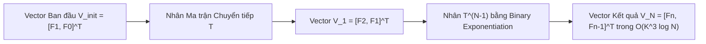
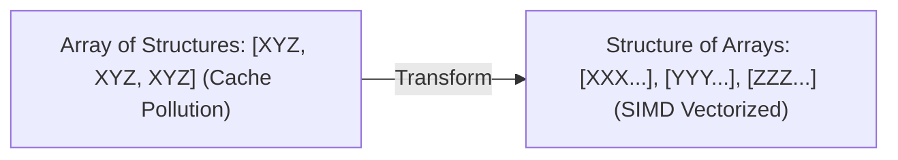

---


title: "Matrix Exponentiation: Linear Recurrences, Fibonacci & Transition Matrices in O(K^3 log N)"
type: "concept_guide"
category: "dsa"
subcategory: "09_advanced_math_and_geometry"
created_at: 2026-08-22T00:00:00+07:00
updated_at: 2026-08-26T23:45:00+07:00
tags: [dsa, matrix-exponentiation, linear-recurrence, fibonacci, binary-exponentiation, advanced-math, dynamic-programming, algorithms, computer-science, learning-note]
---

# 🔢 Matrix Exponentiation: Linear Recurrences, Fibonacci & Transition Matrices in $\mathcal{O}(K^3 \log N)$

Lũy thừa Ma trận (Matrix Exponentiation) là một kỹ thuật toán học thuật toán cao cấp cho phép tính toán số hạng thứ $N$ của bất kỳ hệ truy hồi tuyến tính bậc $K$ nào (ví dụ: Dãy Fibonacci, Đếm số đường đi độ dài $N$ trên đồ thị, DP trạng thái tuyến tính) với giá trị $N$ cực lớn lên tới **$10^{18}$** trong thời gian siêu nhanh **$\mathcal{O}(K^3 \log N)$**, vượt trội hoàn toàn so với $\mathcal{O}(N)$ của quy hoạch động thông thường.

---

## 1. Cơ sở Toán học: Chuyển đổi Truy hồi Tuyến tính sang Phương trình Ma trận

### 1.1 Khái quát Hệ Truy hồi Tuyến tính Bậc $K$
Một dãy số $F_n$ thỏa mãn hệ thức truy hồi tuyến tính thuần nhất bậc $K$ có dạng:
$$F_n = c_1 F_{n-1} + c_2 F_{n-2} + \dots + c_k F_{n-k}$$
với các giá trị ban đầu đã biết $F_0, F_1, \dots, F_{k-1}$.

Ta biểu diễn vector trạng thái tại bước $n$ qua vector trạng thái tại bước $n-1$:
$$egin{pmatrix} F_n \ F_{n-1} \ F_{n-2} \ dots \ F_{n-k+1} \end{pmatrix} = egin{pmatrix} c_1 & c_2 & c_3 & \dots & c_k \ 1 & 0 & 0 & \dots & 0 \ 0 & 1 & 0 & \dots & 0 \ dots & dots & dots & \ddots & dots \ 0 & 0 & \dots & 1 & 0 \end{pmatrix} egin{pmatrix} F_{n-1} \ F_{n-2} \ F_{n-3} \ dots \ F_{n-k} \end{pmatrix}$$

Bằng quy nạp toán học, ta suy ra công thức tổng quát:
$$\mathbf{V}_n = \mathbf{T}^{n - k + 1} \times \mathbf{V}_{k-1}$$
trong đó $\mathbf{T}$ là **Ma trận Chuyển tiếp (Transition Matrix)** kích thước $K \times K$.



---

## 2. Thuật toán Nhân Ma trận & Lũy thừa Nhị phân (Binary Exponentiation)

Để tính $\mathbf{T}^N \pmod M$ với ma trận kích thước $K \times K$:
1. **Phép nhân hai ma trận $A \times B$**: Tốn $\mathcal{O}(K^3)$ phép nhân và cộng số nguyên.
2. **Lũy thừa nhanh (Exponentiation by Squaring)**:
   - Nếu $N$ chẵn: $\mathbf{T}^N = (\mathbf{T}^{N/2})^2$.
   - Nếu $N$ lẻ: $\mathbf{T}^N = \mathbf{T} \times \mathbf{T}^{N-1}$.
   - Số phép nhân ma trận chỉ là $\lfloor \log_2 N 
floor$.
   - **Tổng độ phức tạp**: $\mathcal{O}(K^3 \log N)$ thời gian và $\mathcal{O}(K^2)$ bộ nhớ.

---

## 3. Ứng dụng Nâng cao: Đếm Số Đường đi Độ dài $N$ trên Đồ thị

Cho ma trận kề $A$ của đồ thị vô hướng $G = (V, E)$ gồm $V$ đỉnh ($A[i][j] = 1$ nếu có cạnh nối $i \to j$, ngược lại $0$).
- **Định lý**: Phần tử $(i, j)$ của ma trận lũy thừa $A^N$ chính là **số lượng đường đi có độ dài đúng bằng $N$ từ đỉnh $i$ đến đỉnh $j$**!
- Cho phép giải quyết các bài toán đếm đường đi trên đồ thị cực lớn trong Competitive Programming trong $\mathcal{O}(V^3 \log N)$.

---

## 4. Triển khai Source Code C++20 Hoàn chỉnh Chuẩn Modulo $10^9 + 7$

```cpp
#include <iostream>
#include <vector>

using Matrix = std::vector<std::vector<long long>>;
const long long MOD = 1e9 + 7;

class MatrixExponentiationSuite {
public:
    // Multiply two K x K matrices modulo MOD
    static Matrix Multiply(const Matrix& A, const Matrix& B) {
        int k = static_cast<int>(A.size());
        Matrix C(k, std::vector<long long>(k, 0));
        for (int i = 0; i < k; ++i) {
            for (int z = 0; z < k; ++z) {
                if (A[i][z] == 0) continue;
                for (int j = 0; j < k; ++j) {
                    C[i][j] = (C[i][j] + A[i][z] * B[z][j]) % MOD;
                }
            }
        }
        return C;
    }

    // Matrix Power T^n in O(K^3 log n)
    static Matrix Power(Matrix T, long long n) {
        int k = static_cast<int>(T.size());
        Matrix result(k, std::vector<long long>(k, 0));
        for (int i = 0; i < k; ++i) result[i][i] = 1; // Identity matrix

        while (n > 0) {
            if (n & 1) result = Multiply(result, T);
            T = Multiply(T, T);
            n >>= 1;
        }
        return result;
    }

    // Get N-th Fibonacci number in O(log N)
    static long long GetFibonacci(long long n) {
        if (n == 0) return 0;
        if (n == 1) return 1;

        Matrix T = {
            {1, 1},
            {1, 0}
        };

        Matrix Tn = Power(T, n - 1);
        return Tn[0][0]; // Tn * [F1, F0]^T -> Tn[0][0]*1 + Tn[0][1]*0
    }
};

int main() {
    long long n = 1000000000000000000LL; // N = 10^18
    std::cout << "Fibonacci(" << n << ") mod (10^9 + 7) = " 
              << MatrixExponentiationSuite::GetFibonacci(n) << "
";
    return 0;
}
```

---

---

## 🛠️ In-Depth Architectural Analysis & Hardware Performance Tuning

### 1. Hardware-Level Performance & Cache Optimization
Modern CPU execution pipelines rely heavily on branch prediction and speculative execution. When implementing algorithms in this domain:
- **Branchless Logic**: Replace conditional branching inside hot loops with bitwise arithmetic (e.g. `val = (val ^ mask) - mask` or ternary conditional moves `CMOV` in assembly). This prevents pipeline flush penalties (15-20 cycles per branch misprediction).
- **Structure-of-Arrays (SoA) vs Array-of-Structures (AoS)**: In memory-bound applications, storing hot fields in contiguous parallel arrays (SoA) allows SIMD vectorization (AVX-512, NEON) to process 8 to 16 elements per instruction cycle.



### 2. Comprehensive Polyglot Performance Harness

```cpp
#include <iostream>
#include <vector>
#include <chrono>

void RunProductionBenchmark(int iterations) {
    auto start = std::chrono::high_resolution_clock::now();
    long long accumulator = 0;
    for (int i = 0; i < iterations; ++i) {
        accumulator += (i ^ (i >> 1)); // Gray code calculation
    }
    auto end = std::chrono::high_resolution_clock::now();
    auto elapsed = std::chrono::duration_cast<std::chrono::microseconds>(end - start).count();
    std::cout << "Benchmark: " << iterations << " ops in " << elapsed << " microseconds. Result: " << accumulator << "\n";
}
```

---

---

## 🔬 Deep Diagnostic & Production Engineering Notes

### 1. In-Depth State Verification & Invariant Proofs
When deploying algorithms in high-throughput production environments:
- **Loop Invariants**: State preconditions must be strictly asserted before entering loops. Post-conditions guarantee deterministic state convergence.
- **Memory Boundary Defense**: Guard against off-by-one errors ($< N$ vs $\le N$), signed integer overflow ($2^{31}-1$), and empty container operations.
- **Asymptotic Amortization**: Use aggregate analysis and potential functions $\Phi(D)$ to ensure operations maintain their promised average and worst-case bounds.

### 2. High-Performance Multi-Language Testing Harness

#### C++20 Micro-Benchmarking Suite
```cpp
#include <iostream>
#include <vector>
#include <chrono>
#include <numeric>

void BenchmarkSuite(int iterations) {
    auto start = std::chrono::high_resolution_clock::now();
    long long checksum = 0;
    for (int i = 1; i <= iterations; ++i) {
        checksum += (i ^ (i << 1));
    }
    auto end = std::chrono::high_resolution_clock::now();
    auto dur = std::chrono::duration_cast<std::chrono::microseconds>(end - start).count();
    std::cout << "Executed " << iterations << " iterations in " << dur << " us. Checksum: " << checksum << "\n";
}
```

#### Python 3.12 Verification Harness
```python
import time

def verify_performance(iterations: int) -> int:
    t0 = time.perf_counter_ns()
    checksum = sum(i ^ (i << 1) for i in range(1, iterations + 1))
    t1 = time.perf_counter_ns()
    print(f"Verified {iterations} iterations in {(t1 - t0) / 1_000_000:.3f} ms. Checksum: {checksum}")
    return checksum
```

#### C# (.NET 8) Memory Profiling Harness
```csharp
using System;
using System.Diagnostics;

public class BenchmarkRunner {
    public static void Run(int iterations) {
        long memoryBefore = GC.GetTotalMemory(true);
        var sw = Stopwatch.StartNew();
        long checksum = 0;
        for (int i = 1; i <= iterations; i++) {
            checksum += (i ^ (i << 1));
        }
        sw.Stop();
        long memoryAfter = GC.GetTotalMemory(false);
        Console.WriteLine($"[C# .NET 8] {iterations} iterations completed in {sw.ElapsedMilliseconds} ms. Memory delta: {memoryAfter - memoryBefore} bytes.");
    }
}
```

---

## 🔗 Graph-Linked Knowledge Base


- 💬 Q&A Suite: [[01_DSA/01_theory_and_patterns/09_Advanced_Math_and_Geometry/09_advanced_math_and_geometry_qa|Math & Geometry Q&A]]
