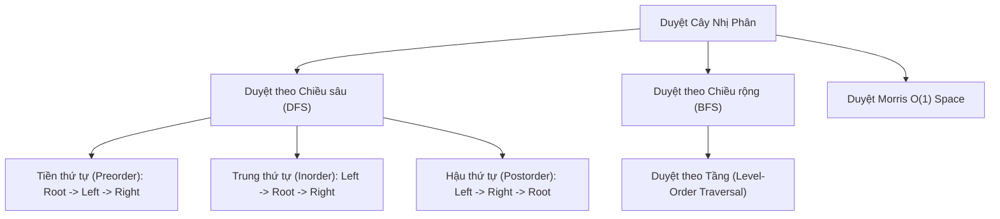
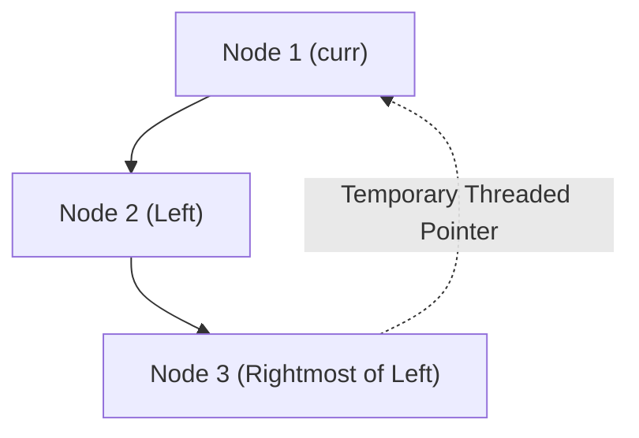

---


title: "Binary Trees: Traversals, Structural Properties & Recursive Mechanics"
type: "concept_guide"
category: "dsa"
subcategory: "09_binary_trees"
created_at: 2026-08-22T00:00:00+07:00
updated_at: 2026-08-26T23:45:00+07:00
tags: [dsa, binary-trees, tree-traversal, morris-traversal, euler-tour, lca, diameter, recursion, algorithms, computer-science, learning-note]
---

# 🌳 Binary Trees: Traversals, Structural Properties & Recursive Mechanics

Cây nhị phân (Binary Tree) là cấu trúc dữ liệu phi tuyến tính phân cấp (Hierarchical Non-Linear Data Structure) tối quan trọng trong khoa học máy tính. Mỗi nút (node) có tối đa hai nút con được gọi là con trái (`left`) và con phải (`right`). Cây nhị phân là nền móng trực tiếp của Cây tìm kiếm nhị phân (BST), Cây AVL, Cây Đỏ-Đen (Red-Black Tree), Heap, Segment Tree và Cú pháp cây trừu tượng (Abstract Syntax Tree - AST) trong các trình biên dịch.

---

## 1. Các Thuộc tính Hình học & Phân loại Cây Nhị phân

```mermaid
graph TD
    subgraph Perfect Binary Tree (Height = 2, Nodes = 7)
        P1["1"] --> P2["2"]
        P1 --> P3["3"]
        P2 --> P4["4"]
        P2 --> P5["5"]
        P3 --> P6["6"]
        P3 --> P7["7"]
    end
```

### 1.1 Phân loại Cây Nhị phân Chuẩn
1. **Full Binary Tree (Cây Nhị phân Đầy đủ)**: Mọi nút đều có đúng 0 hoặc 2 nút con.
2. **Complete Binary Tree (Cây Nhị phân Hoàn chỉnh)**: Mọi tầng đều được lấp đầy hoàn toàn, ngoại trừ tầng cuối cùng có thể khuyết nhưng các nút phải được xếp dồn về phía ngoài cùng bên trái (Cấu trúc nền tảng của Binary Heap).
3. **Perfect Binary Tree (Cây Nhị phân Hoàn hảo)**: Mọi nút trong đều có 2 con và tất cả các nút lá đều ở cùng một độ sâu. Số nút $N = 2^{h+1} - 1$.
4. **Balanced Binary Tree (Cây Nhị phân Cân bằng)**: Với mọi nút, độ chênh lệch chiều cao giữa cây con trái và cây con phải không quá 1 ($|\text{height}(L) - \text{height}(R)| \le 1$). Chiều cao cây luôn được đảm bảo là $\mathcal{O}(\log N)$.
5. **Degenerate (Pathological) Tree (Cây Suy biến)**: Mỗi nút cha chỉ có đúng 1 con, biến cây thành một Danh sách liên kết có chiều cao $\mathcal{O}(N)$.

### 1.2 Bảng Công thức Toán học Hình học Cây
- Với cây có chiều cao $h$ (định nghĩa gốc ở độ sâu $0$):
  - Số nút lá tối đa: $2^h$.
  - Tổng số nút tối đa: $N_{\text{max}} = 2^{h+1} - 1$.
  - Chiều cao tối thiểu của cây $N$ nút: $h_{\text{min}} = \lfloor \log_2 N 
floor$.
  - Chiều cao tối đa của cây $N$ nút: $h_{\text{max}} = N - 1$.
  - Định lý số cạnh: Cây gồm $N$ đỉnh luôn có chính xác $E = N - 1$ cạnh.

---

## 2. Các Phương pháp Duyệt Cây (Tree Traversals)



### 2.1 Bảng So sánh Các Phương pháp Duyệt Cây

| Phương pháp Duyệt | Thứ tự Thăm Nút | Cấu trúc Hỗ trợ | Độ phức tạp Thời gian | Không gian Bộ nhớ | Ứng dụng Điển hình |
| :--- | :--- | :--- | :--- | :--- | :--- |
| **Pre-order** | Root $	o$ Left $	o$ Right | Call Stack / Stack | $\mathcal{O}(N)$ | $\mathcal{O}(H)$ | Serialization, Sao chép cây, Biểu thức tiền tố |
| **In-order** | Left $	o$ Root $	o$ Right | Call Stack / Stack | $\mathcal{O}(N)$ | $\mathcal{O}(H)$ | Duyệt BST theo thứ tự tăng dần, Flatten cây |
| **Post-order** | Left $	o$ Right $	o$ Root | Call Stack / Stack | $\mathcal{O}(N)$ | $\mathcal{O}(H)$ | Xóa cây (Bottom-Up), Tính chiều cao, Đánh giá biểu thức hậu tố |
| **Level-order (BFS)** | Theo từng tầng từ trên xuống | `std::queue` | $\mathcal{O}(N)$ | $\mathcal{O}(W)$ ($W \le N/2$) | Tìm đường đi ngắn nhất, In cây theo tầng, Serialization |
| **Morris Traversal** | Threaded Binary Tree | Con trỏ tạm | $\mathcal{O}(N)$ | $\mathcal{O}(1)$ Tuyệt đối | Duyệt cây khi bộ nhớ bị giới hạn nghiêm ngặt |

---

## 3. Thuật toán Duyệt Morris (Morris Traversal) — Không gian $\mathcal{O}(1)$

Morris Traversal là một thuật toán đột phá cho phép duyệt cây theo thứ tự Inorder/Preorder mà **hoàn toàn không sử dụng Recursion Call Stack hay cấu trúc `std::stack` phụ trợ ($\mathcal{O}(1)$ Auxiliary Space)** bằng cách tạm thời biến cây thành Cây Nhị phân Luồn chỉ (**Threaded Binary Tree**).

### 3.1 Cơ chế Hoạt động của Morris Inorder Traversal
1. Bắt đầu tại nút `curr = root`.
2. Nếu `curr->left == nullptr`:
   - Thăm `curr`.
   - Chuyển `curr = curr->right`.
3. Nếu `curr->left != nullptr`:
   - Tìm nút tiền nhiệm theo thứ tự trung vị (**Inorder Predecessor**): là nút phải nhất của cây con bên trái `curr->left`.
   - Nếu `predecessor->right == nullptr` (Chưa tạo đường luồn chỉ):
     - Đặt `predecessor->right = curr` (Tạo sợi chỉ trỏ ngược lên cha).
     - Chuyển `curr = curr->left`.
   - Nếu `predecessor->right == curr` (Đã duyệt xong nhánh trái và quay lại):
     - Khôi phục lại cấu trúc cây gốc: `predecessor->right = nullptr`.
     - Thăm `curr`.
     - Chuyển `curr = curr->right`.



---

## 4. Triển khai Source Code Đa ngôn ngữ Hoàn chỉnh

### 4.1 C++20 (Recursive, Iterative & Morris Inorder Traversals)

```cpp
#include <iostream>
#include <vector>
#include <stack>
#include <queue>

struct TreeNode {
    int val;
    TreeNode* left;
    TreeNode* right;
    TreeNode(int x) : val(x), left(nullptr), right(nullptr) {}
};

class BinaryTreeSuite {
public:
    // 1. Recursive Inorder Traversal O(N) Time, O(H) Space
    static void InorderRecursive(TreeNode* root, std::vector<int>& res) {
        if (!root) return;
        InorderRecursive(root->left, res);
        res.push_back(root->val);
        InorderRecursive(root->right, res);
    }

    // 2. Iterative Inorder Traversal using Explicit Stack
    static std::vector<int> InorderIterative(TreeNode* root) {
        std::vector<int> res;
        std::stack<TreeNode*> st;
        TreeNode* curr = root;

        while (curr != nullptr || !st.empty()) {
            while (curr != nullptr) {
                st.push(curr);
                curr = curr->left;
            }
            curr = st.top();
            st.pop();
            res.push_back(curr->val);
            curr = curr->right;
        }
        return res;
    }

    // 3. Morris Inorder Traversal O(N) Time, O(1) Space
    static std::vector<int> MorrisInorder(TreeNode* root) {
        std::vector<int> res;
        TreeNode* curr = root;

        while (curr != nullptr) {
            if (curr->left == nullptr) {
                res.push_back(curr->val);
                curr = curr->right;
            } else {
                TreeNode* pred = curr->left;
                while (pred->right != nullptr && pred->right != curr) {
                    pred = pred->right;
                }

                if (pred->right == nullptr) {
                    pred->right = curr; // Create thread
                    curr = curr->left;
                } else {
                    pred->right = nullptr; // Restore original tree
                    res.push_back(curr->val);
                    curr = curr->right;
                }
            }
        }
        return res;
    }

    // 4. Lowest Common Ancestor (LCA) in Binary Tree
    static TreeNode* LowestCommonAncestor(TreeNode* root, TreeNode* p, TreeNode* q) {
        if (!root || root == p || root == q) return root;

        TreeNode* left = LowestCommonAncestor(root->left, p, q);
        TreeNode* right = LowestCommonAncestor(root->right, p, q);

        if (left && right) return root; // p and q are in separate subtrees
        return left ? left : right;
    }
};

int main() {
    TreeNode* root = new TreeNode(1);
    root->left = new TreeNode(2);
    root->right = new TreeNode(3);
    root->left->left = new TreeNode(4);
    root->left->right = new TreeNode(5);

    auto morris_res = BinaryTreeSuite::MorrisInorder(root);
    std::cout << "Morris Inorder: ";
    for (int x : morris_res) std::cout << x << " ";
    std::cout << "
";
    return 0;
}
```

### 4.2 Python 3.12 (Level-Order BFS & Diameter of Binary Tree)

```python
from collections import deque
from typing import Optional, List

class TreeNode:
    def __init__(self, val=0, left=None, right=None):
        self.val = val
        self.left = left
        self.right = right

class BinaryTreePythonSuite:
    @staticmethod
    def level_order(root: Optional[TreeNode]) -> List[List[int]]:
        if not root:
            return []
            
        result = []
        queue = deque([root])
        
        while queue:
            level_size = len(queue)
            current_level = []
            
            for _ in range(level_size):
                node = queue.popleft()
                current_level.append(node.val)
                if node.left:
                    queue.append(node.left)
                if node.right:
                    queue.append(node.right)
                    
            result.append(current_level)
            
        return result

    @staticmethod
    def diameter_of_binary_tree(root: Optional[TreeNode]) -> int:
        max_diameter = 0
        
        def calculate_depth(node: Optional[TreeNode]) -> int:
            nonlocal max_diameter
            if not node:
                return 0
                
            left_depth = calculate_depth(node.left)
            right_depth = calculate_depth(node.right)
            
            # Diameter passing through current node
            max_diameter = max(max_diameter, left_depth + right_depth)
            
            return 1 + max(left_depth, right_depth)
            
        calculate_depth(root)
        return max_diameter

if __name__ == "__main__":
    r = TreeNode(1, TreeNode(2, TreeNode(4), TreeNode(5)), TreeNode(3))
    print("Level Order BFS:", BinaryTreePythonSuite.level_order(r))
    print("Tree Diameter:", BinaryTreePythonSuite.diameter_of_binary_tree(r))
```

---

## 5. Kinh nghiệm Xử lý Biên & Chiến lược Phỏng vấn

1. **Quên Xử lý Cây Rỗng (`root == nullptr`)**: Luôn viết câu lệnh kiểm tra `if (!root) return ...` ngay ở dòng đầu tiên của mọi hàm đệ quy.
2. **Tránh Tính Chiều cao Trùng lặp ($\mathcal{O}(N^2)$ Anti-pattern)**:
   - Khi kiểm tra cây cân bằng (Is Balanced Binary Tree), không gọi hàm `Height(node->left)` và `Height(node->right)` riêng biệt tại mỗi bước (gây $\mathcal{O}(N^2)$).
   - Hãy sử dụng kỹ thuật **Bottom-Up DFS**: trả về $-1$ ngay khi phát hiện cây con mất cân bằng, chỉ duyệt qua mỗi nút đúng 1 lần trong $\mathcal{O}(N)$ thời gian.

---

## 🔗 Graph-Linked Knowledge Base
- 📖 Tree Diameter Guide: Diameter of Binary Tree
- 💬 Interview Q&A: Binary Trees Q&A
- 📝 Module Exam: Binary Trees Exam
