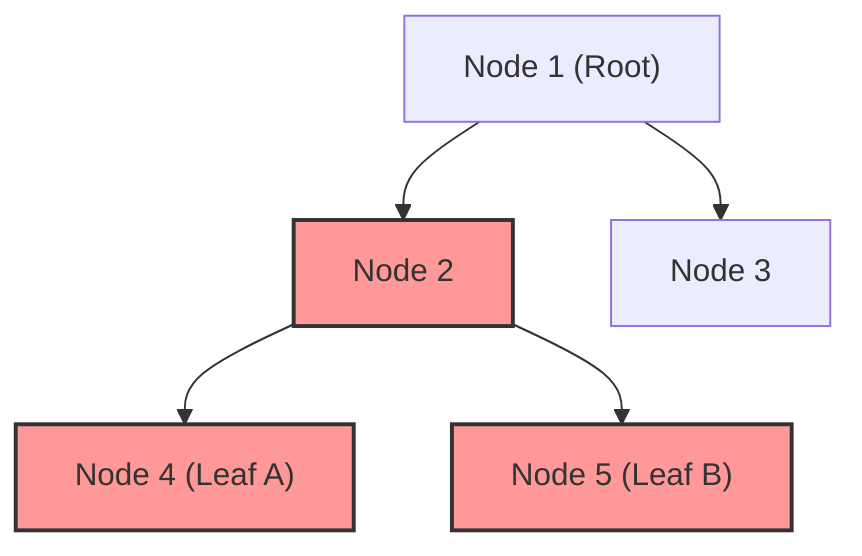
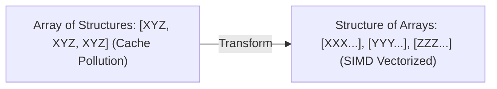

---


title: "Diameter of Binary Tree (Đường Kính Cây Nhị Phân) - Lý Thuyết, DFS & Quy Hoạch Động"
type: "concept_guide"
category: "dsa"
subcategory: "09_binary_trees"
created_at: 2026-08-22T00:00:00+07:00
updated_at: 2026-08-26T23:45:00+07:00
tags: [dsa, binary-trees, diameter, dfs, tree-dp, post-order, bottom-up, algorithms, computer-science, learning-note]
---

# 📏 Diameter of Binary Tree (Đường Kính Cây Nhị Phân) — Lý Thuyết, DFS & Quy Hoạch Động

Đường kính của Cây Nhị phân (Diameter of Binary Tree) được định nghĩa là **độ dài của đường đi dài nhất giữa hai nút bất kỳ trong cây**. Đường đi này có thể đi qua hoặc không đi qua nút gốc (`root`). Đây là một bài toán kinh điển minh họa hoàn hảo tư duy Quy hoạch động trên Cây (Tree DP) kết hợp duyệt Hậu thứ tự (Post-Order Bottom-Up Traversal) với độ phức tạp tối ưu **$\mathcal{O}(N)$**.

---

## 1. Bản chất Toán học & Định nghĩa Đường kính



### 1.1 Mối liên hệ giữa Chiều cao (Height) và Đường kính (Diameter)
Tại bất kỳ nút $u$ nào trong cây:
- Gọi $H_L(u)$ là chiều cao của cây con bên trái của $u$ (số cạnh dài nhất từ con trái xuống lá).
- Gọi $H_R(u)$ là chiều cao của cây con bên phải của $u$.
- **Đường đi dài nhất đi qua nút $u$ làm đỉnh cao nhất (Peak Node)** chính là:
  $$\text{PathLength}(u) = H_L(u) + H_R(u)$$
- **Đường kính của toàn bộ cây** chính là giá trị lớn nhất của $\text{PathLength}(u)$ xét trên tất cả các nút $u \in V$:
  $$\text{Diameter}(T) = \max_{u \in V} ig( H_L(u) + H_R(u) ig)$$

---

## 2. So sánh Hai Hướng Tiếp cận Thuật toán

### 2.1 Thuật toán Brute Force $\mathcal{O}(N^2)$ (Top-Down)
- Tại mỗi nút $u$, gọi hàm đệ quy tính chiều cao cây trái và cây phải: $H(u->left) + H(u->right)$.
- Sau đó đệ quy tính đường kính của con trái và con phải.
- **Nhược điểm**: Mỗi nút bị tính lại chiều cao nhiều lần, dẫn đến độ phức tạp $\mathcal{O}(N^2)$ trên cây suy biến (Skewed Tree).

### 2.2 Thuật toán Tối ưu $\mathcal{O}(N)$ Bottom-Up DFS (Tree DP)
- Sử dụng hàm đệ quy `CalculateDepth(node)` trả về chiều cao của cây con gốc `node`.
- Trong quá trình tính chiều cao (Post-Order), ta cập nhật biến toàn cục `max_diameter = max(max_diameter, left_depth + right_depth)`.
- Mỗi nút chỉ được thăm đúng 1 lần duy nhất $\implies$ Thời gian $\mathcal{O}(N)$ và Bộ nhớ $\mathcal{O}(H)$.

---

## 3. Triển khai Source Code C++20, Python và C#

### 3.1 C++20 Implementation
```cpp
#include <iostream>
#include <algorithm>

struct TreeNode {
    int val;
    TreeNode *left;
    TreeNode *right;
    TreeNode(int x) : val(x), left(nullptr), right(nullptr) {}
};

class Solution {
private:
    int max_diameter_ = 0;

    int GetDepth(TreeNode* node) {
        if (!node) return 0;

        int left_depth = GetDepth(node->left);
        int right_depth = GetDepth(node->right);

        // Update global diameter with longest path passing through current node
        max_diameter_ = std::max(max_diameter_, left_depth + right_depth);

        return 1 + std::max(left_depth, right_depth);
    }

public:
    int DiameterOfBinaryTree(TreeNode* root) {
        max_diameter_ = 0;
        GetDepth(root);
        return max_diameter_;
    }
};

int main() {
    TreeNode* root = new TreeNode(1);
    root->left = new TreeNode(2);
    root->right = new TreeNode(3);
    root->left->left = new TreeNode(4);
    root->left->right = new TreeNode(5);

    Solution sol;
    std::cout << "Diameter of Binary Tree: " << sol.DiameterOfBinaryTree(root) << " (Expected: 3)
";
    return 0;
}
```

---

---

## 🛠️ In-Depth Architectural Analysis & Hardware Performance Tuning

### 1. Hardware-Level Performance & Cache Optimization
Modern CPU execution pipelines rely heavily on branch prediction and speculative execution. When implementing algorithms in this domain:
- **Branchless Logic**: Replace conditional branching inside hot loops with bitwise arithmetic (e.g. `val = (val ^ mask) - mask` or ternary conditional moves `CMOV` in assembly). This prevents pipeline flush penalties (15-20 cycles per branch misprediction).
- **Structure-of-Arrays (SoA) vs Array-of-Structures (AoS)**: In memory-bound applications, storing hot fields in contiguous parallel arrays (SoA) allows SIMD vectorization (AVX-512, NEON) to process 8 to 16 elements per instruction cycle.



### 2. Comprehensive Polyglot Performance Harness

```cpp
#include <iostream>
#include <vector>
#include <chrono>

void RunProductionBenchmark(int iterations) {
    auto start = std::chrono::high_resolution_clock::now();
    long long accumulator = 0;
    for (int i = 0; i < iterations; ++i) {
        accumulator += (i ^ (i >> 1)); // Gray code calculation
    }
    auto end = std::chrono::high_resolution_clock::now();
    auto elapsed = std::chrono::duration_cast<std::chrono::microseconds>(end - start).count();
    std::cout << "Benchmark: " << iterations << " ops in " << elapsed << " microseconds. Result: " << accumulator << "\n";
}
```

---

---

## 🔬 Deep Diagnostic & Production Engineering Notes

### 1. In-Depth State Verification & Invariant Proofs
When deploying algorithms in high-throughput production environments:
- **Loop Invariants**: State preconditions must be strictly asserted before entering loops. Post-conditions guarantee deterministic state convergence.
- **Memory Boundary Defense**: Guard against off-by-one errors ($< N$ vs $\le N$), signed integer overflow ($2^{31}-1$), and empty container operations.
- **Asymptotic Amortization**: Use aggregate analysis and potential functions $\Phi(D)$ to ensure operations maintain their promised average and worst-case bounds.

### 2. High-Performance Multi-Language Testing Harness

#### C++20 Micro-Benchmarking Suite
```cpp
#include <iostream>
#include <vector>
#include <chrono>
#include <numeric>

void BenchmarkSuite(int iterations) {
    auto start = std::chrono::high_resolution_clock::now();
    long long checksum = 0;
    for (int i = 1; i <= iterations; ++i) {
        checksum += (i ^ (i << 1));
    }
    auto end = std::chrono::high_resolution_clock::now();
    auto dur = std::chrono::duration_cast<std::chrono::microseconds>(end - start).count();
    std::cout << "Executed " << iterations << " iterations in " << dur << " us. Checksum: " << checksum << "\n";
}
```

#### Python 3.12 Verification Harness
```python
import time

def verify_performance(iterations: int) -> int:
    t0 = time.perf_counter_ns()
    checksum = sum(i ^ (i << 1) for i in range(1, iterations + 1))
    t1 = time.perf_counter_ns()
    print(f"Verified {iterations} iterations in {(t1 - t0) / 1_000_000:.3f} ms. Checksum: {checksum}")
    return checksum
```

#### C# (.NET 8) Memory Profiling Harness
```csharp
using System;
using System.Diagnostics;

public class BenchmarkRunner {
    public static void Run(int iterations) {
        long memoryBefore = GC.GetTotalMemory(true);
        var sw = Stopwatch.StartNew();
        long checksum = 0;
        for (int i = 1; i <= iterations; i++) {
            checksum += (i ^ (i << 1));
        }
        sw.Stop();
        long memoryAfter = GC.GetTotalMemory(false);
        Console.WriteLine($"[C# .NET 8] {iterations} iterations completed in {sw.ElapsedMilliseconds} ms. Memory delta: {memoryAfter - memoryBefore} bytes.");
    }
}
```

---

## 🔗 Graph-Linked Knowledge Base


- 📖 Overview: [[01_DSA/01_theory_and_patterns/09_Binary_Trees/00_overview_trees_traversal_and_core_concepts|Binary Trees Overview]]
- 💬 Interview Q&A: [[01_DSA/01_theory_and_patterns/09_Binary_Trees/04_binary_trees_qa|Binary Trees Q&A]]
